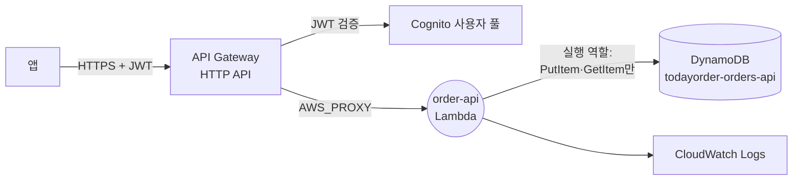
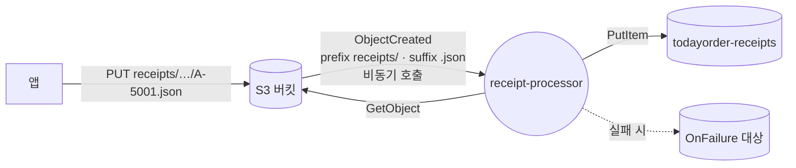

# M07-06. 서버리스 아키텍처 패턴 — API + Lambda + DynamoDB, S3 이벤트 처리, 프런트엔드·모바일(Amplify, Device Farm)
> 도메인: D2, D3 · 예상 시간: 60분 · 실습 등급: 🟢

## 왜 필요한가

TodayOrder가 "주말 반짝 할인" 기능을 빠르게 붙이려 한다. 트래픽은 주말에만 몰리고 평일엔 거의 없다. 서버를 두면 평일 내내 놀고, 주말엔 모자란다. 앞 레슨들의 부품(Lambda, API Gateway, Cognito, 이벤트 트리거)을 조합하면 **서버를 하나도 관리하지 않고, 요청만큼만 비용을 내는** 주문 API와 영수증 처리 파이프라인을 만들 수 있다. 이 레슨은 시험과 실무에서 가장 자주 나오는 두 조합을 직접 만든다.

## 핵심 개념

### 패턴 1 — 서버리스 REST API



- 각 계층이 **요청 수에 따라 자동으로** 늘고 줄며, 유휴 시간에는 (거의) 비용이 없다.
- **DynamoDB가 짝인 이유**: 연결(커넥션) 없는 HTTP API라 Lambda 동시 실행이 1,000개로 늘어도 커넥션 풀이 고갈되지 않는다. RDS를 써야 한다면 **RDS Proxy**로 연결을 모은다.
- **멱등성**: 클라이언트는 타임아웃이 나면 재시도한다. `ConditionExpression="attribute_not_exists(orderId)"`로 같은 주문이 두 번 생기지 않게 한다(M05).
- 권한은 두 방향: API Gateway → Lambda(**리소스 정책**), Lambda → DynamoDB(**실행 역할**, 표 ARN과 동작을 최소로).

### 패턴 2 — S3 이벤트 기반 처리



- 썸네일 생성, 업로드 파일 검증, 로그 파일 적재의 표준 형태. S3 → Lambda는 **비동기 호출**이라 실패하면 Lambda가 재시도하고, 그래도 실패하면 대상/DLQ로(M07-02).
- 처리량이 매우 크거나 여러 소비자가 필요하면 **S3 → SQS(또는 SNS·EventBridge) → Lambda**로 버퍼를 둔다.
- 함정: **처리 결과를 같은 버킷·같은 접두사에 쓰면 무한 루프**(쓴 객체가 다시 이벤트를 만든다). 출력은 다른 버킷이나 필터에 걸리지 않는 접두사로.

### 프런트엔드·모바일 한눈에

| 서비스 | 언제 |
|---|---|
| **AWS Amplify** | 웹·모바일 앱의 **풀스택 개발·호스팅**: Git 연결만으로 프런트엔드(React·Next.js 등) 빌드·배포·호스팅, 인증(Cognito)·API·데이터·스토리지 백엔드를 도구로 구성 |
| **AWS Device Farm** | 실제 **휴대폰·태블릿·브라우저**에서 앱을 자동/수동 테스트(기기를 사지 않고) |
| **AWS AppSync** | 관리형 **GraphQL**(및 실시간 구독) API |
| S3 정적 웹 호스팅 + CloudFront | 정적 SPA를 가장 싸게 배포(M04·M08) |

## 직접 해 보기

### 1) 서버리스 주문 API — [lab04-serverless-order-api.sh](./labs/lab04-serverless-order-api.sh)

함수 코드: [functions/order_api.py](./functions/order_api.py). 코드에 엔드포인트도 키도 없다 — `boto3.client("dynamodb")`만 있다.

```bash
bash curriculum/m07-serverless-containers/labs/lab04-serverless-order-api.sh
```

```
== 3. 함수 (환경 변수 TABLE_NAME) + HTTP API 라우트 2개
POST /orders
GET /orders/{orderId}
API: https://127.0.0.1:9306/_aws/execute-api/y6abp5yu9r   (실제 AWS: https://y6abp5yu9r.execute-api.us-east-1.amazonaws.com)
== 4. 주문 생성 — 실행 역할에 DynamoDB 권한이 없다
{"message":"Internal Server Error"}
[HTTP 500]
-- 함수 로그:
[ERROR] AccessDeniedException: An error occurred (AccessDeniedException) when calling the PutItem operation: User: arn:aws:sts::000000000000:assumed-role/todayorder-order-api-role/todayorder-order-api is not authorized to perform: dynamodb:PutItem on resource:
```

방금 본 것: Lambda 안의 boto3 호출이 **실행 역할을 맡은 세션**(`assumed-role/todayorder-order-api-role/todayorder-order-api`)으로 DynamoDB에 갔고, 역할에 권한이 없어 거부됐다. 함수는 이 오류를 숨기지 않고 다시 던졌으므로 클라이언트는 500, 원인은 함수 로그에 남았다. **"API가 500인데 이유를 모르겠다" → 함수 로그 → 실행 역할**이 디버깅 순서다.

```
== 5. 최소 권한 정책: 이 표에 PutItem·GetItem 만
{"orderId": "A-4001", "status": "CREATED"}
[HTTP 201]
== 6. 같은 주문을 다시 POST (클라이언트 재시도) → 409, 표에는 1건
{"message": "order A-4001 already exists"}
[HTTP 409]
...
== 8. 조회 → 200 / 없는 주문 → 404
{"orderId": "A-4001", "customerId": "C-77", "total": 32000, "status": "CREATED"}
[HTTP 200]
{"message": "order A-9999 not found"}
[HTTP 404]
== 9. DynamoDB 에 실제로 저장됐나 (CLI 로 직접 확인)
{
    "orderId": "A-4001",
    "customerId": "C-77",
    "total": "32000",
    "status": "CREATED"
}
표의 항목 수: 1
LAB04 OK
```

방금 본 것: 정책을 넣자(표 ARN 하나, 동작 두 개) 201. 재시도는 조건부 쓰기 덕분에 409로 막혔고 표에는 1건뿐이다. CLI로 본 항목이 API로 만든 것과 같다 — **함수가 정말로 DynamoDB에 썼다.**

### 2) S3 이벤트 처리 — [lab05-s3-event-lambda.sh](./labs/lab05-s3-event-lambda.sh)

함수 코드: [functions/receipt_processor.py](./functions/receipt_processor.py).

```
== 3. add-permission 없이 알림 구성 → S3 가 거부한다

aws: [ERROR]: An error occurred (InvalidArgument) when calling the PutBucketNotificationConfiguration operation: Unable to validate the following destination configurations
== 4. add-permission(주체 s3.amazonaws.com, 이 버킷·이 계정에서만) 후 다시 구성
{
    "Id": "receipt-json",
    "Events": [
        "s3:ObjectCreated:*"
    ],
    "Rules": [
        {
            "Name": "Prefix",
            "Value": "receipts/"
        },
        {
            "Name": "Suffix",
            "Value": ".json"
        }
    ]
}
== 5. 영수증 2건(receipts/*.json) + 필터 밖 객체 2건 업로드
A-5001	12000	receipts/2026/11/A-5001.json	ObjectCreated:Put
A-5002	45000	receipts/2026/11/A-5002.json	ObjectCreated:Put
LAB05 OK
```

방금 본 것: SNS→SQS와 달리 S3는 알림을 **저장하는 순간** 대상(Lambda)에 권한이 있는지 검증한다. 업로드 4건 중 접두사·접미사 필터를 통과한 2건만 함수를 깨웠고, 함수는 S3에서 객체를 읽어(`s3:GetObject`) DynamoDB에 썼다.

## 실제 AWS에서는

**설계 문서의 "저자 확인" 항목 — Lambda 안에서 DynamoDB를 호출할 수 있는가: 된다.** 저자가 함수 안에서 직접 확인한 내용:

| 항목 | 관찰 |
|---|---|
| 함수 안 `boto3.client("dynamodb").meta.endpoint_url` | `https://dynamodb.us-east-1.amazonaws.com` (실제 AWS 주소 모양). 하지만 요청은 밖으로 나가지 않고 같은 에뮬레이터의 DynamoDB로 간다 |
| 자격 증명 | 함수 환경 변수에 `AWS_ACCESS_KEY_ID`·`AWS_SECRET_ACCESS_KEY`·`AWS_SESSION_TOKEN`이 **없다**. 에뮬레이터가 넣어 준 boto3 대체 모듈이 실행 역할의 세션(`assumed-role/<역할>/<함수>`)으로 호출한다 |
| 권한 | **실행 역할의 IAM 정책을 실제로 평가한다** — `PutItem`·`GetItem` 권한이 없으면 `AccessDeniedException`, 표 ARN으로 허용하면 통과 (단, 권한 없는 역할로도 `ListTables`는 통과했다) |
| 오류 형태 | `ConditionalCheckFailedException`이 `botocore.exceptions.ClientError`의 하위 클래스로, `e.response["Error"]["Code"]`도 실제와 같다 |
| 쓸 수 있는 서비스 | sqs, events, dynamodb, logs, cloudwatch, apigateway, secretsmanager, opensearch, stepfunctions, sesv2, s3, xray, rds-data, appconfig. **`sts`·`lambda`는 함수 안에서 `UnknownServiceError`** |

그래서 "서버리스 주문 API" 실습은 설계대로 🟢로 확정했다. 다만 함수가 **RustPython 위에서, 에뮬레이터가 넣은 boto3 대체 모듈로** 돈다는 점(M07-01)은 실제 AWS와 다르다. 이 실습의 함수는 표준 라이브러리 + boto3 클라이언트 API만 쓰도록 작성했다.

- `resource` API(`boto3.resource("dynamodb").Table(...)`)도 함수 안에서 동작했고, 숫자는 실제처럼 `Decimal`로 돌아왔다(그대로 `json.dumps` 하면 `Runtime.MarshalError`).
- 실제 AWS에서는 IAM 정책 변경이 반영되기까지 몇 초 걸릴 수 있다. 실습은 201이 될 때까지 폴링한다.
- 실제 AWS에서 해 보려면: Lambda·DynamoDB(25 GB 저장, 온디맨드 요청 소량)·S3 소량은 비용이 거의 없고, API Gateway는 상시 무료 항목이 아니다(M07-03). 정리: `aws apigatewayv2 delete-api --api-id <id>`, `aws lambda delete-function --function-name todayorder-order-api` / `todayorder-receipt-processor`, `aws dynamodb delete-table --table-name todayorder-orders-api` / `todayorder-receipts`, `aws s3 rb s3://todayorder-m07-receipts --force`(실제 S3 버킷 이름은 전 세계 고유라 다른 이름이 필요하다), 역할 삭제.

## 시험 포인트

- "서버 관리 없이, 트래픽에 따라 자동 확장, 사용한 만큼 과금하는 API" → **API Gateway + Lambda + DynamoDB**.
- "Lambda가 RDS 연결을 너무 많이 만든다" → **RDS Proxy**(또는 DynamoDB).
- "업로드된 파일을 자동 처리" → **S3 이벤트 → Lambda**(대량·내구성 필요 시 **S3 → SQS → Lambda**).
- "S3 이벤트 함수가 자기 출력을 다시 처리하며 무한 반복" → 출력 버킷/접두사 분리.
- "Lambda → DynamoDB 접근" → 실행 역할에 **표 ARN 단위 최소 권한**. 키를 환경 변수에 넣지 않는다.
- "프런트엔드 빌드·호스팅과 백엔드(인증·API)를 빠르게" → **Amplify**. "여러 실제 기기에서 앱 테스트" → **Device Farm**. "GraphQL" → **AppSync**.

## 스스로 확인

1. 주문 API의 Lambda가 DynamoDB 표 전체 권한(`dynamodb:*` on `*`)을 갖고 있다. 무엇이 문제이고 어떻게 고치나?
2. 영수증 처리 함수가 결과 PDF를 같은 버킷의 `receipts/` 아래에 `.json`이 아닌 `.pdf`로 쓴다. 무한 루프가 생기나?
3. 이벤트 날 주문 API 요청이 초당 5,000건으로 뛴다. 서버리스 구성에서 어디가 먼저 한계에 닿을 수 있나?

<details><summary>답</summary>

1. 최소 권한 위반 — 함수가 탈취되면 모든 표를 지우거나 읽을 수 있다. 실제로 쓰는 동작(`PutItem`, `GetItem`)과 그 표의 ARN으로 좁힌다.
2. 이 실습의 알림 필터는 접미사 `.json`이므로 `.pdf`는 이벤트를 만들지 않는다. 하지만 필터를 바꾸면 루프가 생길 수 있으니 출력은 다른 접두사(`processed/`)나 다른 버킷에 쓰는 것이 안전하다.
3. Lambda 동시성(계정 기본 1,000 — 함수 실행 시간이 길수록 빨리 닿는다), API Gateway 계정 스로틀(기본 초당 10,000), DynamoDB(온디맨드도 급격한 증가에는 스로틀 가능). 동시성 증설 요청, 프로비저닝된 동시성, 필요하면 SQS로 쓰기를 버퍼링한다.

</details>
