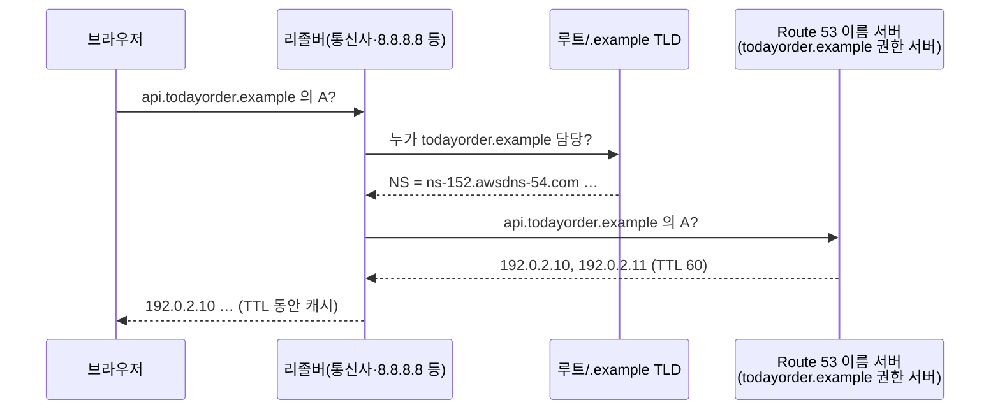

# M08-01. DNS 기초와 Route 53
> 도메인: D2, D3 · 예상 시간: 45분 · 실습 등급: 🟢

## 왜 필요한가

TodayOrder 앱은 지금까지 `http://<EC2 공인 IP>`로 접속했다. 서버를 바꾸면 IP가 바뀌고, 해외 사용자가 생기면 서버가 여러 대·여러 리전이 된다. 사용자는 늘 `todayorder.example` 하나만 기억해야 한다. "이름 → 주소"를 우리가 통제하는 곳이 **DNS**이고, AWS의 DNS 서비스가 **Route 53**이다. 이 레슨에서는 영역과 레코드를 만들고, 시험이 가장 좋아하는 **Alias vs CNAME**을 손으로 확인한다.

## 핵심 개념

### DNS 30초 복습



- **호스팅 영역(hosted zone)**: 한 도메인(예: `todayorder.example`)의 레코드 묶음. **퍼블릭**(인터넷에 답함)과 **프라이빗**(연결한 VPC 안에서만 답함)이 있다. 영역을 만들면 Route 53이 이름 서버 4개(NS)와 SOA 레코드를 자동으로 만든다. 도메인 등록 기관에 이 NS를 적어 줘야(위임) 인터넷이 Route 53에 물어본다.
- **레코드**: `이름 + 유형 + 값 + TTL`. 주로 쓰는 유형: `A`(IPv4), `AAAA`(IPv6), `CNAME`(다른 이름의 별칭), `TXT`(도메인 소유 증명·SPF), `MX`(메일), `NS`, `SOA`.
- **TTL(Time To Live)**: 리졸버가 답을 캐시하는 초. 길면 Route 53 쿼리 비용과 지연이 줄고, 짧으면 바꾼 값이 빨리 퍼진다. 이사(마이그레이션) 전에는 TTL을 미리 줄여 둔다.
- **apex(영역 꼭대기)**: `www.todayorder.example`이 아닌 `todayorder.example` 자체. DNS 표준상 apex에는 NS·SOA가 있어야 하므로 **CNAME을 둘 수 없다**.

### Alias 레코드 — Route 53만의 확장

| | CNAME | Alias (A/AAAA 레코드의 옵션) |
|---|---|---|
| 영역 꼭대기(apex)에 | ❌ 불가 | ✅ 가능 |
| 가리킬 수 있는 대상 | 아무 DNS 이름 | AWS 리소스(CloudFront, ELB, S3 정적 웹 사이트, API Gateway, Global Accelerator, VPC 인터페이스 엔드포인트, Elastic Beanstalk 등)와 **같은 영역의 다른 레코드** |
| 응답 | "이건 저 이름이야" → 리졸버가 한 번 더 찾음 | Route 53이 대상의 **IP를 직접** 답한다 |
| AWS 리소스로의 쿼리 요금 | 과금 | **무료** |
| TTL | 내가 정함 | 대상의 TTL을 따른다(설정 불가) |
| 상태 확인 연동 | 별도 | `EvaluateTargetHealth`로 대상의 건강을 따를 수 있음 |
| EC2 인스턴스의 퍼블릭 DNS 이름 | 가능 | ❌ 대상이 아님 |

> 한 줄 규칙: **AWS 리소스를 가리키면 Alias, apex면 무조건 Alias, AWS 밖의 이름이면 CNAME.**

## 직접 해 보기

[labs/lab01-hosted-zone-records.sh](./labs/lab01-hosted-zone-records.sh)를 실행한다.

```bash
bash curriculum/m08-dns-edge/labs/lab01-hosted-zone-records.sh
```

### 1) 퍼블릭 호스팅 영역

```
== 1. 퍼블릭 호스팅 영역 만들기
HostedZoneId: /hostedzone/ZD2ZTYT6DNYSR01
[
    "ns-152.awsdns-54.com",
    "ns-824.awsdns-17.net",
    "ns-1134.awsdns-21.org",
    "ns-806.awsdns-19.co.uk"
]
-------------------------------------------
|         ListResourceRecordSets          |
+----------------------+---------+--------+
|         Name         |   TTL   | Type   |
+----------------------+---------+--------+
|  todayorder.example. |  172800 |  NS    |
|  todayorder.example. |  900    |  SOA   |
+----------------------+---------+--------+
```

방금 본 것: 영역 하나에 이름 서버 4개가 배정됐다(.com/.net/.org/.co.uk로 나뉘어 있는 것은 한 TLD의 장애에 대비한 것). NS(TTL 2일)와 SOA가 자동으로 생겼다. 이름 끝의 `.`은 "루트까지 다 쓴 이름(FQDN)"이라는 뜻이다.

### 2) 레코드 만들기 — 변경은 비동기

```
== 2. 레코드 만들기: A(api), CNAME(shop), TXT(apex)
변경 ID: /change/CFE36YHKS0HF2FG  처음 상태: PENDING
대기 후 상태: INSYNC
```

방금 본 것: `change-resource-record-sets`는 **변경 묶음(change batch)** 을 받아 변경 ID를 돌려준다. 상태가 `PENDING`에서 모든 Route 53 이름 서버에 퍼지면 `INSYNC`가 된다. 스크립트는 `aws route53 wait resource-record-sets-changed`로 기다렸다. 한 묶음 안의 변경은 **전부 적용되거나 전부 거부된다**(트랜잭션).

`Action`은 `CREATE`(없을 때만), `UPSERT`(있으면 바꾸고 없으면 만듦), `DELETE`(현재 값과 정확히 같아야 함) 세 가지다.

```
== 3. 같은 레코드를 CREATE 로 또 만들기 (실패해야 정상) — UPSERT 와의 차이
aws: [ERROR]: An error occurred (InvalidChangeBatch) when calling the ChangeResourceRecordSets operation: [Tried to create resource record set [name='api.todayorder.example.', type='A'] but it already exists, Tried to create resource record set [name='shop.todayorder.example.', type='CNAME'] but it already exists, Tried to create resource record set [name='todayorder.example.', type='TXT'] but it already exists]
```

### 3) apex의 CNAME은 거부, Alias는 허용

```
== 4. 영역 꼭대기(apex)에 CNAME 만들기 (실패해야 정상)
aws: [ERROR]: An error occurred (InvalidChangeBatch) when calling the ChangeResourceRecordSets operation: [RRSet of type CNAME with DNS name todayorder.example. is not permitted at apex in zone todayorder.example.]
== 5. apex 에는 Alias: CloudFront 배포를 가리키는 A 레코드 (Z2FDTNDATAQYW2 = CloudFront 고정 영역 ID)
PENDING
-- www 는 같은 영역의 api 레코드를 가리키는 Alias
PENDING
```

Alias 레코드의 모양(스크립트 발췌). `TTL`도 `ResourceRecords`도 없고 `AliasTarget`이 있다. `HostedZoneId`는 **대상 서비스의 영역 ID**다(CloudFront는 어디서나 `Z2FDTNDATAQYW2`, ALB는 리전마다 다르다 — `describe-load-balancers`의 `CanonicalHostedZoneId`).

```json
{"Name": "todayorder.example", "Type": "A",
 "AliasTarget": {"HostedZoneId": "Z2FDTNDATAQYW2", "DNSName": "d111111abcdef8.cloudfront.net", "EvaluateTargetHealth": false}}
```

### 4) Route 53이 실제로 무엇을 대답하나 — `test-dns-answer`

에뮬레이터는 DNS 포트(53)를 열지 않아 `dig`로 물어볼 수 없다. 대신 **Route 53 API의 `TestDNSAnswer`** 가 "이 영역에 이 질문을 하면 무엇을 답할지"를 알려 준다(실제 AWS에도 있는 API다).

```
== 6. Route 53 이 실제로 무엇을 대답하는지: test-dns-answer
api.todayorder.example.	A	NOERROR	192.0.2.10,192.0.2.11
shop.todayorder.example.	CNAME	NOERROR	todayorder-shop.example.net
www.todayorder.example.	A	NOERROR	192.0.2.10,192.0.2.11
todayorder.example.	A	NOERROR	d111111abcdef8.cloudfront.net.
todayorder.example.	TXT	NOERROR	"v=spf1 -all"
nothing.todayorder.example.	A	NXDOMAIN	
```

방금 본 것:
- `www`(Alias → 같은 영역의 `api`)를 A로 물으면 **IP가 바로** 나온다. CNAME처럼 "다른 이름을 다시 찾아라"가 아니다.
- apex의 Alias(CloudFront)는 에뮬레이터에서 대상 이름(`d111111abcdef8.cloudfront.net.`)이 나온다. 실제 Route 53은 CloudFront 엣지의 **IP 주소들**을 답한다(에뮬레이터 차이).
- 없는 이름은 `NXDOMAIN`(그런 이름 없음). 이름은 있는데 그 유형이 없으면 `NOERROR` + 빈 값이다(레슨 02에서 다시 본다).

### 5) 같은 이름의 프라이빗 호스팅 영역 (split-horizon)

```
== 7. 같은 이름의 프라이빗 호스팅 영역 (VPC 안에서만 보이는 '사내용' 답)
-------------------------------------------------------
|                ListHostedZonesByName                |
+------------------------------+----------+-----------+
|              Id              | Private  |  Records  |
+------------------------------+----------+-----------+
|  /hostedzone/Z7WZMXNVJOHX29B |  True    |  3        |
|  /hostedzone/ZD2ZTYT6DNYSR01 |  False   |  7        |
+------------------------------+----------+-----------+
-- test-dns-answer 는 퍼블릭 영역 전용이다 (실패해야 정상)
aws: [ERROR]: An error occurred (InvalidInput) when calling the TestDNSAnswer operation: The hosted zone Z7WZMXNVJOHX29B is a private hosted zone; TestDNSAnswer only supports querying public hosted zones
api.todayorder.example — 퍼블릭 영역: 192.0.2.10,192.0.2.11 / 프라이빗 영역(VPC 안): 10.80.1.25
```

방금 본 것: 이름이 같은 영역이 두 개다. VPC 안의 서버가 `api.todayorder.example`을 물으면 프라이빗 영역이 이겨서 **내부 IP(10.80.1.25)** 를 받고, 인터넷 사용자는 퍼블릭 IP를 받는다. 이를 **split-horizon DNS**라고 한다. 프라이빗 영역을 쓰려면 VPC의 `enableDnsSupport`·`enableDnsHostnames`를 켜야 한다(스크립트가 켰다). 프라이빗 영역은 `TestDNSAnswer`로 시험할 수 없어서 레코드 목록으로 확인했다.

### 6) 삭제

```
== 8. 레코드 삭제 — DELETE 는 현재 값과 정확히 같아야 한다
PENDING
todayorder.example.	A	alias
todayorder.example.	NS	172800
todayorder.example.	SOA	900
todayorder.example.	TXT	300
api.todayorder.example.	A	60
www.todayorder.example.	A	alias
LAB01 OK
```

영역 자체를 지우려면 NS·SOA를 뺀 레코드를 모두 먼저 지워야 한다(`HostedZoneNotEmpty`). lab 스크립트의 정리 함수(`labs/_lib.sh`의 `delete_zones`)가 그 순서를 따른다.

## 실제 AWS에서는

- 퍼블릭 영역을 인터넷에서 쓰려면 도메인 등록 기관(Route 53 Domains 또는 외부 등록 기관)에 영역의 NS 4개를 등록해야 한다. 에뮬레이터는 DNS 질의 포트를 열지 않으므로 `dig @ns-152.awsdns-54.com …` 같은 확인은 할 수 없다.
- Alias가 AWS 리소스를 가리킬 때 Route 53은 대상의 IP를 직접 답하고, 그 쿼리는 무료다. 에뮬레이터는 CloudFront Alias에 대상 이름을 돌려준다.
- 프라이빗 영역은 연결한 VPC의 Route 53 Resolver(VPC CIDR +2 주소, 예: 10.80.0.2)가 답한다. 온프레미스와 이름을 주고받으려면 **Route 53 Resolver 인바운드/아웃바운드 엔드포인트**를 쓴다.
- Route 53은 서비스 가용성 SLA가 100%인 몇 안 되는 AWS 서비스다(그래서 DR 설계에서 DNS 장애 조치를 많이 쓴다).

## 시험 포인트

- "**apex(루트 도메인)** 를 CloudFront/ALB/S3 웹 사이트에 연결" → **Alias**. CNAME은 apex에 둘 수 없다.
- "AWS 리소스로의 DNS 쿼리 비용을 줄이고 싶다" → **Alias(무료)**.
- "VPC 안에서만 쓰는 내부 도메인", "같은 이름을 안팎에서 다르게" → **프라이빗 호스팅 영역**(VPC의 DNS 속성 두 개를 켤 것).
- "온프레미스 DNS ↔ VPC 이름 해석" → **Route 53 Resolver 엔드포인트**(인바운드: 온프레미스가 VPC 이름을 물음, 아웃바운드: VPC가 온프레미스 이름을 물음).
- "DNS 변경을 빨리 반영" → 미리 **TTL을 낮춰 둔다**. "도메인 이전 후에도 옛 IP로 접속된다" → 캐시된 TTL.

## 스스로 확인

1. `todayorder.example`(apex)을 ALB에 연결하려는 동료가 CNAME을 만들다 실패했다. 이유와 해결책은?
2. Alias 레코드에 TTL을 지정하지 않는 이유는?
3. 같은 이름의 퍼블릭·프라이빗 영역이 둘 다 있을 때, VPC 안의 EC2가 받는 답과 사용자의 노트북이 받는 답은 각각 어느 영역에서 오나?

<details><summary>답</summary>

1. DNS 표준상 apex에는 NS·SOA가 있어야 해서 CNAME을 함께 둘 수 없다(lab01 4단계의 `InvalidChangeBatch`). ALB를 가리키는 **A 레코드 Alias**를 만든다(대상 영역 ID는 ALB의 `CanonicalHostedZoneId`).
2. Alias는 Route 53이 대상(AWS 리소스나 같은 영역의 레코드)을 직접 해석해 답하므로, TTL도 대상의 것을 따른다.
3. VPC 안(그 VPC에 프라이빗 영역이 연결된 경우) → 프라이빗 영역. 노트북(인터넷) → 퍼블릭 영역.

</details>
