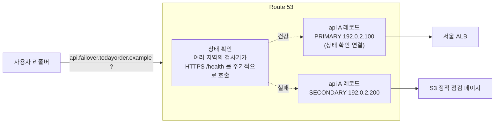

# M08-02. 라우팅 정책 8종과 상태 확인
> 도메인: D2, D3 · 예상 시간: 60분 · 실습 등급: 🟢 레코드·단순·가중치·다중값 / 🟡 지연 시간·지리·지리 근접·IP 기반의 응답 선택 / 🔴 상태 확인·장애 조치 동작

## 왜 필요한가

TodayOrder가 서울 리전에 이어 버지니아(us-east-1)에도 API 서버를 띄웠다. 이제 `api.todayorder.example`이라는 **같은 이름**에 대해 "누구에게 어느 서버 주소를 알려 줄지"를 정해야 한다. 미국 사용자는 버지니아로, 새 버전은 10%만, 서울이 죽으면 점검 페이지로. 이 모든 것을 애플리케이션 코드가 아니라 **DNS 응답**으로 정하는 것이 Route 53 라우팅 정책이다.

## 핵심 개념

### 같은 이름, 여러 레코드 — `SetIdentifier`

단순 정책을 뺀 7개 정책은 같은 이름·유형의 레코드를 **여러 개** 만들고, 각각을 `SetIdentifier`(레코드 세트 식별자)로 구분한다. 레코드에 붙는 필드가 곧 정책이다.

| 정책 | 레코드에 붙는 필드 | Route 53 이 답을 고르는 기준 | TodayOrder 예 |
|---|---|---|---|
| 단순(simple) | (없음) | 그냥 모든 값을 준다. **상태 확인을 붙일 수 없다** | 사내 위키 하나 |
| 가중치(weighted) | `Weight` 0~255 | 가중치 비율대로 무작위 | 새 API 10% 카나리, 블루/그린 |
| 지연 시간(latency) | `Region` | 질의자와 **AWS 리전 사이의 측정 지연**이 가장 짧은 레코드 | 서울·버지니아 중 빠른 쪽 |
| 장애 조치(failover) | `Failover: PRIMARY/SECONDARY` | PRIMARY가 건강하면 PRIMARY, 아니면 SECONDARY | 장애 시 S3 정적 점검 페이지 |
| 지리적 위치(geolocation) | `GeoLocation` (대륙/국가/미국 주) | 질의자의 **위치**. 가장 구체적인 일치(주 > 국가 > 대륙 > 기본 `*`) | 법무: EU 사용자는 EU 서버로 |
| 지리 근접(geoproximity) | `GeoProximityLocation` (+ `Bias` −99~99) | 리소스까지의 **거리**. Bias로 영역을 넓히거나 줄임 | 서울 서버가 일본 트래픽도 일부 받게 |
| 다중값 응답(multivalue) | `MultiValueAnswer: true` | **건강한** 값을 최대 8개까지 무작위로 함께 | 웹 서버 여러 대에 클라이언트 측 분산 |
| IP 기반(IP-based) | `CidrRoutingConfig` (CIDR 컬렉션의 위치) | 질의자 IP가 속한 **CIDR 블록** | 특정 통신사(ISP) 고객은 전용 엔드포인트로 |

> 지연 시간 vs 지리적 위치 vs 지리 근접: **"빠르게"** 는 지연 시간, **"어느 나라 사용자는 반드시 여기로(규정·콘텐츠 권리)"** 는 지리적 위치, **"지역 경계를 조금 움직이고 싶다(Bias)"** 는 지리 근접이다.

### 상태 확인(health check)과 장애 조치



- 상태 확인 종류: **엔드포인트**(HTTP/HTTPS/TCP, 문자열 일치 가능) · **계산된(CALCULATED)**(자식 상태 확인 N개 중 몇 개 이상 건강) · **CloudWatch 경보 기반**.
- Route 53 검사기는 **인터넷에 있다.** 프라이빗 서브넷의 리소스(내부 DB 등)는 직접 검사할 수 없으므로 CloudWatch 지표 → 경보 → 경보 기반 상태 확인으로 연결한다.
- Alias 레코드는 상태 확인 대신 `EvaluateTargetHealth: true`로 대상(ALB 등)의 건강을 따를 수 있다.
- 장애 조치는 **액티브-패시브**, 가중치·지연 시간·다중값 + 상태 확인은 **액티브-액티브**(건강하지 않은 레코드만 빠진다).

## 직접 해 보기

[labs/lab02-routing-policies.sh](./labs/lab02-routing-policies.sh)는 `routing.todayorder.example` 영역에 장애 조치를 뺀 7개 정책의 레코드를 만들고 `test-dns-answer`로 응답을 확인한다. [labs/lab03-health-check-failover.sh](./labs/lab03-health-check-failover.sh)는 상태 확인과 장애 조치를 다룬다.

```bash
bash curriculum/m08-dns-edge/labs/lab02-routing-policies.sh
```

### 1) 레코드 만들기와 "필드 = 정책"

레코드 정의(발췌 — 전체는 스크립트):

```json
{"Name": "weighted.routing.todayorder.example", "Type": "A", "TTL": 60,
 "SetIdentifier": "blue", "Weight": 75, "ResourceRecords": [{"Value": "192.0.2.1"}]}
{"Name": "latency.routing.todayorder.example", "Type": "A", "TTL": 60,
 "SetIdentifier": "seoul", "Region": "ap-northeast-2", "ResourceRecords": [{"Value": "198.51.100.1"}]}
{"Name": "geo.routing.todayorder.example", "Type": "A", "TTL": 60,
 "SetIdentifier": "default", "GeoLocation": {"CountryCode": "*"}, "ResourceRecords": [{"Value": "203.0.113.9"}]}
```

IP 기반 정책은 먼저 **CIDR 컬렉션**을 만들고, 그 안에 "위치(location) = CIDR 목록"을 넣고, 레코드가 위치 이름을 가리킨다.

```
== 2. IP 기반 라우팅: CIDR 컬렉션 → 위치 → 레코드
CIDR 컬렉션 ID: 23440c60-b949-6a1a-b573-853b7bbe3e4e
ChangeCidrCollection → NotImplemented) when calling the ChangeCidrCollection operation: operation ChangeCidrCollection is scaffolded but not implemented in this emulator
== 3. 저장된 레코드: 이름별 라우팅 속성
geo.routing.todayorder.example.	default	*	203.0.113.9
geo.routing.todayorder.example.	europe	EU	203.0.113.2
geo.routing.todayorder.example.	korea	KR	203.0.113.1
geoprox.routing.todayorder.example.	seoul	ap-northeast-2	203.0.113.21
geoprox.routing.todayorder.example.	virginia	us-east-1	203.0.113.22
ipbased.routing.todayorder.example.	default	*	192.0.2.49
ipbased.routing.todayorder.example.	isp-a	isp-a	192.0.2.41
latency.routing.todayorder.example.	seoul	ap-northeast-2	198.51.100.1
latency.routing.todayorder.example.	virginia	us-east-1	198.51.100.2
multi.routing.todayorder.example.	web-1	multi	192.0.2.31
multi.routing.todayorder.example.	web-2	multi	192.0.2.32
multi.routing.todayorder.example.	web-3	multi	192.0.2.33
weighted.routing.todayorder.example.	blue	75	192.0.2.1
weighted.routing.todayorder.example.	green	25	192.0.2.2
```

방금 본 것: 레코드는 정책 8종 모두(장애 조치는 lab03) 저장된다. 다만 CIDR 컬렉션에 실제 CIDR을 넣는 `ChangeCidrCollection`이 501이라, IP 기반 레코드는 "기본 위치(`*`)"만 의미가 있다. 셋째 열은 `Weight || Region || GeoLocation… ` 순서로 처음 있는 필드를 보여 준 것이다. SDK로 같은 판정을 하는 예제는 [sdk/routing_policy_inventory.py](./sdk/routing_policy_inventory.py).

### 2) 단순·가중치·다중값 — 🟢

```
== 4. 단순(simple) — 값 여러 개를 한꺼번에
simple   → NOERROR 192.0.2.10,192.0.2.11
== 5. 가중치(weighted) — blue 75 : green 25, 40번 물어보기
  30 NOERROR 192.0.2.1
  10 NOERROR 192.0.2.2
-- green 의 가중치를 0으로 (롤백): 이제 blue 만
  10 NOERROR 192.0.2.1
== 6. 다중값 응답(multivalue) — 건강한 레코드 여러 개를 함께
multi    → NOERROR 192.0.2.31,192.0.2.32,192.0.2.33
```

방금 본 것:
- **가중치**는 실제로 무작위다. 40번 중 green이 10번(25%) — 실행할 때마다 숫자는 조금씩 달라진다. 가중치를 0으로 바꾸면 그 레코드는 응답에서 빠진다(모든 레코드가 0이면 똑같은 비율로 나뉜다). 카나리 배포를 단계별로 해 보는 SDK 예제: [sdk/weighted_canary.py](./sdk/weighted_canary.py).

  ```
  blue 100 : green   0  →  green 응답   0/200 (  0.0%) |                                        |  (0.8s)
  blue  90 : green  10  →  green 응답  14/200 (  7.0%) |###                                     |  (0.5s)
  blue  50 : green  50  →  green 응답  88/200 ( 44.0%) |##################                      |  (0.7s)
  blue   0 : green 100  →  green 응답 200/200 (100.0%) |########################################|  (0.5s)
  ```

- **다중값 응답**은 값 여러 개를 한 응답에 담는다. 단순 레코드에 값을 여러 개 넣은 것과 비슷해 보이지만, 다중값은 레코드마다 **상태 확인을 붙일 수 있어서 죽은 서버를 응답에서 뺀다**. 실제 AWS는 건강한 레코드 중 최대 8개를 무작위로 고른다. 로드 밸런서를 대체하지는 않는다(클라이언트가 고른다).

### 3) 지연 시간·지리·지리 근접·IP 기반 — 🟡 응답이 위치를 따르지 않는다

`test-dns-answer`에는 질의자를 흉내 내는 옵션이 있다: `--resolver-ip`(리졸버 IP), `--edns0-client-subnet-ip/--edns0-client-subnet-mask`(EDNS Client Subnet — 리졸버가 알려 주는 실제 사용자 대역).

```
== 7. 지연 시간·지리적 위치·지리 근접·IP 기반 — 질의자 IP 를 바꿔 가며 (에뮬레이터 한계 관찰)
질의자(resolver / ECS)              latency              geo                  geoprox              ipbased             
(지정 안 함)                       NOERROR 198.51.100.2 NOERROR 203.0.113.9  NOERROR 203.0.113.21 NOERROR 192.0.2.49  
--resolver-ip 211.234.10.1             NOERROR 198.51.100.1 NOERROR 203.0.113.9  NOERROR 203.0.113.21 NOERROR 192.0.2.49  
--resolver-ip 3.80.0.1                 NOERROR 198.51.100.1 NOERROR 203.0.113.9  NOERROR 203.0.113.21 NOERROR 192.0.2.49  
--resolver-ip 2.16.0.1                 NOERROR 198.51.100.1 NOERROR 203.0.113.9  NOERROR 203.0.113.21 NOERROR 192.0.2.49  
--edns0-client-subnet-ip 203.0.113.7 --edns0-client-subnet-mask 24 NOERROR 198.51.100.2 NOERROR 203.0.113.9  NOERROR 203.0.113.21 NOERROR 192.0.2.49  
```

방금 본 것: 한국 통신사 대역(211.234.x), 미국(3.80.x), 유럽(2.16.x) 어디서 물어도 지리적 위치는 늘 **기본(`*`) 레코드**, 지리 근접은 늘 서울, IP 기반은 늘 기본 위치다. 지연 시간은 리졸버 IP를 주면 서울, 안 주면 버지니아인데 위치와 상관없는 규칙이다(미국 IP도 서울). 즉 에뮬레이터는 **IP→위치·지연 데이터베이스가 없다.** 이 네 정책은 "레코드를 올바르게 쓰는 법"까지만 실습하고, "누가 어떤 답을 받는가"는 아래 워크시트로 손으로 판정한다.

하나는 실제 AWS와 같게 관찰된다. **기본 레코드가 없는** 지리적 위치 레코드는 일치하는 위치가 없을 때 빈 답을 준다.

```
== 8. 기본(*) 레코드가 없는 지리적 위치 레코드 — 일치하는 위치가 없으면 '빈 응답'
geo-kr-only → 'NOERROR'
```

`NOERROR`인데 값이 없다(이른바 NODATA). 실제 서비스라면 해당 국가 밖 사용자는 **접속 자체가 안 된다.** 지리적 위치 정책에는 거의 항상 기본(`*`) 레코드를 둔다.

```
== 9. 정책을 섞으면? 같은 이름·유형에 가중치 + 지연 시간 (실제 AWS는 거부한다)
에뮬레이터 응답: PENDING
→ 에뮬레이터는 받아 준다(AWS와 다름). 정리를 위해 방금 만든 레코드를 지운다.
```

실제 AWS에서는 같은 이름·유형의 레코드는 **모두 같은 라우팅 정책**이어야 한다. 정책을 조합하고 싶으면 "지연 시간 레코드 → Alias → 가중치 레코드 묶음"처럼 **Alias로 트리를 만든다**(또는 Traffic Flow 정책).

### 4) 상태 확인과 장애 조치 — 🔴

```bash
bash curriculum/m08-dns-edge/labs/lab03-health-check-failover.sh
```

```
== 1. 상태 확인 만들기 — 존재할 수 없는 도메인(.invalid)을 검사하게 한다
{
    "Type": "HTTPS",
    "FQDN": "seoul-api.todayorder.invalid",
    "Path": "/health",
    "Interval": 30,
    "Threshold": 3
}
== 2. 장애 조치 레코드: PRIMARY(서울, 상태 확인 연결) / SECONDARY(정적 점검 페이지)
maintenance-secondary	SECONDARY	-	192.0.2.200
seoul-primary	PRIMARY	794c8ff5-fff4-4370-41b5-96818e9977f6	192.0.2.100
== 3. 상태 확인 결과 — 대상 도메인은 존재하지 않는데?
ap-northeast-1	Success: HTTP Status Code 200, OK
ap-southeast-1	Success: HTTP Status Code 200, OK
ap-southeast-2	Success: HTTP Status Code 200, OK
관찰 지점 수와 상태 종류: 8 ['Success: HTTP Status Code 200, OK']
api.failover.todayorder.example → 192.0.2.100
== 4. Inverted(결과 뒤집기)를 켜도?
True
상태: 8 ['Success: HTTP Status Code 200, OK'] / 응답: 192.0.2.100
```

방금 본 것: `.invalid`는 절대 존재할 수 없는 최상위 도메인(RFC 2606)인데 8개 지역 검사기가 모두 "HTTP 200"이라고 보고한다. 결과를 뒤집는 `Inverted`를 켜도 그대로다. **에뮬레이터의 상태 확인은 실제로 검사하지 않고 항상 성공**이고, 따라서 PRIMARY가 영원히 답한다. 장애 조치는 볼 수 없다.

그래서 lab03은 "상태 확인이 실패하면 Route 53이 어떻게 하나"를 **PRIMARY 레코드를 지워서** 흉내 낸다. 실제 AWS에서 PRIMARY가 건강하지 않을 때 받는 답과 같다.

```
== 5. 다른 상태 확인을 묶는 계산된(CALCULATED) 상태 확인도 구성은 된다
{
    "Type": "CALCULATED",
    "Children": [
        "794c8ff5-fff4-4370-41b5-96818e9977f6"
    ],
    "Threshold": 1
}
== 6. 장애 조치를 '손으로' 흉내 내기: PRIMARY 레코드를 지운다
PRIMARY 가 없을 때 api.failover.todayorder.example → 192.0.2.200  (실제 AWS에서 상태 확인이 실패했을 때의 답과 같다)
LAB03 OK
```

### 5) 워크시트 — "이때 어느 레코드가 답하나?"

에뮬레이터가 보여 주지 못하는 판단을 손으로 해 보자. TodayOrder의 레코드:

| 이름 | SetIdentifier | 정책 설정 | 값 | 상태 확인 |
|---|---|---|---|---|
| `api` | seoul | 지연 시간, `ap-northeast-2` | 서울 ALB (Alias, EvaluateTargetHealth=true) | ALB 대상 상태 |
| `api` | virginia | 지연 시간, `us-east-1` | 버지니아 ALB (Alias, EvaluateTargetHealth=true) | ALB 대상 상태 |
| `shop` | kr | 지리적 위치, 국가 KR | 203.0.113.1 | 없음 |
| `shop` | asia | 지리적 위치, 대륙 AS | 203.0.113.3 | 없음 |
| `shop` | default | 지리적 위치, `*` | 203.0.113.9 | 없음 |
| `pay` | primary | 장애 조치 PRIMARY | 192.0.2.100 | HC-pay (HTTPS /health) |
| `pay` | secondary | 장애 조치 SECONDARY | S3 점검 페이지 (Alias) | 없음 |
| `img` | a / b / c | 다중값 응답 | 192.0.2.31 / .32 / .33 | 각각 HC-a / HC-b / HC-c |
| `new` | blue / green | 가중치 255 / 0 | 192.0.2.1 / 192.0.2.2 | 없음 |

1. 도쿄의 사용자가 `api`를 묻는다. 두 리전 모두 건강하다.
2. 1번 상황에서 서울 ALB의 대상이 모두 비정상(unhealthy)이 됐다.
3. 일본 사용자가 `shop`을 묻는다.
4. 한국 사용자가 `shop`을 묻는다.
5. 브라질 사용자가 `shop`을 묻는다. 그런데 운영자가 실수로 `default` 레코드를 지웠다.
6. HC-pay가 실패 상태다.
7. HC-pay가 실패 상태이고, `pay` SECONDARY 레코드도 없다(PRIMARY만 있다).
8. HC-b만 실패 상태다. `img`를 물으면?
9. `new`를 1,000번 물으면 green은 몇 번 나오나? green을 10%로 시작하려면 가중치를 어떻게 바꾸나?
10. `api`(지연 시간)와 `new`(가중치)를 합쳐 "빠른 리전으로 보내되, 그 리전 안에서 10%는 새 버전"을 만들고 싶다.

<details><summary>정답과 해설</summary>

1. **서울 ALB.** 지연 시간 정책은 지리적 거리가 아니라 측정된 네트워크 지연으로 고른다. 도쿄에서는 대개 서울이 버지니아보다 빠르다(측정값이 기준이므로 "항상"이라고 단정하지는 않는다).
2. **버지니아 ALB.** `EvaluateTargetHealth=true`인 Alias는 대상이 건강하지 않으면 후보에서 빠지고, 남은 레코드 중 지연이 가장 짧은 것이 답한다.
3. **asia (203.0.113.3).** JP 국가 레코드는 없고, 대륙 AS가 가장 구체적인 일치다.
4. **kr (203.0.113.1).** 국가 일치(KR)가 대륙 일치(AS)보다 구체적이다.
5. **빈 응답(NOERROR, 값 없음)** → 브라질 사용자는 접속하지 못한다. 기본 레코드가 없으면 일치하지 않는 위치는 답을 받지 못한다(lab02 8단계와 같은 상황).
6. **secondary(S3 점검 페이지).**
7. **PRIMARY를 그대로 준다.** 근거는 AWS 문서의 규칙 "**If no record is healthy, all records are healthy**" — 같은 이름·유형 묶음에 건강한 레코드가 하나도 없으면 Route 53은 아무것도 고를 근거가 없으므로 모두 건강하다고 보고 정책대로 하나를 고른다. 여기서는 PRIMARY 하나뿐이니 PRIMARY다(PRIMARY·SECONDARY가 둘 다 비정상일 때도 PRIMARY). 장애 조치 정책은 SECONDARY까지 만들어야 의미가 있다.
8. **a, c 두 값만**(.31, .33). 다중값 응답은 건강한 레코드만 돌려준다. 상태 확인이 없는 다중값 레코드는 항상 건강한 것으로 친다.
9. **0번.** 가중치 0은 다른 레코드에 0이 아닌 가중치가 있는 한 응답되지 않는다. 10%로 시작하려면 예를 들어 blue 90 : green 10(또는 225 : 25). 가중치는 합에 대한 비율이다.
10. 지연 시간 레코드 두 개(seoul, virginia)를 만들고, 각각을 **Alias로 리전별 가중치 레코드 묶음**(예: `seoul.api` 의 blue 90 / green 10)에 연결한다. 같은 이름에 정책을 섞을 수 없으므로 이름을 나눠 트리를 만든다.

</details>

## 실제 AWS에서는

- 지연 시간·지리·지리 근접·IP 기반 정책은 **질의자의 IP(리졸버 또는 EDNS Client Subnet)** 로 위치·지연을 판단한다. 에뮬레이터에는 그 데이터가 없어 위 표처럼 고정된 답을 준다. `test-dns-answer`의 `--resolver-ip`/`--edns0-client-subnet-*` 옵션은 실제 AWS에서 바로 이런 시험을 하라고 있는 것이다.
- 상태 확인은 실제로 대상을 호출하고, 검사기 중 일정 비율 이상이 정상이라고 보고하면 건강으로 판정한다. 기본 간격은 30초(빠른 간격 10초는 추가 요금), 실패 임계값 기본 3이다. 장애 조치 반영 시간은 "검사 간격 × 실패 임계값 + 리졸버 캐시(TTL)" 만큼 걸린다 — 그래서 장애 조치 레코드의 TTL은 짧게(예: 60초) 둔다.
- 같은 이름·유형에 서로 다른 정책을 섞을 수 없다(에뮬레이터는 받아 준다).
- IP 기반 정책의 CIDR 위치를 채우는 `ChangeCidrCollection`, `ListCidrCollections/Blocks/Locations`는 에뮬레이터에서 501이다.

**실제 AWS에서 해 보려면** (🟡/🔴 부분):
- 비용: 호스팅 영역은 월 요금이 붙고(영역 생성 후 12시간 안에 지우면 청구되지 않는다), 표준 쿼리·상태 확인도 과금된다. AWS 엔드포인트를 검사하는 기본 상태 확인 일부는 무료 범위가 있지만 프리 티어에 Route 53 전체가 포함되는 것은 아니다. 최신 요금은 Route 53 요금 페이지에서 확인한다.
- 도메인이 없어도 된다. 호스팅 영역만 만들고 `aws route53 test-dns-answer`로 응답을 확인할 수 있다(위임하지 않은 영역도 응답을 시험할 수 있다).
- 장애 조치를 실제로 보려면 상태 확인 대상으로 내 웹 서버(또는 일부러 없는 경로 `/does-not-exist`)를 지정하고 `aws route53 get-health-check-status`로 Failure를 확인한 뒤 `test-dns-answer`를 다시 해 본다.
- 정리: 레코드 삭제 → 상태 확인 삭제(**계산된 상태 확인을 먼저**, 그다음 자식 — 순서가 반대면 `HealthCheckInUse`로 거부된다) `aws route53 delete-health-check --health-check-id <ID>` → `aws route53 delete-hosted-zone --id <영역 ID>`.

## 시험 포인트

- "새 버전에 트래픽 **N%** / 블루-그린 / A/B 테스트" → **가중치**.
- "사용자에게 **가장 빠른(지연이 낮은)** 리전" → **지연 시간**. "**어느 나라** 사용자는 반드시 이 리전(규정·라이선스·언어)" → **지리적 위치**(기본 레코드 잊지 말 것). "지역 경계를 **Bias로 조정**" → **지리 근접**.
- "장애 시 **정적 페이지/DR 리전**으로" (액티브-패시브) → **장애 조치 + 상태 확인**. "여러 대 중 **건강한 것만** DNS로, 로드 밸런서 없이" → **다중값 응답**(최대 8개). 다중값은 ELB의 대체가 아니다.
- "특정 **ISP/회사 IP 대역**의 사용자를 특정 엔드포인트로" → **IP 기반**(CIDR 컬렉션).
- "**프라이빗** 리소스의 상태로 장애 조치" → Route 53 검사기는 VPC 안을 못 본다 → **CloudWatch 경보 기반 상태 확인**. 여러 상태 확인을 묶으면 **계산된 상태 확인**.
- 단순 정책 레코드에는 **상태 확인을 붙일 수 없다.** 정책 조합은 **Alias 트리**로.

## 스스로 확인

1. 다중값 응답 레코드 3개와 "값 3개짜리 단순 레코드 1개"는 응답만 보면 똑같다. 실제 운영에서 둘의 결정적 차이는?
2. 에뮬레이터에서 장애 조치 레코드의 동작을 확인할 수 없는 이유를, 관찰한 증거 두 가지로 설명하라.
3. 지리적 위치 정책만 쓰고 기본 레코드를 만들지 않으면 어떤 일이 생기는가? lab02의 어느 단계가 이를 보여 주는가?

<details><summary>답</summary>

1. 다중값 응답은 레코드마다 상태 확인을 붙여 **비정상 서버를 응답에서 뺀다.** 단순 레코드는 상태 확인을 붙일 수 없어서 죽은 서버의 IP도 계속 응답한다.
2. ① 존재할 수 없는 `.invalid` 도메인을 검사하는 상태 확인이 8개 지역 모두 `Success: HTTP Status Code 200`을 보고했다. ② `Inverted`를 켜도 결과와 응답(PRIMARY)이 바뀌지 않았다. 상태 확인이 실제 검사를 하지 않으므로 PRIMARY가 영원히 건강하다.
3. 어느 위치와도 일치하지 않는 사용자는 값 없는 응답(NOERROR/NODATA)을 받아 접속하지 못한다. lab02의 8단계(`geo-kr-only` → `NOERROR`, 값 없음)가 이를 보여 준다.

</details>
