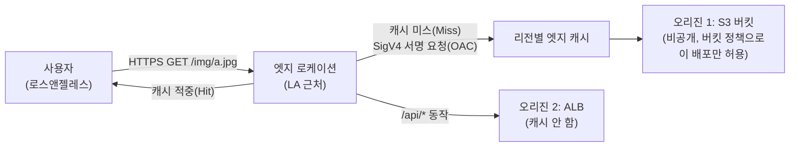

# M08-03. CloudFront — 오리진, 캐시, OAC, 서명된 URL, 엣지 함수
> 도메인: D2, D3 · 예상 시간: 55분 · 실습 등급: 🟡

## 왜 필요한가

TodayOrder 상품 이미지와 프런트엔드(HTML·JS)는 서울 리전 S3 버킷에 있다. 미국 사용자는 이미지 하나를 받는 데 태평양을 건너야 하고, 이벤트 날에는 같은 이미지를 수십만 번 S3에서 꺼낸다. **CloudFront**(AWS의 CDN, 콘텐츠 전송 네트워크)는 전 세계 엣지 로케이션에 사본을 캐시해 가까운 곳에서 응답한다. 동시에 "S3 버킷은 비공개로 두고 CloudFront만 읽게" 만드는 것이 이 레슨의 보안 포인트(OAC)다.

## 핵심 개념



| 용어 | 뜻 |
|---|---|
| 배포(distribution) | CloudFront 설정 한 벌. `dxxxx.cloudfront.net` 도메인을 받는다(대체 도메인 + ACM 인증서로 `cdn.todayorder.example`도 가능 — 인증서는 **us-east-1**의 ACM에 있어야 한다) |
| 오리진(origin) | 원본 위치. S3 버킷, ALB/EC2, API Gateway, 아무 HTTP 서버(사용자 지정 오리진). 오리진 그룹으로 **오리진 장애 조치**도 가능 |
| 동작(cache behavior) | 경로 패턴(`/api/*`, 기본 `*`)별로 어느 오리진에, 어떤 캐시 정책·뷰어 프로토콜로 보낼지 |
| 캐시 정책 / 오리진 요청 정책 | 캐시 키(무엇이 같으면 같은 객체인가: 경로 + 선택한 헤더·쿠키·쿼리 문자열)와 TTL / 캐시 키와 별개로 오리진에 넘길 값 |
| 무효화(invalidation) | 만료 전에 엣지 캐시에서 강제로 지움. 비용이 들 수 있어서 보통은 **파일 이름에 버전을 붙이는 방식**(`app.3f2a.js`)을 먼저 쓴다 |
| OAC(Origin Access Control) | CloudFront가 S3에 **SigV4로 서명한 요청**을 보내게 하는 설정. 버킷 정책에서 `cloudfront.amazonaws.com` + `AWS:SourceArn`(이 배포)만 허용하면 S3 직접 접근은 막힌다. 예전 방식 OAI(Origin Access Identity)를 대체하며, SSE-KMS 객체·모든 리전·PUT 같은 쓰기 요청도 지원한다 |
| 서명된 URL / 서명된 쿠키 | 유료 콘텐츠처럼 "허락받은 사용자만" 볼 때. **파일 하나**(또는 URL을 바꿀 수 있는 경우) → 서명된 URL, **여러 파일**(HLS 영상 조각, 회원 전용 영역)에 URL을 바꾸지 않고 → 서명된 쿠키. 서명 키는 **신뢰할 수 있는 키 그룹**(권장)으로 등록한다 |
| 가격 등급(price class) | `PriceClass_All` / `_200` / `_100` — 비싼 지역의 엣지를 빼서 비용을 줄인다 |
| 지리적 제한 | 국가별 허용·차단 목록 |

### S3 서명된 URL(M04) vs CloudFront 서명된 URL

| | S3 미리 서명된 URL | CloudFront 서명된 URL·쿠키 |
|---|---|---|
| 누가 서명 | IAM 자격 증명(서명한 사람의 권한을 빌려줌) | CloudFront 키 그룹의 개인 키 |
| 어디서 받나 | S3 리전 엔드포인트에서 직접 | 엣지(캐시 이점) |
| 조건 | 만료 시간 | 만료·시작 시간, IP 대역(사용자 지정 정책) |
| 언제 | 업로드 링크, 일회성 다운로드 | 대규모 유료 콘텐츠 배포 |

### 엣지에서 코드 실행: CloudFront Functions vs Lambda@Edge

| | CloudFront Functions | Lambda@Edge |
|---|---|---|
| 언어 | JavaScript(ECMAScript 5.1 호환 런타임) | Node.js, Python |
| 이벤트 | 뷰어 요청·응답 **만** | 뷰어 요청·응답 + **오리진 요청·응답** |
| 실행 시간 | 1밀리초 미만 | 최대 30초 |
| 메모리 / 코드 크기 | 2 MB / 10 KB | 128 MB(뷰어)·최대 10,240 MB(오리진) / 50 MB |
| 네트워크·파일 시스템·요청 본문 접근 | 없음 | 있음 |
| 규모 | 초당 수백만 요청 | 리전당 초당 최대 10,000 요청 |
| 쓰임 | 헤더 추가, URL 재작성·리디렉션, 캐시 키 정규화, JWT 같은 가벼운 토큰 검증 | 외부 API·DB 호출, 이미지 변환, 본문을 보는 인증 |

(수치는 AWS CloudFront 개발자 안내서 "Differences between CloudFront Functions and Lambda@Edge" 표 기준)

## 직접 해 보기

[labs/lab04-cloudfront-oac.sh](./labs/lab04-cloudfront-oac.sh)를 실행한다. 4·5단계의 "배포로 실제 GET"은 배포 주소가 **컨테이너 안에만** 열려 있어서 `docker exec aws-emulator-$EMULATOR_PORT curl …`로 컨테이너 안에서 호출한다(선택 과제 — docker를 쓸 수 없으면 스크립트가 건너뛴다).

```bash
bash curriculum/m08-dns-edge/labs/lab04-cloudfront-oac.sh
```

### 1) 비공개 버킷과 OAC

```
== 1. 비공개 S3 버킷과 정적 파일
make_bucket: todayorder-m08-static
업로드: s3://todayorder-m08-static/index.html
== 2. OAC(Origin Access Control) 만들기 — CloudFront 가 S3 요청에 SigV4 로 서명하게 한다
{
    "Name": "todayorder-m08-oac",
    "SigningProtocol": "sigv4",
    "SigningBehavior": "always",
    "OriginAccessControlOriginType": "s3"
}
```

버킷에는 퍼블릭 액세스 차단 4개 설정을 모두 켰다. OAC는 버킷을 공개하지 않고도 CloudFront가 읽게 해 주므로 이 설정과 충돌하지 않는다.

### 2) 배포 만들기 — 도메인 이름이 실제와 다르다

```
== 3. 배포 만들기
{
    "Id": "EE23GKQ5YZ37Z2",
    "Status": "InProgress",
    "DomainName": "127.0.0.1:44093",
    "ARN": "arn:aws:cloudfront::000000000000:distribution/EE23GKQ5YZ37Z2"
}
대기 후 상태: Deployed  ·  DomainName: 127.0.0.1:44093  (실제 AWS라면 dxxxxxxxxxxxxx.cloudfront.net)
{
    "Root": "index.html",
    "Viewer": "redirect-to-https",
    "CachePolicy": "658327ea-f89d-4fab-a63d-7e88639e58f6",
    "OAC": "E7THQC25A0YN02",
    "PriceClass": "PriceClass_200"
}
```

방금 본 것:
- 상태가 `InProgress` → `Deployed`로 바뀐다(`aws cloudfront wait distribution-deployed`). 실제 AWS에서는 전 세계 엣지에 퍼지는 데 몇 분이 걸린다.
- **`DomainName`이 `*.cloudfront.net`이 아니라 `127.0.0.1:44093`** 이다. 에뮬레이터는 배포마다 **컨테이너 안의** 임의 포트에 작은 HTTP 서버를 띄운다. 이 주소는 학습자 PC에서 열리지 않는다(호스트에서 `curl http://127.0.0.1:<그 포트>/`를 하면 연결이 거부되어 `000`이 나온다). Route 53 Alias의 대상으로도 쓸 수 없다.
- 캐시 정책 ID `658327ea-…`는 AWS 관리형 정책 **Managed-CachingOptimized**의 고정 ID다(실제 AWS에서도 같다).

### 3) OAC + 버킷 정책 — 선택 과제(docker exec)

```
== 4. 버킷 정책 없이 배포로 GET (선택 과제: docker exec)
HTTP 403
== 5. OAC 용 버킷 정책: cloudfront.amazonaws.com 에게, 이 배포(AWS:SourceArn)에서 온 GetObject 만 허용
{'StringEquals': {'AWS:SourceArn': 'arn:aws:cloudfront::000000000000:distribution/EE23GKQ5YZ37Z2'}}
배포로 GET /index.html → HTTP 200
첫 요청 [x-cache: Miss from cloudfront] → 두 번째 요청 [x-cache: Hit from cloudfront]
-- 버킷에 직접 익명 요청 (호스트에서): S3 는 여전히 비공개
HTTP 403
```

버킷 정책(스크립트 발췌):

```json
{"Sid": "AllowCloudFrontServicePrincipalReadOnly", "Effect": "Allow",
 "Principal": {"Service": "cloudfront.amazonaws.com"},
 "Action": "s3:GetObject",
 "Resource": "arn:aws:s3:::todayorder-m08-static/*",
 "Condition": {"StringEquals": {"AWS:SourceArn": "arn:aws:cloudfront::000000000000:distribution/EE23GKQ5YZ37Z2"}}}
```

방금 본 것:
- OAC만 만들고 버킷 정책이 없으면 CloudFront도 **403**이다. "OAC = 서명", "버킷 정책 = 허락" 두 가지가 모두 있어야 한다.
- 정책을 넣자 **200**. 첫 요청은 `Miss`(오리진 S3에서 가져옴), 두 번째는 `Hit`(엣지 캐시) — 캐시 동작이 실제로 관찰된다.
- 같은 객체를 S3에 직접 익명으로 요청하면 여전히 **403**. 사용자는 CloudFront를 거쳐야만 볼 수 있다.
- `Condition`의 `AWS:SourceArn`이 핵심이다. 이것이 없으면 **다른 사람의 CloudFront 배포**도 서비스 주체 `cloudfront.amazonaws.com`이라 내 버킷을 읽을 수 있다("혼동된 대리인" 문제). 스크립트를 고쳐 SourceArn을 다른 값으로 바꾸면 403이 나오는 것도 확인해 볼 수 있다.

### 4) 무효화와 엣지 함수

```
== 6. 무효화(invalidation) — 엣지 캐시에서 /index.html 을 지운다
무효화 IBGJKSXZRLFO82: Completed
== 7. CloudFront Functions — 만들기는 되지만 TestFunction 은 501
todayorder-m08-security-headers	UNPUBLISHED	cloudfront-js-2.0
aws: [ERROR]: An error occurred (NotImplemented) when calling the TestFunction operation: operation TestFunction is scaffolded but not implemented in this emulator
LAB04 OK
```

방금 본 것: CloudFront Functions는 만들면 `UNPUBLISHED`(개발 단계)다. 실제 AWS에서는 `test-function`으로 이벤트 객체를 넣어 시험하고 `publish-function`으로 LIVE로 올린 뒤 동작(cache behavior)에 연결한다. 에뮬레이터는 `TestFunction`이 501이라 함수 실행은 볼 수 없다.

## 실제 AWS에서는

- 배포 도메인은 `dxxxxxxxxxxxxx.cloudfront.net`이고 전 세계 엣지에서 응답한다. 에뮬레이터의 `DomainName`(`127.0.0.1:<포트>`)은 컨테이너 안에서만 유효하다.
- 에뮬레이터에서 배포 루트(`/`)를 요청하면 `DefaultRootObject`(`index.html`)를 주지 않고 버킷 목록 XML을 돌려줬다(탐색 중 관찰, `s3:GetObject`만 허용한 정책에서도). 실제 CloudFront는 `/` 요청을 `DefaultRootObject`로 바꿔 오리진에 요청한다.
- `TestFunction` 501 — CloudFront Functions·Lambda@Edge 실행은 볼 수 없다.
- 배포 생성·삭제는 실제 AWS에서 몇 분씩 걸리고, 삭제 전에는 **비활성화 → Deployed 대기 → 삭제** 순서를 지켜야 한다(에뮬레이터도 비활성화 전 삭제는 `DistributionNotDisabled`로 거부한다 — lab04의 정리 코드 참고).

**실제 AWS에서 해 보려면**
- 비용: CloudFront는 상시 무료 사용량(매월 일정량의 데이터 전송·요청)이 있고, 무효화도 매월 일정 경로 수까지 무료다. 정확한 한도는 CloudFront 요금 페이지에서 확인한다. S3 저장 비용은 작은 파일 몇 개면 미미하다.
- 순서: 버킷 생성(퍼블릭 액세스 차단 유지) → 파일 업로드 → `create-origin-access-control` → `create-distribution`(위 JSON) → 버킷 정책 → 몇 분 뒤 `curl -I https://<배포 도메인>/index.html`로 `x-cache` 헤더 확인.
- 정리: 배포 비활성화(`update-distribution`에 `Enabled=false`) → `aws cloudfront wait distribution-deployed --id <ID>` → `delete-distribution --if-match <ETag>` → `delete-origin-access-control` → `aws s3 rb s3://<버킷> --force`. 배포를 켜 둔 채로 두면 요청이 들어올 때마다 과금될 수 있다.

## 시험 포인트

- "S3 정적 콘텐츠를 CloudFront로만 제공하고 S3 직접 접근은 막아라" → **OAC + 버킷 정책(SourceArn 조건)**. 보기에 OAI가 있으면 레거시, **OAC가 권장**. "SSE-KMS로 암호화된 객체를 CloudFront로" → OAC(OAI는 미지원).
- "회원만 동영상 여러 조각을 받게, URL은 바꾸지 않고" → **서명된 쿠키**. "파일 하나 다운로드 링크" → **서명된 URL**.
- "헤더 추가·리디렉션·캐시 키 정규화, 초저지연·대량" → **CloudFront Functions**. "외부 호출, 본문 접근, 오리진 요청 단계, Python" → **Lambda@Edge**.
- "커스텀 도메인 HTTPS" → **us-east-1의 ACM 인증서**. "특정 국가 차단" → **지리적 제한**(또는 WAF 지역 일치 규칙). "비용 절감" → **가격 등급**.
- "배포 후 바뀐 파일이 안 보인다" → TTL/캐시. **무효화** 또는 **버전이 붙은 파일 이름**. "오리진 서버 부하를 더 줄이고 싶다" → **Origin Shield**(추가 캐시 계층).
- "오리진이 죽으면 다른 오리진" → **오리진 그룹(오리진 장애 조치)**.

## 스스로 확인

1. OAC를 설정했는데 CloudFront가 403을 돌려준다. 가장 먼저 확인할 것은?
2. 버킷 정책에서 `AWS:SourceArn` 조건을 빼면 어떤 위험이 생기나?
3. 에뮬레이터에서 `curl http://127.0.0.1:<DomainName의 포트>/`가 호스트에서 실패하는 이유는?

<details><summary>답</summary>

1. 버킷 정책이 `cloudfront.amazonaws.com` 서비스 주체에게 `s3:GetObject`를 허용하는지, `AWS:SourceArn`이 **이 배포의 ARN**과 정확히 같은지. (lab04 4단계: 정책이 없으면 403)
2. 같은 서비스 주체를 쓰는 **다른 계정의 CloudFront 배포**가 내 버킷을 오리진으로 지정해 읽을 수 있다(혼동된 대리인).
3. 에뮬레이터는 배포마다 HTTP 서버를 **컨테이너 안의** 127.0.0.1에 띄운다. 그 포트는 호스트로 게시되지 않으므로 컨테이너 안에서(`docker exec … curl`)만 닿는다.

</details>
