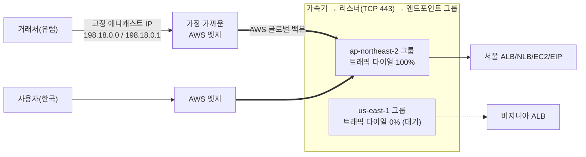

# M08-04. Global Accelerator vs CloudFront
> 도메인: D2, D3 · 예상 시간: 30분 · 실습 등급: 🟡

## 왜 필요한가

TodayOrder가 B2B 주문 API를 연다. 큰 거래처의 방화벽 담당자가 말한다. "우리 회사는 허용 목록에 **고정 IP**만 넣을 수 있어요. 도메인은 안 됩니다." 또 실시간 주문 알림을 보내는 **TCP/UDP** 소켓 서버도 있다. 캐시할 것도 없다. CloudFront로는 답이 안 나오는 이 요구에 맞는 서비스가 **Global Accelerator**(GA)다.

## 핵심 개념



- **애니캐스트 고정 IP 2개**: 전 세계 어디서나 같은 IP로 들어오고, 가장 가까운 엣지에서 AWS 백본으로 들어간다. IP가 바뀌지 않으니 거래처 방화벽에 넣을 수 있다(자기 IP 대역을 가져오는 BYOIP도 가능).
- 구성: **가속기 → 리스너(프로토콜·포트) → 엔드포인트 그룹(리전별) → 엔드포인트(ALB, NLB, EC2, 탄력적 IP)**.
- **트래픽 다이얼**(그룹별 %)과 **엔드포인트 가중치**로 리전·대상 사이 비율을 조절하고, 상태 확인에 실패한 엔드포인트는 자동으로 뺀다. DNS를 바꾸는 것이 아니므로 **클라이언트의 DNS 캐시(TTL)를 기다리지 않는다.**
- **클라이언트 선호도**(`SOURCE_IP`): 같은 클라이언트를 같은 엔드포인트로(상태 있는 연결).
- 캐시는 없다. 패킷(TCP/UDP)을 그대로 전달한다.

### 결정표 — CloudFront vs Global Accelerator

| 요구 | CloudFront | Global Accelerator |
|---|---|---|
| 프로토콜 | HTTP/HTTPS(+WebSocket) | **TCP·UDP** 모든 애플리케이션 |
| 콘텐츠 **캐시** | ✅ 핵심 기능 | ❌ 없음 |
| 진입점 | 도메인 이름(엣지 IP는 바뀜) | **고정 애니캐스트 IP 2개** |
| 리전 장애 조치 | 오리진 그룹(오리진 단위) | 엔드포인트 그룹 상태 확인 + 트래픽 다이얼(DNS 캐시와 무관) |
| 엣지에서 하는 일 | 캐시, TLS 종료, 함수 실행, WAF | 가장 가까운 엣지에서 백본으로 진입(TCP 종료 최적화) |
| 대표 워크로드 | 정적 파일, 이미지, 동영상, 웹·API 가속(캐시·엣지 로직) | 게임(UDP), IoT(MQTT), VoIP, 고정 IP가 필요한 API, 다중 리전 액티브-액티브 빠른 장애 조치 |
| 보안 연동 | WAF, Shield, OAC, 서명된 URL | Shield(Standard 자동, Advanced 가능). WAF는 뒤의 ALB에 |

> 한 줄 구분: **"캐시할 수 있는 HTTP" → CloudFront, "고정 IP·TCP/UDP·빠른 리전 장애 조치" → Global Accelerator.**

### Route 53 지연 시간 라우팅과는 뭐가 다른가

둘 다 "가까운/빠른 리전으로"를 할 수 있다. 차이는 **전환 속도와 진입점**이다. Route 53은 DNS 응답을 바꾸므로 클라이언트가 캐시한 TTL 동안 옛 리전으로 간다. GA는 IP가 그대로이고 AWS 안에서 경로를 바꾸므로 클라이언트 캐시와 무관하다.

## 직접 해 보기

[labs/lab05-global-accelerator.sh](./labs/lab05-global-accelerator.sh)를 실행한다. **실제 AWS에서 Global Accelerator API는 미국 서부(오레곤) `us-west-2` 엔드포인트로만 호출한다.** 이 커리큘럼은 리전을 `us-east-1`로 고정하지만, 실제와 같은 명령이 되도록 GA 호출에만 `--region us-west-2`를 붙였다(에뮬레이터는 리전을 나누지 않으므로 결과는 같다).

```bash
bash curriculum/m08-dns-edge/labs/lab05-global-accelerator.sh
```

```
== 1. 가속기 만들기 — 고정 애니캐스트 IPv4 2개
{
    "Arn": "arn:aws:globalaccelerator::000000000000:accelerator/d9d5b1d9-37fd-4ca0-9598-975c4d808b1f",
    "Ips": [
        "198.18.0.0",
        "198.18.0.1"
    ],
    "DnsName": "ad9d5b1d937fd4ca0.awsglobalaccelerator.com",
    "Status": "IN_PROGRESS"
}
대기 후 상태: DEPLOYED
== 2. 리스너: TCP 443, 같은 클라이언트는 같은 엔드포인트로(SOURCE_IP 선호도)
{
    "Protocol": "TCP",
    "Ports": [
        {
            "FromPort": 443,
            "ToPort": 443
        }
    ],
    "Affinity": "SOURCE_IP"
}
== 3. 엔드포인트 그룹: 서울(트래픽 100%) + 버지니아(트래픽 다이얼 0% — 대기)
ap-northeast-2	100.0	eipalloc-0a1b2c3d4e5f60001	INITIAL
us-east-1	0.0	eipalloc-0a1b2c3d4e5f60002	INITIAL
```

방금 본 것:
- 고정 IP 2개와 `*.awsglobalaccelerator.com` DNS 이름이 할당됐다. ARN에 리전이 없다(`arn:aws:globalaccelerator::…`) — 글로벌 서비스다. 에뮬레이터의 IP `198.18.0.x`는 벤치마크용 예약 대역이라 인터넷에서 닿지 않는다. **트래픽은 흐르지 않는다**(🟡).
- 엔드포인트 상태가 `INITIAL`에 머문다. 실제 AWS에서는 상태 확인 결과에 따라 `HEALTHY`/`UNHEALTHY`가 된다.
- 버지니아 그룹을 다이얼 0%로 두면 평소엔 트래픽이 가지 않는 **웜 스탠바이**가 된다. 서울 장애 시 다이얼을 100으로 올리거나, 서울 엔드포인트가 비정상이 되면 GA가 자동으로 다른 그룹으로 보낸다.

```
== 4. 목록 조회: ListEndpointGroups 는 501
aws: [ERROR]: An error occurred (NotImplemented) when calling the ListEndpointGroups operation: operation ListEndpointGroups is scaffolded but not implemented in this emulator
== 5. 지우는 순서: 엔드포인트 그룹 → 리스너 → (비활성화) → 가속기
엔드포인트 그룹이 남은 채 리스너 삭제 → AssociatedEndpointGroupFoundException
활성 상태에서 가속기 삭제 → AcceleratorNotDisabledException
False	IN_PROGRESS
삭제 후 남은 가속기(이 lab 것): 0
LAB05 OK
```

방금 본 것: 삭제는 **안쪽부터**(엔드포인트 그룹 → 리스너), 그리고 가속기는 **비활성화하고 배포가 끝난 뒤** 지울 수 있다. 에뮬레이터도 이 순서를 강제한다. 다만 `ListEndpointGroups`가 501이라, 엔드포인트 그룹 ARN은 만들 때 받은 값을 보관해 둬야 지울 수 있다.

## 실제 AWS에서는

- GA로 들어온 트래픽이 실제로 가장 가까운 엣지에서 AWS 백본을 타고 엔드포인트에 도달한다. 에뮬레이터는 구성만 저장한다.
- 엔드포인트의 상태 확인(`HealthState`), 트래픽 다이얼에 따른 실제 분산, 클라이언트 IP 보존(ALB 엔드포인트) 등은 관찰할 수 없다.
- `ListEndpointGroups` 501.

**실제 AWS에서 해 보려면**
- 비용: **프리 티어가 없다.** 가속기마다 시간당 고정 요금이 붙고(만들어 두기만 해도 과금), 데이터 전송 프리미엄 요금이 추가된다. 실습은 짧게 하고 바로 지운다.
- 명령은 lab05와 같다(모든 호출에 `--region us-west-2`). 엔드포인트로는 기존 ALB나 탄력적 IP의 할당 ID를 쓴다.
- 정리: `delete-endpoint-group` → `delete-listener` → `update-accelerator --no-enabled` → 상태가 `DEPLOYED`가 될 때까지 `describe-accelerator` → `delete-accelerator`.

## 시험 포인트

- "**고정 IP**(허용 목록)가 필요하다", "**UDP**/게임/IoT/VoIP를 전 세계에서 빠르게" → **Global Accelerator**.
- "정적 콘텐츠·이미지·동영상을 **캐시**해 지연을 줄이고 오리진 부하를 덜어라" → **CloudFront**.
- "다중 리전 액티브-액티브에서 **DNS 캐시 없이 빠르게** 장애 조치" → **Global Accelerator**(엔드포인트 그룹 상태 확인). Route 53 장애 조치는 TTL만큼 늦을 수 있다.
- "블루/그린을 리전 단위로 서서히" → GA **트래픽 다이얼** 또는 Route 53 **가중치**.
- GA는 **캐시를 하지 않고**, CloudFront는 **고정 IP를 주지 않는다** — 보기에서 이 둘을 바꿔 놓은 오답이 자주 나온다.

## 스스로 확인

1. CloudFront 배포에도 엣지 IP가 있는데 왜 "고정 IP 허용 목록" 요구에 쓰지 않나?
2. 서울 리전 장애 시 Route 53 장애 조치와 GA 엔드포인트 그룹 장애 조치 중 사용자가 더 빨리 복구되는 쪽은? 이유는?
3. lab05에서 리스너를 먼저 지우려 했을 때 실패한 이유는?

<details><summary>답</summary>

1. CloudFront 엣지 IP는 많고 수시로 바뀐다. 고객이 고정 IP를 허용 목록에 넣어야 한다면 GA의 **고정 애니캐스트 IP 2개**가 맞다.
2. 대개 GA. GA는 IP가 그대로이고 AWS 안에서 경로를 바꾸므로 클라이언트·리졸버의 DNS 캐시(TTL)를 기다리지 않는다. Route 53은 새 응답이 캐시가 만료된 뒤에야 퍼진다.
3. 엔드포인트 그룹이 아직 리스너에 붙어 있었다(`AssociatedEndpointGroupFoundException`). 안쪽(엔드포인트 그룹)부터 지워야 한다.

</details>
