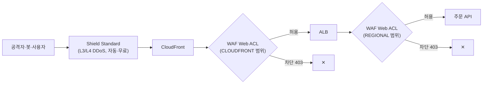

# M08-05. 엣지 보안 — WAF, Shield, Firewall Manager
> 도메인: D1, D2 · 예상 시간: 45분 · 실습 등급: 🟢 Web ACL 구성 · 차단 관찰(docker exec 선택 과제) / 🔴 Shield Advanced·Firewall Manager

## 왜 필요한가

해외 사용자가 생기자 이상한 트래픽도 같이 왔다. 로그인 API에 초당 수백 번 비밀번호를 대입하는 봇, 주문 조회 URL에 `' OR '1'='1`을 붙여 보는 스캐너, 특정 대역에서 쏟아지는 요청. 애플리케이션 코드에서 일일이 막으면 서버가 먼저 지친다. **요청이 서버에 닿기 전, 엣지·로드 밸런서 앞에서 거르는 것**이 WAF이고, 더 아래 계층(L3/L4)의 대규모 DDoS를 흡수하는 것이 Shield다. 이 레슨은 M09-06(심층 방어)으로 이어진다.

## 핵심 개념



### AWS WAF (웹 애플리케이션 방화벽, L7)

- **Web ACL**(웹 ACL) = 규칙 목록 + **기본 동작**(Allow/Block). 규칙은 **우선순위 숫자가 작은 것부터** 평가하고, Allow/Block으로 끝나는 규칙에 걸리면 거기서 멈춘다(Count는 기록만 하고 계속).
- 붙일 수 있는 곳: **CloudFront, ALB, API Gateway(REST), AppSync, Cognito 사용자 풀, App Runner, Verified Access** 등. **NLB·EC2에는 직접 못 붙인다.**
- 범위: CloudFront용은 `CLOUDFRONT`(us-east-1에서 만든다), 나머지는 `REGIONAL`(리소스와 같은 리전).
- 규칙 재료: IP 세트, 지역(국가) 일치, 문자열·정규식 일치, 크기 제약, **SQL 인젝션·XSS 탐지**, **속도 기반 규칙**(IP 등 키별 요청 수 제한), **AWS 관리형 규칙 그룹**(공통 규칙, 알려진 악성 입력, SQLi, IP 평판, 봇 제어 등)과 마켓플레이스 규칙.
- **WCU(Web ACL Capacity Unit)**: 규칙이 쓰는 처리 용량. Web ACL당 최대 5,000 WCU이고, 기본 요금에 포함된 용량을 넘기면 추가 요금이 붙는다(경계값은 WAF 요금 페이지에서 확인).

### AWS Shield

| | Shield Standard | Shield Advanced |
|---|---|---|
| 비용 | **무료, 자동**(모든 AWS 고객) | 월 정액(1년 약정) + 데이터 전송 사용료 |
| 막는 것 | 흔한 L3/L4 공격(SYN 플러드, UDP 반사 등) | 더 크고 정교한 L3/L4/L7 공격 대응, 실시간 가시성 |
| 추가 혜택 | – | **Shield 대응팀(SRT)** 24시간 지원, DDoS로 늘어난 요금 **비용 보호**, 보호 리소스의 WAF 요금 포함 |
| 보호 대상 | 모든 리소스 | CloudFront, Route 53, Global Accelerator, ELB, EC2 탄력적 IP |

### AWS Firewall Manager

여러 계정(AWS Organizations)에 **WAF 규칙, Shield Advanced 보호, 보안 그룹, Network Firewall, Route 53 Resolver DNS Firewall** 정책을 **중앙에서 한 번에** 적용하고, 새 계정·새 리소스에도 자동으로 적용한다. 전제 조건: Organizations, Firewall Manager 관리자 계정 지정, 각 계정의 AWS Config 활성화.

## 직접 해 보기

[labs/lab06-waf-web-acl.sh](./labs/lab06-waf-web-acl.sh)는 주문 API 앞 ALB(고정 응답 200)를 만들고, Web ACL을 붙인 뒤 **컨테이너 안에서** `docker exec … curl`로 공격 요청을 보낸다(ALB 주소가 컨테이너 안에만 있기 때문 — 4·5단계는 선택 과제이며 docker를 쓸 수 없으면 건너뛴다).

```bash
bash curriculum/m08-dns-edge/labs/lab06-waf-web-acl.sh
```

### 1) WAF 없이

```
== 0. 보호할 대상: 주문 API 앞의 ALB (고정 응답 200 'orders-api-ok')
ALB DNSName: 127.0.0.1:38859  (컨테이너 안 주소)
-- WAF 연결 전: 정상 요청 200 · SQL 인젝션 시도 200  (둘 다 통과)
```

### 2) IP 세트와 Web ACL

규칙(스크립트 발췌 — 4개 중 2개):

```json
{"Name": "block-bad-ips", "Priority": 0, "Action": {"Block": {}},
 "Statement": {"IPSetReferenceStatement": {"ARN": "<IP 세트 ARN>",
   "IPSetForwardedIPConfig": {"HeaderName": "X-Forwarded-For", "FallbackBehavior": "NO_MATCH", "Position": "FIRST"}}}, ...}
{"Name": "rate-limit-login", "Priority": 1, "Action": {"Block": {}},
 "Statement": {"RateBasedStatement": {"Limit": 20, "EvaluationWindowSec": 60, "AggregateKeyType": "IP",
   "ScopeDownStatement": {"ByteMatchStatement": {"SearchString": "/login", "FieldToMatch": {"UriPath": {}}, ...}}}}, ...}
```

```
== 1. IP 세트 — 차단할 공격자 대역
arn:aws:wafv2:us-east-1:000000000000:regional/ipset/todayorder-m08-blocklist/d887f7ff-4d6a-4548-b402-a64b0c5e4f90
== 2. Web ACL — 기본 동작 Allow + 규칙 4개 (우선순위가 낮은 숫자부터 평가)
필요 용량(WCU): 905
{
    "Capacity": 905,
    "Default": "Allow",
    "Rules": [
        "0: block-bad-ips",
        "1: rate-limit-login",
        "2: aws-common",
        "3: aws-sqli"
    ]
}
== 3. ALB 에 연결
ALB 에 연결된 Web ACL: todayorder-m08-api-acl
```

방금 본 것:
- `check-capacity`로 규칙이 쓸 WCU(905)를 미리 계산했다. 관리형 규칙 그룹(공통 규칙 세트, SQLi 세트)이 대부분을 차지한다.
- 기본 동작이 Allow → "규칙에 걸리지 않으면 통과"(블랙리스트 방식). 관리자 페이지처럼 허용 목록이 맞는 곳은 기본 동작 Block + Allow 규칙으로 만든다.
- `ByteMatchStatement`의 `SearchString`은 바이너리(blob) 타입이라 AWS CLI v2에서는 `--cli-binary-format raw-in-base64-out`을 줘야 평문 `/login`을 쓸 수 있다(실제 AWS에서도 같다).

### 3) 공격 흉내 — 실제로 막힌다

```
== 4. 공격 흉내 (선택 과제: docker exec 로 컨테이너 안에서 ALB 호출)
정상 요청                      200
차단 목록 IP (X-Forwarded-For) 403
SQL 인젝션 쿼리               403
XSS 쿼리                         403
User-Agent 없음                  403
-- 로그인 30번 연타 (속도 제한 20/60초)
  20 200
  10 403
== 5. 어느 규칙이 막았나 — 샘플링된 요청
blockBadIps     BLOCK  x1   /                                             -
rateLimitLogin  BLOCK  x10  /login                                        -
awsCommon       BLOCK  x1   /                                             AWS#AWSManagedRulesCommonRuleSet#NoUserAgent_HEADER
awsCommon       BLOCK  x1   /search?q=%3Cscript%3Ealert(1)%3C/script%3E   AWS#AWSManagedRulesCommonRuleSet#CrossSiteScripting_QUERYARGUMENTS
awsSqli         BLOCK  x1   /orders?id=1%27%20OR%20%271%27=%271           AWS#AWSManagedRulesSQLiRuleSet#SQLi_QUERYARGUMENTS
```

방금 본 것: 이 에뮬레이터 버전의 WAF는 규칙을 **저장만 하는 것이 아니라 ALB에서 실제로 평가해 403으로 차단**한다(재생성된 FIDELITY.md의 `edge-better` 탐침도 같은 결과를 기록한다).
- 관리형 규칙 그룹 안의 **어느 하위 규칙**이 걸렸는지(`SQLi_QUERYARGUMENTS`, `CrossSiteScripting_QUERYARGUMENTS`, `NoUserAgent_HEADER`)가 `get-sampled-requests`에 나온다. 정상 트래픽이 막혔을 때(오탐) 이 이름으로 그 하위 규칙만 Count로 바꾸는 식으로 튜닝한다.
- 속도 기반 규칙: 20번까지 통과, 이후 10번 차단. 에뮬레이터는 숫자를 정확히 지키지만 **실제 WAF는 "한도 근처에서" 막고 정확한 일치를 보장하지 않으며 감지에 약간의 지연이 있다.** 한도의 최솟값은 10, 평가 창은 60/120/300/600초다.
- 차단 목록 IP는 `X-Forwarded-For` 헤더로 흉내 냈다. 그래서 규칙에 `IPSetForwardedIPConfig`(XFF의 첫 IP를 본다)를 넣었다. 이 설정이 없으면 실제 WAF는 **요청을 보낸 연결의 IP**를 본다(XFF는 위조가 쉬우므로, 앞에 신뢰할 수 있는 프록시가 있을 때만 쓴다). 에뮬레이터는 이 설정이 없어도 XFF를 클라이언트 IP로 취급했다(탐색 중 관찰 — AWS와 다름).

### 4) CloudFront용 Web ACL, Shield, Firewall Manager

```
== 6. CloudFront 용 Web ACL 은 범위가 CLOUDFRONT 이고 us-east-1 에서 만든다
arn:aws:wafv2:us-east-1:000000000000:global/webacl/todayorder-m08-cf-acl/ec1398db-bab3-40e9-aac2-628f5c1fdf08
== 7. Shield 와 Firewall Manager — 읽기만
Shield Advanced 구독 상태: INACTIVE  (Shield Standard 는 구독 없이 모든 고객에게 자동 적용)
Firewall Manager: AccessDeniedException) when calling the ListPolicies operation: No default admin could be found for account 000000000000 in Region us-east-1
LAB06 OK
```

방금 본 것: CloudFront용 ACL의 ARN에는 `regional/`이 아니라 `global/`이 들어간다. 배포에 연결할 때는 배포 설정의 `WebACLId`에 이 ARN을 넣는다. Firewall Manager는 **관리자 계정이 지정돼 있지 않으면** 아무것도 할 수 없다(Organizations가 전제). Shield Advanced는 월 정액 구독이라 이 커리큘럼에서는 상태만 읽는다(🔴).

## 실제 AWS에서는

- WAF 차단 동작은 에뮬레이터에서도 관찰되지만, 실제 WAF의 속도 제한은 근사치·약간의 지연이 있고, IP 판단은 `ForwardedIPConfig`를 넣었을 때만 XFF를 본다.
- 실제 Web ACL은 CloudWatch 지표(`AWS/WAFV2`)와 샘플 요청, 그리고 선택적으로 전체 요청 로그(CloudWatch Logs·S3·Data Firehose)를 남긴다.
- Shield Advanced 구독(🔴): 월 정액이 크고 1년 약정이라 실습 대상이 아니다. Firewall Manager(🔴): Organizations와 관리자 계정이 필요하다.

**실제 AWS에서 해 보려면**
- 비용: WAF는 프리 티어가 없다. Web ACL당 월 요금 + 규칙당 월 요금 + 요청 100만 건당 요금이 붙고, 일부 관리형 규칙 그룹(봇 제어 등)은 별도 요금이다. 몇 시간 실습 후 지우면 비용은 작지만 0은 아니다(요금은 일할 계산된다).
- ALB 대신 API Gateway REST API 스테이지에 붙여도 된다. 차단 확인은 `curl -i 'https://<엔드포인트>/orders?id=1%27%20OR%20%271%27=%271'` → 403.
- 정리: `aws wafv2 disassociate-web-acl --resource-arn <ALB ARN>` → `delete-web-acl --lock-token …` → `delete-ip-set --lock-token …` → ALB·VPC 삭제.

## 시험 포인트

- "**SQL 인젝션·XSS** 차단", "특정 **국가** 차단", "**IP당 요청 수 제한**(무차별 대입·스크래핑)" → **AWS WAF**(관리형 규칙·지역 일치·속도 기반 규칙).
- "WAF를 **NLB/EC2**에 붙이고 싶다" → 불가. ALB·CloudFront·API Gateway 앞에서. NLB 앞이 필요하면 GA/CloudFront·Network Firewall 등을 고려.
- "대규모 **DDoS**, 대응팀 지원, DDoS로 늘어난 **요금 보호**" → **Shield Advanced**. 그냥 "기본 DDoS 보호"는 **Shield Standard(자동·무료)**.
- "**여러 계정**에 같은 WAF 규칙·보안 그룹 정책을 **일괄·자동** 적용" → **Firewall Manager**(Organizations 필요).
- WAF는 **L7(HTTP)**, Shield Standard는 **L3/L4**, 보안 그룹·NACL은 VPC 안의 L3/L4 — 계층을 구분하는 문제가 나온다.

## 스스로 확인

1. 관리형 공통 규칙 세트가 정상 고객 요청(본문이 큰 주문서 업로드)을 막는다. Web ACL 전체를 끄지 않고 대처하는 방법은?
2. 로그인 API를 IP당 분당 20회로 제한하려면 어떤 규칙을 어떻게 구성하나? lab06에서 어떤 결과가 그것을 보여 줬나?
3. 회사에 AWS 계정이 30개다. 모든 계정의 ALB에 같은 WAF 규칙을 강제하고, 새 계정이 생겨도 자동 적용하고 싶다. 무엇을 쓰나?

<details><summary>답</summary>

1. `get-sampled-requests`(또는 로그)에서 막은 **하위 규칙 이름**(예: `SizeRestrictions_BODY`)을 찾아 관리형 규칙 그룹의 그 규칙만 **Count로 재정의**(rule action override)하거나, 범위 축소(scope-down) 문으로 해당 경로를 제외한다.
2. **속도 기반 규칙**: `Limit 20`, `EvaluationWindowSec 60`, 집계 키 IP, 범위 축소 문으로 URI 경로가 `/login`으로 시작하는 요청만, 동작 Block. lab06 4단계에서 30번 중 20번 200, 10번 403이 나왔다.
3. **AWS Firewall Manager**(Organizations + 관리자 계정 + 각 계정 Config 활성화). WAF 정책을 만들면 범위 안의 기존·신규 리소스에 자동 적용된다.

</details>
