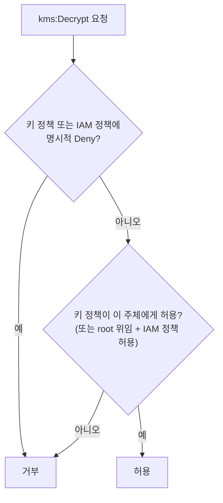
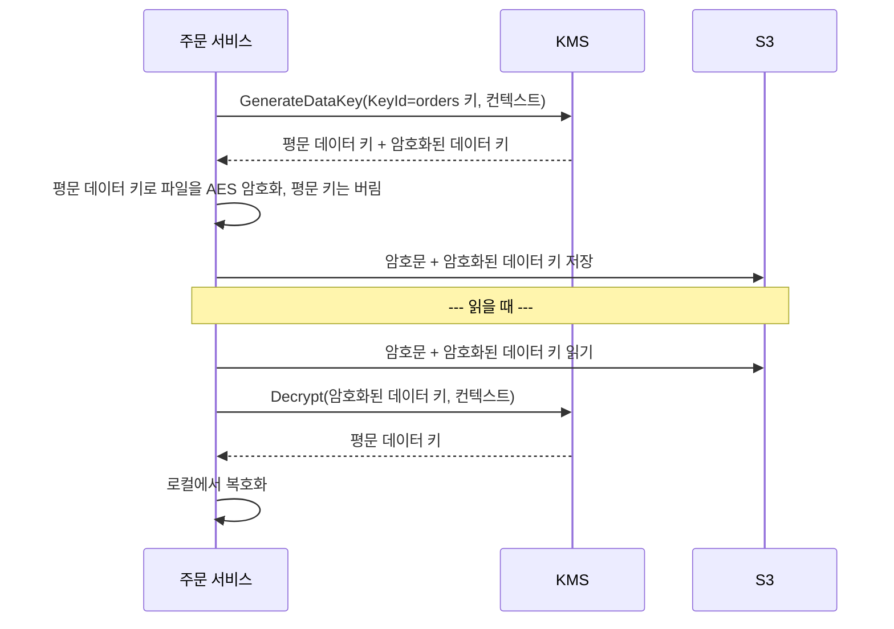

# M09-01. KMS — 키 종류, 키 정책, 봉투 암호화, 교체, 다중 리전 키 (그리고 CloudHSM)
> 도메인: D1 · 예상 시간: 60분 · 실습 등급: 🟢

## 왜 필요한가

TodayOrder가 첫 보안 감사를 받는다. 감사인의 질문은 셋이다. "카드 결제 토큰과 주문 내보내기 파일은 암호화돼 있나요? **키는 누가 갖고 있나요?** 퇴사자가 키를 들고 나가면요?" 키를 소스 코드나 환경 변수에 두면 답할 수 없다. **AWS KMS(Key Management Service)** 는 키를 HSM(하드웨어 보안 모듈) 안에 두고 밖으로 내보내지 않으며, "누가 이 키로 무엇을 할 수 있나"를 **키 정책**으로 통제하고, 모든 사용을 CloudTrail에 남긴다.

## 핵심 개념

### 키의 종류

| 구분 | 누가 만들고 관리 | 예 | 키 정책 수정 | 교체 |
|---|---|---|---|---|
| **고객 관리형 키**(customer managed key) | 나 | `alias/todayorder-m09-orders` | ✅ | 자동 교체 선택(기간 90~2560일, 기본 365일) + 즉시 교체 |
| **AWS 관리형 키** | AWS 서비스가 내 계정에 만듦 | `alias/aws/s3`, `alias/aws/ssm` | ❌ (보기만) | 매년 자동 |
| **AWS 소유 키** | AWS가 여러 계정에 걸쳐 소유 | SSE-S3, DynamoDB 기본 암호화 | ❌ (보이지도 않음) | AWS가 관리 |

- **대칭 키**(`SYMMETRIC_DEFAULT`, AES-256): 암호화·복호화. 키 재료가 KMS 밖으로 나오지 않는다.
- **비대칭 키**(RSA, ECC): 서명·검증 또는 공개 키 암호화. 공개 키는 내려받을 수 있다.
- **HMAC 키**: 메시지 인증 코드 생성·검증.
- **다중 리전 키**: 키 ID가 `mrk-`로 시작하고, 다른 리전에 **같은 키 재료의 복제본**을 만든다. 한 리전에서 암호화한 데이터를 다른 리전에서 다시 암호화하지 않고 복호화할 수 있다(DR, 전역 테이블).

### 키 정책 — KMS 권한의 출발점

KMS 키에 대한 접근은 **키 정책(리소스 기반 정책)** 이 반드시 허락해야 한다. 기본 키 정책은 "이 계정(root)에게 `kms:*`"인데, 이것은 "**계정의 IAM 정책으로 권한을 위임한다**"는 뜻이다. 그래서 IAM 사용자는 IAM 정책도 있어야 키를 쓸 수 있다. 반대로 키 정책에 명시적 Deny가 있으면 IAM 정책이 무엇을 허용하든 거부된다. (교차 계정 사용은 키 정책 + 상대 계정의 IAM 정책 둘 다, 또는 **grant**로 위임.)



### 봉투 암호화(envelope encryption)

KMS `Encrypt`는 **4 KiB(4,096바이트)** 까지만 받는다. 큰 데이터는 이렇게 한다.



- 데이터는 KMS로 보내지 않는다(네트워크·4 KiB 한도·요청 비용 모두 절약). KMS에 오가는 것은 32바이트 데이터 키뿐이다.
- **KMS 키 하나를 끄면 그 키로 감싼 모든 데이터 키 → 모든 파일이 잠긴다.** 키 정책·비활성화·삭제가 곧 데이터 접근 통제다.
- S3 SSE-KMS, EBS, RDS 암호화가 내부적으로 이렇게 동작한다.
- **암호화 컨텍스트**(encryption context): 키-값 쌍을 함께 넣으면 복호화할 때 똑같이 넣어야 한다(추가 인증 데이터). CloudTrail에 기록되고, 키 정책 조건(`kms:EncryptionContext:…`)으로도 쓴다.

### S3 서버 측 암호화 비교 (M04 복습, 시험 단골)

| | SSE-S3 | SSE-KMS | DSSE-KMS | SSE-C |
|---|---|---|---|---|
| 키 | S3가 관리(AWS 소유 키) | KMS 키(AWS 관리형 `aws/s3` 또는 고객 관리형) | KMS 키, 2중 암호화 | **고객이 요청마다 키를 보냄** (AWS는 저장 안 함) |
| 키 사용 감사(CloudTrail) | ❌ | ✅ | ✅ | ❌ |
| 키 정책으로 접근 분리·키 비활성화 | ❌ | ✅ | ✅ | 고객이 키를 안 주면 끝 |
| 비용·한도 | 추가 비용 없음 | KMS 요청 요금, KMS 요청 한도 영향(S3 버킷 키로 완화) | KMS 요금 + 추가 | 추가 비용 없음, HTTPS 필수 |
| 언제 | 기본값(새 객체는 기본 SSE-S3) | 감사·키 통제·규정 요구 | 2계층 암호화 규정 | 키를 AWS 밖에서만 관리해야 할 때 |

> **SSE-C는 새 버킷에서 기본 차단이다.** 2026년 4월부터 새로 만드는 범용 버킷(그리고 SSE-C 객체가 없던 계정의 기존 버킷)은 SSE-C 업로드를 `403 AccessDenied`로 거부한다. 쓰려면 `PutBucketEncryption`의 `BlockedEncryptionTypes`로 명시적으로 허용해야 한다.

클라이언트 측 암호화(앱이 올리기 전에 암호화, 예: AWS Encryption SDK)는 "AWS가 평문을 한 번도 보지 않아야 한다"일 때.

### KMS vs CloudHSM

| | KMS | CloudHSM |
|---|---|---|
| 형태 | 완전 관리형 다중 테넌트 서비스(HSM으로 보호) | **내 VPC 안의 전용(단일 테넌트) HSM 클러스터** |
| 키 통제 | AWS가 HSM 운영, 나는 키 정책으로 통제 | **고객만** 키에 접근(AWS도 못 봄), 사용자·키 관리도 고객 |
| 연동 | S3·EBS·RDS 등 대부분의 AWS 서비스와 바로 연동 | 표준 API(PKCS#11, JCE, OpenSSL 엔진 등)로 애플리케이션이 직접. KMS **사용자 지정 키 저장소**로 KMS와 연결 가능 |
| 고가용성 | AWS가 보장 | 여러 AZ에 HSM을 두는 것은 고객 몫 |
| 비용 | 키당 월 요금 + 요청 요금 | HSM 시간당 요금(훨씬 비쌈) |
| 연동 API | AWS SDK/CLI (KMS API) | PKCS#11, JCE, CNG/KSP, OpenSSL 동적 엔진 |
| 언제 | 대부분 | "**단일 테넌트·전용 HSM**", "고객 단독 키 통제", Oracle TDE·SSL/TLS 오프로드처럼 표준 HSM API가 필요할 때 |

## 직접 해 보기

### 1) 키 만들기, 암호화·복호화, 컨텍스트 — [labs/lab01-kms-basics.sh](./labs/lab01-kms-basics.sh)

```bash
bash curriculum/m09-security-encryption/labs/lab01-kms-basics.sh
```

```
== 1. 고객 관리형 키 만들기 + 별칭
{
    "KeyState": "Enabled",
    "KeySpec": "SYMMETRIC_DEFAULT",
    "KeyUsage": "ENCRYPT_DECRYPT",
    "KeyManager": "CUSTOMER",
    "Origin": "AWS_KMS",
    "MultiRegion": false
}
== 2. Encrypt → Decrypt (암호화 컨텍스트 orderId=A-1001)
평문 24바이트 → 암호문 90바이트
{
    "KeyId": "arn:aws:kms:us-east-1:000000000000:key/d5c44bcb-69a2-4815-aea6-4f5fb51e675a",
    "Plaintext": "Y2FyZD00MTExLTExMTEtMTExMS0xMTEx"
}
복호화 결과: card=4111-1111-1111-1111
== 3. 암호화 컨텍스트가 다르면? (실패해야 정상)
aws: [ERROR]: An error occurred (InvalidCiphertextException) when calling the Decrypt operation:
```

방금 본 것: 암호문이 평문보다 훨씬 길다 — 어느 키로 암호화했는지 같은 메타데이터가 들어 있어서 `Decrypt`에 키 ID를 주지 않아도 된다. CLI는 바이너리를 base64로 주고받는다(`Plaintext`는 base64). 컨텍스트가 하나라도 다르면 `InvalidCiphertextException`이다.

### 2) 키를 끄면? — 저자 확인 항목

CURRICULUM이 "탐침 미검증, 저자 확인"으로 남긴 항목이다. 결과: **비활성화된 키로는 Decrypt가 `DisabledException`으로 실패하고, 다시 켜면 복호화된다(🟢, 실제 AWS와 같은 오류 코드).**

```
== 4. 키를 비활성화하면 Decrypt 도 실패한다
KeyState: Disabled
aws: [ERROR]: An error occurred (DisabledException) when calling the Decrypt operation: arn:aws:kms:us-east-1:000000000000:key/d5c44bcb-69a2-4815-aea6-4f5fb51e675a is disabled.
다시 활성화 후 복호화: card=4111-1111-1111-1111
== 5. Encrypt 는 4 KiB(4096바이트)까지 — 더 크면 봉투 암호화(lab03)
aws: [ERROR]: An error occurred (ValidationException) when calling the Encrypt operation: 1 validation error detected: Value at 'plaintext' failed to satisfy constraint: Member must have length less than or equal to 4096
```

> 비교: M04에서 SSE-KMS 객체는 키를 꺼도 에뮬레이터 S3가 그대로 읽어 줬다(에뮬레이터 S3가 키 상태를 확인하지 않음). "키를 끄면 못 읽는다"는 이 레슨처럼 KMS를 직접 부를 때 관찰된다.

### 3) 교체, 삭제 예약, 다중 리전 키

```
== 6. 자동 교체(rotation)와 즉시 교체 — 옛 암호문은 그대로 복호화된다
{
    "Enabled": true,
    "PeriodDays": 365
}
ON_DEMAND	CURRENT
교체 후 옛 암호문 복호화: card=4111-1111-1111-1111
== 7. 삭제 예약(최소 7일) — 대기 중인 키는 쓸 수 없다
대기 3일 → ValidationException
{
    "KeyState": "PendingDeletion",
    "PendingWindowInDays": 7
}
aws: [ERROR]: An error occurred (KMSInvalidStateException) when calling the Decrypt operation: arn:aws:kms:us-east-1:000000000000:key/25450517-7ceb-4459-b04f-e7521099d553 is pending deletion.
삭제 취소 후 KeyState: Disabled  (취소하면 '비활성' 상태로 돌아온다)
== 8. 다중 리전 키 — 같은 키 ID(mrk-)를 다른 리전에 복제
arn:aws:kms:ap-northeast-2:000000000000:key/mrk-fcaa6734412d40b3a61eed92109e6b03
{
    "Type": "PRIMARY",
    "Replicas": [
        "ap-northeast-2"
    ]
}
== 9. AWS 관리형 키 이름(alias/aws/…)은 고객이 쓸 수 없다
aws: [ERROR]: An error occurred (NotAuthorizedException) when calling the CreateAlias operation: The alias name for a customer managed CMK cannot begin with alias/aws/.
LAB01 OK
```

방금 본 것:
- **교체해도 키 ID·ARN은 그대로**이고 옛 키 재료도 보관되므로, 옛 암호문은 계속 복호화된다. 데이터를 다시 암호화할 필요가 없다.
- 키는 **즉시 삭제할 수 없다.** 대기 기간 7~30일(기본 30일), 그 사이에는 `PendingDeletion`이라 쓸 수 없고(`KMSInvalidStateException`) 취소할 수 있다. 취소하면 `Disabled`로 돌아오므로 다시 `enable-key` 해야 한다. 삭제된 키로 암호화한 데이터는 **영원히 복구할 수 없으니**, 확신이 없으면 비활성화를 먼저 쓴다.
- 다중 리전 키 복제본의 ARN은 리전만 다르고 키 ID(`mrk-…`)가 같다.

### 4) 키 정책과 IAM 정책 — [labs/lab02-kms-key-policy.sh](./labs/lab02-kms-key-policy.sh)

```
== 1. 기본 키 정책 — 계정(root)에게 kms:* 를 준다 = 'IAM 정책으로 권한을 위임한다'는 뜻
{
  "Version" : "2012-10-17",
  "Id" : "key-default-1",
  "Statement" : [ {
    "Sid" : "Enable IAM User Permissions",
    "Effect" : "Allow",
    "Principal" : {
      "AWS" : "arn:aws:iam::000000000000:root"
    },
    "Action" : "kms:*",
    "Resource" : "*"
  } ]
}
== 2. IAM 정책이 없는 배치 사용자로 Encrypt (실패해야 정상)
arn:aws:iam::000000000000:user/todayorder-m09-batch
aws: [ERROR]: An error occurred (AccessDeniedException) when calling the Encrypt operation: User: arn:aws:iam::000000000000:user/todayorder-m09-batch is not authorized to perform: kms:Encrypt on resource: arn:aws:kms:us-east-1:000000000000:key/7ffe7e41-f478-41c8-844a-b85b61ea9cdf because no identity-based policy allows the kms:Encrypt action
== 3. IAM 정책으로 이 키의 Encrypt/Decrypt 허용 → 성공
IAM 정책 추가 후 배치 사용자 Decrypt: pg-token-123
== 4. 키 정책에 명시적 Deny: 컨텍스트 app=orders-api 가 아니면 누구도 Decrypt 불가
배치 사용자, app=batch  → AccessDeniedException) when calling the Decrypt operation: User: arn:aws:iam::000000000000:user/todayorder-m09-batch is not authorized to perform: kms:Decrypt on resource: arn:aws:kms:us-east-1:000000000000:key/7ffe7e41-f478-41c8-844a-b85b61ea9cdf with an explicit deny in a resource-based policy
관리자(emulator), app=batch → AccessDeniedException
배치 사용자, app=orders-api → pg-token-123
== 5. 키 정책을 기본으로 되돌린다 (Deny 를 지운다)
Deny 제거 후 관리자 Decrypt(app=batch): pg-token-123
LAB02 OK
```

추가한 Deny 문:

```json
{"Sid": "DenyDecryptOutsideOrdersApi", "Effect": "Deny",
 "Principal": {"AWS": "*"}, "Action": "kms:Decrypt", "Resource": "*",
 "Condition": {"StringNotEquals": {"kms:EncryptionContext:app": "orders-api"}}}
```

방금 본 것: 오류 메시지가 이유를 구분해 준다 — "no identity-based policy allows"(IAM 정책 없음, 암묵적 Deny) vs "explicit deny in a resource-based policy"(키 정책의 명시적 Deny). 키 정책 Deny는 **관리자도** 막는다. 이 에뮬레이터는 KMS의 키 정책·IAM 정책·조건 키를 실제로 평가한다.

> ⚠️ 실제 AWS에서 키 정책을 쓸 때 root 허용 문(`EnableIAMUserPermissions`)을 빼면 그 키를 관리할 수 있는 사람이 없어져 **AWS Support에 연락해야** 할 수 있다. KMS는 이를 막으려고 정책 잠금 안전 검사(`BypassPolicyLockoutSafetyCheck`)를 한다.

### 5) 봉투 암호화 — [labs/lab03-envelope-encryption.sh](./labs/lab03-envelope-encryption.sh)

로컬 암호화는 짧은 파이썬(`cryptography` 패키지의 **AES-256-GCM**)이 맡는다. 셸 실습인데 왜 파이썬인가? 처음에는 `openssl enc -aes-256-cbc -K <16진 키>`를 썼는데, 그 방식에는 운영에서 쓰면 안 되는 약점이 셋 있었다. ① CBC에는 무결성 검사(MAC)가 없어 암호문 바꿔치기를 알 수 없고, ② `-K <키>`가 명령줄 인자라 실행되는 동안 같은 컴퓨터의 다른 사용자가 `ps`로 키를 볼 수 있고, ③ 평문 키를 잠깐 파일로 써야 했다. 지금 lab03은 이렇게 한다.

- `aws kms generate-data-key … --output json` 의 출력(평문 키가 든 JSON)을 **파이프(표준 입력)로만** 파이썬에 넘긴다. 평문 키는 명령줄 인자·셸 변수·디스크 어디에도 나타나지 않고 파이썬 프로세스 메모리에만 잠깐 있다.
- AES-256-GCM, 메시지마다 새 **96비트 nonce**, KMS 암호화 컨텍스트를 GCM의 **AAD**(추가 인증 데이터)로 묶는다. 저장 형식은 `nonce(12바이트) || 암호문 || 태그(16바이트)`.

```
== 0. 암호화할 데이터: 주문 1,000건 내보내기 (KMS Encrypt 한도 4096바이트보다 크다)
orders.jsonl: 64893바이트
== 1·2. GenerateDataKey → (파이프로) 로컬 AES-256-GCM 암호화. 평문 키는 파일·변수·명령줄에 남지 않는다
KeyId: arn:aws:kms:us-east-1:000000000000:key/62602660-56e0-4989-bb8e-0b98b4d95bde
암호문 64921바이트(= nonce 12 + 평문 + GCM 태그 16) · 암호화된 데이터 키 98바이트
  작업 폴더: orders.jsonl
  작업 폴더: orders.jsonl.enc
  작업 폴더: orders.jsonl.enc.key
== 3. S3 에 '암호문(nonce 포함) + 암호화된 데이터 키 + 컨텍스트' 를 함께 저장
{
    "Size": 64921,
    "Metadata": [
        "x-alg",
        "x-datakey",
        "x-ctx"
    ]
}
== 4. 복호화: 메타데이터의 암호화된 키 → KMS Decrypt →(파이프)→ 로컬 AES-GCM 복호화(태그 검증)
{"orderId":"A-0001","total":1000,"card":"4111-****-****-0001"}
{"orderId":"A-0002","total":2000,"card":"4111-****-****-0002"}
원본과 동일: 예 (1000줄)
== 5. 암호문 1바이트 변조 → GCM 태그 검증 실패 (CBC 와 달리 바꿔치기를 알아챈다)
InvalidTag: 암호문·nonce·AAD 중 하나가 바뀌었다 (GCM 태그 검증 실패)
== 6. KMS 키를 비활성화하면 → 데이터 키를 못 풀어 파일도 못 연다 (= 키 하나로 모든 파일을 잠근다)
aws: [ERROR]: An error occurred (DisabledException) when calling the Decrypt operation: arn:aws:kms:us-east-1:000000000000:key/62602660-56e0-4989-bb8e-0b98b4d95bde is disabled.
== 7. GenerateDataKeyWithoutPlaintext — 지금 당장은 암호화하지 않을 쪽(예: 나중에 쓸 워커)에 넘길 키
CiphertextBlob	KeyId	KeyMaterialId
LAB03 OK
```

방금 본 것:
- 64 KB 파일을 암호화하는 데 KMS에는 32바이트 데이터 키만 오갔다. 작업 폴더에는 원본·암호문·**암호화된** 데이터 키만 있고 평문 키 파일은 없다. S3에도 암호문과 암호화된 데이터 키만 있으므로 버킷이 통째로 유출돼도 KMS 권한 없이는 못 연다.
- 암호문이 평문보다 정확히 28바이트(nonce 12 + 태그 16) 길다.
- **1바이트만 바꿔도 `InvalidTag`** — 인증 암호화(GCM)는 변조를 알아챈다. CBC만 쓰면 이 단계가 조용히 깨진 데이터를 돌려준다.

> 이것도 교육용 조립이다. 실서비스에서는 nonce 관리·키 캐시·형식 버전 관리까지 해 주는 **AWS Encryption SDK**나, 서버 쪽에서 같은 일을 해 주는 **S3 SSE-KMS**를 먼저 고려한다.

### 6) boto3 판 — [sdk/envelope_encryption.py](./sdk/envelope_encryption.py)

```bash
uv run python curriculum/m09-security-encryption/sdk/envelope_encryption.py
```

```
로컬 암호: AES-256-GCM (cryptography), nonce 96비트, 암호화 컨텍스트 = AAD
영수증 평문 9,232바이트 (KMS Encrypt 한도 4,096바이트 초과 → 봉투 암호화)
저장: s3://todayorder-m09-sdk-receipts/receipts/2026/11/A-1001.receipt.enc.json (12,607바이트) 필드=['alg', 'context', 'ct', 'encrypted_data_key', 'nonce']
복호화: 9,232바이트, 원본과 같음=True
같은 평문을 다시 암호화: nonce 다름=True, 암호문 다름=True
변조된 암호문 → InvalidTag (GCM 태그 검증 실패)
다른 암호화 컨텍스트 → InvalidCiphertextException (KMS 단계에서 거부)
KMS 키 비활성화 → DisabledException
정리 완료 (KMS 키는 별칭과 함께 다음 실행에 재사용)
SDK envelope_encryption OK
```

방금 본 것:
- 같은 평문을 두 번 암호화해도 nonce가 달라 암호문이 다르다(같은 키로 nonce를 재사용하면 GCM은 안전성을 잃는다 — 그래서 매번 `os.urandom(12)`).
- 변조는 로컬 단계에서 `InvalidTag`, 다른 컨텍스트는 KMS 단계에서 `InvalidCiphertextException`(데이터 키부터 안 풀린다), 키 비활성화는 `DisabledException`으로 막힌다.
- 파이썬은 메모리의 `bytes`를 덮어쓸 수 없고 언제 지워질지(GC)도 보장하지 않는다. 예제가 할 수 있는 것은 평문 데이터 키를 함수 밖으로 돌려주지 않고, 저장·로그하지 않는 것뿐이다(코드 주석 참고).

`cryptography`는 이 저장소의 프로젝트 의존성이다. `ModuleNotFoundError: No module named 'cryptography'`가 나오면 저장소 루트에서 `uv sync`를 다시 실행한다(의존성이 추가되기 전에 설치한 환경일 때).

## 실제 AWS에서는

- KMS 동작(암복호화, 컨텍스트, 비활성화·삭제 대기, 키 정책·IAM 평가, 교체, 다중 리전 키)은 에뮬레이터에서 실제와 같게 관찰됐다.
- 실제 KMS에는 요청 수 한도(초당 요청)가 있어, SSE-KMS를 쓰는 S3 대량 처리에서는 **S3 버킷 키**로 KMS 호출을 줄인다.
- 모든 KMS 호출은 CloudTrail에 남는다(누가 언제 어느 키로 Decrypt 했나). 에뮬레이터의 CloudTrail 이벤트 기록에는 KMS 이벤트가 나타나지 않았다(레슨 4).
- 실제로 해 볼 때: 고객 관리형 키는 키당 월 요금이 있고(삭제 대기 중에는 청구되지 않는다), 요청은 프리 티어 한도 안에서 무료다. 실습 후 `aws kms schedule-key-deletion --key-id <키> --pending-window-in-days 7`.

## 시험 포인트

- "키 사용을 **감사**하고 키 **접근을 분리·통제**(키 정책), 키를 끄면 데이터 접근 차단" → **SSE-KMS(고객 관리형 키)**. "그냥 암호화만, 추가 비용 없이" → **SSE-S3**. "키를 AWS에 저장하면 안 되고 요청마다 보낸다" → **SSE-C**. "AWS가 평문을 보면 안 된다" → **클라이언트 측 암호화**.
- "**4 KB보다 큰** 데이터를 KMS로" → **봉투 암호화(GenerateDataKey)**.
- "**전용·단일 테넌트 HSM**, **고객만** 키에 접근(AWS 도 못 봄), 애플리케이션이 **PKCS#11·JCE·CNG** 같은 표준 HSM API 로 직접 사용, **SSL/TLS 오프로드**, **Oracle TDE**" → **CloudHSM**. 그 외 대부분 → **KMS**. ("FIPS 검증 HSM"만으로는 구분되지 않는다 — KMS 의 HSM 도 FIPS 140-3 Level 3 검증을 받았다.)
- "다른 리전에서 다시 암호화하지 않고 복호화(DR·글로벌 앱)" → **다중 리전 키**.
- "키를 **즉시** 삭제" → 불가. 최소 7일 대기(기본 30일). 급하면 **비활성화**.
- "**교차 계정**으로 KMS 키 사용" → 키 정책에서 상대 계정 허용 + 상대 계정의 IAM 정책. 암호화된 EBS 스냅샷·AMI 공유는 **고객 관리형 키**여야 한다(AWS 관리형 키는 공유 불가).
- "자동 교체를 켜면 옛 데이터는?" → 그대로 복호화된다(키 ID 동일, 옛 키 재료 보관).

## 스스로 확인

1. 주문 내보내기 파일(수십 MB)을 KMS 키로 보호하라는 요구가 있다. `aws kms encrypt`로 파일을 바로 암호화하면 안 되는 이유와 올바른 방법은?
2. 키 정책은 기본값(root에게 `kms:*`)이고, 개발자 IAM 사용자에게는 아무 정책도 없다. 개발자가 `kms:Decrypt`를 호출하면? lab02의 어느 단계·어떤 메시지가 이를 보여 주나?
3. 실수로 운영 키에 `schedule-key-deletion`을 실행했다. 데이터를 살릴 수 있나? 무엇을 해야 하나?

<details><summary>답</summary>

1. `Encrypt`는 4,096바이트까지만 받는다(lab01 5단계). `GenerateDataKey`로 데이터 키를 받아 로컬에서 암호화하고, 암호화된 데이터 키를 파일과 함께 저장한다(봉투 암호화, lab03).
2. 거부된다. 기본 키 정책은 IAM 정책으로 위임하는데, IAM 정책이 없으니 암묵적 Deny다. lab02 2단계: `because no identity-based policy allows the kms:Encrypt action`.
3. 대기 기간(7~30일) 안이면 `cancel-key-deletion`으로 취소하고, 취소 후 상태가 `Disabled`이므로 `enable-key`로 다시 켠다(lab01 7단계). 대기 기간이 지나 삭제되면 그 키로 암호화한 데이터는 복구할 수 없다.

</details>
