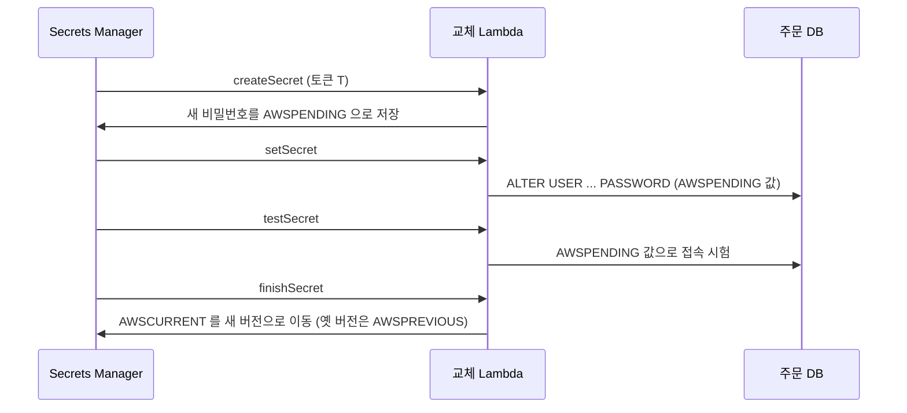

# M09-02. 비밀 관리 — Secrets Manager vs Parameter Store, 자동 교체
> 도메인: D1 · 예상 시간: 50분 · 실습 등급: 🟢

## 왜 필요한가

감사인이 TodayOrder 저장소를 열자 `application.yml`에 DB 비밀번호가, `.env`에 결제 대행사 API 키가 평문으로 있었다. 깃 기록에도 남아 있다. 게다가 이 비밀번호는 3년째 그대로다. 비밀은 **코드 밖**에, **암호화**해서, **누가 읽었는지 기록**되게, 그리고 **주기적으로 바꿔야** 한다. AWS에는 이 일을 하는 곳이 두 군데 있다: **Secrets Manager**와 **Systems Manager Parameter Store**.

## 핵심 개념

### 한 줄 구분

> **자동 교체(rotation)가 필요한 자격 증명(DB 비밀번호 등) → Secrets Manager. 설정값과 단순한 비밀, 무료·계층 관리 → Parameter Store.**

| | Secrets Manager | Parameter Store |
|---|---|---|
| 용도 | DB 자격 증명, API 키 등 **비밀** | 설정값(String/StringList) + 비밀(SecureString) |
| 자동 교체 | ✅ Lambda 교체 함수. RDS·Aurora·Redshift·DocumentDB는 AWS 제공 템플릿/관리형 교체 | ❌ (직접 구현해야 함) |
| 암호화 | 항상 KMS(기본 `aws/secretsmanager` 또는 고객 관리형 키) | SecureString만 KMS(`aws/ssm` 또는 고객 관리형) |
| 버전 | 스테이지 레이블 `AWSCURRENT`·`AWSPREVIOUS`·`AWSPENDING` | 버전 번호 + 레이블 |
| 크기 | 비밀 값 최대 64 KB | Standard 4 KB / Advanced 8 KB |
| 비용 | 비밀당 월 요금 + API 호출 요금 | **Standard 무료**, Advanced는 파라미터당 요금 |
| 다른 리전 복제 | ✅ `ReplicateSecretToRegions` | ❌ |
| 계층 | 이름에 `/`를 쓸 수는 있음 | `GetParametersByPath`로 **경로 단위 조회**가 핵심 기능 |
| 연결 | Parameter Store에서 `/aws/reference/secretsmanager/<이름>`으로 참조 가능 | |

### 버전 스테이지와 교체



- 앱은 항상 `AWSCURRENT`를 읽는다. 교체 중에도 옛 비밀번호가 유효하다가 `finishSecret` 순간에 넘어간다.
- Secrets Manager가 Lambda를 호출하려면 **Lambda 리소스 정책**에 `secretsmanager.amazonaws.com` 허용이 있어야 한다. Lambda가 DB에 닿으려면 VPC 설정, Secrets Manager에 닿으려면 VPC 엔드포인트나 NAT가 필요하다.
- 실패한 교체로 남은 `AWSPENDING`이 `AWSCURRENT`와 다른 버전에 붙어 있으면 다음 교체가 실패한다(교체 문제 해결의 단골).

## 직접 해 보기

### 1) Secrets Manager — [labs/lab04-secrets-manager.sh](./labs/lab04-secrets-manager.sh)

```bash
bash curriculum/m09-security-encryption/labs/lab04-secrets-manager.sh
```

```
== 1. 비밀 만들기 — 고객 관리형 KMS 키로 암호화
{
    "ARN": "arn:aws:secretsmanager:us-east-1:000000000000:secret:todayorder/m09/orders-db-QPU16r",
    "Name": "todayorder/m09/orders-db"
}
ARN 끝의 '-xxxxxx' 6자는 AWS가 붙이는 무작위 접미사다 (같은 이름을 지웠다 다시 만들어도 ARN 이 다르게)
== 2. 새 값 저장 → AWSCURRENT 는 새 버전으로, AWSPREVIOUS 는 옛 버전으로
  버전 77881740… → AWSPREVIOUS
  버전 02ed568a… → AWSCURRENT
AWSCURRENT : {"username":"orders_app","password":"v2-Changed!","host":"orders-db.todayorder.invalid","port":5432}
AWSPREVIOUS: {"username":"orders_app","password":"v1-Initial!","host":"orders-db.todayorder.invalid","port":5432}
== 3. 잘못 바꿨다! AWSCURRENT 를 옛 버전으로 되돌리기(롤백)
  버전 02ed568a… → AWSPREVIOUS
  버전 77881740… → AWSCURRENT
롤백 후 AWSCURRENT: {"username":"orders_app","password":"v1-Initial!","host":"orders-db.todayorder.invalid","port":5432}
```

방금 본 것: 값을 새로 넣으면 스테이지 레이블이 **자동으로 이동**한다. 롤백은 값을 다시 쓰는 것이 아니라 `update-secret-version-stage`로 `AWSCURRENT` 레이블을 옛 버전에 옮기는 것이다. IAM 정책에서는 ARN 접미사 때문에 `…:secret:todayorder/m09/orders-db-??????`처럼 와일드카드를 쓴다.

이제 진짜 자동 교체. 교체 함수(스크립트 안의 `lambda_function.py`)는 AWS 문서의 4단계 구조를 그대로 따르고, `setSecret`·`testSecret`은 DB가 없으므로 비워 뒀다.

```
== 4. Lambda 로 자동 교체 — 교체 함수(4단계: createSecret→setSecret→testSecret→finishSecret)
-- 리소스 정책 없이 교체 설정 (실패해야 정상: Secrets Manager 가 함수를 호출할 권한이 없다)
aws: [ERROR]: An error occurred (AccessDeniedException) when calling the RotateSecret operation: Secrets Manager cannot invoke the specified Lambda function. Ensure that the function policy grants access to the principal secretsmanager.amazonaws.com.
{
    "RotationEnabled": true,
    "Rules": {
        "AutomaticallyAfterDays": 30
    },
    "LastRotated": true
}
  버전 77881740… → AWSPREVIOUS
  버전 775b6070… → AWSCURRENT, AWSPENDING
교체 후 AWSCURRENT: {"username": "orders_app", "password": "lIr1geEmAb4L9WKzhyzGwphV", "host": "orders-db.todayorder.invalid", "port": 5432}
```

방금 본 것:
- `lambda add-permission --principal secretsmanager.amazonaws.com` 없이는 교체 설정 자체가 거부된다(처음 탐침 보고서의 "RotateSecret 오류"는 이 권한이 없을 때의 정상 동작이었다. 재생성된 FIDELITY.md는 교체 실행을 확인한다).
- 권한을 주자 에뮬레이터가 **Lambda를 실제로 4단계 호출**했고, 비밀번호가 무작위 값으로 바뀌었다. `RotateSecret`은 기본적으로 설정 즉시 한 번 교체한다.
- 새 버전에 `AWSCURRENT`와 `AWSPENDING`이 함께 붙어 있다. AWS 문서에 따르면 성공한 교체 후 `AWSPENDING`은 `AWSCURRENT`와 같은 버전에 붙어 있거나 아무 버전에도 없을 수 있다 — 정상이다.

```
== 5. 삭제는 '복구 기간'(7~30일, 지정하지 않으면 30일)을 거친다 → 그 사이 RestoreSecret 으로 되살릴 수 있다
{
    "Name": "todayorder/m09/orders-db",
    "DeletionDate": true
}
삭제 예약 중 조회 → InvalidRequestException) when calling the GetSecretValue operation: You can't perform this operation on the secret because it was marked for deletion.
todayorder/m09/orders-db
LAB04 OK
```

### 2) Parameter Store — [labs/lab05-parameter-store.sh](./labs/lab05-parameter-store.sh)

```
== 1. 계층형 이름으로 설정값 넣기 — String / StringList / SecureString
{
    "Version": 1,
    "Tier": "Standard"
}
/todayorder/prod/api/allowed-origins	StringList	Standard	-
/todayorder/prod/api/timeout-ms	String	Standard	-
/todayorder/prod/db/password	SecureString	Standard	alias/aws/ssm
/todayorder/prod/payment/api-key	SecureString	Standard	alias/todayorder-m09-params
== 2. SecureString 은 WithDecryption 없이 읽으면 암호문
SecureString	ASRlZDNiOTQ0OC05Zjk3LTQxZWEtODlkMS1lYzNhYjYyNDlmZjYWy7spFMTe2BtcasMYhpMVqSRlmYwOPzz+GDUxNreNpgX0aMmcHQ==
SecureString	S3cr3t-db!
== 3. 경로로 한꺼번에 — 앱은 시작할 때 자기 환경(prod)의 설정만 읽는다
/todayorder/prod/api/allowed-origins	https://todayorder.example,https://admin.todayorder.example
/todayorder/prod/api/timeout-ms	3000
/todayorder/prod/db/password	S3cr3t-db!
/todayorder/prod/payment/api-key	pk_live_example
Recursive: 4개 · Recursive 없이(바로 아래 단계만): 0개
```

방금 본 것: `/todayorder/prod/…`와 `/todayorder/dev/…`를 나누면 IAM 정책도 `arn:aws:ssm:…:parameter/todayorder/prod/*`처럼 **경로로** 줄 수 있다. `--recursive` 없이는 바로 아래 단계만 본다(여기서는 0개 — 전부 두 단계 아래).

```
== 4. SecureString 의 복호화는 KMS 를 거친다 — 키 정책으로 Decrypt 를 막으면 그 파라미터만 못 읽는다
payment/api-key(고객 관리형 키) → AccessDeniedException) when calling the GetParameter operation: User: arn:aws:iam::000000000000:user/emulator is not authorized to perform: kms:Decrypt on resource: arn:aws:kms:us-east-1:000000000000:key/d7da8c08-8c8e-44dd-b8f5-c4214079ebc8 with an explicit deny in a resource-based policy
db/password(aws/ssm 키) → S3cr3t-db!
-- 참고: 키를 '비활성화'하는 것으로는 에뮬레이터의 SSM 복호화가 막히지 않는다 (AWS와 다름)
비활성 키로 payment/api-key → pk_live_example
```

방금 본 것: SecureString을 읽으려면 **`ssm:GetParameter` + 그 키의 `kms:Decrypt`** 가 둘 다 필요하다. 고객 관리형 키를 쓰면 키 정책으로 "결제 키는 결제 서비스만"처럼 더 좁힐 수 있다. 단, 에뮬레이터의 SSM은 키 **비활성화**는 확인하지 않았다(실제 AWS에서는 비활성 키로 복호화가 실패한다).

```
== 5. 덮어쓰기는 --overwrite, 버전 이력과 레이블
aws: [ERROR]: An error occurred (ParameterAlreadyExists) when calling the PutParameter operation: The parameter already exists. To overwrite this value, set the overwrite option in the request to true.
2
1	3000
2	5000
1
이름:stable → 3000 · 이름:2 → 5000
== 6. 티어 — Standard 는 값 4KB(4096자)까지, 더 크면 Advanced
ValidationException) when calling the PutParameter operation: Standard tier parameters support a maximum parameter value of 4096 characters
Advanced
== 7. Parameter Store 에서 Secrets Manager 비밀 참조하기 (/aws/reference/secretsmanager/…)
{"apiKey":"pg_live_example"}
LAB05 OK
```

### 3) 앱에서 읽기 — [sdk/app_config_loader.py](./sdk/app_config_loader.py)

```
설정 로드: timeout=3000ms origins=['https://todayorder.example', 'https://admin.todayorder.example']
           payment_api_key=<11자 숨김> db=orders_app@orders-db.todayorder.invalid password=<10자 숨김>
요청 100번 뒤 AWS 호출 수: 2 (첫 로드 2)
교체 직후(TTL 안, 캐시): <10자 숨김> · TTL 지난 뒤: <12자 숨김> · 같은 값? False
정리 완료
SDK app_config_loader OK
```

방금 본 것: 요청마다 AWS를 부르지 않도록 **캐시**한다(호출 수 2에서 그대로). 대신 TTL이 지나면 다시 읽어 **교체된 비밀번호를 따라간다.** 예제는 실제 시간을 기다리지 않도록 **시계를 주입**해 "TTL 직전"과 "TTL 경과"를 흉내 냈고, 인증 오류가 나면 즉시 다시 읽는 `invalidate()`도 둔다. 캐시 TTL은 교체 주기보다 훨씬 짧아야 한다. 출력에는 비밀의 앞 글자조차 찍지 않고 길이만 보여 준다(로그에 비밀 일부가 남는 것도 유출이다). (Lambda라면 AWS가 제공하는 Parameters and Secrets Lambda Extension이 같은 캐시 역할을 한다.)

## 실제 AWS에서는

- Secrets Manager 버전 스테이지·교체 Lambda·삭제 복구, Parameter Store 계층·SecureString·버전·레이블·티어는 실제와 같게 관찰됐다.
- 다른 점: 에뮬레이터 SSM은 비활성화된 KMS 키로도 SecureString을 복호화했다. 공개 파라미터(`/aws/service/global-infrastructure/regions`)는 비어 있다.
- 실제 교체 함수는 DB에 접속해야 하므로 Lambda를 DB와 같은 VPC에 두고, Secrets Manager API에 닿도록 **인터페이스 VPC 엔드포인트** 또는 NAT를 준비한다. RDS는 `ManageMasterUserPassword`로 Secrets Manager가 마스터 비밀번호를 직접 관리·교체하게 할 수도 있다.
- 실제로 해 볼 때: Parameter Store Standard는 무료. Secrets Manager는 비밀당 월 요금이 있으니(신규 계정 무료 체험이 있을 수 있음) 실습 후 `aws secretsmanager delete-secret --secret-id <이름> --recovery-window-in-days 7`로 지운다.

## 시험 포인트

- "DB 자격 증명을 **자동으로 주기적 교체**" → **Secrets Manager**(RDS 연동). Parameter Store는 자동 교체가 없다.
- "설정값을 환경별 **계층**으로, **비용 없이**" → **Parameter Store(Standard)**. 비밀이면 **SecureString**.
- "비밀을 **다른 리전에도**(DR)" → **Secrets Manager 복제**.
- "교체가 실패한다 — Lambda가 호출되지 않음" → Lambda **리소스 정책**(secretsmanager.amazonaws.com). "Lambda가 Secrets Manager/DB에 못 닿음" → **VPC 엔드포인트/NAT·보안 그룹**.
- "CloudFormation/ECS 작업 정의에 비밀을 평문 없이 주입" → Secrets Manager/Parameter Store **참조**(ECS `secrets`, CFN 동적 참조).
- SecureString 조회 권한 = `ssm:GetParameter` + **`kms:Decrypt`**.

## 스스로 확인

1. 운영 DB 비밀번호를 90일마다 바꾸라는 규정이 생겼다. Parameter Store SecureString으로 충분한가?
2. 교체 직후 앱 일부 인스턴스가 "인증 실패"를 낸다. 캐시와 관련해 무엇을 의심하고, 어떻게 고치나?
3. lab04에서 `RotateSecret`이 처음에 거부된 이유는?

<details><summary>답</summary>

1. 저장·암호화는 되지만 **자동 교체가 없다.** 직접 스케줄러·함수를 만들어야 한다. Secrets Manager의 관리형 교체(RDS)가 정답에 가깝다.
2. 옛 비밀번호를 오래 캐시하고 있는 인스턴스. 캐시 TTL을 짧게 하고, 인증 실패 시 캐시를 비우고 `AWSCURRENT`를 다시 읽는다(sdk/app_config_loader.py는 TTL이 지나면 새 값을 읽고, `invalidate()`로 즉시 버릴 수도 있다). 교체 함수는 새 비밀번호가 유효해진 뒤(`testSecret`) `AWSCURRENT`를 옮긴다.
3. 교체 Lambda의 리소스 정책에 `secretsmanager.amazonaws.com`의 `lambda:InvokeFunction` 허용이 없었다(`add-permission` 후 성공).

</details>
