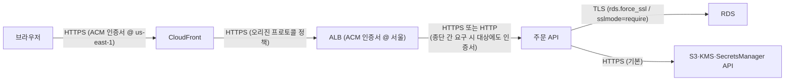

# M09-03. 인증서(ACM)와 전송 중 암호화
> 도메인: D1 · 예상 시간: 35분 · 실습 등급: 🟢 가져오기 · 🟡 DNS 검증 요청 · 🔴 발급

## 왜 필요한가

레슨 1·2는 **저장된 데이터**(at rest)를 지켰다. 감사인의 다음 질문은 "사용자 브라우저에서 ALB까지, ALB에서 서버까지, 서버에서 DB까지 **오가는 데이터**(in transit)도 암호화되나요?"다. 그 답이 TLS이고, TLS에는 인증서가 필요하다. 인증서를 직접 사고·설치하고·만료 전에 갱신하는 일은 사고가 잦다(만료된 인증서로 서비스가 멈추는 일은 흔하다). **AWS Certificate Manager(ACM)** 는 공인 인증서를 무료로 발급하고 **자동 갱신**한다.

## 핵심 개념

| 항목 | 내용 |
|---|---|
| ACM 공인 인증서 | 무료. 도메인 소유를 **DNS 검증**(권장, 자동 갱신과 궁합) 또는 이메일 검증으로 증명하면 발급. ACM이 만료 전에 자동 갱신 |
| 쓸 수 있는 곳 | **ACM 통합 서비스**: ELB(ALB/NLB), CloudFront, API Gateway, App Runner 등. EC2 인스턴스에 직접 설치하려면 내보내기 가능한(exportable) 공인 인증서(유료 옵션)나 ACM Private CA·자체 인증서를 쓴다 |
| 리전 | 인증서는 **리전 리소스**. ALB에는 ALB와 **같은 리전**, CloudFront에는 **us-east-1**의 인증서 |
| 가져온(imported) 인증서 | 외부 CA에서 산 인증서를 ACM에 넣어 통합 서비스에 붙인다. **ACM이 자동 갱신하지 않는다** — 만료 전에 직접 다시 가져와야 한다(ACM은 만료 임박 이벤트를 EventBridge로 알린다) |
| ACM Private CA | 사내(비공개) 인증서를 발급하는 관리형 사설 CA. 내부 서비스 간 mTLS 등 |

### 전송 중 암호화 지도 (TodayOrder)



- S3 버킷 정책의 `"aws:SecureTransport": "false"` → Deny 로 **HTTP 접근을 금지**할 수 있다(시험 단골).
- 온프레미스 ↔ VPC: **Site-to-Site VPN**(IPsec)은 암호화, **Direct Connect** 자체는 암호화가 아니다(필요하면 DX 위 VPN 또는 MACsec).
- 종단 간 암호화가 규정이면: ALB에서 TLS를 풀고 대상에 다시 HTTPS로 보내거나, NLB의 **TLS 통과(TCP 리스너)** 로 서버가 직접 TLS를 종료.

## 직접 해 보기

[labs/lab06-acm-certificates.sh](./labs/lab06-acm-certificates.sh)를 실행한다.

```bash
bash curriculum/m09-security-encryption/labs/lab06-acm-certificates.sh
```

### 1) 자체 서명 인증서 가져오기 — 🟢

```
== 1. openssl 로 자체 서명 인증서 만들기 (사내 관리 API 용, 30일)
subject=CN=api.todayorder.internal
issuer=CN=api.todayorder.internal
notAfter=Dec 12 12:42:44 2026 GMT
== 2. ACM 으로 가져오기(import)
{
    "Domain": "api.todayorder.internal",
    "Type": "IMPORTED",
    "Status": "ISSUED",
    "KeyAlgorithm": "RSA-2048",
    "RenewalEligibility": "INELIGIBLE",
    "InUseBy": []
}
-- 가져온 인증서는 개인 키를 내보낼 수 없다(내보내기는 내보내기 가능 옵션으로 발급한 인증서만)
ValidationException) when calling the ExportCertificate operation: Certificate ARN: arn:aws:acm:us-east-1:000000000000:certificate/f021844c-eaac-4bbe-9f06-9836909e4365 is not an export enabled certificate
```

방금 본 것: `openssl req -x509 …`로 만든 인증서·개인 키를 `import-certificate`로 넣자 바로 `ISSUED`, 유형 `IMPORTED`다. `RenewalEligibility: INELIGIBLE` — **가져온 인증서는 ACM이 갱신해 주지 않는다**. 주체(subject)와 발급자(issuer)가 같은 것이 자체 서명의 표시이고, 브라우저는 이 인증서를 신뢰하지 않는다(사내 도구·테스트용).

### 2) 공인 인증서 요청(DNS 검증) — 🟡 요청·검증 레코드 / 🔴 발급

```
== 3. 공인 인증서 요청 — DNS 검증 (api.todayorder.kr)
{
    "Status": "PENDING_VALIDATION",
    "Type": "AMAZON_ISSUED",
    "Validation": {
        "Method": "DNS",
        "Status": "PENDING_VALIDATION",
        "Record": {
            "Name": "_52319207bbe0b212b60abd3139b6ff73.api.todayorder.kr.",
            "Type": "CNAME",
            "Value": "_68f21c3792d52e894cd22cb841926bf5.e5e9449fd0.acm-validations.aws."
        }
    }
}
== 4. 검증 CNAME 을 Route 53 에 넣는다 (실제 AWS라면 이걸로 발급·자동 갱신이 된다)
CNAME 반영됨(INSYNC). 20초 동안 상태를 지켜본다:
관찰한 상태: PENDING_VALIDATION PENDING_VALIDATION PENDING_VALIDATION PENDING_VALIDATION
```

방금 본 것: ACM은 "이 이름의 CNAME을 이 값으로 만들어 보라"고 알려 준다. 도메인을 통제하는 사람만 만들 수 있으니 소유 증명이 된다. 이 CNAME을 **지우지 않고 두면** ACM이 갱신할 때도 같은 레코드로 다시 검증한다(그래서 DNS 검증이 자동 갱신에 유리하다). 에뮬레이터는 실제 DNS 검증을 하지 않으므로 Route 53에 레코드를 넣어도 **`PENDING_VALIDATION`에서 멈춘다.**

```
== 5. 예약 도메인(.example)으로 요청하면 에뮬레이터는 곧 FAILED 로 바꾼다
FAILED	ADDITIONAL_VERIFICATION_REQUIRED
== 6. 목록
api.todayorder.example	FAILED	AMAZON_ISSUED
api.todayorder.kr	PENDING_VALIDATION	AMAZON_ISSUED
api.todayorder.internal	ISSUED	IMPORTED
LAB06 OK
```

`.example`·`.test`·`.local` 같은 예약 도메인은 에뮬레이터가 곧바로 `FAILED`로 바꾼다. 그래서 이 lab은 DNS 검증 요청에 `todayorder.kr`을 썼다(에뮬레이터 안에서만 쓰는 이름이며 실제 DNS는 건드리지 않는다).

## 실제 AWS에서는

- DNS 검증 CNAME을 만들면 보통 수 분~수십 분 안에 `ISSUED`가 된다. Route 53 영역이면 콘솔의 "Route 53에서 레코드 생성" 버튼으로 끝난다. 에뮬레이터에서는 발급을 볼 수 없다(🔴).
- ACM 인증서를 ALB 리스너나 CloudFront에 붙이면 `InUseBy`에 그 리소스가 나타나고, 사용 중인 인증서는 지울 수 없다.

**실제 AWS에서 해 보려면**
- 비용: ACM 공인 인증서는 무료(통합 서비스에 쓸 때). 필요한 것은 **내가 소유한 도메인**과 그 DNS를 수정할 권한이다. Route 53 호스팅 영역은 월 요금이 있다.
- `aws acm request-certificate --domain-name api.<내 도메인> --validation-method DNS` → `describe-certificate`의 `ResourceRecord`를 DNS에 추가 → `aws acm wait certificate-validated --certificate-arn <ARN>`.
- 정리: 리스너 등에서 떼어 낸 뒤 `aws acm delete-certificate --certificate-arn <ARN>`, 검증 CNAME 삭제.

## 시험 포인트

- "인증서 발급·**자동 갱신**을 관리 부담 없이" → **ACM(DNS 검증)**. "외부 CA 인증서를 ALB에" → ACM **가져오기** — 갱신은 **직접**(만료 알림은 EventBridge·Config 규칙 `acm-certificate-expiration-check`).
- "CloudFront 커스텀 도메인 HTTPS" → **us-east-1**의 ACM 인증서. "ALB" → ALB와 같은 리전.
- "S3에 **HTTPS로만** 접근" → 버킷 정책 `aws:SecureTransport=false` Deny.
- "**사내 전용** 인증서 대량 발급(mTLS, 내부 서비스)" → **ACM Private CA**.
- "Direct Connect 구간 암호화" → DX 위 **VPN**(또는 MACsec). DX 단독은 암호화가 아니다.
- "TLS를 **서버에서** 종료(종단 간)" → **NLB TCP 통과** 또는 ALB → 대상 HTTPS.

## 스스로 확인

1. 외부 CA에서 산 인증서를 ACM으로 가져와 ALB에 붙였다. 1년 뒤 서비스가 인증서 만료로 멈췄다. 왜 ACM이 갱신하지 않았나?
2. 서울 리전에서 발급한 ACM 인증서를 CloudFront 배포에 붙이려 한다. 목록에 안 보인다. 이유는?
3. DNS 검증과 이메일 검증 중 자동 갱신에 유리한 쪽과 그 이유는?

<details><summary>답</summary>

1. 가져온 인증서는 `RenewalEligibility: INELIGIBLE`(lab06 2단계) — ACM은 자기가 발급한 인증서만 자동 갱신한다. 만료 전에 새 인증서를 다시 가져와야 한다.
2. CloudFront는 **us-east-1**의 ACM 인증서만 쓴다. us-east-1에서 다시 요청한다.
3. DNS 검증. 검증 CNAME을 남겨 두면 ACM이 갱신 때 사람 개입 없이 다시 검증할 수 있다. 이메일 검증은 갱신 때마다 누군가 메일의 링크를 눌러야 한다.

</details>
