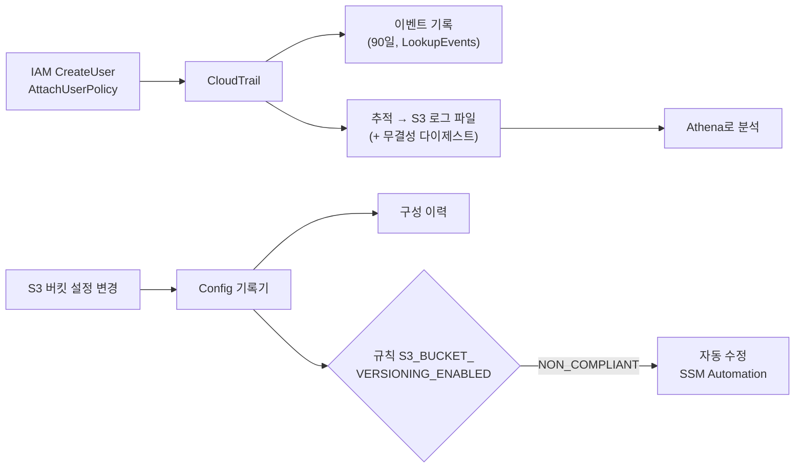

# M09-04. 감사와 규정 준수 — CloudTrail, Config, Audit Manager, Artifact
> 도메인: D1 · 예상 시간: 55분 · 실습 등급: 🟡 CloudTrail · 🟢 Config

## 왜 필요한가

금요일 밤, 누군가 운영 계정에 IAM 사용자를 만들고 `AdministratorAccess`를 붙였다. 월요일 아침 감사인이 묻는다. "**누가, 언제, 어디서** 그랬나요?" 그리고 "영수증 버킷 중에 버전 관리가 꺼진 것이 있나요? **지금 이 순간** 규정을 어기는 리소스는?" 첫 질문은 **CloudTrail**(API 호출 기록), 둘째 질문은 **AWS Config**(리소스 구성 기록과 규칙 평가)의 몫이다. 감사 보고서 준비는 **Audit Manager**, AWS 자신의 인증서(ISO, SOC, PCI)는 **AWS Artifact**에서 받는다.

## 핵심 개념

### CloudTrail vs Config — 한 줄 구분

> **CloudTrail = "누가 무엇을 했나(API 호출 로그)". Config = "리소스가 어떤 상태였고 지금 규칙에 맞나(구성 이력 + 준수 평가)".**

| | CloudTrail | AWS Config |
|---|---|---|
| 기록 단위 | API 호출 이벤트(누가·언제·어디서·무엇을·결과) | 리소스의 **구성 항목**(configuration item) — 바뀔 때마다 스냅샷 |
| 질문 | "보안 그룹 0.0.0.0/0을 **누가** 열었나?" | "보안 그룹이 **언제부터** 열려 있었나? 지금 규칙 위반인가?" |
| 기본 제공 | **이벤트 기록**: 최근 90일 관리 이벤트, 무료, 설정 없이 조회 | 없음 — 기록기를 켜야 한다 |
| 장기 보관 | **추적(trail)** → S3(+ CloudWatch Logs), 조직 추적, 무결성 검증 | 전달 채널 → S3, 집계자(aggregator)로 다계정·다리전 |
| 이벤트 종류 | **관리 이벤트**(리소스 생성·변경, 기본 기록) / **데이터 이벤트**(S3 객체 Get/Put, Lambda Invoke — 추가 설정·과금) / Insights(비정상 API 호출량) | – |
| 규칙·조치 | – (EventBridge로 연동) | **관리형/사용자 지정 규칙**, 적합성 팩, **자동 수정**(SSM Automation) |



### Audit Manager와 Artifact

| 서비스 | 한 줄 |
|---|---|
| **AWS Audit Manager** | 내 AWS 사용에 대해 **감사 증거를 자동 수집**하고 프레임워크(CIS, PCI DSS, GDPR 등)별 평가 보고서를 만든다 — "감사 준비를 자동화" |
| **AWS Artifact** | **AWS 자체**의 규정 준수 보고서(SOC, ISO, PCI 증명 등)와 계약(BAA 등)을 내려받는 포털 — "AWS가 인증받았다는 증빙" |
| AWS Config 적합성 팩 | 규칙 + 수정 조치를 묶어 한 번에 배포하는 템플릿 |

## 직접 해 보기

### 1) CloudTrail — [labs/lab07-cloudtrail.sh](./labs/lab07-cloudtrail.sh)

```bash
bash curriculum/m09-security-encryption/labs/lab07-cloudtrail.sh
```

```
== 1. 로그 버킷 — 정책 없이 추적을 만들면? (실패해야 정상)
aws: [ERROR]: An error occurred (InsufficientS3BucketPolicyException) when calling the CreateTrail operation: Incorrect S3 bucket policy is detected for bucket: todayorder-m09-trail-logs
== 2. CloudTrail 이 이 추적에서만 쓰도록 허용하는 버킷 정책
== 3. 멀티 리전 추적 + 로그 파일 무결성 검증 → 로깅 시작
{
    "Name": "todayorder-m09-trail",
    "MultiRegion": true,
    "Validation": true,
    "Global": true
}
IsLogging: True
-- 관리 이벤트(기본) + 특정 버킷의 S3 데이터 이벤트(객체 단위, 별도 과금)를 기록
{
    "Mgmt": true,
    "Data": [
        "arn:aws:s3:::todayorder-receipts/"
    ]
}
```

방금 본 것: 추적은 버킷 정책이 `cloudtrail.amazonaws.com`의 `GetBucketAcl`·`PutObject`(`AWSLogs/<계정>/…`, `bucket-owner-full-control`)를 허용해야 만들어진다. 정책의 `aws:SourceArn`을 이 추적으로 제한해 다른 추적이 쓰지 못하게 했다. **멀티 리전 추적**은 모든 리전의 이벤트를, **로그 파일 무결성 검증**은 시간별 다이제스트 파일로 로그가 삭제·변조되지 않았음을 증명한다.

```
== 4. 수상한 일 저지르기: 누군가 사용자를 만들고 관리자 권한을 붙인다 + 버킷도 하나 만든다
arn:aws:iam::000000000000:user/todayorder-m09-suspicious-user
== 5. LookupEvents(이벤트 기록, 최근 90일 관리 이벤트) 에서 찾기
-- EventName=CreateUser
CreateUser	iam.amazonaws.com	emulator	todayorder-m09-suspicious-user
-- EventName=AttachUserPolicy
AttachUserPolicy	iam.amazonaws.com	emulator	todayorder-m09-suspicious-user
-- EventName=CreateBucket (에뮬레이터는 S3 이벤트를 이벤트 기록에 남기지 않는다)
(없음)
-- 이벤트 원본 JSON 의 핵심 필드
{
  "eventTime": "2026-11-12T12:44:32Z",
  "eventSource": "iam.amazonaws.com",
  "eventName": "AttachUserPolicy",
  "awsRegion": "us-east-1",
  "sourceIPAddress": null,
  "userIdentity": {
    "type": "IAMUser",
    "arn": "arn:aws:iam::000000000000:user/emulator"
  },
  "requestParameters": {
    "userName": "todayorder-m09-suspicious-user",
    "policyArn": "arn:aws:iam::aws:policy/AdministratorAccess"
  }
}
```

방금 본 것: "누가(`userIdentity.arn`), 언제(`eventTime`), 무엇을(`eventName` + `requestParameters`)"가 그대로 남는다. 실제 이벤트에는 `sourceIPAddress`와 `userAgent`도 채워진다(에뮬레이터는 `null`). **S3 `CreateBucket`은 이벤트 기록에 나타나지 않았다** — 에뮬레이터 차이이며, 이 lab의 단언은 IAM 이벤트로 한다(🟡). 실제 AWS에서는 S3 버킷 수준 API(`CreateBucket`, `PutBucketPolicy`)도 관리 이벤트로 기록된다.

```
== 6. 추적은 같은 이벤트를 S3 에 gzip JSON 파일로 남긴다 (장기 보관·Athena 분석용)
AWSLogs/000000000000/CloudTrail/us-east-1/2026/11/12/000000000000_CloudTrail_us-east-1_20261112T1244Z_282e3d4238f246e1.json.gz
로그 파일 안에서 todayorder-m09-suspicious-user 관련 레코드: 2건
== 7. 정리: 로깅 중지 → 추적 삭제 (버킷의 로그 파일은 남는다)
LAB07 OK
```

로그 파일 경로 규칙 `AWSLogs/<계정>/CloudTrail/<리전>/<YYYY/MM/DD>/…json.gz`은 실제와 같다. 실제 AWS는 약 5분 간격으로 파일을 쓰고, 에뮬레이터는 거의 즉시 쓴다(시간에 기대지 말 것 — 스크립트는 폴링한다).

### 2) AWS Config — [labs/lab08-config-rule.sh](./labs/lab08-config-rule.sh)

```bash
bash curriculum/m09-security-encryption/labs/lab08-config-rule.sh
```

```
== 1. 기록기(configuration recorder) — 무엇을 기록할지 + Config 가 쓸 서비스 역할
== 2. 전달 채널 — 구성 기록을 보낼 S3 버킷. 버킷 정책이 없으면? (실패해야 정상)
aws: [ERROR]: An error occurred (InsufficientDeliveryPolicyException) when calling the PutDeliveryChannel operation: Insufficient delivery policy to s3 bucket: todayorder-m09-config-logs, unable to get s3 bucket acl.
기록 중: True
== 3. 평가 대상: 버전 관리를 켠 버킷 1개, 끈 버킷 1개
== 4. AWS 관리형 규칙 S3_BUCKET_VERSIONING_ENABLED
todayorder-m09-unversioned-1794496757   NON_COMPLIANT
todayorder-m09-versioned-1794496757     COMPLIANT
규칙 전체 판정(하나라도 위반이면 NON_COMPLIANT): NON_COMPLIANT
== 5. 고친다 → 다시 평가 → COMPLIANT
todayorder-m09-unversioned-1794496757: NON_COMPLIANT → COMPLIANT
== 6. 구성 이력 — 이 버킷의 구성 항목(configuration item)이 시간순으로 쌓인다
2026-11-13T00:19:38.628578+09:00	OK
2026-11-13T00:19:33.487814+09:00	ResourceDiscovered
```

방금 본 것:
- Config는 **기록기**(무엇을 기록할지 + 서비스 역할) + **전달 채널**(S3 버킷, 버킷 정책 필수) + **기록 시작**의 3단계로 켠다. 기록기·전달 채널은 계정·리전에 하나씩이다.
- 관리형 규칙이 실제로 버킷을 평가해 `NON_COMPLIANT`를 냈고, 버전 관리를 켜고 재평가하자 `COMPLIANT`가 됐다(🟢).
- 버킷의 구성 항목이 "발견(ResourceDiscovered) → 변경(OK)"으로 시간순으로 쌓였다. "언제부터 위반이었나"는 이 이력으로 답한다(그 변경을 **누가** 했는지는 CloudTrail).

```
== 7. 자동 수정(remediation): 위반 리소스에 SSM Automation 문서 AWS-ConfigureS3BucketVersioning 실행
0
-- 버전 관리 없이 새 버킷을 만든다: todayorder-m09-autofix-1794496757
todayorder-m09-autofix-1794496757	SUCCEEDED
todayorder-m09-autofix-1794496757 버전 관리: Enabled (사람이 켜지 않았다)
-- 정리: 자동 수정은 계정의 모든 버킷에 적용되므로 실습이 끝나면 지운다
LAB08 OK
```

방금 본 것: 자동 수정을 켜 두면 **새로 만든 위반 버킷의 버전 관리를 Config가 SSM Automation으로 직접 켠다.** 수정이 쓸 역할은 `ssm.amazonaws.com`이 맡고 `s3:PutBucketVersioning`만 할 수 있게 최소 권한으로 만들었다. 이 실습을 만들면서 겪은 함정: 자동 수정 설정을 지우지 않고 규칙만 지웠다가 다시 만들자, **이후 만든 모든 버킷에 버전 관리가 저절로 켜져** 실습이 엉뚱하게 COMPLIANT를 냈다. 그래서 스크립트는 시작과 끝에 자동 수정 설정을 먼저 지운다.

## 실제 AWS에서는

- CloudTrail 이벤트 기록은 모든 서비스의 관리 이벤트를 담는다. 에뮬레이터는 IAM(및 CloudTrail·STS 등 일부) 이벤트만 담고 S3·KMS 이벤트는 담지 않았다. 추적 로그 파일도 실제로는 약 5분 간격으로 쓰인다.
- Config 규칙 평가·자동 수정은 실제와 같게 관찰됐다. 실제로는 평가·수정까지 수 분이 걸릴 수 있다.

**실제 AWS에서 해 보려면** (CloudTrail 🟡 부분)
- 비용: 이벤트 기록 조회는 무료이고, **관리 이벤트의 첫 번째 추적 사본**은 무료다(S3 저장 비용만). 데이터 이벤트·두 번째 이후 사본·Insights는 과금된다. Config는 기록된 구성 항목과 규칙 평가 횟수만큼 과금되므로 실습은 리소스 유형을 좁혀서(`recording-group resourceTypes=AWS::S3::Bucket`) 하는 것이 좋다.
- `aws cloudtrail lookup-events --lookup-attributes AttributeKey=EventName,AttributeValue=CreateBucket`으로 S3 이벤트도 나오는지 확인해 본다.
- 정리: `aws cloudtrail delete-trail --name <추적>`, `aws configservice stop-configuration-recorder` → `delete-delivery-channel` → `delete-configuration-recorder`, 로그 버킷 비우고 삭제.

## 시험 포인트

- "**누가** 리소스를 지웠나/설정을 바꿨나" → **CloudTrail**. "리소스 설정이 **어떻게 바뀌어 왔나**, 지금 **규칙 위반**인가" → **Config**.
- "모든 계정·리전의 API 활동을 한 버킷에, 변조 방지" → **조직 추적(멀티 리전) + 로그 파일 무결성 검증** + 버킷 정책·S3 객체 잠금, 별도 로그 계정.
- "S3 **객체 단위** 읽기/쓰기 감사" → CloudTrail **데이터 이벤트**(기본 꺼짐).
- "비정상적으로 많은 API 호출 감지" → **CloudTrail Insights**. "CloudTrail 로그를 SQL로" → **Athena**(또는 CloudTrail Lake).
- "규정 위반 리소스를 **자동으로 고쳐라**" → **Config 규칙 + 자동 수정(SSM Automation)**. 여러 규칙 묶음 배포 → **적합성 팩**. 다계정 집계 → **집계자**.
- "감사용 **증거 수집 자동화**" → **Audit Manager**. "**AWS의** SOC/PCI 보고서를 감사인에게" → **AWS Artifact**.

## 스스로 확인

1. 보안 그룹에 0.0.0.0/0:22가 열려 있는 것을 발견했다. "언제부터 열려 있었나"와 "누가 열었나"를 각각 어느 서비스로 확인하나?
2. lab07에서 추적을 만들 때 처음 실패한 이유는?
3. lab08을 만들면서 "새 버킷이 저절로 버전 관리가 켜지는" 현상이 생겼다. 원인과, 운영에서 같은 기능을 쓸 때 주의할 점은?

<details><summary>답</summary>

1. 언제부터 → **Config** 구성 이력(그 보안 그룹의 구성 항목 타임라인). 누가 → **CloudTrail**(`AuthorizeSecurityGroupIngress` 이벤트의 `userIdentity`).
2. 로그 버킷에 CloudTrail 서비스 주체를 허용하는 버킷 정책이 없었다(`InsufficientS3BucketPolicyException`).
3. 이전 실행의 **자동 수정 설정(Automatic=true)** 이 남아 있어서, 규칙이 위반을 찾을 때마다 SSM Automation이 버전 관리를 켰다. 운영에서는 자동 수정이 계정 전체에 즉시 손을 댄다는 점을 알고, 수정 역할을 최소 권한으로, 범위(규칙의 Scope)를 좁게, 먼저 수동 수정으로 검증한 뒤 자동으로 바꾼다.

</details>
