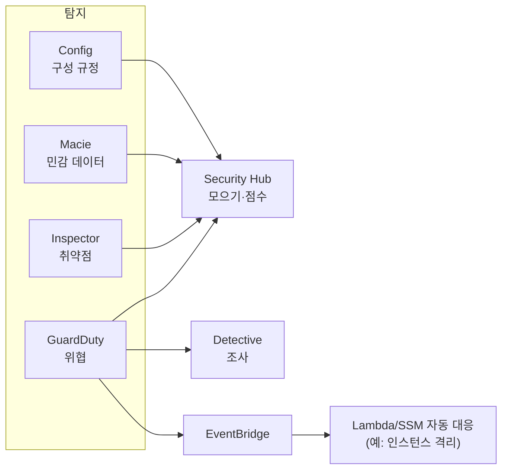

# M09-05. 위협 탐지 — GuardDuty, Inspector, Macie, Security Hub, Detective
> 도메인: D1 · 예상 시간: 35분 · 실습 등급: 🟡

## 왜 필요한가

CloudTrail과 Config는 "기록"이다. 수백만 줄의 기록에서 **이상한 것**을 사람이 찾을 수는 없다. 새벽 3시에 TodayOrder EC2 인스턴스가 비트코인 채굴 풀 도메인을 조회하기 시작했다면? 영수증 버킷에 카드 번호가 평문으로 들어 있다면? 배포한 컨테이너 이미지에 알려진 취약점이 있다면? AWS는 이것들을 **각각 다른 서비스**가 맡는다. 시험은 이 다섯 개를 헷갈리게 섞어 놓는다.

## 핵심 개념

### 한 줄 구분법 (외우자)

| 서비스 | 한 줄 | 보는 것 | 결과 예 |
|---|---|---|---|
| **GuardDuty** | **위협 탐지** — "지금 공격·침해가 일어나고 있나" | CloudTrail 이벤트, VPC Flow Logs, DNS 로그(+ S3·EKS·RDS·Lambda·런타임 보호 등) — **켜기만 하면 됨, 에이전트·로그 설정 불필요** | 채굴 도메인 조회, 탈취된 자격 증명이 AWS 밖에서 사용, 포트 스캔 |
| **Inspector** | **취약점 스캔** — "약점(CVE)·노출이 있나" | EC2(SSM 에이전트 또는 에이전트리스), ECR 컨테이너 이미지, Lambda 코드 | 패키지의 CVE, 인터넷에 열린 포트(네트워크 도달성) |
| **Macie** | **S3 민감 데이터 발견** — "버킷에 개인정보·카드 번호가 있나" | S3 객체 내용(머신 러닝·패턴) + 버킷 공개 여부 | 영수증 CSV에 신용카드 번호, 공개된 버킷 |
| **Security Hub** (현 이름 Security Hub **CSPM**) | **통합 대시보드·보안 표준 점검** — "한 화면에 모아 점수 매기기" | GuardDuty·Inspector·Macie·Config·서드파티 결과를 모으고 CIS·AWS 기본 보안 모범 사례 표준으로 점검 | 계정 보안 점수, 표준별 실패 컨트롤 |
| **Detective** | **조사(사후 분석)** — "이 결과의 원인·범위는" | GuardDuty 결과 + 로그로 만든 **행동 그래프** | 이 IAM 사용자가 지난주 어떤 IP에서 무엇을 했나 |

> **이름 변경 주의**: 2025년 12월 새 **AWS Security Hub**가 정식 출시되면서, 기존 서비스(ASFF 형식으로 결과를 모으고 CIS·AWS 기본 보안 모범 사례 표준으로 점수를 매기는 것)는 **AWS Security Hub CSPM**으로 이름이 바뀌어 따로 계속 제공된다. 새 Security Hub는 GuardDuty·Inspector·Macie·Security Hub CSPM의 신호를 OCSF 형식으로 상관 분석해 위험의 우선순위를 매긴다. 시험 가이드와 문제에는 대개 그냥 "Security Hub"로 나오며, 묻는 것은 "여러 보안 결과를 한곳에 모으고 표준 준수를 점검"이다. 이 레슨의 lab이 켜는 것(`securityhub enable-security-hub`, 표준 구독)은 CSPM 쪽 API다.

> 외우는 법: **G**uardDuty = **G**uard(경비원, 지금 수상한 행동), **I**nspector = **I**nspect(점검, 취약점), **M**acie = 데이터 속 개인정보, **Security Hub** = 허브(모으기), **Detective** = 형사(사후 조사).



### GuardDuty 결과(finding) 읽기

결과 유형 이름은 `위협 목적:리소스 유형/위협 패밀리.변형!탐지 방법` 형식이다. 예: `CryptoCurrency:EC2/BitcoinTool.B!DNS` = 암호 화폐 채굴 목적, 대상은 EC2, DNS 로그로 탐지. 심각도는 1.0\~10.0 값이고 **치명(Critical, 9.0\~10.0)·높음(7.0\~8.9)·중간(4.0\~6.9)·낮음(1.0\~3.9)** 네 단계로 나뉜다. 치명은 공격 시퀀스(여러 신호가 이어진 랜섬웨어형 공격 등)가 진행 중일 수 있다는 뜻이다. 탐지 후 자동 대응은 **EventBridge 규칙 → Lambda/SSM**으로 만든다(GuardDuty가 스스로 차단하지는 않는다).

## 직접 해 보기

[labs/lab09-guardduty-findings.sh](./labs/lab09-guardduty-findings.sh)를 실행한다. 에뮬레이터의 GuardDuty는 로그를 분석하지 않으므로 **진짜 위협은 탐지하지 않는다.** 실제 AWS에도 있는 `CreateSampleFindings`로 "[SAMPLE]" 결과를 만들어 읽는다(🟡).

```bash
bash curriculum/m09-security-encryption/labs/lab09-guardduty-findings.sh
```

```
== 1. 탐지기(detector) — 계정·리전당 하나. 이미 있으면 그대로 쓴다
새 탐지기: 9346e986ac9b29f7219700a1db9b0001
{
    "Status": "ENABLED",
    "Frequency": "FIFTEEN_MINUTES"
}
두 번째 탐지기 만들기 → BadRequestException
== 2. 샘플 결과 만들기 — TodayOrder 에 일어날 법한 세 가지
== 3. 결과 읽기 — 유형 이름이 곧 '무슨 일인가'다 (위협목적:리소스/위협이름)
 8.0 높음  CryptoCurrency:EC2/BitcoinTool.B!DNS                                   리소스=Instance     sample=True
 8.0 높음  UnauthorizedAccess:IAMUser/InstanceCredentialExfiltration.OutsideAWS   리소스=AccessKey    sample=True
 2.0 낮음  Recon:EC2/PortProbeUnprotectedPort                                     리소스=Instance     sample=True
{
    "2": 1,
    "8": 2
}
```

방금 본 것:
- 탐지기는 **리전마다 하나**다(두 번째는 `BadRequestException`). 여러 리전에서 쓰려면 리전마다 켜고, Organizations에서는 위임 관리자 계정이 전체를 켠다.
- `InstanceCredentialExfiltration.OutsideAWS` = EC2 인스턴스 역할의 임시 자격 증명이 **AWS 밖**에서 쓰였다 → 자격 증명 유출. 이런 결과가 뜨면 역할 세션을 무효화하고 인스턴스를 격리한다.
- `PortProbeUnprotectedPort`(낮음) = 보안 그룹이 열어 둔 포트를 누군가 두드린다 → 보안 그룹을 좁힐 근거.
- 샘플 결과에는 `sample=true` 표시가 붙는다.

```
== 4. 그 밖의 탐지·보안 서비스 — '켜져 있나'만 읽는다
Macie(S3 민감 데이터)            : ENABLED
Security Hub(통합 대시보드) 표준 :
   arn:aws:securityhub:us-east-1::standards/aws-foundational-security-best-practices/v/1.0.0
   arn:aws:securityhub:::ruleset/cis-aws-foundations-benchmark/v/1.2.0
Inspector(취약점 스캔) 계정 상태 :
   DISABLED	DISABLED	DISABLED
Detective(조사용 행동 그래프)    : arn:aws:detective:us-east-1:000000000000:graph:14bfa9eb4b43a24dcf4132162720a19c
LAB09 OK
```

방금 본 것: Security Hub를 기본 표준으로 켜면 **AWS 기본 보안 모범 사례**와 **CIS 벤치마크** 표준이 구독된다. Inspector는 스캔 대상(EC2·ECR·Lambda)을 각각 켠다(여기서는 모두 꺼짐). 에뮬레이터에서 이 서비스들은 켜기·상태 조회까지만 의미가 있다.

## 실제 AWS에서는

- GuardDuty는 켜는 순간부터 CloudTrail·VPC Flow Logs·DNS 로그를 **사용자가 따로 설정하지 않아도** 독립적으로 분석한다. 에뮬레이터는 샘플 결과만 만든다.
- 에뮬레이터에서 GuardDuty 결과가 EventBridge로 전달되는 것은 관찰되지 않았다(규칙 `source=aws.guardduty` → SQS로 시험, 도착 안 함). Security Hub에도 GuardDuty 결과가 모이지 않았다.
- Inspector 스캔, Macie 민감 데이터 발견 작업, Detective 그래프 분석은 실제 데이터가 있어야 의미가 있다.

**실제 AWS에서 해 보려면**
- 비용: GuardDuty·Inspector·Macie·Security Hub·Detective는 대부분 **30일 무료 체험**이 있고, 그 뒤 분석량만큼 과금된다. 체험 기간 안에 끄는 것을 잊지 말 것.
- `aws guardduty create-detector --enable` → `aws guardduty create-sample-findings --detector-id <ID>` → 콘솔에서 결과 확인 → EventBridge 규칙(`{"source": ["aws.guardduty"]}`)을 SNS 이메일로 연결해 알림까지.
- 정리: `aws guardduty delete-detector --detector-id <ID>`, `aws securityhub disable-security-hub`, `aws macie2 disable-macie`, `aws inspector2 disable --resource-types EC2 ECR LAMBDA`, `aws detective delete-graph --graph-arn <ARN>`.

## 시험 포인트

- "계정에서 **악의적 활동·침해 징후**(채굴, 자격 증명 유출, 비정상 API)를 **에이전트 없이** 탐지" → **GuardDuty**.
- "EC2·**컨테이너 이미지(ECR)**·Lambda의 **소프트웨어 취약점(CVE)** 스캔" → **Inspector**.
- "S3에 **개인정보(PII)·카드 번호**가 있는지 찾아라" → **Macie**.
- "여러 보안 서비스 결과를 **한곳에 모으고** CIS·모범 사례 **준수 점수**" → **Security Hub**.
- "GuardDuty 결과의 **근본 원인·영향 범위를 조사**" → **Detective**.
- "탐지되면 **자동 대응**" → GuardDuty/Security Hub → **EventBridge** → Lambda·SSM Automation.
- 보기에 "GuardDuty로 취약점 패치", "Inspector로 S3 개인정보", "Macie로 EC2 위협" 같은 **뒤섞인 짝**은 오답.

## 스스로 확인

1. "ECR에 올린 컨테이너 이미지에 알려진 취약점이 있는지 푸시할 때마다 검사"하려면? GuardDuty가 아닌 이유는?
2. `UnauthorizedAccess:IAMUser/InstanceCredentialExfiltration.OutsideAWS` 결과를 이름만 보고 해석하라.
3. 보안팀이 "GuardDuty, Inspector, Macie 결과를 서로 다른 콘솔에서 보느라 힘들다"고 한다. 무엇을 제안하나?

<details><summary>답</summary>

1. **Inspector**(ECR 향상된 스캔). GuardDuty는 행동(로그) 기반 위협 탐지이고 이미지 속 패키지 취약점을 스캔하지 않는다.
2. 무단 접근(UnauthorizedAccess) 목적, 대상은 IAM 사용자/자격 증명, **EC2 인스턴스의 자격 증명이 AWS 밖에서 사용됨** → 인스턴스 역할의 임시 자격 증명이 유출됐다.
3. **Security Hub** — 여러 서비스의 결과를 표준 형식(ASFF)으로 모으고 우선순위를 매긴다. 조사가 필요하면 Detective로 이어진다.

</details>
