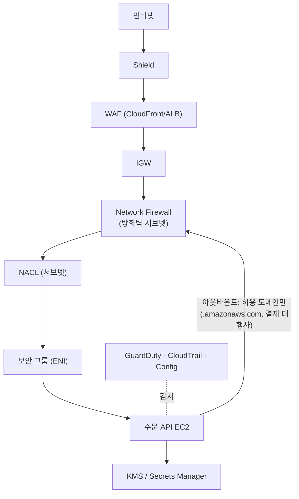

# M09-06. 네트워크·앱 방어 복습과 심층 방어 — WAF, Shield, Network Firewall
> 도메인: D1 · 예상 시간: 30분 · 실습 등급: 🟡

## 왜 필요한가

감사의 마지막 질문: "공격자가 한 겹을 뚫으면 그다음은 무엇이 막나요?" 보안은 문 하나가 아니라 **여러 겹**이다(심층 방어, defense in depth). M08에서 엣지(WAF·Shield)를, M02에서 VPC(보안 그룹·NACL)를, 이 모듈에서 데이터(KMS·Secrets Manager)와 탐지(CloudTrail·Config·GuardDuty)를 봤다. 이 레슨은 그것들을 한 장으로 묶고, 아직 다루지 않은 **AWS Network Firewall**을 더한다. TodayOrder 주문 서버가 해킹당해도 **아무 데로나 데이터를 보내지 못하게**(아웃바운드 통제) 하는 것이 목표다.

## 핵심 개념

### 계층별 방어선

| 계층 | 서비스 | 막는 것 | 성격 |
|---|---|---|---|
| 엣지 | **Shield Standard**(자동) / Advanced | L3/L4 DDoS | 무료 자동 / 유료 구독 |
| 엣지·L7 | **WAF** (CloudFront·ALB·API Gateway…) | SQLi·XSS·봇·속도 남용·국가 | 규칙 기반 HTTP 필터 |
| VPC 경계 | **Network Firewall** | VPC로 들고 나는 트래픽: 도메인(SNI/Host) 허용 목록, Suricata 규칙(IPS), 프로토콜 | 관리형 상태 저장 방화벽, **방화벽 서브넷 + 라우팅**으로 끼워 넣음 |
| DNS | **Route 53 Resolver DNS Firewall** | VPC에서 나가는 DNS 질의 중 악성 도메인 | 도메인 목록 차단 |
| 서브넷 | **NACL** | IP·포트, 허용/**거부** | 상태 비저장, 번호 순 평가 |
| 인스턴스(ENI) | **보안 그룹** | IP·포트·다른 SG, **허용만** | 상태 저장 |
| 데이터 | **KMS**, Secrets Manager, S3 버킷 정책·퍼블릭 액세스 차단 | 유출돼도 읽지 못하게 | 암호화·접근 통제 |
| 탐지·감사 | CloudTrail, Config, GuardDuty, Security Hub | 사후 추적·지속 점검 | 기록·탐지 |
| 중앙 관리 | **Firewall Manager** | 위 정책을 여러 계정에 일괄 | Organizations |



### Network Firewall vs 보안 그룹 vs NACL vs WAF

| 요구 | 답 |
|---|---|
| "VPC에서 나가는 트래픽을 **도메인 이름**(FQDN) 허용 목록으로" | **Network Firewall**(상태 저장 도메인 목록) — SG·NACL은 IP만 본다 |
| "알려진 공격 시그니처로 **침입 탐지·차단(IDS/IPS)**" | **Network Firewall**(Suricata 호환 규칙) |
| "특정 IP를 **명시적으로 거부**" | **NACL**(SG는 거부 규칙이 없다) 또는 WAF IP 세트(HTTP) |
| "SQL 인젝션" | **WAF** |
| "서버별 포트 허용" | **보안 그룹** |
| "타사 방화벽 어플라이언스를 투명하게 끼워 넣기" | **Gateway Load Balancer**(M03) |

## 직접 해 보기

[labs/lab10-network-firewall.sh](./labs/lab10-network-firewall.sh)는 주문 서버의 **아웃바운드 허용 목록**을 Network Firewall 규칙 그룹과 방화벽 정책으로 만든다. 에뮬레이터는 트래픽을 흘리지 않으므로 **구성만** 확인한다(🟡). 실제 방화벽 엔드포인트를 만들고 라우팅 테이블을 바꾸는 부분은 "실제 AWS에서 해 보려면"에 정리했다.

```bash
bash curriculum/m09-security-encryption/labs/lab10-network-firewall.sh
```

```
== 1. 상태 저장 규칙 그룹 — 도메인 허용 목록(ALLOWLIST)
{
    "Name": "todayorder-m09-egress-allowlist",
    "Type": "STATEFUL",
    "Capacity": 100,
    "Status": "ACTIVE"
}
{
    "Targets": [
        ".amazonaws.com",
        "api.payments.example"
    ],
    "TargetTypes": [
        "TLS_SNI",
        "HTTP_HOST"
    ],
    "GeneratedRulesType": "ALLOWLIST"
}
== 2. 방화벽 정책 — 상태 비저장 기본 동작은 '상태 저장 엔진으로 넘김', 상태 저장은 위 규칙 그룹
{
    "Name": "todayorder-m09-egress-policy",
    "Status": "ACTIVE"
}
정책에 연결된 상태 저장 규칙 그룹: 1개
```

방금 본 것:
- **도메인 목록 규칙**은 HTTPS의 **SNI**(TLS 핸드셰이크에 보이는 서버 이름)와 HTTP의 **Host** 헤더를 본다. 패킷을 복호화하지 않고도 "어느 도메인으로 가려는지"를 판단한다. `.amazonaws.com`처럼 점으로 시작하면 하위 도메인 전체다.
- `ALLOWLIST`로 만들면 목록에 없는 도메인으로의 HTTP/HTTPS는 막힌다. 해킹된 서버가 공격자 서버로 데이터를 보내려는 시도(데이터 유출)를 막는 마지막 겹이다.
- 정책의 상태 비저장 기본 동작 `aws:forward_to_sfe`는 "상태 비저장 규칙에 안 걸린 패킷은 상태 저장 엔진(stateful engine)으로 넘겨라"라는 뜻이다.

```
== 3. 계층별 방어선 점검표 (TodayOrder) — 각 계층에 무엇이 있나
  엣지      : CloudFront + WAF(관리형 규칙·속도 제한) + Shield Standard(자동)   ← M08 lab06
  VPC 경계  : Network Firewall(아웃바운드 도메인 허용 목록)                    ← 이 lab
  서브넷    : NACL(상태 비저장, 허용/거부 규칙)                               ← M02
  인스턴스  : 보안 그룹(상태 저장, 허용만)                                     ← M02
  데이터    : KMS 암호화 · 키 정책 · Secrets Manager                           ← M09 lab01~05
  탐지·감사 : CloudTrail · Config · GuardDuty                                ← M09 lab07~09
LAB10 OK
```

## 실제 AWS에서는

- 실제 Network Firewall은 `create-firewall`로 AZ별 **방화벽 엔드포인트**를 전용 서브넷에 만들고, 애플리케이션 서브넷·IGW의 라우팅 테이블이 그 엔드포인트(`vpce-…`)를 거치게 바꿔야 트래픽을 검사한다. 이 lab은 규칙 그룹·정책까지만 만든다.
- WAF는 M08 lab06에서 실제 차단까지 관찰했다. Shield Advanced·Firewall Manager는 구독·조직 전제라 개념으로 다룬다.

**실제 AWS에서 해 보려면**
- 비용: Network Firewall은 **방화벽 엔드포인트마다 시간당 요금 + 처리한 데이터(GB)당 요금**이 붙고 프리 티어가 없다. 몇 시간 실습으로도 요금이 나오니 끝나면 바로 지운다.
- 순서: VPC에 방화벽 서브넷(AZ당 하나) → `aws network-firewall create-firewall --firewall-policy-arn … --subnet-mappings SubnetId=…` → `describe-firewall`에서 엔드포인트 ID 확인 → 앱 서브넷 라우팅 `0.0.0.0/0 → 방화벽 엔드포인트`, IGW 라우팅(엣지 연결) `앱 서브넷 CIDR → 방화벽 엔드포인트` → EC2에서 `curl https://example.com`(차단)과 `curl https://s3.amazonaws.com`(허용) 비교.
- 정리: 라우팅 원복 → `delete-firewall` → `delete-firewall-policy` → `delete-rule-group`.

## 시험 포인트

- "VPC 아웃바운드를 **도메인 이름 허용 목록**으로 제한", "VPC 전체에 **IPS/IDS**" → **AWS Network Firewall**.
- "VPC의 **DNS 질의**로 악성 도메인 접근 차단" → **Route 53 Resolver DNS Firewall**.
- "특정 IP 대역 **거부**" → **NACL**(SG는 거부 불가). "웹 공격(L7)" → **WAF**. "DDoS" → **Shield**.
- "여러 계정에 방화벽·WAF·SG 정책을 일괄" → **Firewall Manager**.
- 심층 방어 문제는 "한 겹만 고르는 보기"를 경계한다 — 엣지(WAF/Shield) + 네트워크(SG/NACL/Network Firewall) + 데이터(KMS) + 탐지(GuardDuty)를 **조합**한 보기가 정답인 경우가 많다.

## 스스로 확인

1. 해킹된 EC2가 공격자의 서버(`evil.example`)로 주문 데이터를 HTTPS로 보내려 한다. 보안 그룹의 아웃바운드 규칙으로 막기 어려운 이유와, 막을 수 있는 서비스는?
2. Network Firewall 도메인 목록 규칙은 HTTPS 트래픽을 복호화하지 않고 어떻게 도메인을 아나?
3. "공격 IP 203.0.113.0/24를 VPC 서브넷 단위에서 거부"하라. 보안 그룹, NACL, WAF 중 무엇이 맞나?

<details><summary>답</summary>

1. 보안 그룹은 IP·포트만 보고 도메인을 모른다. 443 아웃바운드를 열어 두면 어느 HTTPS 서버로든 나간다. **Network Firewall**의 도메인 허용 목록(SNI 기반)이나 **Route 53 Resolver DNS Firewall**로 막는다.
2. TLS 핸드셰이크의 **SNI**(Server Name Indication)는 평문으로 보인다. 그 서버 이름을 목록과 비교한다(HTTP는 Host 헤더).
3. **NACL**(거부 규칙 가능, 서브넷 단위). 보안 그룹은 허용만 있다. WAF는 HTTP 계층이고 ALB·CloudFront 같은 리소스 단위다.

</details>
