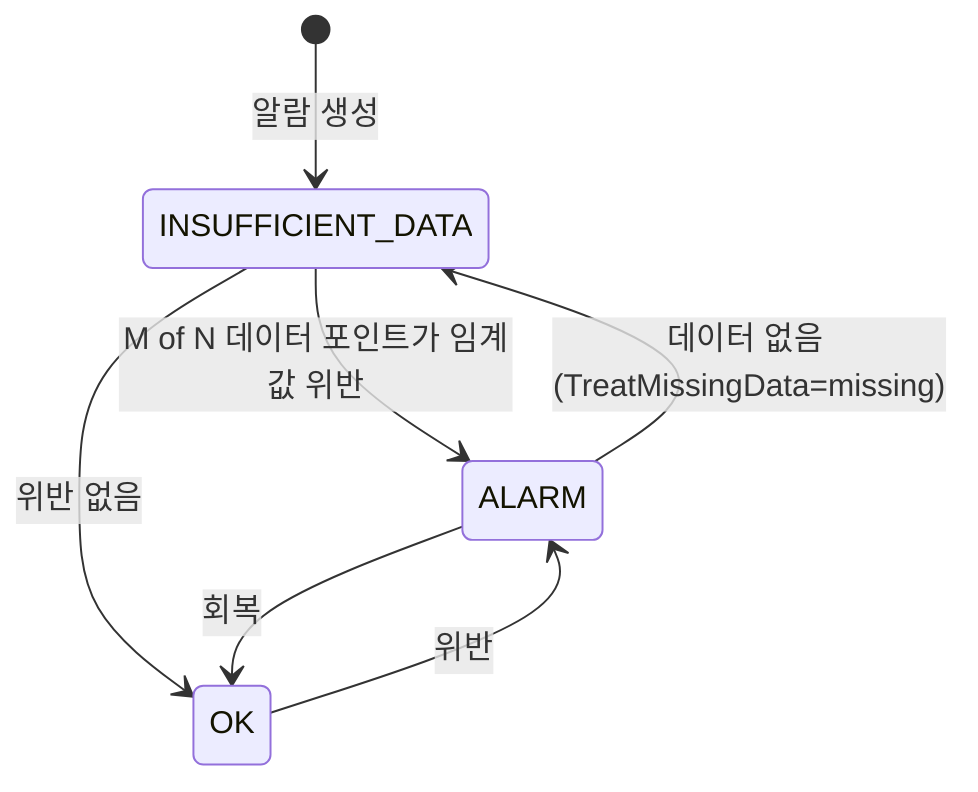
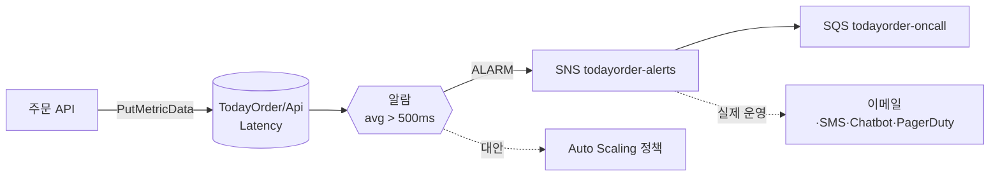

# M10-01. CloudWatch 지표와 알람
> 도메인: D2 · 예상 시간: 55분 · 실습 등급: 🟢

## 왜 필요한가

새벽 3시, TodayOrder 주문 API가 느려졌다. 고객 문의가 쌓인 다음에야 팀이 알았다. "느려지면 사람이 먼저 알게 하자"가 이 레슨의 목표다. 서버 한 대 시절에는 `top`과 `tail -f`로 버텼지만, 서버가 여러 대이고 관리형 서비스(RDS, Lambda, SQS)까지 섞이면 **숫자를 한곳에 모으고, 기준을 넘으면 자동으로 알리는** 장치가 필요하다. 그게 Amazon CloudWatch의 지표(metric)와 알람(alarm)이다.

## 핵심 개념

### 지표의 정체: (네임스페이스, 이름, 차원) + 시계열

- **지표(metric)** — 시간에 따라 찍히는 숫자 열. 예: "POST /orders 의 지연 시간".
- **네임스페이스(namespace)** — 지표를 담는 칸. AWS 서비스는 `AWS/EC2`, `AWS/SQS`처럼 `AWS/` 로 시작한다. 내 앱 지표는 `TodayOrder/Api` 처럼 직접 정한다.
- **차원(dimension)** — 지표를 쪼개는 이름=값 꼬리표. `Route=POST /orders`. 지표 하나에 최대 30개. **차원 조합이 다르면 다른 지표**이고, 사용자 지정 지표는 차원끼리 자동으로 합쳐 주지 않는다.
- **통계(statistic)** — 기간(period) 안의 데이터 포인트를 요약한 값: `Average`, `Sum`, `Minimum`, `Maximum`, `SampleCount`, 백분위(`p99`).
- **해상도(resolution)** — 표준(1분)과 고해상도(1초, `StorageResolution=1`). 고해상도 지표에만 10초·30초 알람을 걸 수 있다(요금이 더 비싸다).

데이터 보존 기간(AWS 문서 기준): 1분 미만 3시간 → 1분 15일 → 5분 63일 → 1시간 455일(15개월). 오래될수록 거친 단위로 합쳐진다.

### 기본 지표에 없는 것: 메모리와 디스크 (시험 단골)

EC2가 공짜로 주는 기본 지표는 **하이퍼바이저가 밖에서 볼 수 있는 것**뿐이다: CPU 사용률, 네트워크 입출력, 디스크 I/O 횟수, 상태 확인. **메모리 사용률·디스크 남은 용량·프로세스 수는 게스트 OS 안에서만 보인다** → 인스턴스에 **CloudWatch 에이전트**를 설치해 사용자 지정 지표로 보내야 한다.

| 모니터링 | 주기 | 비용 |
|---|---|---|
| 기본 모니터링 (EC2) | 5분 | 무료 |
| 세부 모니터링 (EC2) | 1분 | 유료 |
| 사용자 지정 지표 (`PutMetricData`, 에이전트) | 1분 또는 1초(고해상도) | 유료 |

### 알람: 상태 기계



- **Period × EvaluationPeriods × DatapointsToAlarm** — "최근 N개 구간 중 M개가 위반이면 ALARM" (M of N). 순간 튀는 값에 깨지 않게 하는 장치다.
- **TreatMissingData** — 데이터가 안 올 때: `missing`(판단 보류) · `notBreaching`(정상 취급) · `breaching`(위반 취급) · `ignore`(직전 상태 유지). 하트비트 지표가 끊기면 장애로 보고 싶다면 `breaching`.
- **액션** — 상태가 **바뀔 때** 실행: SNS 알림, EC2 Auto Scaling 정책, EC2 동작(중지·종료·재부팅·복구), Systems Manager OpsItem. 상태에 "머물러 있다"고 반복 실행하지 않는다.
- **복합 알람(composite alarm)** — 여러 알람을 `AND`/`OR`/`NOT`으로 묶는다. "지연 높음 AND 5xx 많음"일 때만 당직을 깨워 **알람 피로**를 줄인다.
- **지표 수학(metric math)** — `100*errors/requests` 처럼 지표끼리 계산한 값에 알람을 건다.



## 직접 해 보기

### 1) 사용자 지정 지표 게시와 조회 — [lab01-custom-metrics.sh](./labs/lab01-custom-metrics.sh)

주문 API의 지연 시간 3건(120·250·900ms)과 주문 수를 게시한다.

```bash
aws cloudwatch put-metric-data --namespace TodayOrder/Api --metric-name Latency --unit Milliseconds \
  --dimensions "Route=POST /orders,Run=$RUN" --value 120     # 250, 900 도 같은 방식
aws cloudwatch list-metrics --namespace TodayOrder/Api --dimensions Name=Run,Value=$RUN \
  --query 'Metrics[].{Metric: MetricName, Dims: join(`, `, Dimensions[].Name)}' --output table
```

```
--------------------------------
|          ListMetrics         |
+-------------+----------------+
|    Dims     |    Metric      |
+-------------+----------------+
|  Route, Run |  Latency       |
|  Run        |  OrdersPlaced  |
+-------------+----------------+
```

방금 본 것: `PutMetricData`는 응답 본문이 없다. 지표는 "만드는" API가 따로 없고 **처음 게시할 때 생긴다.** 지표는 지울 수도 없다(데이터가 끊기면 15개월 뒤 만료). 그래서 lab은 실행마다 `Run` 차원 값을 바꿔 새 지표를 쓴다.

```bash
aws cloudwatch get-metric-statistics --namespace TodayOrder/Api --metric-name Latency \
  --dimensions "Name=Route,Value=POST /orders" "Name=Run,Value=$RUN" \
  --start-time "$START" --end-time "$END" --period 3600 --statistics Average Maximum SampleCount
```

```
{
    "Label": "Latency",
    "Datapoints": [
        {
            "Timestamp": "2026-11-12T21:06:00+09:00",
            "SampleCount": 3.0,
            "Average": 423.3333333333333,
            "Maximum": 900.0,
            "Unit": "Milliseconds"
        }
    ]
}
```

방금 본 것: 평균 423ms는 "괜찮아 보이지만" 최댓값 900ms가 숨어 있다. 지연 시간은 평균보다 **최댓값·백분위(p99)** 로 봐야 꼬리 지연을 놓치지 않는다. 조회할 때도 게시한 **차원 조합 그대로**(`Route`+`Run`)를 줘야 한다 — `Route`만 주면 아무것도 안 나온다.

`get-metric-data`는 여러 지표를 한 번에 읽고 **지표 수학**을 할 수 있다. 지연 합계 ÷ 주문 수:

```
[
    {
        "Label": "LatencyPerOrder",
        "Values": [
            423.3333333333333
        ]
    }
]
```

마지막으로 EC2 기본 지표를 찾아본다.

```
== 5. EC2 기본 지표(AWS/EC2)가 있나? (실제 AWS: 인스턴스가 돌면 CPUUtilization 등이 저절로 생김)
AWS/EC2 지표 개수: 0
```

방금 본 것: 에뮬레이터의 EC2 인스턴스는 부팅하지 않으므로 `AWS/EC2` 지표가 없다. 실제 AWS에서는 인스턴스가 뜨면 `CPUUtilization` 등이 저절로 생기지만, **거기에도 메모리 지표는 없다.**

### 2) 알람이 스스로 ALARM → SNS → SQS — [lab02-alarm-sns-sqs.sh](./labs/lab02-alarm-sns-sqs.sh)

당직 큐(`todayorder-oncall`)를 SNS 토픽에 구독시키고, **큐 정책**으로 그 토픽만 메시지를 넣을 수 있게 한다(정책이 없으면 알림이 조용히 버려진다 — M06).

```bash
aws cloudwatch put-metric-alarm --alarm-name todayorder-api-latency-high \
  --namespace TodayOrder/Api --metric-name Latency --dimensions "Name=Route,Value=POST /orders" \
  --statistic Average --period 10 --evaluation-periods 1 --datapoints-to-alarm 1 \
  --threshold 500 --comparison-operator GreaterThanThreshold --treat-missing-data missing \
  --alarm-actions "$TOPIC" --ok-actions "$TOPIC"
```

```
{
    "State": "INSUFFICIENT_DATA",
    "Period": 10,
    "Threshold": 500.0
}
```

느린 요청(800·900·1000ms)을 **고해상도**로 게시하면서 상태를 폴링한다.

```bash
aws cloudwatch put-metric-data --namespace TodayOrder/Api --metric-data \
  '[{"MetricName":"Latency","Unit":"Milliseconds","StorageResolution":1,"Values":[800,900,1000],"Dimensions":[{"Name":"Route","Value":"POST /orders"}]}]'
```

```
{
    "State": "ALARM",
    "Reason": "Threshold Crossed: 1 out of the last 1 datapoints [900.0 (12/11/26 12:16:40)] was greater than the threshold (500.0) (minimum 1 datapoint for OK -> ALARM transition)."
}
```

당직 큐에 도착한 알림(원문 전달 `RawMessageDelivery=true`라 SNS 봉투 없이 알람 JSON 그대로):

```
{
  "AlarmName": "todayorder-api-latency-high",
  "OldStateValue": "INSUFFICIENT_DATA",
  "NewStateValue": "ALARM",
  "NewStateReason": "Threshold Crossed: 1 out of the last 1 datapoints [900.0 (12/11/26 12:16:40)] was greater than the threshold (500.0) (minimum 1 datapoint for OK -> ALARM transition)."
}
```

```
|  Action             |  Successfully executed action arn:aws:sns:us-east-1:000000000000:todayorder-alerts   |
|  StateUpdate        |  Alarm updated from INSUFFICIENT_DATA to ALARM                                       |
|  ConfigurationUpdate|  Alarm created                                                                       |
```

방금 본 것: 누구도 상태를 바꾸지 않았다. **게시된 데이터만으로** 알람이 평가되어 ALARM이 되었고, 액션이 실행되어 SNS → SQS로 알림이 왔다. 알람 이력(`describe-alarm-history`)에 상태 변경과 액션 실행이 남는다.

### 3) `set-alarm-state`와 복합 알람

`set-alarm-state`는 데이터 없이 상태를 강제로 바꾼다 — **알림 경로(SNS 구독, 당직 도구)를 시험할 때** 쓴다. 다음 평가 주기에 실제 데이터로 다시 계산되므로 "알람을 끄는" 용도가 아니다.

```bash
aws cloudwatch set-alarm-state --alarm-name todayorder-api-5xx-high --state-value ALARM --state-reason "lab02: 알림 경로 점검"
aws cloudwatch put-composite-alarm --alarm-name todayorder-api-degraded \
  --alarm-rule 'ALARM("todayorder-api-latency-high") AND ALARM("todayorder-api-5xx-high")' --alarm-actions "$TOPIC"
```

```
{
    "State": "ALARM",
    "Rule": "ALARM(\"todayorder-api-latency-high\") AND ALARM(\"todayorder-api-5xx-high\")"
}
== 8. 5xx 경보를 OK 로 되돌리면 복합 알람도 OK
복합 알람: OK
```

방금 본 것: 두 하위 알람이 모두 ALARM일 때만 복합 알람이 ALARM이 된다. 하나가 OK로 돌아오면 복합 알람도 OK. 지울 때는 **복합 알람을 먼저** 지워야 한다(하위 알람이 참조되고 있으므로).

## 실제 AWS에서는

- 알람 평가는 실제로는 분 단위 지연이 있다. 에뮬레이터에서 10초 Period 알람이 금방 ALARM이 된 것을 "AWS는 10초면 알린다"로 받아들이지 말 것. 실습 스크립트도 시간을 가정하지 않고 상태를 폴링한다.
- EC2·RDS·ELB·SQS 등은 `AWS/*` 지표를 **자동으로** 보낸다. 에뮬레이터에는 이 기본 지표가 없다.
- 메모리·디스크 지표는 **CloudWatch 에이전트**(Systems Manager로 배포·설정 가능)를 설치해야 생긴다.
- 알림 채널: SNS 이메일 구독은 확인 메일을 눌러야 활성화된다. Slack/Teams로 보내려면 AWS Chatbot(Amazon Q Developer in chat applications)을 쓴다.

## 시험 포인트

- "EC2 **메모리** 사용률을 보고 싶다 / 디스크 여유 공간으로 알람" → **CloudWatch 에이전트**(사용자 지정 지표). 기본 지표에는 없다.
- "1분보다 촘촘하게" → 세부 모니터링(1분)·**고해상도 사용자 지정 지표**(1초) + 10/30초 알람.
- "CPU 70% 넘으면 서버 추가" → 알람 액션 = **Auto Scaling 정책**(요즘은 대상 추적 정책이 알람을 알아서 만든다). "사람에게 알림" → SNS.
- "알람이 너무 자주 울린다" → **M of N(DatapointsToAlarm)**, **복합 알람**.
- "인스턴스 상태 확인 실패 시 자동 복구" → 알람 액션의 **EC2 recover**(같은 인스턴스 ID·IP 유지).
- 지표는 리전 단위 · 지울 수 없음 · 15개월 후 만료. 차원 조합이 다르면 다른 지표.

## 스스로 확인

1. 평균 지연 시간 알람이 조용한데 고객은 느리다고 한다. 무엇을 의심하고 어떤 통계로 바꿀 것인가?
2. 결제 워커가 1분마다 하트비트 지표를 보낸다. 워커가 죽어 지표가 끊기면 알람을 울리고 싶다. `TreatMissingData`를 무엇으로 둘 것인가?
3. `set-alarm-state`로 ALARM을 만들었는데 잠시 뒤 OK로 돌아갔다. 왜인가?

<details><summary>답</summary>

1. 평균이 꼬리 지연을 가린다(lab01: 평균 423ms, 최댓값 900ms). `p99`(백분위)나 `Maximum`으로 알람을 건다.
2. `breaching` — 데이터가 없으면 위반으로 본다. `missing`이면 INSUFFICIENT_DATA로 가서 액션이 실행되지 않을 수 있다.
3. `set-alarm-state`는 일시적이다. 다음 평가 주기에 실제 지표 데이터로 다시 판정한다. 알림 경로 테스트용이다.
</details>
