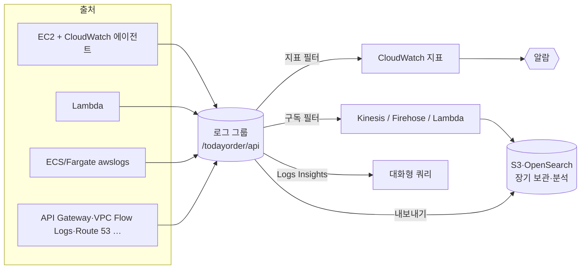

# M10-02. CloudWatch Logs와 X-Ray 개요
> 도메인: D2 · 예상 시간: 50분 · 실습 등급: 🟢

## 왜 필요한가

알람이 "주문 API가 느리다"고 알려 줬다. 이제 **왜** 느린지 알아야 한다. 서버 세 대에 SSH로 들어가 `grep`하던 방식은 서버가 오토 스케일링으로 사라지면 로그도 함께 사라진다. TodayOrder 팀은 모든 서버·Lambda의 로그를 **한곳에 모아 보존 기간을 정하고, 검색하고, 로그에서 숫자를 뽑아 알람까지** 걸고 싶다. CloudWatch Logs가 그 자리다.

## 핵심 개념

| 용어 | 뜻 | 비유 없이 한 줄 |
|---|---|---|
| 로그 이벤트 | 타임스탬프 + 메시지 한 줄 | `tail -f`에 찍히는 한 줄 |
| 로그 스트림 | 같은 출처(인스턴스 하나, Lambda 실행 환경 하나)의 이벤트 순서열 | 파일 하나 |
| 로그 그룹 | 같은 설정(보존 기간·권한·암호화·필터)을 공유하는 스트림 묶음 | `/var/log/todayorder/` 디렉터리 |
| 보존 기간 | 그룹 단위. 1일~10년 중 **정해진 값**만. 기본은 **무기한 보관** | 안 정하면 요금이 계속 쌓인다 |
| 지표 필터 | 로그 패턴 → CloudWatch 지표 | "ERROR 줄 개수"를 지표로 |
| 구독 필터 | 로그 → Kinesis Data Streams / Data Firehose / Lambda / OpenSearch 로 실시간 전달 | 로그 파이프 |
| Logs Insights | 로그 그룹에 대한 대화형 쿼리 언어 | 로그용 SQL |



### 구조화 로그(JSON)를 쓰는 이유

`2026-11-12 ERROR payment failed order=A-1003` 같은 문자열 로그는 사람이 읽기 좋지만 기계가 뽑기 어렵다. 한 줄에 JSON 하나를 쓰면 `{ $.status >= 500 }` 같은 **필드 기반 필터**와 Insights의 `stats ... by route` 가 그대로 된다. 더 나아가 **EMF(Embedded Metric Format)** 블록을 JSON에 넣으면 CloudWatch가 로그에서 지표를 직접 뽑는다 — `PutMetricData`를 따로 부를 필요가 없다(Lambda에서 특히 유용).

### 필터 패턴 세 가지

| 패턴 | 예 | 맞는 것 |
|---|---|---|
| 용어 | `ERROR` | ERROR 라는 단어가 든 이벤트 |
| 구문 | `"payment failed"` | 그 구문이 그대로 든 이벤트 |
| JSON | `{ $.level = "ERROR" }`, `{ $.latency_ms > 1000 }` | 필드 조건을 만족하는 JSON 이벤트 |

### X-Ray (개요)

로그는 "서버 하나에서 무슨 일이 있었나", 지표는 "숫자가 어떻게 변했나"를 보여 준다. **분산 추적(tracing)** 은 "요청 하나가 API Gateway → Lambda → DynamoDB → SQS를 지나며 어디서 시간을 썼나"를 보여 준다. AWS X-Ray는 요청에 추적 ID를 붙여 구간(segment)별 시간을 모으고 **서비스 맵**을 그린다. 시험에서는 "마이크로서비스 사이의 병목·오류 지점을 찾고 싶다 → X-Ray"로 나온다.

> 참고: AWS X-Ray SDK·데몬은 2026-02-25부터 유지 관리 모드(보안 수정만)이고, 이후 지원 종료 일정은 X-Ray 개발자 안내서의 "X-Ray SDK and Daemon Support timeline"에 있다. 새 코드는 **OpenTelemetry**(AWS Distro for OpenTelemetry)로 계측해 X-Ray로 보내는 것을 권장한다. X-Ray 서비스 자체가 없어지는 것은 아니다.

## 직접 해 보기

[lab03-logs-metric-filter-insights.sh](./labs/lab03-logs-metric-filter-insights.sh)

### 1) 로그 그룹과 보존 기간

```bash
aws logs create-log-group --log-group-name /todayorder/api
aws logs put-retention-policy --log-group-name /todayorder/api --retention-in-days 10
```

```
aws: [ERROR]: An error occurred (InvalidParameterException) when calling the PutRetentionPolicy operation: Invalid retention value. Valid values are: [1, 3, 5, 7, 14, 30, 60, 90, 120, 150, 180, 365, 400, 545, 731, 1096, 1827, 2192, 2557, 2922, 3288, 3653]
```

방금 본 것: 보존 기간은 아무 숫자나 안 된다. 정해진 값 중 하나(14로 다시 설정). 보존 기간을 **아예 설정하지 않으면 무기한**이라는 점이 운영 비용의 함정이다.

### 2) 지표 필터 두 개

```bash
aws logs put-metric-filter --log-group-name /todayorder/api --filter-name errors \
  --filter-pattern '{ $.level = "ERROR" }' \
  --metric-transformations "[{\"metricName\":\"$ERR_METRIC\",\"metricNamespace\":\"TodayOrder/Logs\",\"metricValue\":\"1\",\"defaultValue\":0}]"
aws logs put-metric-filter --log-group-name /todayorder/api --filter-name latency \
  --filter-pattern '{ $.latency_ms = * }' \
  --metric-transformations "[{\"metricName\":\"$LAT_METRIC\",\"metricNamespace\":\"TodayOrder/Logs\",\"metricValue\":\"\$.latency_ms\",\"unit\":\"Milliseconds\"}]"
```

```
--------------------------------------
|        DescribeMetricFilters       |
+----------+-------------------------+
|   Name   |         Pattern         |
+----------+-------------------------+
|  errors  |  { $.level = "ERROR" }  |
|  latency |  { $.latency_ms = * }   |
+----------+-------------------------+
```

방금 본 것: 첫 필터는 맞는 줄마다 `1`을, 둘째는 JSON 필드 `latency_ms`의 **값**을 지표로 보낸다. 지표 필터는 **만든 뒤에 들어온 로그에만** 적용된다(과거 로그를 소급하지 않는다). 그래서 필터를 먼저 만들고 로그를 쓴다.

### 3) 구조화 로그 5건 쓰고 찾기

```bash
aws logs put-log-events --log-group-name /todayorder/api --log-stream-name api-1 --log-events "$EVENTS"
aws logs filter-log-events --log-group-name /todayorder/api --filter-pattern '{ $.status >= 500 }' --query 'events[].message' --output text
```

```
{"level": "ERROR", "route": "POST /orders", "status": 500, "latency_ms": 2300, "msg": "payment failed"}	{"level": "ERROR", "route": "POST /orders", "status": 502, "latency_ms": 1800, "msg": "payment timeout"}
-- (b) 구문(phrase) 패턴 "payment failed"
{"level": "ERROR", "route": "POST /orders", "status": 500, "latency_ms": 2300, "msg": "payment failed"}
```

### 4) 로그가 지표가 되었다

```
ApiErrors1794485847 Sum=2.0   ApiLatency1794485847 Maximum=2300.0
```

방금 본 것: ERROR 로그 2건 → `ApiErrors` 합계 2, 지연 최댓값 2300ms. 이제 이 지표에 레슨 1의 알람을 걸면 "5분간 ERROR 5건 이상이면 당직 호출"이 된다. (지표 이름 끝의 숫자는 lab이 실행마다 붙이는 접미사 — 지표는 지울 수 없어서.)

### 5) Logs Insights

```
stats count(*) as requests, avg(latency_ms) as avg_ms, max(latency_ms) as max_ms by route | sort requests desc
```

```
[
    {
        "route": "POST /orders",
        "requests": "3",
        "avg_ms": "1406.6666666666667",
        "max_ms": "2300"
    },
    {
        "route": "GET /orders",
        "requests": "2",
        "avg_ms": "470",
        "max_ms": "900"
    }
]
```

```
fields @timestamp, status, msg | filter status >= 500 | sort @timestamp desc
```

```
[
    {
        "@timestamp": "2026-11-12 12:17:50.003",
        "status": "502",
        "msg": "payment timeout"
    },
    {
        "@timestamp": "2026-11-12 12:17:50.002",
        "status": "500",
        "msg": "payment failed"
    }
]
```

방금 본 것: JSON 로그의 필드가 자동으로 열이 된다. Insights는 `start-query` → `get-query-results` 폴링의 **비동기** API다(Athena와 같은 모양).

### 6) boto3: 구조화 로그 전송기 — [sdk/structured_logger.py](./sdk/structured_logger.py)

로그를 버퍼에 모았다가 `PutLogEvents` 한 번으로 보내고(호출 수 = 비용·스로틀링), 각 줄에 EMF 블록을 넣어 지표까지 만든다. EMF 차원에 실행마다 바뀌는 `run` 값을 넣어, 지울 수 없는 이전 실행의 지표 때문에 확인이 저절로 통과하지 않게 했다.

```
로그 그룹 /todayorder/sdk/api / 스트림 api-401cbab2
보낸 로그: 7건
Insights(레벨별): [{"level": "INFO", "n": "4", "max_ms": "180"}, {"level": "ERROR", "n": "2", "max_ms": "3000"}, {"level": "WARN", "n": "1", "max_ms": "950"}]
EMF 지표 TodayOrder/EMF/latency_ms(route=POST /orders, run=401cbab2) 생성: True
SDK structured_logger OK
```

## 실제 AWS에서는

- EC2의 로그 파일을 보내려면 **CloudWatch 에이전트**(로그 + 메모리·디스크 지표)를 설치한다. Lambda는 런타임이 stdout을 `/aws/lambda/<함수>` 그룹으로 보낸다(실행 역할에 `logs:CreateLogStream`·`PutLogEvents` 권한 필요).
- 로그 수집(GB당)·저장(GB-월)·Insights 스캔(GB당) 각각에 요금이 붙는다. 보존 기간 설정과 장기 보관용 S3 내보내기(또는 Firehose 구독)를 함께 설계한다.
- 로그 그룹은 KMS 키로 암호화할 수 있고, 교차 계정 중앙 로깅은 구독 필터 + 대상(destination)으로 만든다.
- Insights의 일부 함수는 에뮬레이터에서 실패했다(`pct()` 백분위 → `Failed`). 실습에 쓴 `stats count/avg/max`, `filter`, `sort`, `fields` 는 동작했다.

## 시험 포인트

- "로그에서 특정 오류 문자열이 N번 나오면 알림" → **지표 필터 → 알람 → SNS**.
- "로그를 실시간으로 다른 시스템(OpenSearch·S3·분석)에 흘려보내기" → **구독 필터**(Kinesis / Firehose / Lambda). 정기·일회성 보관은 S3 내보내기.
- "로그를 즉석에서 SQL처럼 검색·집계" → **CloudWatch Logs Insights**. "S3에 쌓인 오래된 로그를 SQL로" → Athena(M11).
- "마이크로서비스 호출 경로에서 지연 구간 찾기" → **X-Ray**(서비스 맵·트레이스).
- "누가 API를 호출했나(감사)" → CloudTrail(M09). 애플리케이션 로그(CloudWatch Logs)와 혼동하지 말 것.
- 보존 기간 기본값 = **무기한**. 비용 문제는 보존 기간 설정으로.

## 스스로 확인

1. 지표 필터를 오늘 만들었는데 어제 발생한 ERROR 로그가 지표에 반영되지 않았다. 왜인가?
2. 로그를 30일 동안은 빠르게 검색하고, 7년 동안은 싸게 보관해야 한다. 어떻게 나눌 것인가?
3. 로그(Logs)·지표(Metrics)·추적(X-Ray)은 각각 어떤 질문에 답하는가?

<details><summary>답</summary>

1. 지표 필터는 만든 뒤에 수집된 로그에만 적용된다. 과거 로그를 집계하려면 Logs Insights로 조회한다.
2. 로그 그룹 보존 기간 30일 + 구독 필터(Firehose)나 내보내기로 S3에 저장하고, S3 수명 주기로 Glacier 계열로 전환한다.
3. 로그: "그때 무슨 일이 있었나(개별 이벤트)". 지표: "얼마나·어떤 추세인가(숫자)". 추적: "요청 하나가 어느 구간에서 시간을 썼나(서비스 간 경로)".
</details>
