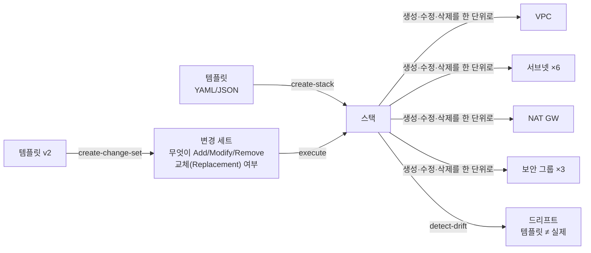
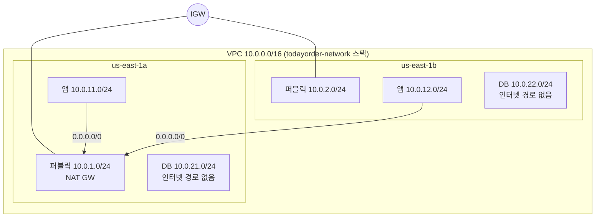

# M10-03. CloudFormation: 인프라를 코드로
> 도메인: D2 · 예상 시간: 60분 · 실습 등급: 🟢 (드리프트 🟡, VPC 스택 변경 세트 🔴)

## 왜 필요한가

M02에서 3-티어 VPC를 CLI 명령 수십 개로 만들었다. 스테이징 환경을 하나 더 만들어야 한다면? 누가 콘솔에서 보안 그룹을 몰래 바꿨다면? 장애 후 다른 리전에 똑같이 다시 세워야 한다면? 명령을 다시 치는 것은 느리고 틀린다. TodayOrder 팀은 인프라를 **선언문(템플릿)** 으로 저장해 Git으로 리뷰하고, 같은 템플릿으로 몇 번이고 같은 환경을 만들고 지우고 싶다. 그게 AWS CloudFormation이다.

## 핵심 개념



- **템플릿** — "무엇이 있어야 하는가"를 적은 문서. **스택** — 그 템플릿으로 실제 만든 리소스 묶음. 스택 단위로 만들고, 바꾸고, **통째로 지운다.**
- **실패하면 되돌린다** — 생성 중 리소스 하나가 실패하면 기본적으로 이미 만든 리소스까지 모두 지우고 `ROLLBACK_COMPLETE`. 업데이트가 실패하면 이전 상태로 `UPDATE_ROLLBACK_COMPLETE`. (디버깅용으로 `--on-failure DO_NOTHING`·`--disable-rollback`도 있다.)
- **변경 세트(change set)** — 업데이트를 바로 하지 않고 "무엇이 바뀌는지"를 먼저 계산해 보여 준다. 특히 `Replacement: True`(리소스를 **지우고 새로 만듦** — DB라면 데이터 유실 위험)를 실행 전에 잡는다. 웹 서비스의 `terraform plan`과 같은 자리다.
- **드리프트(drift)** — 누가 콘솔·CLI로 스택 밖에서 리소스를 바꿔 템플릿과 실제가 달라진 상태. `detect-stack-drift`로 찾는다. 찾기만 하고 고쳐 주지는 않는다.
- **스택 세트(StackSets)** — 한 템플릿을 **여러 계정·여러 리전**에 한 번에 배포(Organizations와 함께 쓰면 새 계정에 자동 배포).
- 그 밖의 보호 장치: **종료 보호**(실수로 스택 삭제 방지), **DeletionPolicy: Retain/Snapshot**(스택을 지워도 버킷·DB는 남기거나 스냅샷), **스택 정책**(업데이트로 특정 리소스를 못 바꾸게).

| 리소스 속성·기능 | 언제 쓰나 |
|---|---|
| `DeletionPolicy: Retain / Snapshot / RetainExceptOnCreate` | 스택(또는 리소스)을 지울 때 실제 리소스를 남기거나 스냅샷을 뜬다 |
| `UpdateReplacePolicy: Retain / Snapshot` | 업데이트로 리소스가 **교체**될 때 옛 리소스를 남기거나 스냅샷 |
| `CreationPolicy` + `cfn-signal` (또는 WaitCondition) | EC2·ASG가 "만들어졌다"가 아니라 **부트스트랩(사용자 데이터) 완료 신호**를 보낼 때까지 CREATE_COMPLETE를 미룬다. 신호가 안 오면 실패 → 롤백 |
| 롤백 트리거 | 생성·업데이트 **중**과, 모든 리소스를 배포한 뒤의 **모니터링 기간**(0~180분, 기본 0) 동안 지정한 CloudWatch 알람이 `ALARM`이 되면 스택 작업 전체를 자동 롤백 ([롤백 트리거](https://docs.aws.amazon.com/AWSCloudFormation/latest/UserGuide/using-cfn-rollback-triggers.html)) |

### 템플릿 해부

| 섹션 | 역할 | 이 모듈의 예 |
|---|---|---|
| `Parameters` | 실행할 때 넣는 값 (`AllowedValues`로 제한) | `VpcCidr`, `EnvName` |
| `Mappings` | 고정된 조회표 (리전별 AMI 등) | – |
| `Conditions` | 조건부 생성 (`prod`일 때만 NAT 2개) | – |
| `Resources` | **유일한 필수 섹션.** 만들 리소스 | 25개 |
| `Outputs` | 결과값 출력, `Export`로 다른 스택과 공유 | `VpcId`, `AppSubnets` |

내장 함수: `!Ref`(ID나 파라미터 값), `!GetAtt 리소스.속성`, `!Sub "${EnvName}-vpc"`, `!Join`, `!Select`, `!ImportValue`(다른 스택의 Export 읽기). 리소스 사이의 의존성은 `!Ref`/`!GetAtt`로 **자동** 계산되고, 보이지 않는 의존성만 `DependsOn`으로 적는다(예: IGW가 VPC에 붙은 뒤에 기본 경로·EIP).

### 이 실습의 VPC — [labs/templates/vpc-3tier.yaml](./labs/templates/vpc-3tier.yaml)



보안 그룹 체인: 인터넷 → `web`(443) → `app`(8080, **web SG에서만**) → `db`(5432, **app SG에서만**). NAT 게이트웨이는 비용 때문에 AZ a에 하나만 두었다 — 운영이라면 **AZ마다 하나**씩 두고 앱 라우팅 테이블도 AZ별로 나눠야 AZ a 장애 때 b의 앱이 살아남는다(M02 시험 포인트). 이 템플릿은 M02의 VPC를 그대로 옮긴 것이 아니라 같은 요구를 만족하는 별도 설계다 — 서브넷 CIDR(M02는 `10.0.0.0/24`·`10.0.10.0/24`·`10.0.20.0/24` 계열), NAT 개수(M02는 AZ마다), 앱 라우팅 테이블 수(M02는 AZ별 2개), 보안 그룹 이름(M02는 `todayorder-alb-sg` 등)이 다르다(M10 README "설계 대비 대체 사유").

## 직접 해 보기

### 1) 3-티어 VPC 스택 — [lab04-cfn-vpc-3tier.sh](./labs/lab04-cfn-vpc-3tier.sh)

```bash
aws cloudformation validate-template --template-body file://templates/vpc-3tier.yaml
aws cloudformation create-stack --stack-name todayorder-network --template-body file://templates/vpc-3tier.yaml --tags Key=project,Value=todayorder
# 이후 describe-stacks 로 2초마다 상태를 확인 (labs/_lib.sh 의 wait_stack)
```

> ⚠️ **에뮬레이터 전용 주의**: 이 VPC 스택에 `aws cloudformation wait stack-create-complete`를 쓰면 에뮬레이터에서는 **항상 롤백된다.** 에뮬레이터는 스택을 **`describe-stacks`로 조회할 때만** 다음 단계로 진행시키고, 다른 리소스를 기다리는 리소스(NAT 게이트웨이를 기다리는 `AppDefault` 경로)에는 **약 10초의 마감**이 있다. 생성 직후 그 안에 스택 조회가 한 번도 오지 않으면 NAT가 이미 available이어도 경로가 "wait ran out"으로 실패한다. CLI 웨이터는 0초와 30초에 조회하므로 이 VPC 스택에서는 항상 마감을 놓치고 롤백된다. 기다리는 리소스가 없는 앱 스택(lab05)에서는 `wait`가 정상 동작한다(확인함). 그래서 lab은 생성 직후부터 2초마다 `describe-stacks`를 직접 부른다. **실제 AWS에서는 `aws cloudformation wait`가 정상적인 도구**이고 그대로 쓰면 된다(NAT 게이트웨이 생성에 수 분 걸린다).

```
스택 상태: CREATE_COMPLETE
  AWS::EC2::EIP                                 1
  AWS::EC2::InternetGateway                     1
  AWS::EC2::NatGateway                          1
  AWS::EC2::Route                               2
  AWS::EC2::RouteTable                          3
  AWS::EC2::SecurityGroup                       3
  AWS::EC2::Subnet                              6
  AWS::EC2::SubnetRouteTableAssociation         6
  AWS::EC2::VPC                                 1
  AWS::EC2::VPCGatewayAttachment                1
  합계                                            25  (상태: ['CREATE_COMPLETE'])
```

Outputs와 Export:

```
|  VpcId        |  vpc-000000000000000ab                              |  todayorder-VpcId       |
|  VpcCidr      |  10.0.0.0/16                                        |  None                   |
|  PublicSubnets|  subnet-000000000000000b4,subnet-000000000000000b6  |  None                   |
|  AppSubnets   |  subnet-000000000000000b8,subnet-000000000000000ba  |  todayorder-AppSubnets  |
|  DbSubnets    |  subnet-000000000000000bc,subnet-000000000000000be  |  None                   |
|  NatGatewayId |  nat-000000000000000c2                              |  None                   |
|  DbSgId       |  sg-000000000000000d3                               |  None                   |
```

방금 본 것: `Export`가 붙은 출력(`todayorder-VpcId`, `todayorder-AppSubnets`)은 다른 스택(예: 앱 서버 스택)이 `!ImportValue`로 읽을 수 있다. Export 이름은 **리전 안에서 유일**해야 하고, 누군가 import 하는 동안에는 내보낸 스택을 지울 수 없다. (이 실습을 만들면서 실제로 겪었다: 이전 스택이 지워지기 전에 같은 템플릿으로 새 스택을 만들자 `Export with name todayorder-AppSubnets is already exported by stack ...`로 롤백됐다. 그래서 스테이징 스택은 `EnvName=todayorder-stg`로 이름을 바꾼다.)

템플릿을 믿지 말고 **EC2 API로** 실재를 확인한다.

```
-----------------------------------------
|            DescribeSubnets            |
+---------------+--------------+--------+
|  10.0.1.0/24  |  us-east-1a  |  True  |
|  10.0.11.0/24 |  us-east-1a  |  False |
|  10.0.12.0/24 |  us-east-1b  |  False |
|  10.0.2.0/24  |  us-east-1b  |  True  |
|  10.0.21.0/24 |  us-east-1a  |  False |
|  10.0.22.0/24 |  us-east-1b  |  False |
+---------------+--------------+--------+
-- 라우팅 테이블별 기본 경로(0.0.0.0/0)의 대상
  rtb-000000000000000ae  VPC 기본(main) 라우팅 테이블 — 명시적으로 연결하지 않은 서브넷이 쓴다
  rtb-000000000000000c4  연결 서브넷 2개  0.0.0.0/0 → igw-000000000000000b3
  rtb-000000000000000c7  연결 서브넷 2개  0.0.0.0/0 → nat-000000000000000c2
  rtb-000000000000000ca  연결 서브넷 2개  0.0.0.0/0 → (없음: 프라이빗)
-- NAT 게이트웨이
{
    "State": "available",
    "Subnet": "subnet-000000000000000b4",
    "PublicIp": "54.0.0.3"
}
-- 보안 그룹 체인 (누가 누구에게 열려 있나)
  app tier  tcp/8080  ← web tier SG
  db tier   tcp/5432  ← app tier SG
  web tier  tcp/443  ← 0.0.0.0/0
```

방금 본 것: "퍼블릭 서브넷"은 이름이 아니라 **IGW로 가는 경로가 있는 라우팅 테이블에 연결된 서브넷**이다. 앱 서브넷은 NAT로 나가기만 하고, DB 서브넷은 인터넷 경로가 아예 없다.

### 2) 드리프트 감지 (🟡 — 에뮬레이터가 VPC 리소스를 잘못 판정)

누가 콘솔에서 web SG에 SSH(22)를 0.0.0.0/0으로 열었다고 하자.

```bash
aws ec2 authorize-security-group-ingress --group-id "$WEB_SG" --protocol tcp --port 22 --cidr 0.0.0.0/0
aws cloudformation detect-stack-drift --stack-name todayorder-network
```

```
{
    "Detection": "DETECTION_COMPLETE",
    "Stack": "DRIFTED",
    "DriftedResources": 15
}
  DELETED   15개: AppAAssoc AppBAssoc AppDefault AppRt DbAAssoc DbBAssoc DbRt Igw IgwAttach NatEip NatGw PublicAAssoc PublicBAssoc PublicDefault PublicRt
  IN_SYNC   10개: AppA AppB AppSg DbA DbB DbSg PublicA PublicB Vpc WebSg
```

방금 본 것 — **에뮬레이터의 한계**: 실제로 멀쩡히 있는 IGW·라우팅 테이블·NAT·EIP 15개를 `DELETED`로, 정작 바꾼 `WebSg`는 `IN_SYNC`로 판정했다(스택을 만들자마자 감지해도 같은 15개가 DELETED로 나온다). 실제 AWS라면 `WebSg`만 `MODIFIED`로 나오고 `SecurityGroupIngress`에 22번 규칙이 추가됐다는 차이가 보인다. 정확하게 동작하는 드리프트는 6) 앱 스택(lab05)에서 본다.

### 3) VPC 스택의 변경 세트 (🔴 — 에뮬레이터 501로 롤백)

앱 서브넷 C(10.0.13.0/24)를 추가하는 템플릿으로 변경 세트를 만든다.

```
[
    {
        "Action": "Add",
        "Logical": "AppC",
        "Type": "AWS::EC2::Subnet"
    }
]
스택 상태: UPDATE_ROLLBACK_COMPLETE
  IgwAttach: NotImplemented: this emulator does not change the properties of an existing AWS::EC2::VPCGatewayAttachment in place; the resource was left as it is.
롤백 후 서브넷 수: 6 (변경 전 그대로)
```

방금 본 것: 변경 세트 계산은 정확하다(`Add AppC` 하나). 그러나 실행하면 에뮬레이터가 바뀌지도 않은 `IgwAttach`를 갱신하려다 501로 실패하고, CloudFormation 규칙대로 **업데이트 전체가 롤백**되어 서브넷은 6개 그대로다. 실제 AWS에서는 `UPDATE_COMPLETE`, 서브넷 7개가 된다. 이 실패 덕분에 "업데이트 실패 → 자동 롤백"을 볼 수 있었다는 점은 진짜다.

### 4) 생성 실패와 롤백 (🟢)

같은 템플릿에 `VpcCidr=10.1.0.0/16`만 넣어 스테이징 스택을 만든다. 서브넷 CIDR은 `10.0.x.0/24`로 **하드코딩**되어 있다.

```
스택 상태: ROLLBACK_COMPLETE
  첫 실패: PublicA — Resource handler returned message: "The CIDR '10.0.1.0/24' is invalid." (RequestToken: b17228b3-a94c-9d38-a6f4-4db305dd74d9, HandlerErrorCode: InvalidRequest)
롤백 후 남은 10.1.0.0/16 VPC: 0 개
```

방금 본 것: VPC는 만들어졌다가 서브넷 실패 후 **함께 지워졌다**. 반쯤 만들어진 인프라가 남지 않는다. 교훈: 파라미터와 하드코딩 값이 섞이면 템플릿이 재사용되지 않는다(`!Cidr`·`!Select`로 VPC CIDR에서 서브넷 CIDR을 계산하거나 서브넷 CIDR도 파라미터로). `ROLLBACK_COMPLETE` 스택은 업데이트할 수 없고 **지우는 것만** 가능하다.

### 5) 삭제

```
VPC vpc-000000000000000ab 삭제 확인
LAB04 OK
```

`delete-stack` 한 번으로 25개 리소스가 의존성 역순으로 지워진다. 실제 AWS에서는 이것이 NAT·EIP 요금을 멈추는 가장 확실한 방법이다.

### 6) 앱 스택: 변경 세트·드리프트·종료 보호 — [lab05-cfn-changeset-drift.sh](./labs/lab05-cfn-changeset-drift.sh)

VPC·IGW 연결이 없는 앱 스택([app-stack.yaml](./labs/templates/app-stack.yaml): 버킷 + 큐 + 테이블)에서는 변경 세트가 끝까지 실행된다. v2([app-stack-v2.yaml](./labs/templates/app-stack-v2.yaml))는 DLQ를 추가하고 주문 큐에 `RedrivePolicy`를 단다.

```
-------------------------------------------------------
|                  DescribeChangeSet                  |
+--------+---------------+-------------------+--------+
|  Add   |  OrdersDlq    |  AWS::SQS::Queue  |  None  |
|  Modify|  OrdersQueue  |  AWS::SQS::Queue  |  False |
+--------+---------------+-------------------+--------+
== 3. 변경 세트 실행 → UPDATE_COMPLETE, 실제 큐에 RedrivePolicy가 붙었나
스택 상태: UPDATE_COMPLETE
RedrivePolicy: {"deadLetterTargetArn":"arn:aws:sqs:us-east-1:000000000000:todayorder-app-OrdersDlq-B59A4601498C","maxReceiveCount":5}
```

방금 본 것: 마지막 열이 `Replacement`. `False`면 같은 큐를 제자리에서 수정한다(URL 유지). `True`였다면 큐를 새로 만들고 옛 큐를 지운다 — 큐에 남은 메시지가 사라진다. 변경 세트의 존재 이유가 이 열이다.

파라미터만 바꾸는 변경 세트(`--use-previous-template`)는 계산만 하고 지웠다. 실행하지 않았으니 실제 값은 그대로다.

```
[
    {
        "Action": "Modify",
        "Logical": "OrdersQueue",
        "Replacement": "False",
        "Scope": [
            "Properties"
        ]
    }
]
실행하지 않았으므로 가시성 타임아웃은 그대로: 45
```

드리프트: 콘솔에서 버킷 버전 관리를 끄고, 큐 가시성 타임아웃을 5초로 바꿨다.

```
{
    "Stack": "DRIFTED",
    "DriftedResources": 3
}
  OrdersDlq      IN_SYNC
  OrdersQueue    MODIFIED
      /VisibilityTimeout: 기대 45 → 실제 5
  OrdersTable    DELETED
  ReceiptsBucket MODIFIED
      /VersioningConfiguration/Status: 기대 Enabled → 실제 Suspended
```

방금 본 것: S3·SQS는 **어느 속성이 기대값과 어떻게 다른지**까지 정확히 나온다. `OrdersTable DELETED`는 에뮬레이터 오판(테이블은 멀쩡히 있다 — DynamoDB 드리프트를 지원하지 않는 것으로 보임). 드리프트를 고치는 방법은 둘: 실제 리소스를 템플릿 값으로 되돌리거나(실습에서 한 것), 바뀐 값을 템플릿에 반영해 스택을 업데이트한다.

종료 보호:

```
aws: [ERROR]: An error occurred (ValidationError) when calling the DeleteStack operation: Stack [todayorder-app] cannot be deleted while TerminationProtection is enabled
삭제 후 주문 큐 조회: NonExistentQueue
```

## 실제 AWS에서는

- CLI 웨이터 문제(에뮬레이터 전용): 에뮬레이터는 스택을 **`describe-stacks`로 조회할 때만** 다음 단계로 진행시키고, 다른 리소스를 기다리는 리소스(NAT 게이트웨이를 기다리는 `AppDefault` 경로)에는 **약 10초의 마감**이 있다. 생성 직후 그 안에 스택 조회가 한 번도 오지 않으면 NAT가 이미 available이어도 경로가 "wait ran out"으로 실패한다. CLI 웨이터는 0초와 30초에 조회하므로 이 VPC 스택에서는 항상 마감을 놓치고 롤백된다. 기다리는 리소스가 없는 앱 스택(lab05)에서는 `wait`가 정상 동작한다(확인함). 실제 AWS에서는 `aws cloudformation wait stack-create-complete`를 그대로 쓰면 된다.
- 드리프트 감지는 AWS에서도 **지원하는 리소스 유형만** 검사한다. 에뮬레이터는 EC2 네트워크 리소스·DynamoDB 테이블을 DELETED로 오판하고 보안 그룹 규칙 변경을 놓쳤다.
- VPC 스택 변경 세트 실행은 에뮬레이터에서 `VPCGatewayAttachment` 갱신 501로 롤백된다. AWS에서는 서브넷 추가가 정상 완료된다.

> **실제 AWS에서 해 보려면** (🟡/🔴 부분: 드리프트, VPC 변경 세트)
> - 프리 티어: CloudFormation 자체는 무료(AWS 리소스 유형). **NAT 게이트웨이(시간당 + 처리 GB당)와 퍼블릭 IPv4 주소(EIP, 시간당)는 프리 티어가 아니다** — 몇 시간만 둬도 요금이 나온다. 비용 없이 하려면 템플릿에서 `NatEip`·`NatGw`·`AppDefault` 리소스와 **Outputs의 `NatGatewayId`도 함께** 지운다(출력이 `!Ref NatGw`를 참조하므로 남겨 두면 템플릿 검증이 `Unresolved resource dependencies [NatGw]`로 실패한다).
> - 순서: `create-stack` → 콘솔에서 web SG에 22번 규칙 추가 → `detect-stack-drift` → `describe-stack-resource-drifts --stack-resource-drift-status-filters MODIFIED` 로 `WebSg`의 `PropertyDifferences` 확인 → 변경 세트로 `AppC` 추가·실행.
> - 정리: `aws cloudformation delete-stack --stack-name todayorder-network` 후 `aws cloudformation wait stack-delete-complete --stack-name todayorder-network`. 콘솔에서 VPC·EIP가 남지 않았는지 확인.

## 시험 포인트

- "여러 환경(개발·스테이징·운영)을 똑같이, 반복 가능하게" → **CloudFormation 템플릿 + 파라미터**.
- "업데이트가 무엇을 바꾸는지(특히 교체) 실행 전에 확인" → **변경 세트**.
- "누가 콘솔에서 바꾼 것을 찾기" → **드리프트 감지**. (규정 준수 규칙으로 계속 감시하려면 AWS Config — M09)
- "여러 계정·리전에 같은 스택" → **StackSets**(+ Organizations 자동 배포).
- "EC2 사용자 데이터 설치가 끝난 뒤에야 스택 완료로" → **CreationPolicy + cfn-signal**.
- "스택을 지워도 DB·버킷은 남겨야" → **DeletionPolicy: Retain / Snapshot**. "교체될 때 옛 DB 스냅샷" → **UpdateReplacePolicy: Snapshot**. "스택 삭제 자체를 막아야" → **종료 보호**. "업데이트로 특정 리소스를 바꾸지 못하게" → **스택 정책**.
- 스택 간 값 공유 → **Outputs Export + `Fn::ImportValue`**(또는 중첩 스택). 생성 실패 → 기본 **롤백**.
- 비교: Elastic Beanstalk(앱 배포 플랫폼, 내부적으로 CloudFormation 사용) vs CloudFormation(모든 리소스) vs AWS CDK(코드로 쓰고 CloudFormation 템플릿으로 합성) vs Service Catalog(승인된 템플릿을 셀프서비스로 — 레슨 5).

## 스스로 확인

1. 변경 세트에서 RDS 인스턴스가 `Replacement: True`로 나왔다. 실행하면 무슨 일이 생기며, 어떻게 대비하는가?
2. 스택 생성이 `ROLLBACK_COMPLETE`로 끝났다. 같은 이름으로 다시 만들려면 무엇을 먼저 해야 하는가?
3. 네트워크 스택의 VPC ID를 앱 스택에서 쓰고 싶다. 하드코딩 말고 어떤 방법이 있는가? 그 방법의 제약은?

<details><summary>답</summary>

1. 새 DB를 만들고 옛 DB를 지운다 — 데이터가 사라질 수 있다. 실행 전 스냅샷, `DeletionPolicy`/`UpdateReplacePolicy: Snapshot`, 또는 교체를 일으키는 속성 변경을 피한다.
2. 스택을 삭제한다. `ROLLBACK_COMPLETE` 스택은 업데이트할 수 없다.
3. 네트워크 스택의 Outputs에 `Export`를 달고 앱 스택에서 `!ImportValue`. Export 이름은 리전에서 유일해야 하고, import 하는 스택이 있으면 내보낸 값을 바꾸거나 스택을 지울 수 없다.
</details>
