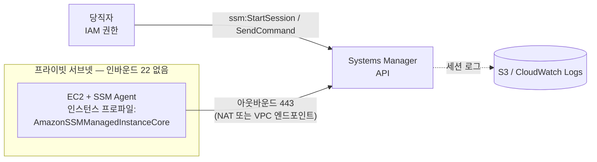

# M10-04. Systems Manager: 서버를 SSH 없이 다루기
> 도메인: D1, D2 · 예상 시간: 35분 · 실습 등급: 🔴 Session Manager / 🟡 Run Command / 🟢 Parameter Store

## 왜 필요한가

새벽 장애 때 당직자가 앱 서버에 들어가 로그를 보려면 SSH 키, 22번 포트, 배스천(bastion) 호스트가 필요했다. 키는 퇴사자 노트북에 남아 있고, 22번 포트는 보안 감사에서 지적받았다. 서버 50대에 같은 패치를 깔려면 50번 접속해야 한다. AWS Systems Manager(SSM)는 **인스턴스 안의 에이전트가 AWS로 먼저 연결해 두고**, 우리는 IAM 권한으로 그 연결을 빌려 명령을 내리는 방식으로 이 문제를 푼다.

## 핵심 개념



관리형 노드(managed node)가 되려면 세 가지가 필요하다: ① **SSM Agent**(Amazon Linux·Windows AMI 등에 기본 설치), ② 인스턴스 프로파일에 **`AmazonSSMManagedInstanceCore`** 권한, ③ SSM 엔드포인트로 나가는 **아웃바운드 HTTPS**(NAT 게이트웨이 또는 인터페이스 VPC 엔드포인트 `ssm`, `ssmmessages`, `ec2messages`). 인바운드 포트는 하나도 필요 없다.

| 기능 | 하는 일 | 시험에서 이렇게 나온다 |
|---|---|---|
| **Session Manager** | 브라우저·CLI로 셸 접속. SSH 키·배스천·인바운드 22 불필요, 세션 기록을 S3/CloudWatch Logs에 저장 | "배스천 없이, 포트를 열지 않고, 접속을 감사 가능하게" |
| **Run Command** | 태그·인스턴스 ID로 고른 여러 서버에 명령(문서) 실행 | "수백 대에 한 번에 스크립트 실행" |
| **Patch Manager** | 패치 기준선(baseline)에 따라 OS 패치 스캔·설치, 유지 관리 기간(maintenance window)에 실행 | "OS 패치를 자동화·준수 보고" |
| **Parameter Store** | 설정·비밀 값 계층 저장(`/todayorder/prod/...`), SecureString은 KMS 암호화 | M09 — Secrets Manager와 비교 |
| State Manager · Automation | 원하는 상태 유지 · 운영 절차(런북) 자동화 | "AMI 갱신·인스턴스 복구 절차 자동화" |
| Inventory · Fleet Manager · OpsCenter | 설치 소프트웨어 목록 · 노드 관리 UI · 운영 이슈(OpsItem) | – |

## 직접 해 보기

[lab06-ssm-observe.sh](./labs/lab06-ssm-observe.sh) — 에뮬레이터의 EC2는 부팅하지 않으므로 SSM Agent도 없다. 그래서 "무엇이 되고 무엇이 안 되는지"를 관찰하는 실습이다.

```bash
aws ssm describe-instance-information --query 'InstanceInformationList'
aws ssm start-session --target i-0123456789abcdef0
```

```
[]
aws: [ERROR]: An error occurred (NotImplemented) when calling the StartSession operation: operation StartSession is scaffolded but not implemented in this emulator
```

방금 본 것: 관리형 노드가 0개이고, Session Manager는 501(미구현)이다. 🔴.

```bash
aws ssm send-command --document-name AWS-RunShellScript \
  --targets Key=tag:app,Values=todayorder --parameters 'commands=["uptime"]' --comment "todayorder lab06"
```

```
{
    "Document": "AWS-RunShellScript",
    "Status": "Pending",
    "Targets": 0,
    "Completed": 0
}
```

방금 본 것: Run Command 요청은 받아 주지만 대상 노드가 0개라 `Pending`에서 멈춘다(🟡). 실제 AWS에서는 태그가 맞는 관리형 노드마다 호출(invocation)이 생기고 `Success`/`Failed`로 끝나며, 출력은 `get-command-invocation`이나 S3·CloudWatch Logs에서 본다. 이 명령도 에뮬레이터에서는 501(`ListCommandInvocations`)이다.

```
aws: [ERROR]: An error occurred (NotImplemented) when calling the DescribePatchBaselines operation: operation DescribePatchBaselines is scaffolded but not implemented in this emulator
```

Patch Manager 기준선 조회도 501이다(🔴). 에이전트가 필요 없는 Parameter Store만 실제처럼 동작한다(🟢).

```
1
2
{
    "Name": "/todayorder/prod/api/log-level",
    "Value": "DEBUG",
    "Version": 2
}
```

## 실제 AWS에서는

> **실제 AWS에서 해 보려면** (Session Manager 🔴 / Run Command 🟡)
> - 프리 티어: Session Manager·Run Command는 EC2 대상이면 추가 요금이 없다. `t2.micro`/`t3.micro` 인스턴스는 프리 티어 대상(계정 조건 확인). **퍼블릭 서브넷에 두고 퍼블릭 IP를 붙이면 퍼블릭 IPv4 요금**이 붙고, 프라이빗 서브넷이면 NAT 게이트웨이나 VPC 엔드포인트(둘 다 유료)가 필요하다.
> - 순서: IAM 역할(신뢰: `ec2.amazonaws.com`, 정책: `AmazonSSMManagedInstanceCore`)과 인스턴스 프로파일 → Amazon Linux 2023 인스턴스 시작(보안 그룹 인바운드 규칙 없음) → 몇 분 뒤 `aws ssm describe-instance-information`에 나타나는지 확인 → `aws ssm start-session --target <id>`(로컬에 Session Manager 플러그인 필요) → `aws ssm send-command --document-name AWS-RunShellScript --targets Key=tag:app,Values=todayorder --parameters 'commands=["uptime"]'` → `aws ssm list-command-invocations --command-id <id> --details`.
> - 정리: `aws ec2 terminate-instances --instance-ids <id>`, 역할·인스턴스 프로파일 삭제.

## 시험 포인트

- "배스천 호스트 없이, 인바운드 포트를 열지 않고, 접속 기록을 남기며 프라이빗 인스턴스에 접속" → **Session Manager**.
- "여러 인스턴스에 같은 명령/스크립트" → **Run Command**. "OS 패치 자동화" → **Patch Manager**(+ Maintenance Windows).
- 관리형 노드 조건: **SSM Agent + 인스턴스 프로파일(`AmazonSSMManagedInstanceCore`) + SSM 엔드포인트로 나가는 경로**(인터넷 없는 서브넷이면 인터페이스 VPC 엔드포인트).
- "설정값·비밀을 계층적으로 저장, 무료 표준 티어" → Parameter Store. "자동 교체가 필요한 DB 비밀번호" → Secrets Manager(M09).
- CloudWatch 에이전트 설정을 Parameter Store에 두고 Run Command/State Manager로 배포하는 조합이 자주 나온다.

## 스스로 확인

1. 인스턴스가 프라이빗 서브넷에 있고 NAT 게이트웨이가 없다. Session Manager로 접속하려면 무엇이 필요한가?
2. Session Manager가 SSH+배스천보다 보안상 나은 점 세 가지는?

<details><summary>답</summary>

1. SSM Agent와 `AmazonSSMManagedInstanceCore` 권한을 가진 인스턴스 프로파일, 그리고 `ssm`·`ssmmessages`·`ec2messages` 인터페이스 VPC 엔드포인트(보안 그룹에서 443 허용).
2. 인바운드 포트(22)가 필요 없다 / SSH 키를 배포·회수할 필요 없이 IAM으로 접근 제어 / 세션 내용과 접속 이력이 S3·CloudWatch Logs·CloudTrail에 남는다. (배스천 서버를 운영·패치할 필요도 없다.)
</details>
