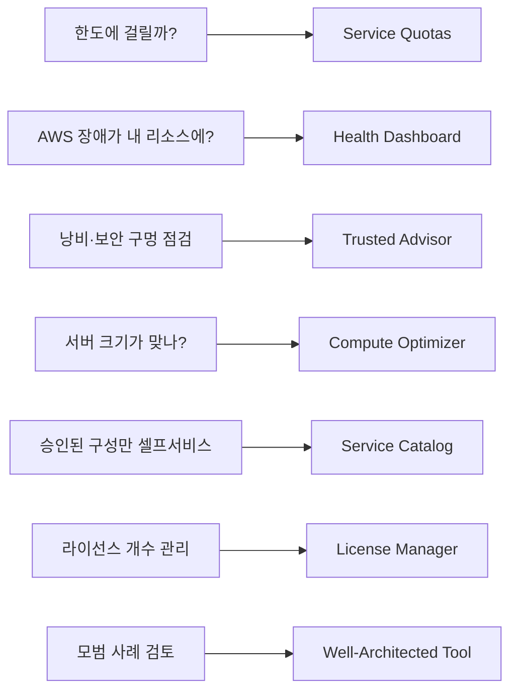

# M10-05. 운영 지원 서비스 한눈에
> 도메인: D2, D4 · 예상 시간: 35분 · 실습 등급: 🟡 (설정값 읽기)

## 왜 필요한가

TodayOrder가 계정 여러 개, 서버 수십 대 규모가 되자 질문이 바뀌었다. "NAT를 하나 더 만들려는데 한도에 걸리지 않을까?", "AWS 쪽 장애인지 우리 장애인지?", "서버가 너무 큰 건 아닌가?", "팀마다 제멋대로 만든 리소스를 어떻게 표준화하지?" 이런 질문마다 담당 서비스가 따로 있다. 시험은 이 서비스들의 **이름과 한 줄 용도**를 짝지을 수 있는지 묻는다.

## 핵심 개념

| 서비스 | 한 줄 용도 | "이런 문장이 나오면" |
|---|---|---|
| **AWS Trusted Advisor** | 비용·성능·보안·내결함성·서비스 한도·운영 우수성 점검과 권고 | "열린 보안 그룹, 사용하지 않는 EIP, 한도 근접을 자동 점검" — 전체 점검·API는 **유료 지원 플랜**: Business Support+ · Enterprise Support · Unified Operations(기존 Business·Developer 플랜은 2027-01-01 종료, Enterprise On-Ramp는 2026년 중 Enterprise로 전환) |
| **AWS Health Dashboard** | AWS 서비스 상태(공용)와 **내 계정 리소스에 영향을 주는 이벤트**(계정별) | "예정된 EC2 유지 관리·리전 장애가 내 리소스에 영향이 있는지", EventBridge로 자동 대응 |
| **Service Quotas** | 서비스 한도(할당량) 조회·증가 요청·사용량 알람 | "리전당 EIP 5개 한도에 가까워지면 알림" |
| **AWS Compute Optimizer** | 사용 지표를 ML로 분석해 EC2·ASG·EBS·Lambda·ECS(Fargate) 적정 크기 권고 | "과다 프로비저닝된 인스턴스를 찾아 적정 크기로" (M13) |
| **AWS License Manager** | 소프트웨어 라이선스(Windows·SQL Server·Oracle 등) 사용량 추적·한도 강제 | "BYOL 라이선스 위반을 막기" |
| **AWS Service Catalog** | 승인된 CloudFormation 템플릿을 "제품"으로 등록, 사용자는 셀프서비스로 배포 | "개발팀이 승인된 구성만 스스로 띄우게" |
| **AWS Proton** | 플랫폼 팀이 만든 환경·서비스 템플릿으로 컨테이너·서버리스 앱 배포 표준화 | "플랫폼 팀 템플릿 + 개발팀 셀프 배포(코드 → 인프라)" — ⚠️ **2026-10-07 지원 종료**(2025-10-07 신규 가입 중단). 시험 범위 목록에는 아직 있어 이름과 용도만 알아 둔다. 대안: Service Catalog, Backstage 기반 Harmonix 등 |
| **Amazon Managed Grafana** | 관리형 Grafana 대시보드 (CloudWatch·Prometheus·X-Ray 등 데이터 소스) | "Grafana를 직접 운영하지 않고" |
| **Amazon Managed Service for Prometheus** | Prometheus 호환 지표 저장·쿼리(PromQL), 주로 EKS/컨테이너 지표 | "EKS 지표를 PromQL로, 서버 운영 없이" |
| **AWS Well-Architected Tool** | 6개 기둥(운영 우수성·보안·안정성·성능 효율성·비용 최적화·지속 가능성) 질문으로 워크로드 검토 | "아키텍처를 모범 사례 기준으로 점검" (M14) |



## 직접 해 보기

[lab07-ops-services-read.sh](./labs/lab07-ops-services-read.sh) — 에뮬레이터에는 실제 사용량·권고·장애 이벤트가 없으므로 **설정값을 읽는 데까지만** 한다(🟡).

```bash
aws service-quotas get-service-quota --service-code ec2 --quota-code L-0263D0A3 \
  --query 'Quota.{Name: QuotaName, Value: Value, Adjustable: Adjustable}'
```

```
{
    "Name": "EC2-VPC Elastic IPs",
    "Value": 5.0,
    "Adjustable": true
}
```

방금 본 것: 리전당 EIP 기본 한도는 5개이고 증가 요청이 가능하다(`Adjustable`). 레슨 3의 VPC는 NAT 하나에 EIP 하나를 썼다 — AZ마다 NAT를 두는 환경을 여러 개 만들면 금방 한도에 닿는다.

```
== 2. Service Quotas: Lambda 한도 중 시험에 나오는 것
  Function timeout               900.0
  Function and layer storage     75.0
  Concurrent executions          1000.0
```

Lambda 타임아웃 900초(15분), 리전당 동시 실행 기본 1,000(M07).

```
aws: [ERROR]: An error occurred (SubscriptionRequiredException) when calling the DescribeTrustedAdvisorChecks operation: Amazon Web Services Premium Support Subscription is required to use this service.
== 4. AWS Health API — 유료 지원 플랜(Business Support+ 등) 필요
aws: [ERROR]: An error occurred (SubscriptionRequiredException) when calling the DescribeEvents operation: You must have a Business, Enterprise On-Ramp, or Enterprise Support plan from Amazon Web Services Support to use the Health API.
```

방금 본 것: Trusted Advisor의 API(Support API)와 Health API는 **유료 지원 플랜**이 있어야 쓸 수 있다 — 실제 AWS와 같은 오류다. 오류 메시지의 플랜 이름(Business, Enterprise On-Ramp)은 예전 이름이고, AWS 문서는 이제 Business Support+ · Enterprise Support · Unified Operations를 적는다(기존 Business·Developer 플랜은 2027-01-01 종료). (콘솔의 Health Dashboard와 Trusted Advisor 기본 점검은 모든 계정이 볼 수 있다.)

```
== 5. Compute Optimizer 가입 상태
{
    "Status": "Inactive"
}
== 6. Well-Architected Tool 공식 렌즈
  AWS Well-Architected Framework (AWS_OFFICIAL)
  Connected Mobility Lens (AWS_OFFICIAL)
  Data Analytics Lens (AWS_OFFICIAL)
== 7. 관리형 관측·거버넌스 서비스 목록 조회 (모두 비어 있음)
  aws grafana list-workspaces                   0개
  aws amp list-workspaces                       0개
  aws servicecatalog list-portfolios            0개
  aws proton list-environments                  0개  ← 실제 AWS: 2026-10-07 지원 종료 (에뮬레이터 관찰만)
  aws license-manager list-license-configurations 0개
```

방금 본 것: Compute Optimizer는 **옵트인(가입)** 해야 분석을 시작한다. 나머지는 API가 응답하지만 비어 있다. Proton은 에뮬레이터가 응답할 뿐, 실제 AWS에서는 지원이 끝난 서비스다.

## 실제 AWS에서는

> **실제 AWS에서 해 보려면** (🟡: 설정값 읽기만 재현)
> - 프리 티어·요금: Service Quotas 조회, Trusted Advisor 기본 점검, Health Dashboard, Well-Architected Tool, Compute Optimizer 기본 권고는 **무료**. Trusted Advisor 전체 점검·Health API는 유료 지원 플랜(월 요금, Business Support+ · Enterprise Support · Unified Operations(기존 Business·Developer 플랜은 2027-01-01 종료, Enterprise On-Ramp는 2026년 중 Enterprise로 전환)) 필요. Managed Grafana·Prometheus·Service Catalog는 쓰는 만큼 과금. Proton은 2026-10-07 지원이 종료되어 실습할 수 없다.
> - 순서: 콘솔 → Service Quotas → Amazon EC2 → "EC2-VPC Elastic IPs" 사용량 확인 · Trusted Advisor → 보안 점검 결과 · Health Dashboard → "Your account health" · `aws compute-optimizer update-enrollment-status --status Active` 후 (지표가 쌓이는) 하루 이상 뒤 `get-ec2-instance-recommendations`.
> - 정리: Compute Optimizer 해지 `update-enrollment-status --status Inactive`. 나머지는 만든 리소스가 없다.

## 시험 포인트

- "서비스 한도 증가 요청·한도 근접 알림" → **Service Quotas**(CloudWatch 알람 연동). 전반 점검 → Trusted Advisor.
- "내 계정 리소스에 영향을 주는 AWS 이벤트(예정된 유지 관리)를 알림·자동 대응" → **AWS Health**(+ EventBridge).
- "EC2 적정 크기 권고" → **Compute Optimizer**. "비용 낭비·보안 그룹 0.0.0.0/0·MFA 미설정 점검" → **Trusted Advisor**.
- "승인된 템플릿을 사용자 셀프서비스로" → **Service Catalog**. "라이선스 수 초과 방지" → **License Manager**.
- "Grafana/Prometheus를 관리형으로" → **Amazon Managed Grafana / Managed Service for Prometheus**.
- "아키텍처를 6개 기둥으로 검토" → **Well-Architected Tool**.

## 스스로 확인

1. 새 리전에 서비스를 확장하기 전, 다음 주에 예정된 대규모 이벤트 트래픽에 대비해 EC2 vCPU 한도를 미리 올리고 싶다. 어디서 무엇을 하는가?
2. "AWS 서비스 장애"가 내 RDS 인스턴스에 영향을 줄 때 자동으로 슬랙 알림을 받고 싶다. 어떤 서비스를 조합하는가?

<details><summary>답</summary>

1. Service Quotas에서 해당 리전의 EC2 온디맨드 vCPU 한도를 확인하고 증가를 요청한다(승인에 시간이 걸릴 수 있으니 미리).
2. AWS Health 이벤트 → EventBridge 규칙 → SNS(또는 Amazon Q Developer in chat applications/Chatbot)로 Slack.
</details>
