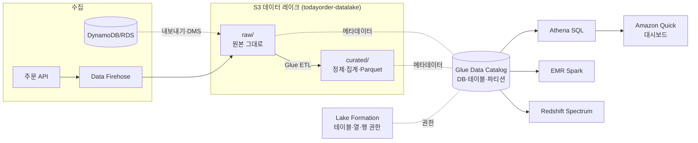

# M11-01. 데이터 레이크와 Lake Formation
> 도메인: D3 · 예상 시간: 35분 · 실습 등급: 🟢 (Lake Formation 설정 읽기 🟡)

## 왜 필요한가

대표가 묻는다. "지난주 강남점 매출이 왜 떨어졌지? 결제 수단별로는?" 주문 데이터는 DynamoDB(M05)에, 접속 로그는 CloudWatch Logs(M10)에, 결제 내역은 외부 PG사 파일로 흩어져 있다. 운영 DB에 무거운 집계 쿼리를 날리면 주문 API가 느려진다. 그래서 분석용 데이터는 운영 시스템에서 **복사해 한곳에 모으고**, 운영과 분리된 엔진으로 조회한다. AWS에서 그 "한곳"의 표준 답이 **S3 데이터 레이크**다.

## 핵심 개념

### 데이터 레이크 vs 데이터 웨어하우스

| | 데이터 레이크 (S3) | 데이터 웨어하우스 (Redshift) |
|---|---|---|
| 저장 형태 | 원본 그대로 (JSON, CSV, 로그, 이미지, Parquet) | 정제된 표(열 지향) |
| 스키마 | **읽을 때** 적용 (schema-on-read) | **쓸 때** 적용 (schema-on-write) |
| 비용 | 저장은 매우 쌈, 조회할 때 엔진 요금 | 클러스터/서버리스 컴퓨트 요금 |
| 강점 | 무엇이든 일단 쌓기, 여러 엔진이 같은 데이터 공유 | 반복되는 복잡한 BI 쿼리를 빠르게 |
| 이 모듈 | Firehose → S3 → Glue 카탈로그 → Athena | Redshift·Spectrum 비교(레슨 4) |

핵심 아이디어는 **저장과 컴퓨트의 분리**다. 데이터는 S3에 한 벌만 두고, Athena(SQL)·EMR(Spark)·Redshift Spectrum·SageMaker AI가 **같은 파일을 각자 읽는다.** 무엇이 어디 있는지는 **Glue Data Catalog**(테이블 정의 목록)가 알려 준다.



### 영역(zone)과 파티션 경로

- **raw**(원본, 수정 금지·재처리 근거) → **curated**(정제·집계, 분석용 형식) 처럼 접두사로 영역을 나눈다. 영역마다 수명 주기·권한을 다르게 준다.
- **Hive 스타일 파티션 경로**: `raw/orders/dt=2026-11-10/part-0000.json`. 쿼리가 `WHERE dt = '2026-11-10'`이면 엔진은 그 폴더만 읽는다(**파티션 프루닝**) → 빠르고, Athena처럼 "스캔한 만큼" 과금되는 엔진에서는 **싸다.**
- **열 지향 형식(Parquet/ORC) + 압축** — 필요한 열만 읽어 스캔량을 크게 줄인다. 원본 JSON을 curated 영역에서 Parquet으로 바꾸는 것이 전형적인 ETL이다.

### AWS Lake Formation

S3 버킷 정책·IAM 정책만으로 "마케팅팀은 `orders` 테이블의 `amount`·`store` 열만, 강남점 행만" 같은 권한을 표현하기는 어렵다. **Lake Formation**은 Glue Data Catalog 위에 **데이터베이스·테이블·열·행·셀 단위 권한**을 GRANT/REVOKE로 주고, Athena·Redshift Spectrum·EMR이 그 권한을 따른다. 레이크 구축(블루프린트로 수집), LF-Tag 기반 권한, 교차 계정 공유도 한다.

## 직접 해 보기

[lab01-lake-layout.sh](./labs/lab01-lake-layout.sh) — 레이크 버킷의 기본기를 만든다.

```bash
aws s3api create-bucket --bucket todayorder-datalake
aws s3api put-public-access-block --bucket todayorder-datalake --public-access-block-configuration \
  BlockPublicAcls=true,IgnorePublicAcls=true,BlockPublicPolicy=true,RestrictPublicBuckets=true
aws s3api put-bucket-encryption --bucket todayorder-datalake --server-side-encryption-configuration \
  '{"Rules":[{"ApplyServerSideEncryptionByDefault":{"SSEAlgorithm":"AES256"}}]}'
aws s3api put-bucket-versioning --bucket todayorder-datalake --versioning-configuration Status=Enabled
```

수명 주기: raw는 30일 뒤 Standard-IA, 365일 뒤 Glacier Flexible Retrieval(`GLACIER`), 쿼리 결과는 7일 뒤 삭제.

```
[
    {
        "ID": "raw-tiering",
        "Prefix": "raw/",
        "Transitions": [
            [
                30,
                "STANDARD_IA"
            ],
            [
                365,
                "GLACIER"
            ]
        ],
        "ExpireDays": null
    },
    {
        "ID": "athena-results-expire",
        "Prefix": "athena-results/",
        "Transitions": null,
        "ExpireDays": 7
    }
]
```

영역별 예시 객체와 "폴더처럼" 보기:

```
66 curated/daily_revenue/dt=2026-11-10/part-0000.json
91 raw/orders/dt=2026-11-10/part-0000.json
== 4. 접두사(prefix)와 구분자(/)로 '폴더처럼' 보기 — S3에 실제 폴더는 없다
[
    "curated/",
    "raw/"
]
```

방금 본 것: S3에는 폴더가 없다. 키가 `raw/orders/dt=2026-11-10/part-0000.json`인 객체가 있을 뿐이고, `--delimiter /`로 묶으면 폴더처럼 보인다. 파티션도 결국 **키 이름 규칙**이다.

Lake Formation 설정 읽기:

```
{
    "Admins": [],
    "DefaultDbPerms": {
        "Principal": {
            "DataLakePrincipalIdentifier": "IAM_ALLOWED_PRINCIPALS"
        },
        "Permissions": [
            "ALL"
        ]
    }
}
```

방금 본 것: 기본값 `IAM_ALLOWED_PRINCIPALS`에 `ALL` — "Lake Formation 권한을 쓰지 않고 IAM 정책만으로 제어"하는 호환 모드다. Lake Formation 세밀 권한을 쓰려면 데이터 레이크 관리자를 지정하고 이 기본 권한을 걷어 낸 뒤 GRANT로 준다. 에뮬레이터에서는 설정을 읽는 데까지만 한다(🟡).

## 실제 AWS에서는

- 수명 주기 전환은 에뮬레이터에서 일어나지 않는다(M04). 실제로는 매일 비동기로 처리되며, Standard-IA는 최소 30일 보관 요금·128KB 최소 크기 과금이 있다.
- Lake Formation 권한(열·행 필터)은 에뮬레이터에서 집행을 확인하지 않았다.

> **실제 AWS에서 해 보려면** (Lake Formation 🟡)
> - 프리 티어·요금: Lake Formation 권한 관리 자체는 추가 요금이 없다(기반 서비스 S3·Glue·Athena 요금). S3 프리 티어는 계정 생성 시점에 따라 다르다(2025-07-15 이전 계정: 첫 12개월 제한 용량 / 이후 계정: 크레딧 기반 무료 플랜).
> - 순서: Lake Formation 콘솔에서 자신을 데이터 레이크 관리자로 지정 → S3 위치 등록 → Glue 테이블(레슨 3)에 대해 다른 IAM 사용자에게 `SELECT`를 `store`·`amount` 열만 부여 → 그 사용자로 Athena에서 `SELECT *` 해 보면 허용된 열만 나온다.
> - 정리: 부여한 권한 취소(`aws lakeformation revoke-permissions`), 등록한 위치 해제, 테스트 버킷 비우고 삭제.

## 시험 포인트

- "여러 형식의 대량 데이터를 싸게 저장하고 여러 분석 도구로 조회" → **S3 데이터 레이크** + Glue Data Catalog.
- "데이터 레이크 테이블에 **열·행 수준** 권한, 중앙 권한 관리" → **Lake Formation**.
- "쿼리 비용·속도를 줄이려면" → **파티션**(dt=…), **Parquet/ORC** 열 지향, **압축**.
- "정형 데이터로 반복적인 복잡한 BI·조인, 높은 동시성" → 데이터 웨어하우스 **Redshift**(레슨 4).
- 운영 DB(OLTP)와 분석(OLAP)을 분리한다 — 운영 DB에 분석 쿼리를 날리지 않는다.

## 스스로 확인

1. "schema-on-read"가 무슨 뜻이고, 데이터 레이크에서 왜 편리한가?
2. 같은 주문 데이터를 Athena와 EMR이 동시에 써야 한다. 데이터를 몇 벌 두어야 하는가? 테이블 정의는 어디에 두는가?

<details><summary>답</summary>

1. 저장할 때는 형식을 강제하지 않고 원본 그대로 두고, 읽을 때 테이블 정의(스키마)를 씌운다. 수집을 먼저 시작하고 스키마는 나중에 정하거나 바꿀 수 있다.
2. S3에 한 벌. 테이블 정의는 Glue Data Catalog에 두면 Athena·EMR·Redshift Spectrum이 같은 정의를 공유한다(저장·컴퓨트 분리).
</details>
