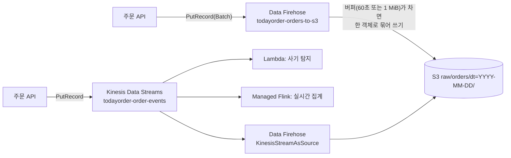

# M11-02. 수집: Kinesis Data Streams · Amazon Data Firehose · MSK
> 도메인: D3 · 예상 시간: 50분 · 실습 등급: 🟢

## 왜 필요한가

주문 API는 하루 수만 건의 주문 이벤트를 만든다. 이 이벤트를 분석용 레이크(S3)로 옮겨야 한다. 주문 API가 매 요청마다 S3에 작은 파일을 하나씩 쓰면 파일이 수백만 개가 되어 조회가 느려지고(작은 파일 문제), S3 요청 요금도 늘어난다. 누군가 이벤트를 **받아서 모았다가 적당한 크기로 묶어** 써 줘야 한다. 실시간 대시보드나 사기 탐지처럼 이벤트를 **받자마자 여러 소비자가 처리**해야 하는 요구도 생긴다. 이 둘이 서로 다른 서비스다.

## 핵심 개념

| | Kinesis Data Streams (KDS) | Amazon Data Firehose | Amazon MSK |
|---|---|---|---|
| 한 줄 | 실시간 스트림 **저장소**. 소비자가 직접 읽는다 | 스트림을 받아 **목적지에 배달**하는 관리형 파이프 | 관리형 **Apache Kafka** |
| 지연 | 실시간(밀리초~초) | **거의 실시간** — 버퍼(시간 또는 크기)가 차면 배달 | 실시간 |
| 소비자 | 내가 만든다(Lambda, KCL 앱, Flink, Firehose…) 여럿 동시 가능 | 없음 — 목적지가 정해져 있다(S3, Redshift, OpenSearch, Splunk, HTTP 엔드포인트, Snowflake, Iceberg 테이블 등) | Kafka 컨슈머 |
| 보존·재처리 | 보존 기간(기본 24시간, 최대 365일) 동안 **다시 읽기(replay) 가능** | 저장하지 않는다(배달 실패 시 재시도·S3 백업만) | 토픽 보존 설정대로 |
| 용량 | 샤드(쓰기 샤드당 1 MB/s 또는 1,000 레코드/s) 또는 온디맨드 모드 | 자동 확장, 관리할 것 없음 | 브로커(또는 MSK Serverless) |
| 변환 | 소비자 코드에서 | Lambda 변환, **JSON → Parquet/ORC 형식 변환**, 동적 파티셔닝 | 컨슈머·Kafka Connect |
| 언제 | 여러 소비자·순서(샤드 안)·재처리가 필요 | "S3/Redshift/OpenSearch로 그냥 실어 날라 줘" | 이미 Kafka를 쓰고 있다(이전·호환) |



조합 패턴: **KDS → Firehose → S3**. 실시간 소비자(Lambda·Flink)와 레이크 적재(Firehose)를 같은 스트림에 함께 붙인다.

Firehose의 S3 목적지 핵심 설정:

- **버퍼링 힌트** — 시간(기본 300초, 최대 900초, 0초 "버퍼링 없음"도 가능)과 크기(기본 5 MiB, 1~128 MiB) 중 **먼저 차는 쪽**에 배달한다. 크게 잡을수록 파일이 커지고 개수가 줄어 분석에 유리하지만 지연은 늘어난다.
- **접두사 식** — `raw/orders/dt=!{timestamp:yyyy-MM-dd}/`처럼 배달 시각(UTC)으로 파티션 경로를 만든다. 레코드 안의 값(예: 매장)으로 나누려면 **동적 파티셔닝**을 켠다. 식을 쓰면 `ErrorOutputPrefix`도 지정해야 한다.
- **레코드 구분자** — Firehose는 레코드를 **이어 붙일 뿐** 줄바꿈을 넣지 않는다. Athena가 JSON을 줄 단위로 읽게 하려면 생산자가 각 레코드 끝에 `\n`을 붙인다(또는 Firehose 처리 기능으로 구분자 추가).
- **서비스 역할** — Firehose가 버킷에 쓰려면 `firehose.amazonaws.com`이 맡을 수 있는 역할과 `s3:PutObject` 등 권한이 필요하다.
- 레코드 한 건 최대 1,000 KiB, `PutRecordBatch`는 호출당 최대 500건 또는 4 MiB.

### 그 밖의 수집·교환 서비스 (한눈에)

| 서비스 | 한 줄 |
|---|---|
| **Kinesis Video Streams** | 카메라·장비의 **영상** 스트림 수집·저장·재생, Rekognition Video 등과 연결 |
| **AWS Data Exchange** | **제3자 데이터**(시장·날씨·금융 데이터)를 구독해 S3·Redshift로 받기 |
| **AWS Data Pipeline** | 예전의 배치 데이터 이동·변환 스케줄러. **신규 고객에게 더 이상 제공되지 않는다**(유지 관리 모드). 새 설계는 Glue·Step Functions·MWAA |
| AWS DMS | DB → DB/S3 마이그레이션·지속 복제(M12) |
| AWS DataSync / Snow 패밀리 / Transfer Family | 파일·대용량 오프라인·SFTP 전송(M04) |
| Amazon AppFlow | Salesforce 같은 SaaS ↔ S3 데이터 흐름(M06) |

## 직접 해 보기

[lab02-firehose-to-s3.sh](./labs/lab02-firehose-to-s3.sh)

### 1) 역할 신뢰가 먼저

```
aws: [ERROR]: An error occurred (InvalidArgumentException) when calling the CreateDeliveryStream operation: Firehose is unable to assume role arn:aws:iam::000000000000:role/does-not-exist. Please check the role provided.
```

방금 본 것: Firehose는 **역할을 맡아서** S3에 쓴다. 신뢰 정책(`Principal: firehose.amazonaws.com`)이 있는 역할을 줘야 전송 스트림이 만들어진다.

### 2) Direct PUT 전송 스트림

```bash
aws firehose create-delivery-stream --delivery-stream-name todayorder-orders-to-s3 --delivery-stream-type DirectPut \
  --extended-s3-destination-configuration '{
    "RoleARN": "'$ROLE_ARN'", "BucketARN": "arn:aws:s3:::todayorder-ingest",
    "Prefix": "raw/orders/dt=!{timestamp:yyyy-MM-dd}/",
    "ErrorOutputPrefix": "errors/!{firehose:error-output-type}/dt=!{timestamp:yyyy-MM-dd}/",
    "BufferingHints": {"IntervalInSeconds": 60, "SizeInMBs": 1},
    "CompressionFormat": "UNCOMPRESSED"}'
```

```
{
    "Status": "ACTIVE",
    "Type": "DirectPut",
    "Prefix": "raw/orders/dt=!{timestamp:yyyy-MM-dd}/",
    "Buffer": {
        "SizeInMBs": 1,
        "IntervalInSeconds": 60
    }
}
```

### 3) 주문 5건 보내기

```bash
aws firehose put-record --delivery-stream-name todayorder-orders-to-s3 --cli-binary-format raw-in-base64-out \
  --record '{"Data": "{\"order_id\":\"F-0001\",...}\n"}'
aws firehose put-record-batch --delivery-stream-name todayorder-orders-to-s3 --cli-binary-format raw-in-base64-out \
  --records "$RECORDS"     # 4건
```

```
{
    "RecordId": "000000000000000018e74bff976b23410000000000000001",
    "Encrypted": false
}
{
    "FailedPutCount": 0,
    "Records": 4
}
```

방금 본 것: `PutRecordBatch`는 **일부만 실패할 수 있다.** 호출이 성공해도 `FailedPutCount`를 확인하고 실패한 레코드만 다시 보내야 한다(SQS `SendMessageBatch`와 같은 패턴). CLI v2는 blob 인자를 base64로 기대하므로 원문을 그대로 보내려고 `--cli-binary-format raw-in-base64-out`을 붙였다.

### 4) S3에 생긴 객체

```
665 raw/orders/dt=2026-11-12/todayorder-orders-to-s3-1-2026-11-12-12-28-58-0-9d496a71-f43d-4a9f-9ee6-8b04575c9c9e
-- 첫 객체 내용
{"order_id":"F-0001","store":"gangnam","menu":"bibimbap","qty":2,"amount":18000,"payment":"card","ordered_at":"2026-11-12T12:28:57Z"}
{"order_id":"F-0002","store":"gangnam","menu":"tteokbokki","qty":1,"amount":6000,"payment":"kakaopay","ordered_at":"2026-11-12T12:28:57Z"}
{"order_id":"F-0003","store":"mapo","menu":"bibimbap","qty":1,"amount":9000,"payment":"card","ordered_at":"2026-11-12T12:28:57Z"}
{"order_id":"F-0004","store":"mapo","menu":"kimbap","qty":3,"amount":10500,"payment":"cash","ordered_at":"2026-11-12T12:28:57Z"}
{"order_id":"F-0005","store":"jamsil","menu":"bibimbap","qty":2,"amount":18000,"payment":"card","ordered_at":"2026-11-12T12:28:57Z"}
```

방금 본 것: 다섯 번의 레코드가 **객체 하나**로 묶였고, 키는 접두사 식대로 `dt=2026-11-12/`(UTC 날짜) 아래에 `<스트림>-<버전>-<시각>-<UUID>` 이름으로 생겼다. 레코드 사이의 줄바꿈은 생산자가 넣은 `\n`이다.

> ⚠️ 에뮬레이터는 버퍼 시간(60초)을 기다리지 않고 수 초 만에 썼다. 실제 AWS에서는 버퍼 조건이 찰 때까지(이 설정이면 최대 약 60초) 기다린다. lab은 시간을 가정하지 않고 객체가 생길 때까지 폴링한다.

### 5) Kinesis Data Streams를 소스로

```
{
    "Shard": "shardId-000000000000"
}
-- 이 전송 스트림에 직접 PutRecord 하면?
aws: [ERROR]: An error occurred (InvalidArgumentException) when calling the PutRecord operation: This operation is not permitted on KinesisStreamAsSource delivery stream type.
132 raw/kds-orders/2026/11/12/12/todayorder-kds-to-s3-1-2026-11-12-12-29-16-0-048290d2-66cc-4549-ba81-c88971a11506
```

방금 본 것: KDS에 넣은 레코드를 Firehose가 읽어 S3에 썼다. 소스가 KDS인 전송 스트림에는 직접 `PutRecord`를 할 수 없다. 접두사 식을 쓰지 않으면 기본 접두사 `YYYY/MM/DD/HH/`(UTC)가 붙는다 — Hive 스타일(`dt=`)이 아니라 Athena에서 파티션으로 쓰려면 경로를 따로 등록해야 한다.

## 실제 AWS에서는

- 버퍼 시간·크기에 따라 수십 초~수 분의 지연이 있다("거의 실시간"). 에뮬레이터의 즉시 배달을 그대로 믿지 말 것.
- Firehose는 수집한 데이터 양(레코드당 5 KB 단위 반올림)으로, KDS는 샤드 시간(프로비저닝) 또는 데이터 양(온디맨드)으로 과금된다. 둘 다 프리 티어가 없다.
- 에뮬레이터는 Firehose 역할의 **신뢰 정책**은 검사했지만, 역할에 S3 권한이 없어도 배달했다. 실제 AWS에서는 권한이 없으면 배달이 실패하고 `errors/` 접두사나 CloudWatch 지표로 드러난다. lab에는 실제에 필요한 권한을 모두 넣었다.

## 시험 포인트

- "S3/Redshift/OpenSearch로 스트리밍 데이터를 **코드 없이, 관리 없이** 적재", "거의 실시간" → **Data Firehose**.
- "실시간으로 **여러 소비자**가 처리, **재처리(replay)**, 샤드 안 순서" → **Kinesis Data Streams**.
- "Firehose로 받으면서 **Parquet로 변환**해 Athena 비용 절감" → Firehose 형식 변환(Glue 테이블 스키마 사용).
- "Firehose에서 레코드 변환·마스킹" → Firehose **Lambda 변환**.
- "기존 Kafka 앱을 그대로" → **MSK**. "영상 스트림" → **Kinesis Video Streams**. "제3자 데이터 구독" → **Data Exchange**.
- SQS(작업 큐, 소비자가 지우면 끝) vs KDS(스트림, 여러 소비자가 같은 데이터를 보존 기간 동안 읽음) — M06.

## 스스로 확인

1. 주문 이벤트를 S3에 적재하면서 동시에 실시간 사기 탐지 Lambda도 돌려야 한다. 서비스를 어떻게 조합하는가?
2. Firehose 버퍼를 10초·1 MiB로 줄였더니 S3 객체 수가 크게 늘었다. 분석 쪽에 어떤 영향이 있고, 어떻게 보완하는가?
3. 레코드 끝에 `\n`을 붙이지 않고 JSON 레코드를 Firehose로 보내면 Athena 조회 결과가 어떻게 될까?

<details><summary>답</summary>

1. 주문 API → KDS → (Lambda 이벤트 소스 매핑으로 사기 탐지) + (Firehose KinesisStreamAsSource → S3). 같은 스트림을 두 소비자가 각자 읽는다.
2. 작은 파일이 많아져 쿼리마다 열어야 할 파일 수가 늘고 느려진다(+ S3 요청 요금). 버퍼를 다시 키우거나, Glue ETL로 주기적으로 큰 Parquet 파일로 합친다(compaction).
3. 여러 JSON이 한 줄로 이어져(`{...}{...}`) 줄 단위 JSON SerDe가 제대로 읽지 못한다. 이 실습을 만들 때 에뮬레이터 Athena에서도 그런 파일은 값이 모두 NULL인 행 하나로 읽혔다.
</details>
