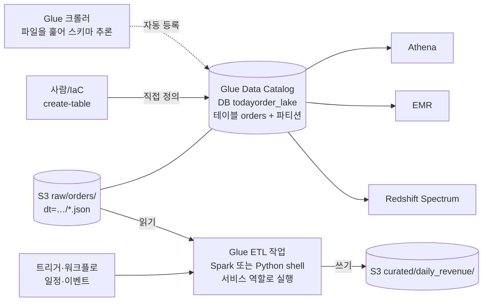

# M11-03. 카탈로그와 변환: AWS Glue
> 도메인: D3 · 예상 시간: 55분 · 실습 등급: 🟢 (크롤러 🔴)

## 왜 필요한가

S3에 주문 파일이 쌓이기 시작했다. 하지만 S3는 파일이 어떤 열을 가졌는지 모른다. Athena에 `SELECT sum(amount) FROM orders`를 하려면 누군가 "`raw/orders/` 아래 JSON 파일들은 `order_id`, `store`, `amount`… 열을 가진 `orders` 표이고, `dt=` 폴더로 나뉜다"고 **등록**해 줘야 한다. 또 원본 JSON을 그대로 매번 읽으면 느리고 비싸니, 하루 한 번 **매장별 매출로 미리 집계**해 두고 싶다. 앞의 일이 Glue **Data Catalog**, 뒤의 일이 Glue **ETL**이다.

## 핵심 개념



| 구성 요소 | 하는 일 |
|---|---|
| **Data Catalog** | 데이터베이스·테이블(열, 타입, S3 위치, 형식/SerDe)·**파티션**의 메타데이터 저장소. Hive 메타스토어 호환. 데이터 자체는 저장하지 않는다 |
| **크롤러** | S3·JDBC 데이터를 훑어 스키마를 추론하고 테이블·파티션을 만들거나 갱신. 일정 실행 가능 |
| **ETL 작업** | Spark(대용량 분산 처리) 또는 **Python shell**(작은 작업) 스크립트를 서버리스로 실행. DPU 단위 과금 |
| **트리거·워크플로** | 일정·이벤트·이전 작업 완료로 작업을 잇는다 |
| Glue DataBrew · Glue Studio | 코드 없이 데이터 정제(시각적) · ETL 작업 시각적 편집 |
| 작업 북마크 | 이미 처리한 데이터를 기억해 다음 실행에서 새 데이터만 처리 |

파티션은 카탈로그에 **따로 등록**해야 엔진이 안다. 새 날짜 폴더(`dt=2026-11-12/`)가 S3에 생겨도 카탈로그는 저절로 모른다. 방법은 넷: 크롤러, Athena `MSCK REPAIR TABLE`/`ALTER TABLE ADD PARTITION`, Glue API `BatchCreatePartition`, 또는 Athena **파티션 프로젝션**(규칙으로 계산해 등록 자체를 생략).

## 직접 해 보기

### 1) 테이블을 손으로 정의하고 파티션 등록 — [lab03-glue-catalog.sh](./labs/lab03-glue-catalog.sh)

이틀치 주문을 Hive 스타일 경로에 둔다.

```
534 raw/orders/dt=2026-11-10/part-0000.json
396 raw/orders/dt=2026-11-11/part-0000.json
```

```bash
aws glue create-database --database-input '{"Name":"todayorder_lake","Description":"TodayOrder data lake"}'
aws glue create-table --database-name todayorder_lake --table-input "$(orders_table_input orders s3://todayorder-catalog/raw/orders/)"
```

테이블 정의([labs/_lib.sh](./labs/_lib.sh)의 `orders_table_input`)의 핵심:

```json
"PartitionKeys": [{"Name": "dt", "Type": "string"}],
"StorageDescriptor": {
  "Columns": [{"Name": "order_id", "Type": "string"}, {"Name": "store", "Type": "string"}, …, {"Name": "amount", "Type": "bigint"}, …],
  "Location": "s3://todayorder-catalog/raw/orders/",
  "InputFormat": "org.apache.hadoop.mapred.TextInputFormat",
  "SerdeInfo": {"SerializationLibrary": "org.openx.data.jsonserde.JsonSerDe"}
}
```

```
{
    "Location": "s3://todayorder-catalog/raw/orders/",
    "SerDe": "org.openx.data.jsonserde.JsonSerDe",
    "Columns": "order_id, store, menu, qty, amount, payment, ordered_at",
    "PartitionKeys": [
        "dt"
    ]
}
```

방금 본 것: `dt`는 열 목록이 아니라 **파티션 키**다. 파일 안에 `dt` 필드가 없어도, 경로 `dt=…`에서 값이 나온다. SerDe(Serializer/Deserializer)는 "이 파일을 어떻게 읽나" — 여기서는 줄마다 JSON 하나.

파티션 등록:

```bash
aws glue batch-create-partition --database-name todayorder_lake --table-name orders \
  --partition-input-list "$(partition_input s3://todayorder-catalog/raw/orders/ 2026-11-10 2026-11-11)"
```

```
{
    "Errors": []
}
-- 같은 파티션을 한 번 더 등록하면? (호출은 성공, 항목별 오류로 알려 준다)
[
  {
    "PartitionValues": [
      "2026-11-10"
    ],
    "ErrorDetail": {
      "ErrorCode": "AlreadyExistsException",
      "ErrorMessage": "Partition already exists."
    }
  }
]
```

방금 본 것: `Batch*` API는 **호출 전체는 성공하고 항목별로 실패를 알려 준다.** 응답의 `Errors`를 꼭 확인해야 한다(Firehose `FailedPutCount`와 같은 패턴). 매일 도는 적재 작업이라면 `AlreadyExistsException`은 무시해도 되는 오류다(sdk 예제가 그렇게 한다).

```
{
    "Values": [
        "2026-11-10"
    ],
    "Location": "s3://todayorder-catalog/raw/orders/dt=2026-11-10/"
}
-- 파티션 전체 목록 (GetPartitions)
aws: [ERROR]: An error occurred (NotImplemented) when calling the GetPartitions operation: operation GetPartitions is scaffolded but not implemented in this emulator
```

파티션 하나 조회(`GetPartition`)는 되지만 목록(`GetPartitions`)은 에뮬레이터에서 501이다.

### 2) 크롤러 (🔴)

```
없는 역할: 
aws: [ERROR]: An error occurred (InvalidInputException) when calling the CreateCrawler operation: Service is unable to assume provided role. Please verify role's TrustPolicy
{
    "State": "READY",
    "Schedule": "cron(15 0 * * ? *)",
    "Target": "s3://todayorder-catalog/raw/orders/"
}
aws: [ERROR]: An error occurred (NotImplemented) when calling the StartCrawler operation: operation StartCrawler is scaffolded but not implemented in this emulator
```

방금 본 것: Glue도 **역할의 신뢰 정책**(`glue.amazonaws.com`)을 검사한다. 크롤러 생성·일정(매일 00:15 UTC)은 저장되지만 실행은 501이다. 그래서 이 모듈은 테이블을 직접 정의한다 — 실무에서도 스키마가 확정된 테이블은 IaC로 직접 정의하는 경우가 많다(크롤러가 타입을 잘못 추론하거나 파티션을 테이블로 오인하는 일을 피하려고).

### 3) Glue ETL 작업(Python shell) — [lab04-glue-python-etl.sh](./labs/lab04-glue-python-etl.sh)

[labs/etl/daily_revenue.py](./labs/etl/daily_revenue.py)를 S3에 올리고 작업으로 등록한다. 이 스크립트는 **Glue 안에서** 돌며, 날짜별 raw 주문을 읽어 매장별 주문 수·매출을 `curated/daily_revenue/dt=…/`에 쓴다.

```bash
aws glue create-job --name todayorder-daily-revenue --role "$ROLE_ARN" \
  --command "Name=pythonshell,ScriptLocation=s3://todayorder-etl/scripts/daily_revenue.py,PythonVersion=3.9" \
  --max-capacity 0.0625 --default-arguments '{"--bucket":"todayorder-etl"}'
aws glue start-job-run --job-name todayorder-daily-revenue --arguments '{"--days":"2026-11-10,2026-11-11"}'
```

역할에 신뢰 정책만 있고 권한 정책이 없을 때:

```
{
    "State": "FAILED",
    "Error": "AccessDenied: An error occurred (AccessDenied) when calling the ListObjectsV2 operation: User: arn:aws:sts::000000000000:assumed-role/todayorder-glue-etl/todayorder-daily-revenue is not authorized to perform: s3:ListBucket on resource: \"arn:aws:s3:::todayorder-etl\" because no identity-based policy allows the s3:ListBucket action",
    ...
}
```

방금 본 것: 작업은 **작업 역할을 맡은 세션**(`assumed-role/todayorder-glue-etl/...`)으로 실행되고, 그 역할에 S3 권한이 없으니 거부됐다. 최소 권한(raw 읽기·curated 쓰기)을 붙이고 다시 실행:

```
{
    "State": "SUCCEEDED",
    "Error": null,
    "Arguments": {
        "--bucket": "todayorder-etl",
        "--days": "2026-11-10,2026-11-11"
    }
}
== 7. curated 결과
214 curated/daily_revenue/dt=2026-11-10/part-0000.json
143 curated/daily_revenue/dt=2026-11-11/part-0000.json
{"day": "2026-11-10", "store": "gangnam", "orders": 2, "revenue": 21500}
{"day": "2026-11-10", "store": "jamsil", "orders": 1, "revenue": 9000}
{"day": "2026-11-10", "store": "mapo", "orders": 1, "revenue": 12000}
{"day": "2026-11-11", "store": "gangnam", "orders": 1, "revenue": 27000}
{"day": "2026-11-11", "store": "mapo", "orders": 2, "revenue": 16000}
이틀 매출 합계: 85500
```

방금 본 것: 서버 없이 스크립트가 실행되어 raw → curated 변환이 끝났다. 작업 인자(`--days`)와 기본 인자(`--bucket`)가 합쳐져 스크립트의 `sys.argv`로 들어간다. 실무에서는 curated를 **Parquet**로 쓰고, 이 결과 위에도 테이블을 정의해 대시보드가 작은 집계 테이블만 읽게 한다.

## 실제 AWS에서는

- 크롤러는 실제로 S3를 훑어 테이블과 파티션을 만든다(에뮬레이터 501). 일정 실행, 스키마 변경 처리 정책을 설정할 수 있다.
- Spark 작업(`glueetl`)은 에뮬레이터에서 `awsglue` 라이브러리가 없어 `ModuleNotFoundError`로 실패했다(이 모듈을 만들며 확인). 실제 Glue에서는 `GlueContext`·`DynamicFrame`으로 대용량을 분산 처리한다.
- 요금: ETL 작업은 DPU-시간 단위(Python shell은 0.0625 또는 1 DPU), 크롤러도 DPU-시간, Data Catalog는 일정 개수까지 무료 후 객체 수·요청 수. 프리 티어에 Data Catalog 일부가 포함된다.

> **실제 AWS에서 해 보려면** (크롤러 🔴)
> - 순서: lab03처럼 버킷에 `dt=` 경로로 JSON을 올림 → 역할(신뢰 `glue.amazonaws.com`, 관리형 정책 `AWSGlueServiceRole` + 버킷 읽기) → `aws glue create-crawler ... --targets '{"S3Targets":[{"Path":"s3://<버킷>/raw/orders/"}]}'` → `aws glue start-crawler --name <이름>` → 상태가 `READY`로 돌아오면 `aws glue get-tables --database-name <DB>`와 `get-partitions`로 추론된 스키마·파티션 확인.
> - 과금 주의: 크롤러는 실행 시간만큼 DPU 요금(최소 과금 시간 있음). 일정(`--schedule`)을 걸었다면 꼭 지운다.
> - 정리: `aws glue delete-crawler --name <이름>`, `aws glue delete-database --name <DB>`, 버킷 비우고 삭제, 역할 삭제.

## 시험 포인트

- "S3 데이터의 스키마를 자동으로 찾아 카탈로그에 등록" → **Glue 크롤러**. "여러 분석 서비스가 공유하는 메타데이터 저장소(Hive 메타스토어 대체)" → **Glue Data Catalog**.
- "서버리스 ETL(JSON → Parquet, 조인·정제)" → **Glue ETL 작업**. 대규모·커스텀 Spark/Hadoop 클러스터 제어가 필요하면 → **EMR**.
- "이미 처리한 파일은 건너뛰고 새 파일만" → Glue **작업 북마크**.
- "코드 없이 데이터 정제·프로파일링" → **Glue DataBrew**.
- "새 파티션을 Athena가 못 본다" → 크롤러 재실행 / `MSCK REPAIR TABLE` / `ALTER TABLE ADD PARTITION` / **파티션 프로젝션**.
- Glue·Firehose 같은 서비스는 **서비스 역할**로 동작한다 → 신뢰 정책 + 최소 권한.

## 스스로 확인

1. 매일 새 날짜 폴더가 생기는데, 크롤러를 매번 돌리는 비용이 아깝다. 크롤러 없이 Athena가 새 파티션을 보게 하는 방법 두 가지는?
2. Glue 작업이 `AccessDenied`로 실패했다. 누구의 권한을 고쳐야 하는가 — 작업을 시작한 개발자, 아니면 다른 무엇?

<details><summary>답</summary>

1. 적재하는 쪽(sdk 예제처럼)이 `BatchCreatePartition`/`ALTER TABLE ADD PARTITION`으로 바로 등록하거나, Athena **파티션 프로젝션**으로 `dt` 범위·형식 규칙을 테이블 속성에 적어 등록 자체를 없앤다.
2. 작업에 지정한 **Glue 서비스 역할**의 권한 정책. 스크립트 안의 S3 호출은 그 역할의 세션으로 실행된다(lab04의 `assumed-role/todayorder-glue-etl/...`). 시작한 개발자에게는 `glue:StartJobRun`과 그 역할을 넘길 `iam:PassRole`이 필요하다.
</details>
