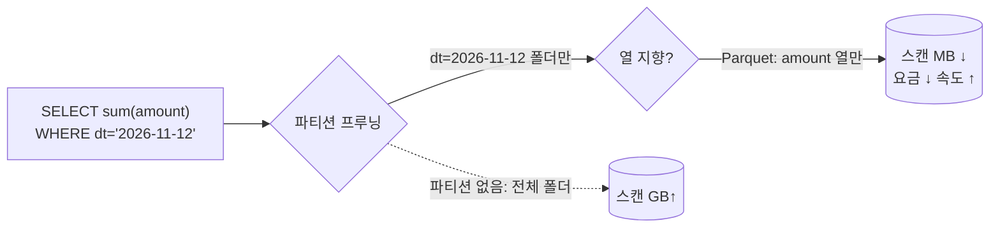
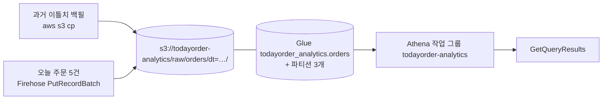

# M11-04. 조회: Athena · Redshift · EMR · OpenSearch · Amazon Quick
> 도메인: D3 · 예상 시간: 60분 · 실습 등급: 🟢

## 왜 필요한가

수집(레슨 2)과 카탈로그(레슨 3)가 끝났다. 이제 대표의 질문 "일자별·매장별 매출은? 결제 수단 비중은?"에 답할 차례다. 분석가는 SQL을 알고, 서버를 운영할 사람은 없고, 쿼리는 하루 몇 번뿐이다. 반대로 내년에 데이터가 수십 TB가 되고 BI 대시보드가 하루 종일 수백 명에게 열려 있다면 답이 달라진다. 이 레슨은 **"어떤 조회 엔진을 언제"** 를 고르는 법이다.

## 핵심 개념

### 비교표 (시험의 핵심)

| | **Athena** | **Redshift** (+ Spectrum, Serverless) | **EMR** (+ EMR Serverless) | **OpenSearch Service** | **Amazon Quick** (Quick Sight) |
|---|---|---|---|---|---|
| 한 줄 | S3 위의 **서버리스 SQL** | 관리형 **데이터 웨어하우스**(열 지향, MPP) | 관리형 **Hadoop/Spark** 빅데이터 클러스터 | **검색**·로그 분석·대시보드 | **BI 대시보드**·시각화 |
| 데이터 위치 | S3 (Glue 카탈로그) | Redshift 내부 저장소 (Spectrum으로 S3도) | S3(EMRFS)·HDFS | OpenSearch 인덱스 | 다양한 소스(Athena·Redshift·RDS·S3…) |
| 관리 | 없음 | 클러스터(노드) 또는 Serverless | 클러스터(인스턴스) 또는 Serverless | 도메인(노드) 또는 Serverless | 없음(사용자 단위 구독) |
| 과금 | **스캔한 데이터 양** (TB당) | 노드 시간 / RPU 시간 | 인스턴스 시간 + EMR 요금 | 노드 시간·스토리지 | 사용자·용량 |
| 잘하는 것 | 가끔 하는 즉석 쿼리, 로그·CSV·JSON·Parquet 탐색 | 복잡한 조인·집계를 **반복적으로, 빠르게, 많은 사용자가** | 대규모 변환·ML 전처리·커스텀 프레임워크(Spark, Hive, Presto, HBase) | 전문 검색, 실시간 로그 검색·시각화(Kibana 계열 Dashboards) | 경영진 대시보드, 자연어 질의 |
| 시험 신호 | "서버리스", "S3에 있는 데이터를 SQL로", "가끔", "최소 운영" | "데이터 웨어하우스", "BI", "페타바이트", "복잡한 분석 쿼리" | "Hadoop/Spark", "클러스터 제어", "기존 온프레미스 Hadoop 이전" | "전문 검색", "로그 검색", "ELK" | "대시보드", "시각화", "BI" |

- **Redshift Spectrum** — Redshift 클러스터에서 S3의 외부 테이블(Glue 카탈로그)을 조인해 조회. "자주 쓰는 데이터는 Redshift에, 오래된 데이터는 S3에 두고 함께 쿼리".
- **Athena 연합 쿼리(federated query)** — Lambda 커넥터로 DynamoDB·RDS 등 S3 밖의 소스도 SQL로.
- **Athena CTAS** — `CREATE TABLE AS SELECT`로 결과를 Parquet+파티션으로 S3에 쓰기(가벼운 ETL).
- **Amazon Quick** — 시험 가이드(SAA-C03 범위 서비스 목록)의 표기. 예전 이름은 **Amazon QuickSight**이고, 2025년에 Quick Suite로 확장된 뒤 지금 AWS 문서는 "AWS Quick"으로, 그 안의 BI 기능을 "Quick Sight"로 부른다. 기존 QuickSight API(`quicksight`)는 그대로다. 시험에서 "대시보드·시각화·BI"가 나오면 이 서비스다.

### Athena 비용은 "스캔한 바이트"



1. **파티션**(`WHERE dt = ...`) → 읽을 폴더 수 ↓
2. **열 지향 형식**(Parquet/ORC) → 읽을 열 ↓
3. **압축**(Snappy/GZIP/ZSTD) → 바이트 ↓
4. **작업 그룹의 쿼리당 스캔 상한**(`BytesScannedCutoffPerQuery`) → 실수로 전체 테이블을 스캔하는 쿼리를 차단

## 직접 해 보기

### 파이프라인 한 번에 — [lab05-athena-revenue.sh](./labs/lab05-athena-revenue.sh)



```
534 raw/orders/dt=2026-11-10/backfill-0000.json
396 raw/orders/dt=2026-11-11/backfill-0000.json
665 raw/orders/dt=2026-11-12/todayorder-analytics-orders-1-2026-11-12-12-31-47-0-724740c9-3581-41bf-aaa3-bf13f4d48bf8
```

작업 그룹: 결과 위치 강제 + 쿼리당 스캔 상한 100 MB.

```bash
aws athena create-work-group --name todayorder-analytics --configuration '{
  "ResultConfiguration": {"OutputLocation": "s3://todayorder-analytics/athena-results/"},
  "EnforceWorkGroupConfiguration": true, "PublishCloudWatchMetricsEnabled": true,
  "BytesScannedCutoffPerQuery": 104857600}'
```

```
{
    "State": "ENABLED",
    "Output": "s3://todayorder-analytics/athena-results/",
    "CutoffBytes": 104857600
}
```

쿼리는 **비동기**다: `start-query-execution` → `get-query-execution`으로 `QUEUED → RUNNING → SUCCEEDED` 폴링 → `get-query-results` ([labs/_lib.sh](./labs/_lib.sh)의 `athena` 함수).

```sql
SELECT count(*) AS orders, sum(amount) AS revenue FROM orders
```

```
orders | revenue
12 | 147000
```

```sql
SELECT substr(ordered_at, 1, 10) AS order_day, count(*) AS orders, sum(amount) AS revenue
FROM orders GROUP BY 1 ORDER BY 1
```

```
order_day | orders | revenue
2026-11-10 | 4 | 42500
2026-11-11 | 3 | 43000
2026-11-12 | 5 | 61500
```

```sql
SELECT store, count(*) AS orders, sum(amount) AS revenue, round(avg(amount)) AS avg_ticket
FROM orders GROUP BY store ORDER BY revenue DESC
```

```
store | orders | revenue | avg_ticket
gangnam | 5 | 72500 | 14500.0
mapo | 5 | 47500 | 9500.0
jamsil | 2 | 27000 | 13500.0
```

```
payment | orders | revenue
card | 7 | 106000
kakaopay | 3 | 27000
cash | 2 | 14000
```

방금 본 것: 백필로 넣은 과거 주문과 Firehose로 들어온 오늘 주문이 **같은 테이블**로 합쳐져 SQL 한 줄로 집계됐다. 서버도, 데이터 적재(LOAD)도 없었다 — S3 파일 위에 테이블 정의를 씌웠을 뿐이다.

쿼리 실행 정보:

```
{
    "State": "SUCCEEDED",
    "Engine": "Athena engine version 3",
    "ScannedBytes": 1595,
    "OutputLocation": "s3://todayorder-analytics/athena-results/079e22e4-9085-4e4f-aaab-a9927ea15fd3.csv"
}
결과 파일 확인 (aws s3 ls s3://todayorder-analytics/athena-results/079e22e4-9085-4e4f-aaab-a9927ea15fd3.csv): (없음)
```

방금 본 것: `DataScannedInBytes`(1,595바이트 = 세 파일 크기의 합)가 실제 AWS에서 요금의 기준이다. 실제 Athena는 결과를 `OutputLocation`에 CSV로 **저장**하는데, 에뮬레이터는 위치만 알려 주고 파일은 쓰지 않는다 → 결과는 `GetQueryResults`로만 읽는다.

### 에뮬레이터가 다른 곳: 파티션 열

```sql
SELECT count(*) AS orders, sum(amount) AS revenue FROM orders WHERE dt = '2026-11-12'
```

```
[FAILED] no such column: dt in SELECT count(*) AS orders, sum(amount) AS revenue FROM "todayorder_analytics.orders" WHERE dt = '2026-11-12' at offset 91
```

방금 본 것: 실제 Athena에서는 이 쿼리가 **파티션 프루닝**으로 `dt=2026-11-12/` 폴더만 읽어 `5 | 61500`을 돌려주는, 이 레슨에서 가장 중요한 쿼리다. 에뮬레이터의 Athena는 파티션 키를 열로 노출하지 않고(위 오류), 등록한 파티션과 상관없이 테이블 위치 아래의 파일을 **모두** 읽는다(파티션을 등록하기 전에도 같은 결과가 나왔다). 그래서 이 실습은 날짜를 파일 안의 `ordered_at` 값으로 계산했다. 같은 SQL이 실제 Athena에서도 그대로 동작한다 — 다만 **모든 파티션을 스캔하므로** 실무라면 `WHERE dt BETWEEN ...`을 함께 쓴다.

### boto3 — [sdk/order_events_loader.py](./sdk/order_events_loader.py) · [sdk/athena_revenue_report.py](./sdk/athena_revenue_report.py)

적재기는 하루치 주문을 JSON Lines 객체 하나로 `raw/orders/dt=…/`에 쓰고 그 날짜 파티션을 `BatchCreatePartition`으로 등록한다(이미 있으면 넘어간다). 리포트는 사흘치를 적재한 뒤 Athena 결과를 **paginator**로 끝까지 읽고, Python으로 직접 더한 값과 비교한다.

```
2026-11-09: 20건 245,500원 → s3://todayorder-sdk-lake/raw/orders/dt=2026-11-09/part-5e99b2fa0e64.json
2026-11-10: 20건 264,000원 → s3://todayorder-sdk-lake/raw/orders/dt=2026-11-10/part-a1ffa82c5238.json
2026-11-11: 20건 245,500원 → s3://todayorder-sdk-lake/raw/orders/dt=2026-11-11/part-78b039e9975e.json
파티션 2026-11-09 → s3://todayorder-sdk-lake/raw/orders/dt=2026-11-09/
...
SDK order_events_loader OK
order_day   store      orders   revenue
2026-11-09  gangnam         6    66,500
2026-11-09  jamsil         10   122,000
2026-11-09  mapo            4    57,000
2026-11-10  gangnam         6    82,000
...
스캔 9099 bytes · 엔진 Athena engine version 3
Python 으로 직접 합산한 값과 Athena 결과가 일치
SDK athena_revenue_report OK
```

## 실제 AWS에서는

- 쿼리 결과가 S3 결과 위치에 CSV(+메타데이터)로 저장되고, 같은 쿼리 결과 재사용·쿼리 기록 보관 기간이 있다.
- 파티션 열(`dt`)로 거르면 스캔량이 줄어든다. 에뮬레이터는 파티션 열을 모르고 위치 아래 파일을 전부 읽는다.
- 에뮬레이터의 SQL 엔진은 Athena(Trino) 함수 일부가 없다: `date_trunc`, `from_iso8601_timestamp`, `approx_distinct`, 중첩 필드 접근(`customer.tier`)은 실패했고, `MSCK REPAIR TABLE`·`SHOW PARTITIONS`는 구문 오류였다. `count/sum/avg/round/substr/CAST/GROUP BY/ORDER BY/WITH(CTE)/HAVING/BETWEEN`은 동작했다.
- 작업 그룹 삭제(`DeleteWorkGroup`)·목록(`ListWorkGroups`), `ListNamedQueries`, `ListDataCatalogs`는 에뮬레이터에서 501이다. lab은 작업 그룹이 남아 있으면 `update-work-group`으로 갱신한다.
- 요금: 스캔한 데이터 TB당 과금(서울 등 리전별 가격은 AWS 요금 페이지 확인). 결과 저장 S3 요금 별도. Athena에는 프리 티어가 없다. 실패한 쿼리도 S3 요청 요금은 발생한다.

## 시험 포인트

- "S3의 로그/CSV/JSON을 **서버 없이** 가끔 SQL로" → **Athena** (+ Glue 카탈로그).
- "Athena 비용·성능 개선" → **파티션**, **Parquet/ORC**, **압축**, 필요한 열만 SELECT, 작업 그룹 스캔 상한.
- "대규모 정형 데이터의 복잡한 BI 쿼리, 높은 동시성, 데이터 웨어하우스" → **Redshift**. "Redshift에서 S3 데이터도 함께" → **Redshift Spectrum**.
- "Hadoop/Spark 클러스터, 기존 온프레미스 빅데이터 이전, 클러스터 세부 제어" → **EMR**(작업이 간헐적이면 **스팟 인스턴스**를 작업 노드에).
- "로그 전문 검색·실시간 대시보드(ELK)" → **OpenSearch Service**.
- "경영진용 대화형 대시보드" → **Amazon Quick**(구 QuickSight).
- Athena·Logs Insights·Redshift Data API 모두 **비동기 쿼리**(시작 → 폴링 → 결과).

## 스스로 확인

1. 데이터 분석팀이 S3의 1년치 주문 로그(10 TB, JSON)를 Athena로 매일 조회하는데 요금이 많이 나온다. 쿼리는 대부분 "최근 7일, 매장별 매출"이다. 무엇을 바꾸겠는가? (세 가지 이상)
2. 매일 오전 9시 경영진 50명이 같은 매출 대시보드를 연다. 쿼리는 여러 테이블을 조인하고 1초 안에 떠야 한다. Athena, Redshift 중 무엇이 적합하고 대시보드는 무엇으로 만드는가?

<details><summary>답</summary>

1. ① `dt` 파티션으로 나누고 쿼리에 `WHERE dt >= ...` ② Glue ETL/Firehose 형식 변환/CTAS로 **Parquet + 압축** ③ `SELECT *` 대신 필요한 열만 ④ 매장별 일 매출을 미리 집계한 curated 테이블(lab04)을 조회 ⑤ 작업 그룹 스캔 상한으로 실수 방지.
2. 반복적이고 동시성이 높은 조인 쿼리 → **Redshift**(또는 Redshift Serverless), 대시보드는 **Amazon Quick**(Quick Sight, SPICE 캐시로 응답을 더 빠르게).
</details>
