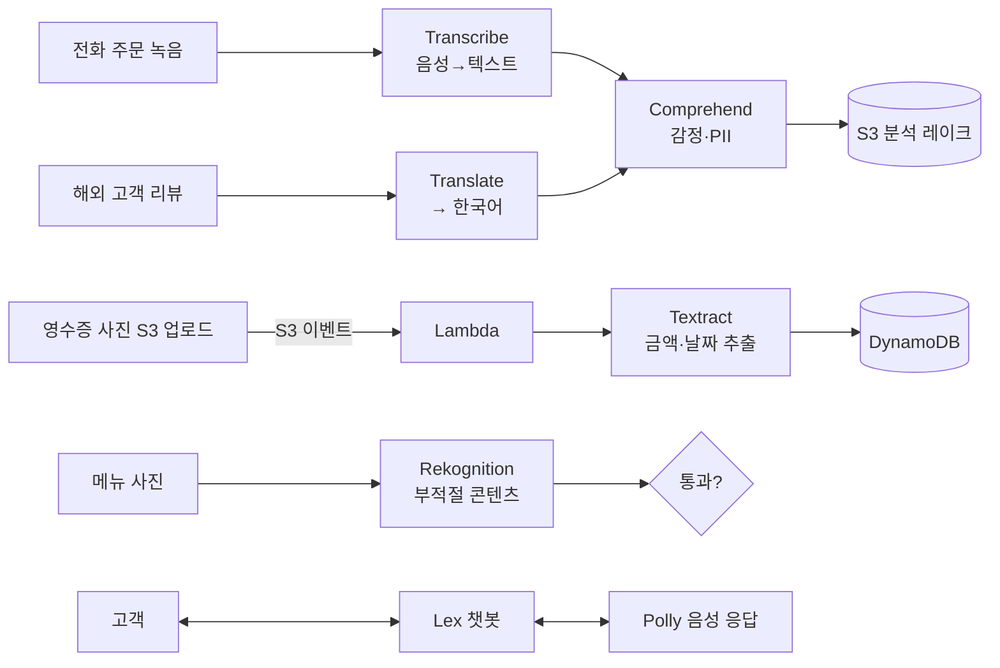

# M11-05. AI/ML 서비스 한눈에
> 도메인: D3 · 예상 시간: 25분 · 실습 등급: 🔴 (개념 + 시나리오)

## 왜 필요한가

TodayOrder에 아이디어가 쏟아진다. "리뷰가 부정적이면 점주에게 알림", "전화 주문을 받아 주는 챗봇", "영수증 사진에서 금액 읽기", "메뉴 사진에 부적절한 이미지가 있는지 검사". 모델을 직접 학습시킬 ML 엔지니어는 없다. AWS는 이런 흔한 작업을 **API 한 번으로** 하는 사전 학습(pre-trained) AI 서비스를 제공한다. SAA-C03은 깊은 ML을 묻지 않는다. **요구 사항 문장에서 서비스 이름을 고르는 것**만 묻는다.

## 핵심 개념

### 요구 사항 → 서비스 한 줄 매칭

| 요구 사항에 이런 말이 나오면 | 서비스 | 입력 → 출력 |
|---|---|---|
| 텍스트의 **감정·핵심 구문·개체(사람·장소)·언어**, 개인정보(PII) 찾기 | **Amazon Comprehend** | 텍스트 → 분석 결과 |
| **챗봇**, 음성·텍스트 **대화형 인터페이스**(의도·슬롯) | **Amazon Lex** | 대화 → 의도 + 응답 |
| 텍스트를 **사람 목소리로 읽어 주기**(TTS) | **Amazon Polly** | 텍스트 → 음성 |
| 이미지·**영상**에서 얼굴·물체·장면·문자·**부적절 콘텐츠** 검출 | **Amazon Rekognition** | 이미지/영상 → 레이블 |
| 스캔 문서·영수증·양식에서 **텍스트·표·키-값 추출**(OCR 이상) | **Amazon Textract** | 문서 이미지/PDF → 구조화 텍스트 |
| **음성을 텍스트로**(STT), 콜센터 통화 기록 | **Amazon Transcribe** | 음성 → 텍스트 |
| **번역** | **Amazon Translate** | 텍스트 → 다른 언어 텍스트 |
| **내 데이터로 모델을 직접** 만들고 학습·배포(노트북, 학습 작업, 엔드포인트) | **Amazon SageMaker AI** | 데이터 → 맞춤 모델 |

> 위 8개가 SAA-C03 시험 가이드의 Machine Learning 범위 서비스다. 이름이 비슷한 것끼리 헷갈리게 내는 문제가 많다: **Textract**(문서 → 텍스트) vs **Transcribe**(음성 → 텍스트) vs **Translate**(언어 → 언어) vs **Comprehend**(텍스트 → 의미).

### 조합 패턴

- 사전 학습 서비스로 안 되는 **우리만의 예측**(예: 매장별 다음 주 주문량 예측, 맞춤 추천 모델)은 SageMaker AI로 직접 만든다. 학습 데이터는 레슨 1~4의 S3 레이크에서 나온다.

## 직접 해 보기

이 레슨은 🔴 개념 레슨이라 lab 스크립트가 없다. 에뮬레이터는 일부 AI API를 받아 주지만(탐침: Comprehend `DetectSentiment`, Translate `TranslateText`, Polly `SynthesizeSpeech`, Rekognition `ListCollections` 호출 성공), 실제 모델이 돌지 않으므로 그 결과로 서비스의 능력을 판단하면 안 된다. SageMaker의 `ListNotebookInstances`는 501이다. 대신 아래 시나리오를 손으로 풀어 본다(답은 맨 아래).

| # | 시나리오 | 내 답 |
|---|---|---|
| 1 | 앱 리뷰 수천 건에서 부정적인 리뷰만 골라 점주에게 알림 | |
| 2 | 콜센터 통화 녹음을 검색 가능한 텍스트로 | |
| 3 | 점주가 올린 메뉴 사진에 선정적인 이미지가 있으면 자동 차단 | |
| 4 | 종이 사업자 등록증 스캔본에서 상호·대표자·등록번호를 필드별로 추출 | |
| 5 | 일본어·영어 리뷰를 한국어로 | |
| 6 | 시각 장애인을 위해 주문 확인 문구를 음성으로 읽어 주기 | |
| 7 | "떡볶이 2인분 주문할게요" 같은 말을 이해하는 주문 챗봇 | |
| 8 | 3년치 주문 데이터로 매장별 다음 주 주문량을 예측하는 자체 모델 | |

답

1 Comprehend(감정 분석) · 2 Transcribe · 3 Rekognition(콘텐츠 조정) · 4 Textract(양식의 키-값 추출) · 5 Translate · 6 Polly · 7 Lex · 8 SageMaker AI

## 실제 AWS에서는

> **실제 AWS에서 해 보려면** (🔴)
> - 프리 티어: 2025-07-15 이전에 만든 계정은 Comprehend·Translate·Polly·Rekognition·Textract·Transcribe에 대부분 **처음 12개월 월 사용량 프리 티어**가 있고, 그 이후 계정은 **크레딧 기반 무료 플랜(최대 6개월)** 으로 바뀌었다. 서비스별 한도는 각 요금 페이지에서 확인. SageMaker AI의 노트북·학습·**엔드포인트는 켜 둔 시간만큼 과금**되므로 실습 후 반드시 삭제.
> - 가장 쉬운 체험(요금 거의 없음):
>   `aws comprehend detect-sentiment --language-code ko --text "배달이 너무 늦고 음식이 식었어요"`
>   `aws translate translate-text --source-language-code auto --target-language-code ko --text "The tteokbokki was amazing"`
>   `aws polly synthesize-speech --voice-id Seoyeon --output-format mp3 --text "주문이 접수되었습니다" order.mp3`
> - 정리: 위 세 명령은 리소스를 만들지 않는다. SageMaker를 써 봤다면 엔드포인트·노트북 인스턴스를 삭제하고 S3 산출물을 지운다.

## 시험 포인트

- 텍스트 의미(감정·개체·PII) → **Comprehend** · 문서에서 텍스트·표·양식 → **Textract** · 음성→텍스트 → **Transcribe** · 텍스트→음성 → **Polly** · 번역 → **Translate** · 챗봇 → **Lex** · 이미지·영상 → **Rekognition** · 맞춤 모델 → **SageMaker AI**.
- "ML 전문 지식 없이, 최소 운영으로" → 사전 학습된 AI 서비스(위 7개). "자체 데이터로 학습한 맞춤 모델" → SageMaker AI.
- 영상 실시간 분석 → **Kinesis Video Streams + Rekognition Video**(레슨 2).
- 파이프라인 결합: S3 이벤트 → Lambda → AI API → 결과를 DynamoDB/S3에 저장(서버리스, M07).

## 스스로 확인

1. "PDF 계약서에서 표를 추출"과 "통화 녹음을 텍스트로"를 서로 바꿔 고르는 실수가 잦다. 두 서비스를 이름으로 구분하는 요령은?
2. 리뷰 감정 분석 정확도가 TodayOrder의 메뉴 은어 때문에 낮다. 사전 학습 서비스 안에서 시도할 방법과, 그래도 안 될 때의 선택지는?

답

1. **Text**ract = 문서에서 **텍스트를 끄집어냄**(extract), **Transcr**ibe = 소리를 **받아 적음**(transcribe). 입력이 종이/이미지면 Textract, 소리면 Transcribe.
2. Comprehend의 **사용자 지정 분류(custom classification)·사용자 지정 개체 인식**으로 우리 레이블 데이터를 학습시킨다. 그래도 부족하면 SageMaker AI로 직접 모델을 만든다.

