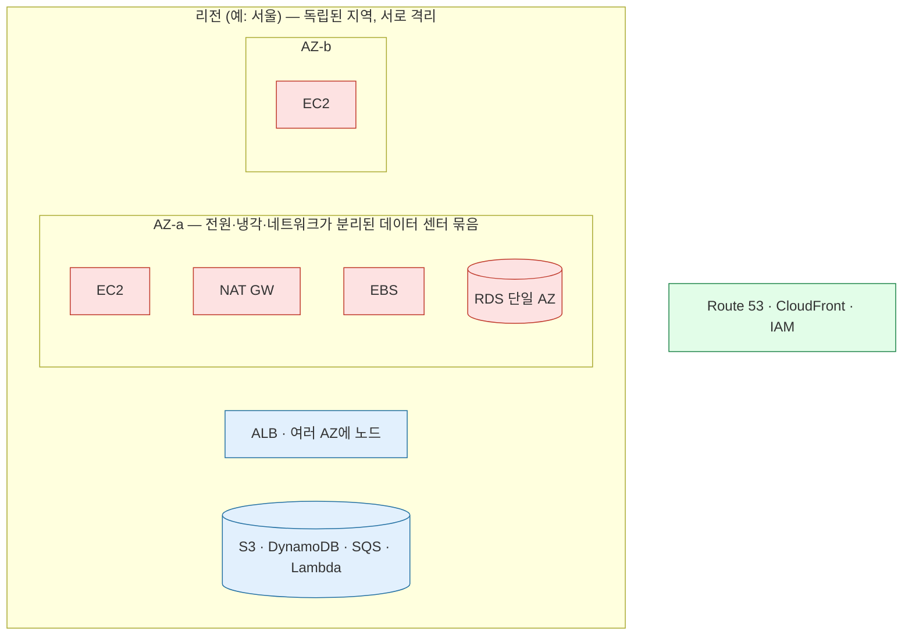
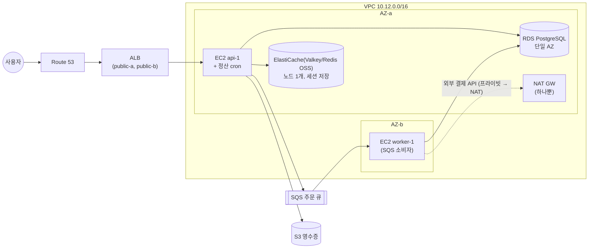

# M12-01. 가용성 숫자 읽기, 단일 장애점 찾기, AZ·리전 단위 설계
> 도메인: D2 · 예상 시간: 55분 · 실습 등급: 🟢 (구성 수준. 트래픽·장애 조치는 흐르지 않는다)

## 왜 필요한가

새벽 3시, "us-east-1의 한 가용 영역에서 전원 문제" 뉴스가 떴다. TodayOrder 팀장이 묻는다. "우리 서비스는 AZ 하나가 죽으면 살아남나?" M02~M05에서 VPC·EC2·RDS를 하나씩 만들었지만, 조각을 붙여 놓고 **전체가 어디서 끊어지는지** 본 적은 없다. 이 레슨은 가용성을 숫자로 읽는 법, 아키텍처 그림에서 **단일 장애점(SPOF, Single Point of Failure — 그것 하나만 죽어도 서비스 전체가 멈추는 구성 요소)**을 찾는 법, 그리고 AZ와 리전 중 어느 단위로 대비할지 고르는 법을 다룬다.

## 핵심 개념

### 가용성 숫자: "9가 몇 개인가"

가용성(availability) = 서비스가 정상으로 동작한 시간의 비율. 숫자 하나가 늘 때마다 허용되는 중단 시간은 10분의 1이 된다.

| 가용성 | 1년에 허용되는 중단 | 한 달(730시간)에 |
|---|---|---|
| 99% | 87.6시간 | 438분 |
| 99.9% ("three nines") | 8.76시간 | 43.8분 |
| 99.99% | 52.6분 | 4.4분 |
| 99.999% | 5.3분 | 26초 |

**직렬(모두 살아야 함)**은 곱하고, **병렬(하나만 살면 됨)**은 "모두 동시에 죽을 확률"을 뺀다.

- 직렬: `A = A1 × A2 × A3`. 사슬이 길수록 낮아진다.
- 병렬(독립 n개): `A = 1 − (1 − A1)ⁿ`. 같은 것을 두 개 두면 급격히 높아진다 — **단, 서로 독립일 때만.** 같은 AZ에 둔 두 서버는 AZ 장애에 함께 죽으므로 독립이 아니다.

예시(⚠️ 계산 연습용 숫자, AWS SLA 값이 아님): 로드 밸런서 99.99%, 서버 한 대 99.5%, DB 한 대 99.5%.

| 구성 | 계산 | 가용성 | 연간 중단 |
|---|---|---|---|
| v1: LB → 서버 1대 → DB 1대 | 0.9999 × 0.995 × 0.995 | 98.99% | 약 88시간 |
| v2: LB → 서버 2대(다른 AZ) → Multi-AZ DB(99.95%) | 0.9999 × (1 − 0.005²) × 0.9995 | 99.94% | 약 5.5시간 |

서버를 두 대로(병렬) 만들자 그 구간은 99.9975%가 됐고, 이제 사슬에서 가장 약한 고리는 DB다. **가장 약한 고리가 전체를 정한다.**

### 장애 범위: 무엇이 무엇과 함께 죽나



| 범위 | 예 | 고가용성을 만드는 책임 |
|---|---|---|
| **AZ 단위(zonal)** — 빨강 | EC2 인스턴스, EBS 볼륨, NAT 게이트웨이, 서브넷, 단일 AZ RDS | **나**. 여러 AZ에 나눠 둬야 한다 |
| **리전 단위(regional)** — 파랑 | S3, DynamoDB, SQS, SNS, Lambda, ALB(여러 AZ 서브넷 지정 시), EFS(리전 클래스) | AWS가 리전 안 여러 AZ에 걸쳐 운영. 나는 "여러 AZ 서브넷을 주는 것"만 챙긴다 |
| **글로벌** — 초록 | Route 53, CloudFront, IAM | AWS |

AZ 하나가 죽는 일은 리전 전체가 죽는 일보다 훨씬 흔하다. 그래서 **운영 서비스의 기본값은 "다중 AZ"**, **다중 리전은 RTO/RPO 요구가 정당화할 때**(레슨 2)다.

### SPOF를 고치는 표준 처방

| SPOF | 처방 | 관련 모듈 |
|---|---|---|
| EC2 한 대 | 시작 템플릿 + **Auto Scaling 그룹(최소 2, 여러 AZ)** + ALB 헬스 체크 | M03 |
| NAT 게이트웨이 한 개 | **AZ마다 NAT 하나**, 각 AZ의 프라이빗 라우팅 테이블이 자기 AZ의 NAT로 | M02 |
| RDS 단일 AZ | **Multi-AZ**(동기 복제 대기, 자동 장애 조치 보통 60~120초) 또는 Aurora(스토리지가 3개 AZ에 걸쳐 6개 복사본, 복제본 승격) | M05 |
| ElastiCache 노드 하나 | 복제본 + Multi-AZ 자동 장애 조치 | M05 |
| 큐 소비자(워커) 한 대 | ASG로 2대 이상. 큐가 버퍼가 되어 주문은 **잃지 않고 늦어질 뿐**(중단이 아니라 저하) | M06 |
| 서버 한 대에 박힌 cron | EventBridge Scheduler + Lambda/ECS 작업 | M06, M07 |
| 서버 디스크에만 있는 파일 | S3 또는 EFS | M04 |
| 리전 하나 | DR 전략(백업·복원 ~ 다중 사이트) | 레슨 2·3 |

## 직접 해 보기

### 워크시트 1: TodayOrder v1의 SPOF 찾기

아래는 입사 첫 달에 급하게 만든 TodayOrder v1이다. **AZ-a 하나가 통째로 사라지면** 무엇이 멈추는지, 그리고 **AZ-b의 무엇 하나가 죽으면** 무엇이 멈추는지 찾아 표로 정리하라. "멈춤(중단)"과 "느려짐(저하)"을 구분할 것.



<details><summary>모범 답안</summary>

| # | 구성 요소 | AZ-a 장애 시 | SPOF인가 | 처방 |
|---|---|---|---|---|
| 1 | EC2 `api-1` | API 전체 중단 | **예** (한 대) | ASG 최소 2대, 2개 AZ, ALB 대상 그룹 |
| 2 | 정산 cron(api-1 안) | 정산이 돌지 않음 | **예** (서버에 묶임) | EventBridge Scheduler → Lambda 또는 ECS 작업 |
| 3 | RDS 단일 AZ | 주문 저장 불가 → 전체 중단 | **예** | Multi-AZ (또는 Aurora + 다른 AZ 복제본) |
| 4 | ElastiCache 노드 1개 | 세션 유실 → 전원 로그아웃 | **예** | 복제본 + Multi-AZ 자동 장애 조치 (세션은 DynamoDB도 대안) |
| 5 | NAT GW 하나(AZ-a) | AZ-b의 worker가 결제 API를 못 부름 | **예** (다른 AZ의 의존) | AZ마다 NAT, AZ별 라우팅 테이블 |
| 6 | EC2 `worker-1`(AZ-b) | (AZ-a 장애와 무관) 이 한 대가 죽으면 주문 처리가 **멈추지만 주문은 큐에 쌓인다** | **예, 단 영향은 "저하"** | ASG 최소 2대 |
| 7 | ALB | 다른 AZ 노드로 계속 동작 | 아니오 (2개 AZ 서브넷) | — |
| 8 | SQS, S3, Route 53 | 계속 동작 | 아니오 (리전·글로벌 관리형) | — |
| 9 | 리전(서울) 자체 | — | 리전 장애에는 전부 중단 | 요구 RTO/RPO에 따라 DR (레슨 2) |

가장 흔한 실수: ALB를 SPOF로 적는 것(여러 AZ에 노드가 있는 관리형이다), NAT를 놓치는 것(AZ-b의 서버가 **AZ-a의 NAT에 의존**한다 — 이런 "AZ를 건너는 의존"이 숨은 SPOF다), 워커를 "중단"으로 적는 것(큐가 있어서 지연일 뿐이다).

</details>

### 실습: 같은 v1을 에뮬레이터에 만들고, 감사 도구로 찾고, 고치기 — [labs/lab01-spof-hunt.sh](./labs/lab01-spof-hunt.sh)

워크시트의 핵심 부분(NAT 1개, API 서버 1대, ALB, 단일 AZ RDS)을 그대로 만든 뒤, [`sdk/spof_audit.py`](./sdk/spof_audit.py)가 **구성 정보만 읽어** "AZ 하나가 사라지면 무엇이 같이 죽는가"를 판정한다.

```bash
bash curriculum/m12-resilience-dr-migration/labs/lab01-spof-hunt.sh
```

```
== 1. TodayOrder v1 만들기
v1 완성: VPC vpc-000000000000000fe · NAT 1개 · API 1대 · ALB · RDS(단일 AZ)
== 2. SPOF 감사 (v1)
감사 대상: todayorder-m12-v1 (vpc-000000000000000fe)
[OK]   EDGE: 로드 밸런서 todayorder-m12-alb 가 2개 AZ에 걸쳐 있음
[SPOF] NAT: NAT 게이트웨이가 us-east-1a 에만 있다. 다른 AZ의 프라이빗 서브넷이 그 NAT 에 의존: todayorder-m12-app-b(us-east-1b)→nat-00000000000000118(us-east-1a), todayorder-m12-db-b(us-east-1b)→nat-00000000000000118(us-east-1a)
[SPOF] COMPUTE: 대상 그룹 todayorder-m12-api 의 서버가 1대 (us-east-1a:1대) — 한 대(또는 한 AZ)가 죽으면 서비스 중단
[SPOF] DATABASE: RDS todayorder-m12-db 가 단일 AZ(us-east-1a) — 대기 인스턴스가 없어 그 AZ 장애 시 스냅샷·PITR 로 복원할 때까지 DB 중단
SPOF 3건
== 3. 고치기
-- 3a. AZ-b 에 NAT 게이트웨이를 하나 더, 프라이빗 라우팅을 AZ 별로 나눈다
-- 3b. API 서버를 2-AZ Auto Scaling 그룹(최소 2대)으로 바꾸고, 수작업 서버는 내린다
-- 3c. RDS 를 Multi-AZ 로
modifying	True
== 4. SPOF 감사 (v2)
감사 대상: todayorder-m12-v1 (vpc-000000000000000fe)
[OK]   NAT: 프라이빗 서브넷마다 같은 AZ의 NAT 사용 (NAT 있는 AZ: us-east-1a, us-east-1b)
[OK]   EDGE: 로드 밸런서 todayorder-m12-alb 가 2개 AZ에 걸쳐 있음
[OK]   COMPUTE: 대상 그룹 todayorder-m12-api — us-east-1a:1대, us-east-1b:1대
[OK]   DATABASE: RDS todayorder-m12-db Multi-AZ
SPOF 0건
LAB01 OK
```

방금 본 것:

- **NAT**: 감사기는 라우팅 테이블마다 `0.0.0.0/0 → nat-…` 경로를 찾고, 그 NAT가 있는 서브넷의 AZ와 라우팅 테이블에 연결된 서브넷의 AZ를 비교했다. AZ-b 서브넷이 AZ-a의 NAT를 쓰는 "AZ를 건너는 의존"이 걸렸다.
- **COMPUTE**: ALB 대상 그룹의 대상(`describe_target_health`)을 인스턴스 AZ별로 셌다. 고친 뒤에는 ASG가 띄운 두 대가 AZ-a·AZ-b에 하나씩 있다.
- **DATABASE**: `modify-db-instance --multi-az --apply-immediately`의 응답은 `modifying True`였고, 폴링으로 `available`이 될 때까지 기다렸다.
- 고치는 데 쓴 명령 세 묶음(NAT·라우팅, ASG, Multi-AZ)이 곧 v2 설계다. 실제로는 이 구성을 CloudFormation 등 IaC로 남긴다(M10).

## 실제 AWS에서는

- 에뮬레이터에서는 트래픽이 흐르지 않고 장애 조치도 일어나지 않는다. RDS는 `MultiAZ=True`가 되지만 `SecondaryAvailabilityZone`이 비어 있고, 강제 장애 조치를 해도 AZ가 바뀌지 않는다(FIDELITY). 이 실습이 보여 주는 것은 "구성이 장애를 견딜 모양인가"이다.
- 실제 AWS의 ASG는 `--target-group-arns`로 붙인 대상 그룹에 **인스턴스를 자동 등록**한다. 에뮬레이터는 자동 등록을 하지 않아 lab이 `register-targets`로 손수 등록한다. 또 에뮬레이터는 `ReplaceRouteTableAssociation`이 501이라 연결을 끊고 다시 이었다(실제 AWS에서는 `replace-route-table-association` 한 번이면 된다).
- 실제 장애 조치를 연습하려면 **AWS Fault Injection Service(FIS)**로 인스턴스 종료·AZ 전원 차단 시나리오를 주입하고, **Amazon Application Recovery Controller(ARC)**의 존 시프트(zonal shift)로 문제 AZ에서 트래픽을 빼는 연습을 한다.
- AZ 이름(`us-east-1a`)은 계정마다 다른 물리 AZ에 대응할 수 있다. 계정 간 같은 AZ를 맞추려면 AZ ID(`use1-az1`)를 쓴다(M00).

**실제 AWS에서 해 보려면**: 이 lab을 실제 계정에서 그대로 돌리면 **NAT 게이트웨이 2개(시간당 + 처리 요금, 프리 티어 아님), ALB(시간당), RDS Multi-AZ(단일 AZ의 약 2배, 프리 티어는 단일 AZ만 해당)**가 과금된다. 해 본다면 몇십 분 안에 정리한다: lab의 `teardown` 함수 순서대로(ASG 삭제 → ALB·대상 그룹 → RDS `--skip-final-snapshot` → NAT 삭제 → 탄력적 IP 해제 → IGW·서브넷·라우팅 테이블·VPC). 무료로 연습하려면 EC2 `t3.micro` 두 대를 서로 다른 AZ에 띄우고 하나를 종료해 보는 정도가 안전하다.

## 시험 포인트

- "AZ 하나가 실패해도 서비스 유지" → **여러 AZ에 걸친 ASG + ALB**, **RDS Multi-AZ**, **AZ별 NAT 게이트웨이**.
- 숨은 SPOF 단골: **NAT 게이트웨이 하나**, 서버에 박힌 cron·세션·파일, 단일 노드 캐시.
- ALB, S3, DynamoDB, SQS, Lambda는 리전 단위로 여러 AZ에 걸쳐 동작한다 → 그 자체를 SPOF로 고르지 않는다(단, ALB에 여러 AZ 서브넷을 지정해야 한다).
- 가용성 계산: 직렬은 곱, 병렬은 `1 − (1 − A)ⁿ`. 같은 AZ의 두 대는 AZ 장애에 독립이 아니다.
- Multi-AZ = **가용성**, 읽기 전용 복제본 = **읽기 확장**(M05). "장애 시 자동 조치"면 Multi-AZ. Multi-AZ **DB 인스턴스** 배포의 대기는 읽을 수 없다. 예외로 **Multi-AZ DB 클러스터** 배포는 읽기 가능한 대기 2개를 두어 읽기도 분산한다.
- 리전 장애 대비는 비용이 크다 → RTO/RPO 요구를 보고 DR 전략을 고른다(레슨 2).

## 스스로 확인

1. 서버 두 대를 같은 AZ에 두면 "병렬 가용성 공식"이 왜 맞지 않는가?
2. SQS 큐 뒤의 워커가 한 대뿐인 것과, API 서버가 한 대뿐인 것은 장애의 성격이 어떻게 다른가?
3. 감사 도구가 v2에서 SPOF 0건을 냈다. 그래도 남아 있는 위험 두 가지를 말해 보라.

<details><summary>답</summary>

1. 공식은 두 대가 **독립적으로** 고장 난다고 가정한다. 같은 AZ의 두 대는 전원·네트워크를 공유하므로 AZ 장애 때 동시에 죽는다. 독립성을 얻으려면 서로 다른 AZ에 둔다.
2. API 한 대가 죽으면 요청을 받을 곳이 없어 **즉시 중단**된다. 워커 한 대가 죽으면 메시지가 큐에 남아 **처리가 늦어질 뿐** 주문은 잃지 않는다(큐 보존 기간 안에서). 둘 다 고쳐야 하지만 우선순위가 다르다.
3. 예: (1) 리전 전체 장애 — 다중 AZ로는 막지 못한다(레슨 2·3). (2) 데이터 손상·실수로 지운 데이터 — Multi-AZ는 잘못된 쓰기까지 즉시 복제하므로 **백업**(PITR, AWS Backup)이 따로 필요하다. 그 밖에 배포 실수, 용량 부족, 의존하는 외부 결제 API 장애 등.

</details>
