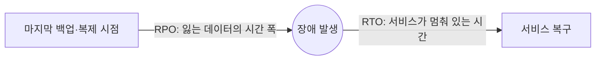
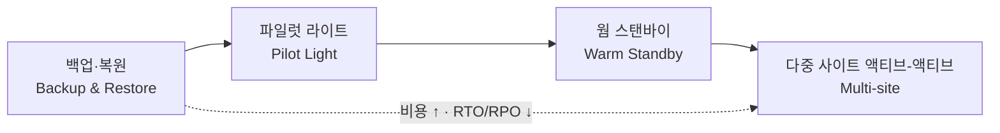

# M12-02. RTO/RPO와 DR 4전략 — 그리고 에뮬레이터 두 개로 "리전 장애" 겪어 보기
> 도메인: D2 · 예상 시간: 60분 · 실습 등급: 🟡 (두 "리전"은 포트가 다른 두 에뮬레이터 — 실제 리전 간 복제·DNS 전환은 없다)

## 왜 필요한가

레슨 1에서 TodayOrder를 다중 AZ로 고쳤다. 그런데 "리전 전체가 몇 시간 멈춘다면?"이라는 질문이 남는다. 다중 리전은 비싸다. 서버·DB·복제 트래픽이 리전 수만큼 늘어난다. 그래서 먼저 사업 쪽과 **두 개의 숫자**를 합의해야 한다. "얼마나 빨리 되살려야 하나(RTO)"와 "얼마만큼의 데이터를 잃어도 되나(RPO)". 이 두 숫자가 DR(Disaster Recovery, 재해 복구) 전략과 비용을 정한다. 이 레슨에서는 4가지 전략을 비교하고, 에뮬레이터 두 개를 "서울"과 "도쿄"로 삼아 장애 조치를 직접 해 본다.

## 핵심 개념

### RTO와 RPO



- **RPO(Recovery Point Objective, 복구 시점 목표)**: 장애가 나면 **과거 어느 시점까지의 데이터로 되돌아가도 되나**. "RPO 1시간" = 최대 1시간치 주문을 잃어도 된다 → 최소 1시간마다 백업·복제해야 한다.
- **RTO(Recovery Time Objective, 복구 시간 목표)**: 장애 발생부터 **서비스가 다시 동작할 때까지 허용되는 시간**. "RTO 15분" = 15분 안에 다른 곳에서 주문을 받아야 한다.
- 둘 다 **짧을수록 비싸다.** RPO를 줄이려면 더 자주(결국 연속으로) 복제하고, RTO를 줄이려면 DR 쪽에 미리 더 많은 것을 켜 둬야 한다.

### DR 4전략



| 전략 | DR 리전에 평소 있는 것 | 장애 때 할 일 | RPO | RTO | 비용 |
|---|---|---|---|---|---|
| **백업·복원** | 백업(스냅샷·AWS Backup 복사본·S3 복제본)만 | 인프라를 IaC로 **새로 만들고** 백업에서 데이터 복원 | 시간 (백업 주기) | 시간 | **가장 낮음** |
| **파일럿 라이트** | **데이터는 실시간에 가깝게 복제**(DB 복제본, S3 CRR), 핵심 인프라는 정의·준비돼 있으나 **앱 서버는 꺼져 있거나 0대** | 앱 서버를 켜고(ASG 용량 0 → N) 트래픽을 돌림 | 초~분 | 수십 분 | 낮음 |
| **웜 스탠바이** | 전체 스택이 **작은 규모로 항상 동작**(트래픽을 받을 수 있음) | 규모를 키우고 트래픽을 돌림 | 초~분 | 분 | 중간 |
| **다중 사이트 액티브-액티브** | 두 리전 모두 **실제 트래픽을 처리** 중 | (거의 없음) 죽은 리전을 빼기만 | 거의 0 | 거의 0 | **가장 높음** |

AWS의 DR 백서도 같은 순서로 RPO/RTO를 "시간 → 수십 분 → 분 → 실시간"으로 설명한다. 헷갈리는 두 개를 구분하는 질문: **"DR 리전이 지금 이 순간 요청을 받을 수 있나?"** 받을 수 없으면(서버를 켜야 함) 파일럿 라이트, 작은 규모라도 받을 수 있으면 웜 스탠바이.

전략별로 자주 쓰는 AWS 재료:

| 재료 | 쓰임 |
|---|---|
| AWS Backup 교차 리전·교차 계정 복사, EBS·RDS 스냅샷 복사 | 백업·복원 (레슨 3) |
| S3 교차 리전 복제(CRR), S3 Replication Time Control(RTC — 객체의 99.9%를 15분 안에 복제한다는 SLA, [S3 RTC](https://docs.aws.amazon.com/AmazonS3/latest/userguide/replication-time-control.html)) | 모든 전략의 객체 데이터 |
| RDS 교차 리전 읽기 전용 복제본(승격), **Aurora Global Database**(보조 리전 승격, 복제 지연 보통 1초 미만) | 파일럿 라이트 이상 |
| **DynamoDB 글로벌 테이블**(다중 리전·다중 활성) | 웜 스탠바이·액티브-액티브 |
| AWS Elastic Disaster Recovery(서버 블록 단위 연속 복제, RPO 초·RTO 분) | 서버 기반 앱의 파일럿 라이트형 DR (레슨 3) |
| CloudFormation/IaC, AMI 복사 | DR 리전 인프라를 "언제든 똑같이" 만들기 |
| Route 53 장애 조치 라우팅 + 상태 확인, Amazon Application Recovery Controller(ARC), Global Accelerator | 트래픽 전환 |

### DR은 "전환 절차"까지가 DR이다

복제만 해 두고 **전환 절차**(런북)를 연습하지 않으면 장애 당일에 RTO를 못 지킨다. 런북에 들어갈 것: 장애 판정 기준(누가 언제 선언하나), 쓰기 중지, DR 쪽 승격·확장, 설정 전환(엔드포인트·DNS), 검증, 그리고 **페일백**(원래 리전 복구 후 되돌아가기 — DR에서 받은 데이터를 역방향으로 옮겨야 한다).

## 직접 해 보기

### 워크시트 2: 시나리오별 전략 고르기

각 상황에 맞는 DR 전략을 고르고 한 줄로 근거를 쓰라.

| # | 상황 |
|---|---|
| a | 사내 위키. 하루 멈춰도 되고, 어제 밤 백업까지만 있으면 된다. 비용은 최소로. |
| b | TodayOrder 주문 API. 리전 장애 시 30분 안에 복구, 잃어도 되는 주문은 1분 이하. 평소 DR 비용은 최소화. |
| c | 결제 승인 서비스. 리전 장애에도 몇 분 안에 줄어든 용량으로라도 바로 응답해야 한다. |
| d | 글로벌 실시간 입찰 시스템. 어떤 리전 장애에도 사용자가 눈치채면 안 되고, 데이터 손실은 0에 가까워야 한다. 비용은 2순위. |
| e | 규정상 백업을 **다른 계정·다른 리전**에 보관하고, 백업을 누구도 지울 수 없어야 한다. |
| f | 온프레미스의 오래된 Windows 서버 30대. 앱을 고칠 수 없다. RPO 초 단위, RTO 분 단위로 AWS에 DR을 두고 싶다. |

<details><summary>모범 답안</summary>

| # | 전략 | 근거 |
|---|---|---|
| a | **백업·복원** | RTO·RPO가 시간~하루 단위로 넉넉하다 → 가장 싼 전략. 매일 백업을 다른 리전에 복사(AWS Backup 복사 규칙) + IaC로 재구축. |
| b | **파일럿 라이트** | RPO 1분 이하 → 데이터는 연속 복제(Aurora Global Database 또는 교차 리전 복제본, S3 CRR). RTO 30분 → 앱 서버는 꺼 두고 장애 때 ASG를 키워도 시간 안에 든다. 웜 스탠바이도 요구는 만족하지만 "평소 비용 최소"에 어긋난다. |
| c | **웜 스탠바이** | "바로 응답(줄어든 용량으로라도)" = DR 쪽 스택이 항상 떠 있어야 한다. 파일럿 라이트는 서버를 켜는 시간이 걸린다. |
| d | **다중 사이트 액티브-액티브** | RTO·RPO ≈ 0. DynamoDB 글로벌 테이블 등 다중 활성 데이터 + Route 53 지연 시간/장애 조치 라우팅 또는 Global Accelerator. |
| e | **백업·복원** + AWS Backup **교차 계정·교차 리전 복사** + **Vault Lock(규정 준수 모드)** 또는 논리적 에어갭 볼트 | 전략은 백업 기반, 핵심은 "삭제 불가". 레슨 3. |
| f | **AWS Elastic Disaster Recovery** | 앱을 고치지 않고 서버 블록 단위 연속 복제, 장애 때 복구 인스턴스를 띄운다. RPO 초·RTO 분. |

</details>

### 실습: 두 에뮬레이터로 "서울 → 도쿄" 장애 조치 — [labs/lab02-multi-region-dr.sh](./labs/lab02-multi-region-dr.sh)

**먼저 분명히 해 둘 것**: 에뮬레이터는 리전을 나누지 않는다(M00). 그래서 이 실습은 **포트가 다른 에뮬레이터 두 개**를 서로 독립된 두 리전처럼 쓴다. 둘 다 기술적으로는 `us-east-1`이고 계정도 같은 `000000000000`이다. "서울"이 꺼져도 "도쿄"는 아무 영향이 없다는 점(독립 장애)만 실제 리전과 같다.

| 이름 | 에뮬레이터 | 연결 방법 |
|---|---|---|
| 서울(주 리전) | `$EMULATOR_PORT` (예: 9297) | `source scripts/env.sh` |
| 도쿄(DR 리전) | `$DR_EMULATOR_PORT` (예: 9298) | `source scripts/dr-env.sh` |

**`DR_EMULATOR_PORT`는 항상 명시하라.** `export EMULATOR_PORT=9297 DR_EMULATOR_PORT=9298`. 터미널에서 직접 실행할 때만 생략하면 `EMULATOR_PORT + 1`을 쓰고, 스크립트·CI·AI 에이전트 같은 비대화형 실행에서는 `dr-env.sh`, lab02, `verify.sh`가 모두 거부한다. lab02와 `verify.sh`는 그 포트의 에뮬레이터 데이터를 지우거나 재시작·종료하기 때문에, "다음 번호 포트"를 추측했다가 남의 에뮬레이터를 지우는 사고를 막으려는 것이다.

공용 [`scripts/dr-env.sh`](../../scripts/dr-env.sh)(M00 레슨 3)는 `scripts/env.sh`가 주 리전에 하는 일을 DR 리전에 대해 한다. `~/.aws/emulator/<DR 포트>/`의 자격 증명·인증서로 `DR_AWS_ENDPOINT_URL`, `DR_AWS_CA_BUNDLE`, `DR_AWS_SHARED_CREDENTIALS_FILE`, `DR_AWS_CONFIG_FILE`을 내보낸다. 그리고 주 리전과 다른 포트인지, 그 리전의 계정이 `000000000000`인지 확인한다(안전 장치). 실패하면 `DR_AWS_*` 변수를 지운다. 셸의 기본 `aws` 명령은 계속 서울을 향하고, 도쿄에 보낼 때는 `dr_aws` 함수를 쓴다.

등장하는 코드 두 개:

- [`sdk/order_app.py`](./sdk/order_app.py) — **리전을 모르는** 주문 앱. 어디에 연결할지는 환경 변수(`EMULATOR_PORT` → `env.sh`)만으로 정해진다. 리전마다 다른 버킷 이름은 그 리전의 Parameter Store `/todayorder/receipts-bucket`에서 읽는다. 그래서 장애 조치는 코드를 바꾸는 일이 아니라 **바라볼 곳을 바꾸는 일**이 된다.
- [`sdk/dr_replicate.py`](./sdk/dr_replicate.py) — 서울의 S3 영수증과 DynamoDB 주문을 도쿄로 복사한다. `emulator_guard`의 `emulator_site()`(M00 레슨 5)로 사이트를 하나씩 연다. `emulator_site(real_aws_region="ap-northeast-2")`는 `AWS_*` 변수(서울)를, `emulator_site("DR_", real_aws_region="ap-northeast-1")`는 `DR_AWS_*` 변수(도쿄)를 검사하고 STS로 계정을 확인한 뒤, **그 사이트로 고정된** `.client()`를 돌려준다. 코드에 엔드포인트가 하나도 없고, 두 리전 모두 같은 안전 장치를 거친다. `real_aws_region`은 실제 AWS에서 돌릴 때(`TODAYORDER_ALLOW_REAL_AWS=1`, env.sh 없는 새 셸)만 쓰는 리전이다.

```bash
export EMULATOR_PORT=9297 DR_EMULATOR_PORT=9298
bash curriculum/m12-resilience-dr-migration/labs/lab02-multi-region-dr.sh
```

```
[env.sh] 포트 9312 의 에뮬레이터에 연결됨: https://127.0.0.1:9312 (Account 000000000000, us-east-1)
[dr-env.sh] 두 번째 사이트 = 포트 9313 의 에뮬레이터: https://127.0.0.1:9313 (Account 000000000000)
== 1. 서울(주 리전) 준비: 테이블·버킷·설정
[order_app] 연결 대상: https://127.0.0.1:9312 (리전 us-east-1)
테이블 생성: todayorder-orders
버킷 생성: todayorder-receipts-seoul
설정: /todayorder/receipts-bucket = todayorder-receipts-seoul
== 2. 도쿄(DR 리전) 파일럿 라이트: 같은 앱으로 '불씨'만 만들어 둔다 (서버는 없음)
[order_app] 연결 대상: https://127.0.0.1:9313 (리전 us-east-1)
테이블 생성: todayorder-orders
버킷 생성: todayorder-receipts-tokyo
설정: /todayorder/receipts-bucket = todayorder-receipts-tokyo
== 3. 평소 영업: 서울에 주문 3건
[order_app] 연결 대상: https://127.0.0.1:9312 (리전 us-east-1)
주문 저장: A-1001 (10010원) → 테이블 todayorder-orders, s3://todayorder-receipts-seoul/receipts/A-1001.json
...(A-1002, A-1003)
== 4. 정기 복제: 서울 → 도쿄
[서울] https://127.0.0.1:9312 (리전 이름 us-east-1 — 에뮬레이터라 둘 다 us-east-1)
[도쿄] https://127.0.0.1:9313 (리전 이름 us-east-1 — 에뮬레이터라 둘 다 us-east-1)
동기화: 영수증 3개 복사 · 0개 변경 없음 · 주문 3건 → 도쿄(s3://todayorder-receipts-tokyo, todayorder-orders) [0.2초]
확인: 서울 주문 3 · 영수증 3  |  도쿄 주문 3 · 영수증 3
SDK dr_replicate OK
== 5. 복제 이후에도 주문은 계속 들어온다 (아직 도쿄에 없음)
...(A-1004, A-1005 저장)
마지막 동기화: 2026-11-12T12:05:36+00:00
서울: 주문 5 · 영수증 5
도쿄: 주문 3 · 영수증 3
지금 주 리전이 사라지면 잃는 주문: 2건 ['A-1004', 'A-1005']  ← 마지막 동기화 이후의 데이터(RPO)
== 6. 서울 리전 장애 발생 (docker pause aws-emulator-9312)
서울 헬스 체크: 응답 없음 → 런북 시작
== 7. 장애 조치: EMULATOR_PORT=9313 로 바꿔 도쿄에서 앱 실행
[order_app] 연결 대상: https://127.0.0.1:9313 (리전 us-east-1)
주문 3건: A-1001, A-1002, A-1003
영수증 3개 (s3://todayorder-receipts-tokyo/receipts/)
[order_app] 연결 대상: https://127.0.0.1:9313 (리전 us-east-1)
주문 저장: A-1006 (10060원) → 테이블 todayorder-orders, s3://todayorder-receipts-tokyo/receipts/A-1006.json
장애 감지 → 도쿄에서 첫 주문 처리까지: 4초 (이 실습 환경의 RTO. 실제는 DNS 전환·확장 시간이 더해진다)
== 8. 서울 복구 (docker unpause)
서울 헬스 체크: ok — 하지만 이제 '진짜 데이터'는 도쿄에 있다(A-1006). 페일백 전에 역방향 동기화가 필요하다
서울: A-1001,A-1002,A-1003,A-1004,A-1005
도쿄: A-1001,A-1002,A-1003,A-1006
잃은 주문(RPO): A-1004, A-1005 — 마지막 동기화 이후 서울에만 쓰인 2건
LAB02 OK
참고: DR 리전 에뮬레이터(포트 9313)는 켜 둔 채로 끝납니다. 다 썼으면 끄세요: scripts/emulator-down.sh 9313
```

방금 본 것:

- **"리전 장애"는 `docker pause`로 흉내 냈다.** 컨테이너가 멈추면 포트는 열려 있어도 응답이 없다. 실제 리전 장애도 "연결 거부"보다 "응답 없음(타임아웃)"으로 보이는 경우가 많다.
- **RPO가 숫자로 보였다.** 마지막 동기화 이후 서울에만 쓰인 A-1004, A-1005가 도쿄에 없다. 이 실습의 복제는 "가끔 한 번에 복사"라서 RPO = 동기화 주기다. 실제 파일럿 라이트는 DB·S3를 **연속 복제**해 RPO를 초~분으로 줄인다.
- **RTO도 숫자로 보였다(4초, 실행마다 조금씩 다르다).** 이 짧은 숫자는 실제 RTO가 아니다. 실제로는 장애 판정(사람·경보), DNS 전환(TTL), 서버 기동·확장, 검증 시간이 더해진다. 그 합을 줄이는 것이 전략 선택의 핵심이다.
- **장애 조치 = `EMULATOR_PORT` 바꾸기.** 앱 코드는 그대로이고, 리전별 설정은 각 리전의 Parameter Store에서 읽었다. 도쿄의 버킷 이름이 서울과 다른 이유: S3 버킷 이름은 **전 세계에서 유일**해야 하기 때문이다. DynamoDB 테이블 이름은 리전마다 같아도 된다.
- **페일백 문제**: 서울이 돌아왔지만 A-1006은 도쿄에만 있다. 단방향 복제를 그대로 다시 돌리면 도쿄의 새 데이터를 무시하게 된다. 그래서 `dr_replicate.py sync`는 "도쿄에만 있는 주문"을 경고로 알린다. 페일백 전에 역방향 동기화가 필요하다.

### 런북을 손으로 실행해 보기

lab이 한 일을 직접 해 보면 "장애 조치는 바라보는 곳을 바꾸는 일"이라는 감각이 생긴다. (포트는 자기 환경에 맞게. 학습자 기본: 서울 9297, 도쿄 9298)

```bash
# 0) 두 리전 준비 (lab02 를 한 번 돌렸다면 이미 되어 있다)
export EMULATOR_PORT=9297 DR_EMULATOR_PORT=9298   # 두 포트를 항상 명시
scripts/emulator-up.sh "$DR_EMULATOR_PORT"        # 도쿄 에뮬레이터
source scripts/env.sh
source scripts/dr-env.sh

# 1) 평소: 서울에 주문하고 도쿄로 복제
uv run python curriculum/m12-resilience-dr-migration/sdk/order_app.py place A-2001 25000
uv run python curriculum/m12-resilience-dr-migration/sdk/dr_replicate.py sync
uv run python curriculum/m12-resilience-dr-migration/sdk/dr_replicate.py status

# 2) 장애: 서울을 멈춘다
docker pause aws-emulator-9297

# 3) 장애 조치: 바라보는 곳을 도쿄로 바꾼다 (이 셸 전체가 도쿄를 향하게 된다)
export EMULATOR_PORT="$DR_EMULATOR_PORT" && source scripts/env.sh
uv run python curriculum/m12-resilience-dr-migration/sdk/order_app.py list
uv run python curriculum/m12-resilience-dr-migration/sdk/order_app.py place A-2002 31000

# 4) 복구와 정리
docker unpause aws-emulator-9297
export EMULATOR_PORT=9297 && source scripts/env.sh
scripts/emulator-down.sh "$DR_EMULATOR_PORT"     # 도쿄 에뮬레이터 끄기
```

3)에서 `source scripts/env.sh`를 하지 않고 `EMULATOR_PORT`만 바꾸면 이 셸의 `AWS_ENDPOINT_URL`은 여전히 서울을 가리킨다. 실제 장애 조치에서도 "설정 하나를 바꿨는데 다른 곳에 옛 값이 남아 있는" 실수가 흔하다. 그래서 전환 절차는 스크립트로 만들어 연습한다.

## 실제 AWS에서는

- 실제 다중 리전에서는 `DR_…` 변수 대신 **같은 자격 증명으로 리전만 다른 두 클라이언트**를 만든다(`boto3.client("s3", region_name="ap-northeast-1")`). 데이터 복사는 직접 하지 않고 **S3 CRR, DynamoDB 글로벌 테이블, Aurora Global Database, AWS Backup 교차 리전 복사** 같은 관리형 복제를 쓴다. 이 lab의 `dr_replicate.py`는 그 원리를 보이기 위한 교육용이다.
- 트래픽 전환은 사람이 `EMULATOR_PORT`를 바꾸는 것이 아니라 **Route 53 장애 조치 레코드 + 상태 확인**이나 **ARC 라우팅 제어**로 한다. 에뮬레이터의 Route 53 상태 확인은 항상 성공하므로 이 부분은 재현할 수 없다(M08).
- 실제 리전 간 복제에는 **리전 간 데이터 전송 요금**과 DR 쪽 리소스 요금이 든다(M13).

**실제 AWS에서 해 보려면**: 프리 티어 계정에서 두 리전(예: `ap-northeast-2`, `ap-northeast-1`)에 S3 버킷을 만들고 **버전 관리를 켠 뒤 CRR 규칙**을 걸어, 서울에 올린 객체가 도쿄에 복제되는 것을 볼 수 있다. S3 저장 요금(프리 티어 범위 안이면 거의 0)과 **리전 간 전송 요금**(작은 파일 몇 개면 몇 센트 미만)이 든다. 정리: 복제 규칙 삭제 → 두 버킷 비우기(모든 버전 포함) → 버킷 삭제. DynamoDB 글로벌 테이블은 쓰기 용량이 리전 수만큼 과금되니 실험 후 바로 지운다.

## 시험 포인트

- "RTO·RPO 몇 시간, 최저 비용" → **백업·복원**. "RPO 초~분, RTO 수십 분, DR 평소 비용 최소" → **파일럿 라이트**. "분 단위 RTO, 줄어든 용량으로 즉시 응답" → **웜 스탠바이**. "RTO·RPO ≈ 0" → **다중 사이트 액티브-액티브**.
- 파일럿 라이트 vs 웜 스탠바이: **DR 쪽이 지금 바로 요청을 받을 수 있나?** 받을 수 있으면 웜 스탠바이.
- "관계형 DB, 리전 장애 시 1분 안쪽 RTO·초 단위 RPO" → **Aurora Global Database**(보조 리전 승격). "NoSQL 다중 리전 다중 쓰기" → **DynamoDB 글로벌 테이블**.
- "S3 객체를 다른 리전에, 시간 보장(SLA)과 함께" → **S3 CRR + Replication Time Control**.
- 트래픽 전환: **Route 53 장애 조치 라우팅 + 상태 확인**, 정밀한 리전 전환 제어는 **ARC**.
- 복제는 실수(잘못된 삭제·손상)도 복제한다 → 백업은 따로.

## 스스로 확인

1. RPO 5분, RTO 4시간인 서비스에 가장 비용 효율적인 전략은 무엇이고, 데이터는 어떻게 다뤄야 하나?
2. lab02에서 RPO가 "동기화 주기"였던 이유와, 실제 파일럿 라이트에서 RPO를 초 단위로 줄이는 방법은?
3. 장애 조치 후 서울이 복구됐다. 바로 서울로 트래픽을 되돌리면 어떤 문제가 생기나?

<details><summary>답</summary>

1. RTO가 넉넉하므로 서버는 장애 때 새로 만들어도 된다(백업·복원 수준의 인프라). 하지만 RPO 5분은 하루 백업으로는 못 지킨다 → 데이터만 연속 또는 5분 이내 주기로 복제한다(DB 교차 리전 복제본/Aurora Global, S3 CRR). 사실상 "데이터는 파일럿 라이트, 컴퓨트는 백업·복원" — 요구를 두 축으로 나눠 보는 것이 핵심이다.
2. `dr_replicate.py`는 실행할 때만 한 번에 복사한다. 그래서 마지막 실행 이후의 쓰기는 모두 잃는다. 실제로는 DB의 지속 복제(Aurora Global Database, RDS 교차 리전 복제본, DynamoDB 글로벌 테이블)와 S3 CRR(+RTC)로 쓰기 직후 복제해 RPO를 초~분으로 만든다.
3. 장애 조치 이후 도쿄에서 받은 주문(A-1006)이 서울에 없다. 바로 되돌리면 그 주문이 "사라진" 것처럼 보이고, 단방향 복제를 다시 돌리면 덮어쓰거나 무시될 수 있다. 페일백 전에 도쿄 → 서울 역방향 동기화와 정합성 확인을 하고, 쓰기를 잠깐 멈춘 상태에서 전환한다.

</details>
