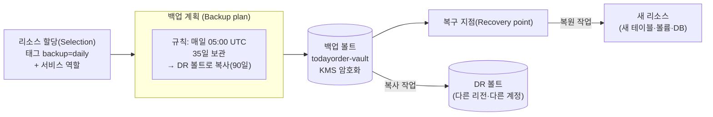

# M12-03. AWS Backup, 스냅샷 교차 리전 복사, Elastic Disaster Recovery
> 도메인: D2 · 예상 시간: 55분 · 실습 등급: 🟢 볼트·계획·선택·온디맨드 백업·복사 / 🟡 복원(테이블만 생기고 데이터는 비어 있음)

## 왜 필요한가

레슨 2에서 고른 전략이 무엇이든 바닥에는 **백업**이 있다. 다중 AZ와 복제는 장비 장애는 막지만, 누군가 `DELETE FROM orders`를 실행하면 그 실수도 즉시 복제한다. TodayOrder에는 지금 서비스마다 백업 방식이 따로 있다. RDS 자동 백업, DynamoDB PITR(시점 복구), EBS 스냅샷 크론, S3 버전 관리가 제각각이다. "모든 주문 데이터를 매일 백업하고, 35일 보관하고, 다른 리전에도 사본을 두고, 아무도 못 지우게" 하려면 한 곳에서 정책으로 관리해야 한다. 그것이 AWS Backup이다.

## 핵심 개념

### AWS Backup의 네 가지 부품



| 부품 | 무엇 | TodayOrder 예 |
|---|---|---|
| **백업 볼트(vault)** | 복구 지점을 담는 암호화된 컨테이너. 볼트별 접근 정책·**Vault Lock** | `todayorder-vault`, `todayorder-dr-vault` |
| **백업 계획(plan)** | 규칙 묶음: 일정(cron), 시작·완료 창, 보관 기간(수명 주기), **복사 작업(다른 리전·계정 볼트로)** | 매일 05:00 UTC, 35일, DR 볼트로 복사 90일 |
| **리소스 할당(selection)** | 계획이 백업할 대상: 리소스 ARN 또는 **태그 조건** + Backup이 맡을 **IAM 서비스 역할** | 태그 `backup=daily` |
| **복구 지점(recovery point)** | 백업 한 번의 결과물(스냅샷 등). 여기서 **복원 작업**으로 새 리소스를 만든다 | 주문 테이블의 05:00 백업 |

대상 서비스: EC2, EBS, RDS, Aurora, DynamoDB, EFS, FSx, S3, Storage Gateway, DocumentDB, Neptune 등. 한 콘솔에서 일정·보관·복사·감사(Backup Audit Manager)를 통합한다.

### 서비스 역할과 신뢰 정책

AWS Backup은 **내 계정의 IAM 역할을 맡아(AssumeRole)** 스냅샷을 만든다. 그래서 역할의 신뢰 정책(trust policy, M01)이 `backup.amazonaws.com`을 허용해야 하고, 권한으로는 관리형 정책 `AWSBackupServiceRolePolicyForBackup`(복원은 `…ForRestores`)을 붙인다.

### 지울 수 없는 백업: Vault Lock

랜섬웨어나 악의적인 관리자는 백업부터 지운다. **Vault Lock**은 볼트에 최소·최대 보존 기간을 걸어, 그 기간 안에는 복구 지점의 삭제·보존 기간 단축을 거부한다.

| 모드 | 잠금 해제 | 용도 |
|---|---|---|
| 거버넌스(governance) | 충분한 IAM 권한이 있으면 잠금 설정 삭제 가능 | 실수 방지, 시험 운영 |
| 규정 준수(compliance) | 유예 기간(최소 3일)이 지나면 **루트 사용자·AWS도 해제·변경 불가** | 규제 보관(WORM) |

더 나아가 **논리적 에어갭 볼트**(logically air-gapped vault)는 규정 준수 모드로 잠긴 볼트를 다른 계정과 공유해 복원하게 하는 방식이다.

### 교차 리전·교차 계정 복사

- AWS Backup 계획 규칙의 **복사 작업**(copy action)이 백업이 끝날 때마다 다른 리전(또는 Organizations의 다른 계정)의 볼트로 사본을 보낸다. 백업·복원 DR 전략의 핵심 재료다.
- 서비스 자체 기능으로도 된다: EBS `copy-snapshot`(대상 리전에서 실행), RDS `copy-db-snapshot`, RDS 자동 백업의 교차 리전 복제, AMI `copy-image`. 암호화된 스냅샷을 다른 리전으로 복사할 때는 **대상 리전의 KMS 키**로 다시 암호화한다(KMS 키는 리전 단위, 다중 리전 키는 예외 — M09).
- 서비스별 시점 복구: RDS 자동 백업(보존 기간 안 임의 시점 복원), DynamoDB PITR(최대 35일, 1~35일로 조정 가능). 복원은 언제나 **새 리소스**를 만든다(새 DB 인스턴스, 새 테이블). 그래서 복원 후 앱의 연결 대상을 바꾸는 단계가 런북에 필요하다.

### Elastic Disaster Recovery(AWS DRS)

온프레미스나 다른 클라우드, 다른 AWS 리전의 **서버**를 블록 단위로 AWS에 **연속 복제**한다. 평소에는 DR 리전의 스테이징 영역 서브넷에 저렴한 복제 서버와 디스크만 두고, 장애 때(또는 훈련 때) 그 시점의 데이터로 **복구 인스턴스를 띄운다**. AWS는 "RPO 초, RTO 분"으로 설명한다. 앱을 고칠 수 없는 서버 기반 워크로드의 파일럿 라이트형 DR이다. (레슨 4의 MGN이 같은 복제 기술을 "이전"에 쓴다면, DRS는 "재해 복구"에 쓴다.)

## 직접 해 보기 — [labs/lab03-aws-backup.sh](./labs/lab03-aws-backup.sh)

```bash
bash curriculum/m12-resilience-dr-migration/labs/lab03-aws-backup.sh
```

```
== 1. 서비스 역할 두 개
arn:aws:iam::000000000000:role/todayorder-backup-role (신뢰: backup.amazonaws.com)
arn:aws:iam::000000000000:role/todayorder-not-backup-role (신뢰: ec2.amazonaws.com)
== 2. 백업 볼트
arn:aws:backup:us-east-1:000000000000:backup-vault:todayorder-vault
arn:aws:backup:us-east-1:000000000000:backup-vault:todayorder-dr-vault
== 3. 백업 계획: 매일 05:00 UTC, 35일 보관, DR 볼트로 복사(90일)
{
    "Rule": "daily-0500utc",
    "Schedule": "cron(0 5 ? * * *)",
    "Retain": 35,
    "CopyTo": "arn:aws:backup:us-east-1:000000000000:backup-vault:todayorder-dr-vault"
}
== 4. 백업 선택(태그 backup=daily) — 먼저 잘못된 역할로

aws: [ERROR]: An error occurred (InvalidParameterValueException) when calling the CreateBackupSelection operation: IAM Role cannot be assumed by AWS Backup
-- 올바른 역할로
{
    "SelectionId": "18e74b2d-88ea-6fb1-0000-000000000018",
    "BackupPlanId": "18e74b2d-39b5-68d3-0000-000000000015"
}
```

방금 본 것 (1~4):

- 계획의 일정 `cron(0 5 ? * * *)`은 기본적으로 **UTC** 기준이다(한국 시각 14:00. 규칙에 `ScheduleExpressionTimezone`을 주면 다른 시간대로 쓸 수 있다). AWS Backup의 cron은 6필드(분 시 일 월 요일 연도) 형식이고, 일과 요일 중 하나는 `?`여야 한다.
- 복사 대상 `todayorder-dr-vault`는 실제 AWS라면 **다른 리전**(ARN의 리전 부분이 다름)의 볼트다. 에뮬레이터는 리전을 나누지 않으므로 같은 리전의 두 번째 볼트로 대신했다.
- **신뢰 정책 검사**: 신뢰 정책이 `ec2.amazonaws.com`인 역할로 리소스 할당을 만들자 `InvalidParameterValueException: IAM Role cannot be assumed by AWS Backup`. Backup이 맡을 수 없는 역할은 거부된다. 실제 AWS에서도 신뢰 정책이 잘못된 역할로는 백업이 돌지 않는다.

```
== 5. 주문 테이블(태그 backup=daily)과 온디맨드 백업
{
    "State": "COMPLETED",
    "ResourceType": "DynamoDB",
    "PercentDone": "100.0",
    "Retain": 35
}
[
    {
        "ResourceType": "DynamoDB",
        "Status": "COMPLETED",
        "Resource": "arn:aws:dynamodb:us-east-1:000000000000:table/todayorder-orders-bk"
    }
]
== 6. 복구 지점을 DR 볼트로 복사
{
    "State": "COMPLETED",
    "To": "arn:aws:backup:us-east-1:000000000000:backup-vault:todayorder-dr-vault"
}
list-copy-jobs → 
aws: [ERROR]: An error occurred (NotImplemented) when calling the ListCopyJobs operation: operation ListCopyJobs is scaffolded but not implemented in this emulator
```

방금 본 것 (5~6):

- `start-backup-job`으로 계획의 일정을 기다리지 않고 **온디맨드 백업**을 했다. 작업은 폴링으로 `COMPLETED`까지 기다렸고, 볼트에 복구 지점이 생겼다.
- `start-copy-job`으로 복구 지점을 DR 볼트에 복사했고 `describe-copy-job`은 `COMPLETED`다. 하지만 복사 작업 **목록**(`ListCopyJobs`)은 501이다. 그래서 lab은 복사 작업 ID로 직접 조회한다.

```
== 7. 복원: 복구 지점에서 새 테이블 만들기
{
    "Status": "COMPLETED",
    "Created": "arn:aws:dynamodb:us-east-1:000000000000:table/todayorder-orders-restored"
}
원본 항목 3개 · 복원된 테이블 항목 0개 (실제 AWS라면 백업 시점의 3개)
== 8. 볼트 잠금(거버넌스 모드, 최소 보존 7일) → 복구 지점 삭제 시도
{
    "Locked": true,
    "MinRetentionDays": 7,
    "MaxRetentionDays": 365
}

aws: [ERROR]: An error occurred (InvalidRequestException) when calling the DeleteRecoveryPoint operation: RecoveryPoint cannot be deleted or updated (Backup vault configured with Lock)
-- 거버넌스 모드는 권한 있는 사용자가 잠금 설정을 지울 수 있다 (정리를 위해 해제)
LAB03 OK
```

방금 본 것 (7~8):

- 복원은 원본을 덮어쓰지 않고 **새 테이블**(`todayorder-orders-restored`)을 만든다. 하지만 에뮬레이터는 **테이블 구조만 만들고 항목은 복원하지 않는다**(0개). 그래서 복원은 🟡다.
- Vault Lock을 걸자 보존 기간 안의 복구 지점 삭제가 거부됐다. `--changeable-for-days`를 주지 않았으므로 거버넌스 모드이고, lab은 정리를 위해 잠금 설정을 지웠다. **규정 준수 모드**(유예 기간 경과 후)였다면 이 해제가 불가능하다. 실제 계정에서 실습할 때는 절대 규정 준수 모드로 시험하지 말 것.

### boto3: 태그 기반 선택을 손으로 — [sdk/backup_tagged_tables.py](./sdk/backup_tagged_tables.py)

계획의 "태그 `backup=daily` 리소스를 백업"이 하는 일을 코드로 한 번 따라 해 본다. 모든 DynamoDB 테이블의 태그를 `list_tags_of_resource`로 읽어 대상을 고르고 온디맨드 백업을 돌린다.

```bash
uv run python curriculum/m12-resilience-dr-migration/sdk/backup_tagged_tables.py
```

```
볼트 생성: todayorder-sdk-vault
태그 backup=daily 테이블이 없어 데모 테이블을 만듭니다: todayorder-m12-sdk-demo
백업 대상 1개: todayorder-m12-sdk-demo
  todayorder-m12-sdk-demo: COMPLETED
볼트 todayorder-sdk-vault 의 복구 지점 1개
  DynamoDB  COMPLETED  table/todayorder-m12-sdk-demo  삭제 예정 35일 후
SDK backup_tagged_tables OK
```

## 실제 AWS에서는

- 에뮬레이터는 **신뢰 정책을 리소스 할당(`CreateBackupSelection`) 때 검사**하지만, `StartBackupJob`은 존재하지 않는 역할이나 존재하지 않는 리소스 ARN으로도 `COMPLETED`가 된다. 실제 AWS의 온디맨드 백업은 역할을 맡지 못하거나 리소스가 없으면 실패한다. lab은 올바른 역할만 쓴다.
- 에뮬레이터에서 501인 Backup 오퍼레이션: `ListCopyJobs`, `ListBackupPlans`, `ListRestoreJobs`, `ListRecoveryPointsByResource`, `GetRecoveryPointRestoreMetadata`, `ListProtectedResources`, `DescribeRegionSettings`. 실제 콘솔과 CLI에서는 모두 된다.
- 실제 AWS의 백업 작업은 리소스 크기에 따라 분~시간이 걸리고, 계획은 시작 창(기본 8시간) 안에서 시작된다. 복사는 **리전 간 전송 요금**과 대상 볼트의 저장 요금이 든다.
- DynamoDB를 AWS Backup으로 백업할 때 콜드 스토리지 전환·교차 리전 복사 같은 고급 기능은 "DynamoDB용 고급 기능"을 켜야 쓸 수 있다.

**실제 AWS에서 해 보려면**: 프리 티어 계정에서 작은 DynamoDB 테이블(온디맨드)을 만들고 AWS Backup 콘솔의 **온디맨드 백업**을 실행해 볼 수 있다. 백업 저장 요금은 GB-월 단위라 작은 테이블이면 몇 센트 미만이다. 정리: 복구 지점 삭제 → 볼트 삭제(비어 있어야 함) → 테이블·역할 삭제. **Vault Lock은 거버넌스 모드로만**, 규정 준수 모드는 유예 기간이 지나면 보존 기간이 끝날 때까지 복구 지점(과 그 요금)을 지울 수 없다.

## 시험 포인트

- "여러 서비스(EC2·EBS·RDS·DynamoDB·EFS…)의 백업을 **중앙에서 정책으로**, 일정·보관·교차 리전·교차 계정 복사" → **AWS Backup**.
- "백업을 아무도(루트 포함) 지울 수 없게, 규정상 WORM" → **AWS Backup Vault Lock 규정 준수 모드** (S3 객체는 S3 Object Lock 규정 준수 모드, M04).
- "태그로 백업 대상 자동 포함" → 백업 계획의 리소스 할당을 **태그 조건**으로.
- 교차 리전 DR 백업 → 계획 규칙의 **복사 작업** 또는 스냅샷 복사. 암호화된 스냅샷은 대상 리전 KMS 키로.
- 서버를 고치지 않고 초 단위 RPO·분 단위 RTO의 DR → **Elastic Disaster Recovery**.
- 복원은 **새 리소스**를 만든다 → 앱의 연결 대상 전환이 런북에 포함돼야 한다.

## 스스로 확인

1. RDS Multi-AZ를 쓰고 있는데 왜 AWS Backup(또는 자동 백업)이 따로 필요한가?
2. 백업 계획의 리소스 할당이 `IAM Role cannot be assumed by AWS Backup`으로 실패했다. 무엇을 고치나?
3. 규제 기관이 "주문 데이터 백업을 7년 동안 어떤 관리자도 삭제할 수 없어야 한다"고 요구한다. 거버넌스 모드 Vault Lock으로 충분한가?

<details><summary>답</summary>

1. Multi-AZ는 장비·AZ 장애 대비이고, 잘못된 쓰기·삭제·손상도 대기 인스턴스에 즉시 복제한다. 과거 시점으로 되돌리려면 시점 복구가 가능한 백업이 필요하다. 또 Multi-AZ는 같은 리전 안이라 리전 장애에는 다른 리전의 백업 사본이 필요하다.
2. 역할의 **신뢰 정책**에 `"Principal": {"Service": "backup.amazonaws.com"}`, `"Action": "sts:AssumeRole"`을 넣는다. 권한 정책으로는 `AWSBackupServiceRolePolicyForBackup`(복원은 `…ForRestores`)을 붙인다.
3. 아니다. 거버넌스 모드는 충분한 권한을 가진 사용자가 잠금을 풀 수 있다. **규정 준수 모드**로, 최소 보존 기간을 7년 이상(2,555일 이상)으로 설정하고 유예 기간이 지나 잠기게 해야 한다.

</details>
