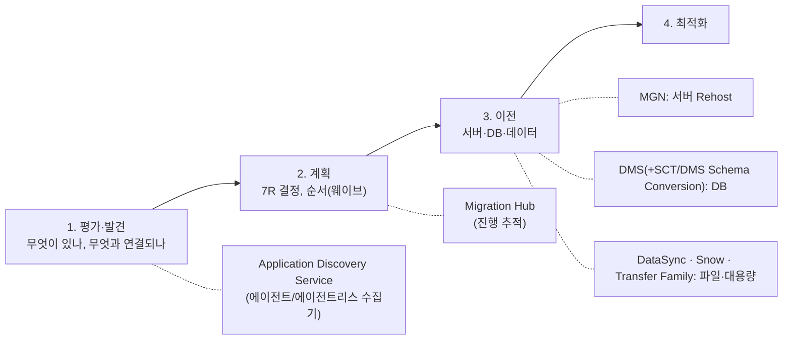
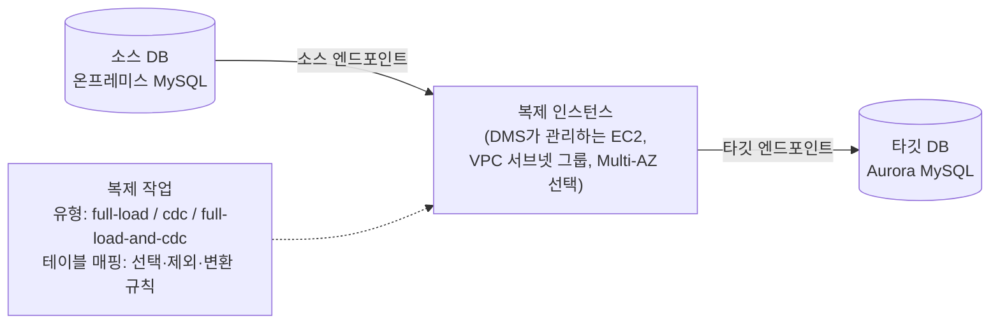

# M12-04. 마이그레이션: 7R, Application Discovery Service, DMS/SCT, MGN, Migration Hub, Snow/DataSync
> 도메인: D2 (D3·D4 일부) · 예상 시간: 55분 · 실습 등급: 🟡 (DMS 구성까지. 연결 테스트 501, 데이터는 움직이지 않는다)

## 왜 필요한가

TodayOrder에는 아직 AWS로 오지 못한 것이 있다. 창업 때부터 사무실 서버실에서 돌던 **MySQL 주문 DB**(500 GB, 하루 종일 쓰기가 들어옴)와 **정산 서버 2대**(Windows, 개발자가 퇴사해 코드를 고칠 사람이 없음), 그리고 **NAS에 쌓인 상품 이미지 40 TB**. 한꺼번에 옮길 수는 없고, 주문 DB는 멈출 수도 없다. 이 레슨은 "무엇을 어떤 방식으로 옮길지" 고르는 틀(7R)과, 그 방식마다 쓰는 AWS 서비스를 정리한다. 그리고 가장 시험에 많이 나오는 DMS의 구성 요소를 에뮬레이터에서 직접 만든다.

## 핵심 개념

### 7R: 워크로드마다 이전 방식 고르기

| R | 뜻 | 예 | AWS 도구 |
|---|---|---|---|
| **Retire** (폐기) | 더 이상 필요 없으니 끈다 | 아무도 안 쓰는 옛 관리자 페이지 | — |
| **Retain** (유지) | 당분간 온프레미스에 둔다 | 규제·의존성 때문에 못 옮기는 시스템 | — |
| **Rehost** (리호스트, "lift-and-shift") | 서버를 **그대로** 옮긴다 | 코드를 못 고치는 Windows 정산 서버 | **AWS Application Migration Service(MGN)** |
| **Relocate** (재배치) | 하이퍼바이저 단위로 옮긴다 | VMware 환경 통째로 | VMware Cloud on AWS 등 |
| **Repurchase** (재구매) | SaaS로 갈아탄다 | 자체 메일 서버 → SaaS | (Marketplace) |
| **Replatform** (리플랫폼, "lift-tinker-and-shift") | 핵심은 그대로, 일부를 관리형으로 | 자체 MySQL → **Amazon RDS/Aurora** | **DMS**, (SCT 불필요: 같은 엔진) |
| **Refactor / Re-architect** (리팩터) | 클라우드 네이티브로 다시 설계 | 모놀리스 → Lambda·SQS·DynamoDB | DMS(데이터), 개발 |

오른쪽(리팩터)으로 갈수록 이득(비용·확장성)은 크지만 시간과 위험도 크다. 흔한 전략은 "**일단 Rehost로 데이터 센터를 빨리 비우고, 그 뒤 Replatform/Refactor**"다.

### 이전 단계와 서비스



| 서비스 | 한 줄 | 시험 키워드 |
|---|---|---|
| **AWS Application Discovery Service** | 온프레미스 서버의 사양·사용률·**프로세스와 네트워크 연결(의존성)**을 수집. VMware용 에이전트리스 수집기, OS 에이전트 | "이전 계획을 위해 서버 사용률·의존성 파악" |
| **AWS Migration Hub** | 여러 도구의 이전 진행 상황을 한곳에서 추적 | "이전 진행 상황 중앙 추적" |
| **AWS Application Migration Service (MGN)** | 서버 디스크를 블록 단위로 **연속 복제** → 테스트 → 짧은 다운타임으로 전환(cutover). 옛 SMS·CloudEndure Migration의 후속 | "최소 다운타임 lift-and-shift", "서버를 그대로" |
| **AWS DMS** | DB → DB **데이터** 이전. 전체 로드(full load) + **CDC(변경 데이터 캡처)로 지속 복제** → 원본은 이전 중에도 계속 쓰기 가능. 동종(MySQL→MySQL)·이종(Oracle→PostgreSQL) 모두 | "다운타임 최소 DB 이전", "지속 복제" |
| **AWS SCT / DMS Schema Conversion** | 이종 DB의 **스키마·코드(프로시저, 뷰) 변환**. DMS는 데이터를, SCT는 구조를 | "Oracle → Aurora PostgreSQL" 이면 SCT + DMS |
| **DataSync** | 온프레미스 NFS·SMB·HDFS·다른 클라우드 ↔ S3·EFS·FSx 온라인 전송(에이전트, 암호화·검증·일정) | "파일 공유를 네트워크로 옮기기" |
| **Snow 패밀리** | 물리 장비로 오프라인 전송 | "네트워크가 느려 몇 주 걸림" — 단, 아래 주의 |
| **Transfer Family** | SFTP·FTPS·FTP 엔드포인트를 S3/EFS 앞에 | "거래처가 SFTP로 파일을 보냄" |

**서비스 제공 상황 주의(2025-11 기준)**: AWS는 2025년 11월 7일부터 **Migration Hub**와 **Application Discovery Service**를 신규 고객에게 열지 않고 후속으로 **AWS Transform**을 안내한다. **Snowball Edge**도 같은 날부터 기존 고객만 쓸 수 있고, 신규 고객에게는 DataSync·Data Transfer Terminal 등을 권한다. Snowmobile은 이미 퇴역했다. 시험 문제는 여전히 이 서비스들의 **용도**를 물을 수 있으니 역할은 알아 두되, 실무에서는 현재 문서를 확인한다. (M04 레슨 7의 Snow/DataSync 비교도 함께 볼 것.)

### DMS 구성 요소



- **복제 인스턴스**: 실제로 데이터를 읽고 쓰는 일꾼. VPC 안에 놓이며 소스·타깃 모두에 네트워크로 닿아야 한다(온프레미스면 VPN/DX). 운영 이전에는 Multi-AZ로 둔다. **DMS Serverless**를 쓰면 용량을 자동으로 정한다.
- **엔드포인트**: 소스·타깃 DB의 접속 정보(엔진, 호스트, 포트, 사용자, 비밀번호 — 실무에서는 Secrets Manager 참조). 만든 뒤 **연결 테스트(TestConnection)**를 통과시켜야 한다.
- **복제 작업**: 이전 유형과 테이블 매핑. `full-load-and-cdc`는 기존 데이터를 한 번 다 옮기고, 그동안과 그 뒤의 변경을 계속 적용한다. 원본 DB가 계속 주문을 받는 동안 따라잡고, 차이가 거의 0이 되면 앱의 연결 대상을 바꾼다(cutover). CDC를 위해 소스 MySQL은 바이너리 로그(binlog, ROW 형식)가 켜져 있어야 한다.

## 직접 해 보기 — [labs/lab04-dms-config.sh](./labs/lab04-dms-config.sh)

온프레미스 MySQL(`db.onprem.todayorder.example`) → Aurora MySQL로 주문 테이블을 옮기는 DMS 구성을 만든다. 둘 다 실제로는 없는 호스트다 — 에뮬레이터 DMS는 **데이터를 움직이지 않는다**. 이 실습의 목표는 구성 요소와 작업 설정을 손으로 만들어 보는 것이다.

```bash
bash curriculum/m12-resilience-dr-migration/labs/lab04-dms-config.sh
```

```
== 1. 네트워크와 복제 인스턴스 (있으면 재사용)
{
    "Id": "todayorder-dms",
    "Class": "dms.t3.medium",
    "Status": "available",
    "MultiAZ": true,
    "AZ": "us-east-1a",
    "StandbyAZ": "us-east-1b",
    "Engine": "3.5.4"
}
== 2. 엔드포인트: 소스(온프레미스 MySQL) · 타깃(Aurora MySQL)
[
    {
        "Id": "todayorder-onprem-mysql",
        "Type": "SOURCE",
        "Engine": "MySQL",
        "Server": "db.onprem.todayorder.example",
        "Status": "active"
    },
    {
        "Id": "todayorder-aurora-mysql",
        "Type": "TARGET",
        "Engine": "Amazon Aurora MySQL",
        "Server": "todayorder.cluster-example.us-east-1.rds.amazonaws.com",
        "Status": "active"
    }
]
== 3. 연결 테스트 (실제 AWS에서는 작업을 만들기 전에 반드시 통과시켜야 한다)

aws: [ERROR]: An error occurred (NotImplemented) when calling the TestConnection operation: operation TestConnection is scaffolded but not implemented in this emulator
== 4. 복제 작업: 전체 로드 + CDC
{
    "Id": "todayorder-orders-migration",
    "Type": "full-load-and-cdc",
    "Status": "ready"
}
-- 저장된 테이블 매핑 규칙
  1. selection      include  {"schema-name": "shop", "table-name": "order%"}
  2. selection      exclude  {"schema-name": "shop", "table-name": "audit_log"}
  3. transformation rename   {"schema-name": "shop"}
LAB04 OK
```

방금 본 것:

- 복제 인스턴스(처음 만들 때 `creating`, 폴링 후 `available`)는 `MultiAZ: true`, 대기 AZ(`StandbyAZ`)가 서브넷 그룹의 다른 AZ로 잡혔다. 복제 인스턴스도 AZ 단위 리소스라 운영 이전에는 Multi-AZ가 레슨 1의 SPOF 처방이다.
- 엔드포인트 두 개가 `active`로 저장됐지만 **연결 테스트는 501**이다. 실제 AWS에서는 이 테스트가 `successful`이 될 때까지(보안 그룹, 방화벽, VPN, 계정 권한, binlog 설정) 작업을 시작하지 않는다.
- 작업은 `ready`. 테이블 매핑 규칙 세 개가 저장됐다: `shop.order%` 테이블 포함, `shop.audit_log` 제외, 타깃에서 스키마 이름을 `shop` → `todayorder`로 변경.
- 작업은 **시작하지 않았다.** 에뮬레이터에서 시작하면 원본이 없는데도 `running`이 되고, `StopReplicationTask`·`DeleteReplicationInstance`가 501이라 되돌릴 수 없다(에뮬레이터를 재시작해야 지워진다). 같은 이유로 lab은 복제 인스턴스·엔드포인트를 **있으면 재사용**한다(`DeleteEndpoint`도 501).

## 실제 AWS에서는

- `full-load-and-cdc` 작업을 시작하면 테이블별 진행률(`describe-table-statistics`)과 CDC 지연(CloudWatch `CDCLatencySource`/`CDCLatencyTarget`)을 보며 cutover 시점을 정한다. 에뮬레이터에서는 `DescribeTableStatistics`·`DescribeConnections`도 501이다.
- 에뮬레이터는 존재하지 않는 엔진 이름이나 JSON이 아닌 테이블 매핑도 받아들인다. 실제 DMS는 거부한다. 매핑 JSON은 [DMS 문서의 테이블 매핑 예제](https://docs.aws.amazon.com/dms/latest/userguide/CHAP_Tasks.CustomizingTasks.TableMapping.html)와 비교해 보라.
- 이종 이전(예: Oracle → Aurora PostgreSQL)이면 DMS 전에 **SCT 또는 DMS Schema Conversion**으로 스키마·프로시저를 변환한다. DMS는 테이블과 데이터만 옮기고, 보조 인덱스·외래 키·트리거 같은 객체는 따로 다룬다.

**실제 AWS에서 해 보려면**: DMS 복제 인스턴스는 프리 티어가 있는 시기도 있지만 조건이 자주 바뀌니 요금 페이지를 먼저 확인한다. 가장 싸게 해 보려면 같은 VPC에 RDS MySQL 프리 티어 인스턴스 두 개(소스·타깃)를 만들고 `dms.t3.micro` 단일 AZ로 `full-load` 작업 하나를 돌린다. 끝나면 작업 → 엔드포인트 → 복제 인스턴스 → RDS 순으로 지운다(`aws dms delete-replication-task`, `delete-endpoint`, `delete-replication-instance`, `aws rds delete-db-instance --skip-final-snapshot`). 복제 인스턴스와 RDS는 켜져 있는 시간만큼 과금된다.

## 시험 포인트

- "원본 DB를 계속 운영하면서 최소 다운타임으로 이전" → **DMS full load + CDC**. "이종 엔진(Oracle → Aurora PostgreSQL)" → **SCT(또는 DMS Schema Conversion) + DMS**. 동종이면 SCT 불필요.
- "서버를 수정 없이 최소 다운타임으로 옮기기(lift-and-shift)" → **MGN**. "서버 사용률·의존성 조사" → **Application Discovery Service**. "진행 추적" → **Migration Hub**.
- "NFS/SMB 파일 공유를 S3·EFS·FSx로 온라인 전송, 일정·검증" → **DataSync**. "네트워크로는 너무 오래 걸리는 수십 TB 이상" → 오프라인 장비(Snow, 신규 고객 제공 여부 확인). "지속적인 하이브리드 접근" → Storage Gateway. "SFTP" → Transfer Family.
- 7R: lift-and-shift = **Rehost**, 관리형 DB로 = **Replatform**, 클라우드 네이티브로 = **Refactor**, SaaS로 = **Repurchase**.
- DMS 복제 인스턴스도 AZ 단위 → 운영 이전은 **Multi-AZ**.

## 스스로 확인

1. 원본 MySQL을 계속 운영하면서 Aurora로 옮기려 한다. DMS 작업 유형으로 무엇을 고르고, 소스 DB에는 무엇을 미리 설정해야 하나?
2. "오라클 → Aurora PostgreSQL" 이전에서 DMS만으로는 부족한 이유는?
3. TodayOrder의 세 가지(주문 MySQL, 코드를 못 고치는 Windows 정산 서버, NAS 이미지 40 TB)에 각각 어떤 R과 서비스를 고르겠는가?

<details><summary>답</summary>

1. `full-load-and-cdc`. 소스 MySQL에 바이너리 로그를 켜고(ROW 형식), 충분한 보존 기간과 복제용 계정 권한을 준다. 복제 인스턴스가 소스에 네트워크로 닿아야 한다(VPN/DX, 보안 그룹·방화벽).
2. DMS는 데이터를 옮길 뿐 이종 엔진 간 스키마·저장 프로시저·함수·뷰를 변환하지 않는다. SCT(또는 DMS Schema Conversion)로 스키마를 먼저 변환해 타깃에 만들고, 그 뒤 DMS로 데이터를 옮긴다.
3. 주문 MySQL → **Replatform**(RDS/Aurora MySQL) + DMS full load + CDC. Windows 정산 서버 → **Rehost** + MGN(나중에 Refactor 검토). NAS 이미지 → **DataSync**로 S3에 온라인 전송(회선이 너무 느리면 오프라인 장비 검토). 40 TB를 0.5 Gbps(1 Gbps 회선의 절반)로 보내면 약 7~8일이다. 일정이 허락하면 DataSync가 단순하다.

</details>
