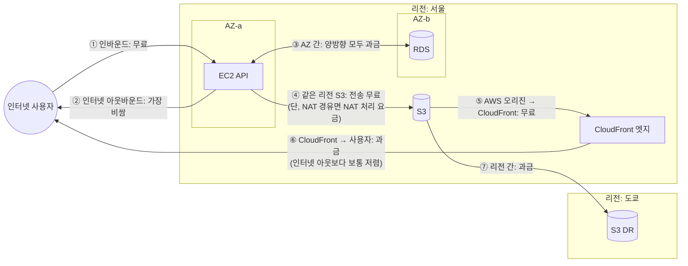

# M13-01. AWS 과금 구조와 데이터 전송 요금 지도
> 도메인: D4 · 예상 시간: 45분 · 실습 등급: 🔴 (워크시트 — 에뮬레이터는 과금하지 않는다)

## 왜 필요한가

TodayOrder가 AWS로 옮긴 지 석 달, 첫 분기 청구서가 왔다. 팀장은 "EC2 몇 대 돌린 것치고 왜 이렇게 많이 나왔지?"라고 묻는다. 청구서를 펼쳐 보면 서버 요금 말고도 **NAT 게이트웨이 처리 요금, AZ 간 데이터 전송, 인터넷으로 나간 트래픽** 같은 줄이 줄줄이 있다. 비용을 줄이려면 먼저 "AWS는 무엇에 돈을 받는가"를 알아야 한다. 이 레슨은 그 지도를 그린다. 그리고 SAA-C03에서 20%를 차지하는 "가장 비용 효율적인(MOST cost-effective)" 문제를 푸는 순서도 함께 정리한다.

## 핵심 개념

### 요금은 세 축으로 나온다

| 축 | 무엇에 | 예 | 줄이는 기본 방법 |
|---|---|---|---|
| **컴퓨트** | 켜져 있는 시간(초·시간), 요청 수, 실행 시간 | EC2 시간당, Lambda 요청+GB-초, Fargate vCPU·메모리-시간 | 끄기, 적정 크기, 구매 옵션(레슨 2) |
| **스토리지** | 저장한 양 × 기간(GB-월), 요청 수, 꺼내는 양 | S3 GB-월 + PUT/GET 요청 + 검색 요금, EBS **프로비저닝한** GB-월 | 클래스·수명 주기, 유형 변경(레슨 3) |
| **데이터 전송** | 경계를 넘어 **나가는** 바이트 | 인터넷 아웃바운드, AZ 간, 리전 간 | 경로 바꾸기, 캐시, 엔드포인트(레슨 4) |

여기에 **관리형 서비스의 "처리" 요금**(NAT 게이트웨이가 처리한 GB, 인터페이스 엔드포인트가 처리한 GB 등)과 **시간당 요금**(NAT 게이트웨이·로드 밸런서·퍼블릭 IPv4 주소처럼 존재만 해도 내는 요금)이 붙는다.

기억할 원칙 세 가지:

1. **쓴 만큼 낸다(pay-as-you-go).** 반대로 말하면, **켜 두면 낸다.** 개발 서버를 밤에 끄기만 해도 EC2 요금이 3분의 1로 준다.
2. **EBS는 쓴 양이 아니라 만든 크기에 낸다.** 500 GiB 볼륨에 10 GiB만 써도 500 GiB 값을 낸다. 인스턴스를 중지해도 볼륨 요금은 계속 나온다.
3. **들어오는 데이터는 대부분 무료, 나가는 데이터가 비싸다.** "AWS로 올리기는 쉽고 내리기는 비싸다"는 말이 여기서 나온다.

### 데이터 전송 요금 지도

| 경로 | 요금 | 시험에서 |
|---|---|---|
| ① 인터넷 → AWS | 무료 | "데이터를 AWS로 올리는 비용"은 전송 요금이 아니라 시간·회선 문제 |
| ② AWS → 인터넷 | 가장 비쌈(GB당) | 정적 콘텐츠는 CloudFront로 |
| ③ 같은 리전, **다른 AZ** | 나가는 쪽·들어오는 쪽 **양방향** 과금 | 고가용성(다중 AZ)의 대가. 단, RDS Multi-AZ의 **복제 트래픽은 무료** |
| 같은 AZ, 프라이빗 IP | 무료 | 퍼블릭 IP·탄력적 IP로 통신하면 같은 AZ여도 과금될 수 있다 |
| ④ EC2 → 같은 리전 S3·DynamoDB | 전송 자체는 무료 | 프라이빗 서브넷에서 **NAT를 거치면 NAT 처리 요금**이 붙는다 → 게이트웨이 엔드포인트(레슨 4) |
| ⑤ S3·EC2·ELB(AWS 오리진) → CloudFront | 무료 | CloudFront를 앞에 두면 오리진 아웃바운드가 사라진다 |
| ⑥ CloudFront → 사용자 | 과금 | 인터넷 아웃바운드보다 낮은 단가 + 캐시로 오리진 부하 감소 |
| ⑦ 리전 → 다른 리전 | 과금 | 교차 리전 복제(CRR)·DR의 비용 (M12) |

> 정확한 단가는 리전·월 사용량 구간·시기마다 다르다. 이 모듈의 계산은 모두 아래 **예시 단가**를 쓴다.

### 이 모듈의 예시 단가 (⚠️ 실제 AWS 가격이 아니다)

계산 연습을 위해 반올림한 숫자다. 실제 가격은 서비스별 요금 페이지와 [AWS Pricing Calculator](https://calculator.aws/)로 확인한다. 실무에서는 Pricing Calculator로 견적을 만들어 링크로 공유한다.

| 항목 | 예시 단가 (USD) |
|---|---|
| 인터넷 아웃바운드 | 0.09 / GB |
| AZ 간 전송 | 0.01 / GB **방향마다** (오가는 1 GB = 0.02) |
| 리전 간 전송 | 0.02 / GB |
| CloudFront → 사용자 | 0.08 / GB |
| NAT 게이트웨이 | 0.05 / 시간 + 0.05 / 처리 GB |
| 인터페이스 엔드포인트 | 0.01 / AZ·시간 + 0.01 / GB |
| 퍼블릭 IPv4 주소 | 0.005 / 시간 (연결 여부와 무관) |
| EC2 m7i.large / m7g.large(Graviton) / c7i.xlarge | 0.10 / 0.08 / 0.18 시간당 |
| EBS gp2 / gp3 | 0.10 / 0.08 GB-월 |
| S3 Standard / Standard-IA / Glacier IR / Glacier Flexible / Deep Archive | 0.025 / 0.0125 / 0.005 / 0.004 / 0.001 GB-월 |

한 달 = **730시간**(Pricing Calculator와 같은 값)으로 계산한다.

### "가장 비용 효율적인" 문제를 푸는 4단계

SAA-C03 비용 문제는 "가장 싼 것"을 묻지 않는다. **요구 사항을 모두 만족하는 것 중** 가장 싼 것을 묻는다. 순서를 지키면 함정 보기가 걸러진다.

1. **깨면 안 되는 제약에 밑줄을 긋는다.** 가용성("AZ 장애를 견뎌야"), 성능("밀리초 단위 조회"), 내구성·보존("7년 보관"), 복구 시간("12시간 안에 꺼내면 됨"), 중단 허용 여부("작업이 중간에 끊겨도 다시 시작 가능"), 운영 부담("최소한의 운영 노력").
2. **제약을 깨는 보기를 지운다.** 가장 싼 보기가 제약을 깨는 경우가 많다. 예: 중단되면 안 되는 작업에 스팟, 즉시 조회해야 하는데 Deep Archive, 다중 AZ가 필요한데 One Zone-IA.
3. **남은 보기의 "숨은 비용"을 본다.** 직접 운영(EC2에 직접 설치) vs 관리형, 데이터 전송, 최소 보관 기간, 검색 요금, 사용하지 않아도 내는 약정.
4. **남은 것 중 가장 싼 것을 고른다.** 비슷하면 **관리형·서버리스·자동화** 쪽이 정답일 확률이 높다("운영 오버헤드 최소" 문구가 함께 나오면 거의 확실).

자주 나오는 키워드 → 답:

| 문제에 나오는 말 | 떠올릴 답 |
|---|---|
| 꾸준하고 예측 가능한 사용량, 1~3년 | Savings Plans / 예약 인스턴스 |
| 중단돼도 되는, 유연한 시작 시간, 배치·CI·렌더링 | 스팟 인스턴스 |
| 접근 패턴을 모름·바뀜 | S3 Intelligent-Tiering |
| 자주 안 읽지만 읽을 땐 즉시(ms) | S3 Standard-IA, 분기 1회 수준이면 Glacier Instant Retrieval |
| 몇 시간 기다려도 되는 장기 보관 | Glacier Flexible Retrieval / Deep Archive(12시간 이내 표준 검색) |
| 프라이빗 서브넷 → S3 트래픽 때문에 NAT 요금이 큼 | S3 게이트웨이 엔드포인트 |
| 전 세계 사용자에게 정적 파일 | CloudFront |
| 가끔·예측 불가 트래픽의 DB | DynamoDB 온디맨드, Aurora Serverless v2 |
| gp2 볼륨 | gp3 (같은 성능에 더 쌈) |

## 직접 해 보기 — 워크시트 1: TodayOrder 데이터 전송 요금

에뮬레이터는 요금을 매기지 않으므로 손으로 계산한다(🔴). 위 예시 단가를 쓴다.

TodayOrder의 한 달 트래픽:

| # | 경로 | 양 |
|---|---|---|
| a | 사용자가 상품 이미지를 **S3에서 직접** 내려받음 | 2,000 GB |
| b | 사용자가 리뷰 사진을 S3로 업로드 | 1,000 GB |
| c | AZ-a의 API 서버 ↔ AZ-b의 RDS 기본 인스턴스 (요청+응답 합계) | 400 GB |
| d | RDS Multi-AZ 기본 → 대기 복제 | 600 GB |
| e | S3 서울 → 도쿄 교차 리전 복제(M12 DR) | 300 GB |
| f | API 서버 → 같은 리전 S3 (S3 게이트웨이 엔드포인트 경유) | 800 GB |

**문제 1.** 각 줄의 월 전송 요금과 합계를 구하라.
**문제 2.** a를 CloudFront 경유로 바꾸면(캐시 적중과 무관하게 사용자에게 2,000 GB 전달) 얼마가 되나?
**문제 3.** c를 0원으로 만드는 가장 쉬운 방법은 무엇이고, 왜 하면 안 되는가?

정답과 풀이

**문제 1.**

| # | 계산 | 요금 |
|---|---|---|
| a | 2,000 × 0.09 | **180.00** |
| b | 인바운드 | **0** |
| c | AZ 간은 양방향 과금: 400 × 0.01 × 2 | **8.00** |
| d | RDS Multi-AZ 복제 트래픽은 무료 | **0** |
| e | 300 × 0.02 | **6.00** |
| f | 같은 리전 S3, 게이트웨이 엔드포인트: 전송·처리 요금 없음 | **0** |
| | 합계 | **194.00 USD/월** |

**문제 2.** S3 → CloudFront는 무료(⑤), CloudFront → 사용자 2,000 × 0.08 = **160.00**. a가 180 → 160으로 줄고 합계는 **174.00**. 실제로는 캐시 덕분에 S3 GET 요청 수도 줄고 지연 시간도 줄어든다. "전 세계 사용자 + 정적 콘텐츠 + 비용"이면 CloudFront다.

**문제 3.** API 서버를 RDS와 같은 AZ에만 두면 c는 0이 된다. 하지만 그 AZ가 죽으면 API가 통째로 죽는다(M12 레슨 1의 단일 장애점). 월 8달러를 아끼려고 가용성 요구를 깨는 것은 "가장 비용 효율적인" 답이 아니다 — 4단계의 2번에서 지워지는 보기다.

## 실제 AWS에서는

- 청구서는 **Billing and Cost Management** 콘솔에서 서비스·리전·사용 유형(Usage Type)별로 본다. 데이터 전송은 사용 유형 이름에 `DataTransfer-Out-Bytes`, `DataTransfer-Regional-Bytes`(AZ 간) 같은 글자가 들어 있어 찾기 쉽다. 레슨 5의 Cost Explorer로 "사용 유형별 그룹"을 하면 지도가 숫자로 나온다.
- 인터넷 아웃바운드 단가는 월 사용량이 커질수록 낮아지는 **구간제**다. 계정마다 매달 일정량의 무료 아웃바운드도 있다. 정확한 숫자는 EC2 요금 페이지의 "데이터 전송" 절을 볼 것.
- 2024년 2월부터 **모든 퍼블릭 IPv4 주소**(EC2에 붙은 것 포함)에 시간당 요금이 붙는다. "쓰지 않는 탄력적 IP만 과금"은 옛 규칙이다.

**실제 AWS에서 해 보려면**: 프리 티어 계정에서 Billing 콘솔 → **Cost Explorer**를 켜 두기만 하면 된다(켜는 것은 무료, 데이터가 쌓이기까지 최대 24시간). 이 워크시트의 경로를 실제로 만들어 트래픽을 흘려 보는 것은 권하지 않는다 — 인터넷 아웃바운드와 NAT 처리 요금이 바로 나온다. 정리할 리소스는 없다.

## 시험 포인트

- "데이터 전송 비용을 줄이면서 전 세계 사용자에게 정적 콘텐츠" → **CloudFront** (오리진 → CloudFront 무료).
- "프라이빗 서브넷의 EC2가 S3로 많은 데이터를 보내 NAT 비용이 크다" → **S3 게이트웨이 엔드포인트**(무료).
- AZ 간 트래픽은 **양방향 과금**. 그래도 고가용성 요구가 있으면 다중 AZ를 포기하지 않는다. RDS Multi-AZ **복제** 트래픽은 무료.
- 인바운드는 무료, 아웃바운드가 비싸다. 리전 간 복제(CRR, DR)는 리전 간 전송 요금이 든다.
- 비용 문제는 **제약을 먼저 지키고** 그다음 가장 싼 것. 비슷하면 관리형·자동화가 답.

## 스스로 확인

1. EBS 볼륨 500 GiB를 만들고 20 GiB만 쓰고 있다. 인스턴스를 중지했다. 이 볼륨에 대해 무엇을 얼마나 내는가?
2. 같은 AZ에 있는 두 EC2가 **탄력적 IP 주소로** 서로 통신하게 설정돼 있다. 비용 관점에서 무엇이 문제인가?
3. "비용이 가장 낮은" 보기가 스팟 인스턴스인데 정답이 아닐 수 있는 문제 조건 두 가지를 말해 보라.

답

1. 프로비저닝한 500 GiB 전체의 GB-월 요금을 계속 낸다(중지해도 볼륨은 남아 있다). 크기를 줄이려면 새 작은 볼륨으로 옮겨야 한다(EBS는 줄이기를 지원하지 않는다).
2. 퍼블릭 주소로 통신하면 트래픽이 같은 AZ의 프라이빗 경로가 아니라 퍼블릭 경로로 취급되어 데이터 전송 요금이 붙을 수 있다. 프라이빗 IP로 통신하면 같은 AZ 트래픽은 무료다.
3. 작업을 중단하면 안 되는 경우(예: 결제 처리, 상태를 디스크에 저장하지 않는 장시간 작업), 정해진 시각에 반드시 끝나야 하는 경우(용량을 보장받지 못함). 이때는 온디맨드나 Savings Plans가 답이다.

