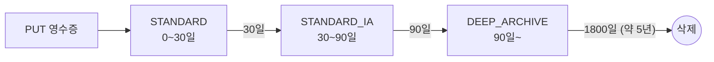

# M13-03. 스토리지·DB 비용: 클래스 전환, gp2→gp3, 예약 용량, 서버리스 옵션
> 도메인: D4 · 예상 시간: 50분 · 실습 등급: 🟢 수명 주기 규칙 구성 / 계산은 워크시트

## 왜 필요한가

TodayOrder는 주문 영수증을 법적으로 5년 보관해야 한다. 매달 500 GB씩 쌓이고, 5년이 지나면 버킷에 30 TB가 들어 있다. 영수증은 주문 직후 한 달은 자주 열리지만(고객 문의·환불), 석 달이 지나면 거의 아무도 안 본다(세무 감사 때 하루 이틀 기다려도 됨). 그런데 30 TB가 전부 S3 Standard에 있다. 이 레슨은 "나이 든 데이터를 싼 곳으로 옮기는" 수명 주기 규칙의 비용을 직접 계산한다. 그리고 블록 스토리지(EBS)와 DB의 비용 손잡이를 정리한다.

## 핵심 개념

### S3 스토리지 클래스: 싸질수록 무엇을 포기하나

| 클래스 | 예시 단가(GB-월) | 꺼낼 때 | 최소 보관 기간 | 맞는 데이터 |
|---|---|---|---|---|
| Standard | 0.025 | 즉시, 검색 요금 없음 | 없음 | 자주 읽는 것 |
| Intelligent-Tiering | 접근 계층에 따라 + 객체당 모니터링 요금 | 즉시(자동 계층) | 없음 | **접근 패턴을 모름** |
| Standard-IA | 0.0125 | 즉시, **GB당 검색 요금** | 30일 | 월 1회 이하, 그래도 즉시 필요 |
| One Zone-IA | (IA보다 쌈) | 즉시, 검색 요금 | 30일 | 다시 만들 수 있는 데이터(AZ 하나에만 저장) |
| Glacier Instant Retrieval | 0.005 | 즉시(ms), 검색 요금 | 90일 | 분기 1회 수준, 즉시 필요 |
| Glacier Flexible Retrieval | 0.004 | 분~시간 | 90일 | 백업·아카이브 |
| Glacier Deep Archive | 0.001 | **12시간 이내(표준)**, 대량 48시간 이내 | 180일 | 규정상 보관, 거의 안 꺼냄 |

(단가는 **예시 숫자**다. 실제 가격은 S3 요금 페이지와 [AWS Pricing Calculator](https://calculator.aws/)로.)

비용을 결정하는 숨은 항목:

- **최소 보관 기간**: Glacier Flexible에 넣고 10일 뒤 지우면 90일치를 낸다(조기 삭제 요금).
- **최소 과금 객체 크기**: Standard-IA·One Zone-IA는 128 KB 미만 객체도 128 KB로 과금한다. 작은 파일이 많으면 IA가 오히려 비쌀 수 있다. Intelligent-Tiering은 128 KB 미만 객체를 자동 계층화하지 않는다.
- **수명 주기 전환 요청 요금**: 객체 하나를 옮길 때마다 요청 요금이 붙는다. **객체가 작고 많으면 전환 요금이 저장 절감액을 잡아먹는다** — 워크시트에서 숫자로 본다.
- **검색 요금**: IA·Glacier 계열은 꺼낼 때 GB당 요금이 있다. 자주 꺼내면 Standard가 더 싸다.

### 수명 주기 규칙



규칙은 **Transition**(며칠 뒤 어느 클래스로)과 **Expiration**(며칠 뒤 삭제)으로 이뤄진다. 접두사·태그·객체 크기로 대상을 좁힐 수 있다. 버전 관리 버킷이면 이전 버전용 규칙(`NoncurrentVersionTransition`/`Expiration`)도 따로 둔다. Standard-IA·One Zone-IA로는 생성 후 **30일이 지난 객체**만 옮길 수 있다.

### EBS·DB 비용 손잡이

| 대상 | 손잡이 | 효과 |
|---|---|---|
| EBS | **gp2 → gp3** | GB당 약 20% 저렴, 크기와 무관하게 기본 3,000 IOPS·125 MiB/s. 붙인 채로 변경 가능 |
| EBS | 붙어 있지 않은 볼륨·오래된 스냅샷 정리 | "아무도 안 쓰는데 내는 돈". 스냅샷은 **증분**이지만 오래 쌓이면 크다. 거의 안 쓰는 스냅샷은 EBS 스냅샷 아카이브 |
| EBS | io2 → gp3 (IOPS 요구가 낮으면) | 프로비저닝 IOPS 요금 제거 |
| RDS | 예약 DB 인스턴스 / Database Savings Plans | 꾸준히 도는 DB의 약정 할인 |
| RDS·Aurora | 적정 크기, Graviton 인스턴스, 개발 DB 중지(최대 7일 뒤 자동 시작) | |
| Aurora | **Aurora Serverless v2** | 부하에 따라 용량(ACU)이 늘고 준다. 간헐적·예측 불가 부하 |
| DynamoDB | **온디맨드 ↔ 프로비저닝(+Auto Scaling)** | 예측 불가·드문 트래픽 → 온디맨드. 꾸준하고 예측 가능 → 프로비저닝 + 예약 용량 |
| DynamoDB | Standard-IA 테이블 클래스 | 저장 비중이 크고 읽기·쓰기가 적은 테이블 |
| 캐시 | ElastiCache·DAX로 DB 읽기 줄이기 | DB를 키우는 대신 캐시 (M05) |

## 직접 해 보기

### 워크시트 3: 영수증 5년 보관 비용

가정 (계산 편의):

- 매달 영수증 **1,000,000개**, 평균 **0.5 MB** → 매달 **500 GB** 유입 (1 GB = 1,000 MB로 계산)
- 한 달 = 30일. 5년 = 1,800일 = 60개월
- "정상 상태" = 5년이 지나 0~60개월 된 영수증이 다 차 있는 상태 (총 30,000 GB)
- 예시 단가: 위 표 + **전환 요청 요금(1,000건당)**: Standard-IA 0.01, Glacier Flexible 0.05, Deep Archive 0.05

| 안 | 규칙 |
|---|---|
| 0 | 전부 Standard, 1,800일 뒤 삭제 |
| A | Standard → 30일 Standard-IA → 90일 Glacier Flexible → 360일 Deep Archive → 1,800일 삭제 |
| B | Standard → 30일 Standard-IA → 90일 Deep Archive → 1,800일 삭제 |

**문제.** 세 안의 정상 상태 월 비용(저장 + 전환 요청)을 구하라. 감사팀이 "90일 넘은 영수증은 요청 후 하루 안에만 주면 된다"고 했다면 어느 안을 고르겠는가?

<details><summary>정답과 풀이</summary>

각 클래스에 쌓인 양 = 500 GB × (머무는 개월 수). 매달 100만 개가 각 전환 단계를 한 번씩 지나간다 → 단계마다 1,000 × (1,000건당 단가).

| 안 | 저장 | 전환 | 합계 |
|---|---|---|---|
| 0 | 30,000 × 0.025 = 750.00 | 0 | **750.00** |
| A | Std 500×0.025=12.50 + IA 1,000×0.0125=12.50 + Glacier 4,500×0.004=18.00 + DA 24,000×0.001=24.00 = 67.00 | IA 10 + Glacier 50 + DA 50 = 110.00 | **177.00** |
| B | 12.50 + 12.50 + DA 28,500×0.001=28.50 = 53.50 | IA 10 + DA 50 = 60.00 | **113.50** |

- A는 저장 요금만 보면 B와 비슷하지만 **전환 요청 요금이 저장 요금보다 크다**. 단계를 하나 줄인 B가 더 싸다.
- 감사 요구("하루 안에")는 Deep Archive 표준 검색(12시간 이내)으로 만족한다 → **B**.
- 만약 "90일 넘은 영수증도 즉시 조회"였다면 Deep Archive는 탈락하고 Glacier Instant Retrieval이 후보가 된다(4단계의 2번: 제약부터).
- 영수증이 평균 50 KB였다면? IA의 128 KB 최소 과금 크기 때문에 IA 저장 요금이 2.5배가 되고, 같은 GB에 객체가 10배라 전환 요금도 10배가 된다. 작은 객체는 묶어서(tar 등) 저장하거나 Standard에 오래 두는 편이 나을 수 있다. 실제 S3도 2024년 9월부터 **128 KB 미만 객체는 기본적으로 전환하지 않는다**(아래 실습 출력의 `TransitionDefaultMinimumObjectSize`).

</details>

### 실습: 규칙을 버킷에 설정하고, 설정값을 읽어 계산 — [labs/lab02-storage-lifecycle-cost.sh](./labs/lab02-storage-lifecycle-cost.sh)

```bash
bash curriculum/m13-cost-optimization/labs/lab02-storage-lifecycle-cost.sh
```

```
make_bucket: todayorder-m13-receipts
== 1. 안 A: 4단계
{
    "TransitionDefaultMinimumObjectSize": "all_storage_classes_128K"
}
[
    {
        "Days": 30,
        "StorageClass": "STANDARD_IA"
    },
    {
        "Days": 90,
        "StorageClass": "GLACIER"
    },
    {
        "Days": 360,
        "StorageClass": "DEEP_ARCHIVE"
    }
]
※ 예시 단가로 계산 (실제 AWS 가격 아님 — AWS Pricing Calculator 로 확인)
가정: 매달 1,000,000개 · 500 GB 유입, 한 달 = 30일
규칙 plan-a-4-tiers: STANDARD(0일~) → STANDARD_IA(30일~) → GLACIER(90일~) → DEEP_ARCHIVE(360일~) → 삭제(1800일)
  클래스               머무는 기간     쌓인 양(GB)      저장 요금      전환 요금
  STANDARD            30일          500      12.50       0.00
  STANDARD_IA         60일        1,000      12.50      10.00
  GLACIER            270일        4,500      18.00      50.00
  DEEP_ARCHIVE      1440일       24,000      24.00      50.00
  합계: 저장 67.00 + 전환 110.00 = 177.00 USD/월
  비교: 전부 STANDARD 로 두면 30,000 GB × 0.025 = 750.00 USD/월
RESULT rule=plan-a-4-tiers storage=67.00 transitions=110.00 total=177.00 all_standard=750.00
== 2. 안 B: 단계를 줄여 전환 요청 요금 아끼기
...
  STANDARD            30일          500      12.50       0.00
  STANDARD_IA         60일        1,000      12.50      10.00
  DEEP_ARCHIVE      1710일       28,500      28.50      50.00
  합계: 저장 53.50 + 전환 60.00 = 113.50 USD/월
RESULT rule=plan-b-3-tiers storage=53.50 transitions=60.00 total=113.50 all_standard=750.00
== 3. 에뮬레이터에서는 전환이 일어나지 않는다: 방금 올린 객체의 스토리지 클래스
[
    {
        "Key": "receipts/A-3001.json",
        "StorageClass": "STANDARD"
    }
]
LAB02 OK
```

방금 본 것:

- `put-bucket-lifecycle-configuration`의 응답에 `TransitionDefaultMinimumObjectSize: all_storage_classes_128K`가 있다. 128 KB 미만 객체는 규칙이 있어도 전환하지 않는다는 기본값이다(실제 S3와 같은 필드).
- [`sdk/lifecycle_cost.py`](./sdk/lifecycle_cost.py)는 `get_bucket_lifecycle_configuration`으로 **버킷에 저장된 규칙**을 읽어 구간을 계산했다. 같은 계산기에 규칙만 바꿔 넣으면 안을 비교할 수 있다.
- 마지막 단계: 에뮬레이터에서는 시간이 지나도 객체가 `STANDARD`에 머문다(FIDELITY: 수명 주기 전환은 일어나지 않음). 그래서 "규칙 구성은 🟢, 비용은 계산"이다. 에뮬레이터는 잘못된 규칙(예: 10일 뒤 Standard-IA)도 거부하지 않으니(M04), 최소 일수는 스스로 지켜야 한다.

## 실제 AWS에서는

- 전환은 하루 한 번 정도 비동기로 일어나고, 규칙을 만든 뒤 실제 이동까지 하루 이상 걸릴 수 있다. 전환 요청 요금, Glacier 계열의 객체당 메타데이터 오버헤드(객체마다 일부를 Standard 요금으로 과금), 검색 요금은 S3 요금 페이지에서 확인한다.
- **S3 Storage Lens**와 **스토리지 클래스 분석(Storage Class Analysis)**은 실제 접근 패턴을 보여 줘 "몇 일 뒤 IA로 옮길지"를 데이터로 정하게 돕는다.
- 접근 패턴을 정말 모르면 규칙을 고민하지 말고 **Intelligent-Tiering**을 쓴다(검색 요금 없음, 객체당 모니터링 요금).

**실제 AWS에서 해 보려면**: 프리 티어 계정에서 버킷을 만들고 이 실습의 규칙을 그대로 넣어 볼 수 있다(규칙 자체는 무료). 작은 객체 몇 개만 올리면 전환 요청 요금은 사실상 0이지만, Glacier 계열로 옮겨진 객체를 일찍 지우면 최소 보관 기간 요금이 붙으니 실험용 객체는 **Standard에 있을 때** 지운다. 정리: `aws s3 rb s3://<버킷> --force`.

## 시험 포인트

- "접근 패턴을 알 수 없음/바뀜" → **S3 Intelligent-Tiering**. "30일 뒤 거의 안 읽음 + 즉시 필요" → Standard-IA. "몇 시간 기다려도 됨 + 최저가" → Deep Archive.
- "다시 만들 수 있는 데이터 + 최저가 + 즉시" → **One Zone-IA** (AZ 장애에 데이터가 사라질 수 있음을 감수).
- 최소 보관 기간(IA 30일, Glacier IR·Flexible 90일, Deep Archive 180일)보다 일찍 지우면 그 기간만큼 과금. 짧게 보관하는 데이터에 Glacier는 함정.
- **gp2 → gp3**: 성능 유지 + 비용 절감의 정답 패턴. 붙인 채로 바꿀 수 있다.
- DynamoDB: 예측 불가·간헐적 → 온디맨드, 꾸준함 → 프로비저닝 + Auto Scaling(+예약 용량). Aurora 간헐적 부하 → Serverless v2.

## 스스로 확인

1. 매일 새로 만들어 7일만 보관하는 로그 파일을 Glacier Flexible Retrieval에 바로 넣으면 왜 손해인가?
2. 평균 20 KB짜리 썸네일 수억 개를 Standard-IA로 옮기는 규칙을 만들자고 한다. 무엇을 먼저 확인하겠는가?
3. 개발용 RDS 인스턴스를 주말 동안 중지해 비용을 아끼려 한다. 무엇이 계속 과금되고, 무엇에 주의해야 하나?

<details><summary>답</summary>

1. Glacier Flexible의 최소 보관 기간은 90일이다. 7일 뒤 지워도 90일치를 낸다. 7일 보관이면 Standard에 두고 7일 Expiration 규칙을 쓴다.
2. 128 KB 최소 과금 크기(IA는 20 KB도 128 KB로 과금)와 객체 수에 비례하는 전환 요청 요금. 계산하면 Standard에 두는 편이 쌀 가능성이 크다. 실제 S3도 기본값으로 128 KB 미만은 전환하지 않는다.
3. 중지 중에는 인스턴스 시간 요금은 안 나오지만 **스토리지(할당한 GB)와 백업 스토리지**는 계속 나온다. RDS는 중지 후 **7일이 지나면 자동으로 다시 시작**하므로 장기 중지는 스냅샷 후 삭제가 낫다.

</details>
