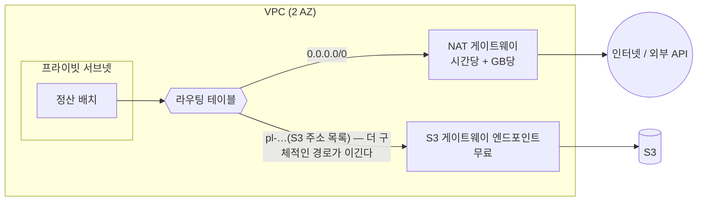

# M13-04. 네트워크 비용: NAT 게이트웨이 vs VPC 엔드포인트, CloudFront, 같은 AZ
> 도메인: D4 · 예상 시간: 40분 · 실습 등급: 🟢 경로 구성 / 비용은 워크시트

## 왜 필요한가

TodayOrder의 정산 배치는 프라이빗 서브넷에서 돌며 매달 3 TB를 S3에 쓰고 읽는다. M02에서 배운 대로 프라이빗 서브넷의 인터넷 출구는 NAT 게이트웨이이고, 고가용성을 위해 AZ마다 하나씩 두었다(M12 레슨 1). 그런데 청구서에서 "NAT Gateway – Data Processed"가 EC2 다음으로 큰 줄이 되었다. 같은 리전의 S3로 가는 트래픽이 굳이 NAT를 거칠 이유가 있을까? 이 레슨은 **경로를 바꿔 같은 일을 더 싸게** 하는 방법을 다룬다.

## 핵심 개념

### NAT 게이트웨이의 요금은 두 가지

- **시간당 요금**: 존재하는 동안 계속. AZ마다 두면 개수만큼.
- **처리 요금**: NAT를 **통과한 모든 GB**. 목적지가 같은 리전의 S3여도 NAT를 지나가면 낸다.

여기에 NAT에 붙은 **퍼블릭 IPv4 주소(EIP)** 의 시간당 요금이 NAT 요금과 별도로 붙는다([레슨 2](./02-compute-cost.md)). NAT 하나마다 주소 하나다.

### VPC 엔드포인트: NAT를 우회하는 길

| | 게이트웨이 엔드포인트 | 인터페이스 엔드포인트 (PrivateLink) |
|---|---|---|
| 대상 서비스 | **S3, DynamoDB 두 개뿐** | 대부분의 AWS 서비스(SQS, KMS, ECR, Secrets Manager …) + S3 |
| 동작 방식 | 라우팅 테이블에 **접두사 목록(pl-…) → vpce-…** 경로 추가 | 서브넷에 **ENI(프라이빗 IP)**를 만들고 DNS가 그 IP를 가리킴 |
| 요금 | **무료** | AZ·시간당 + GB당 |
| 온프레미스(VPN·DX)·다른 리전에서 접근 | 불가 | 가능 |
| 보안 | 엔드포인트 정책, 버킷 정책의 `aws:SourceVpce` | + 보안 그룹 |



라우팅은 **가장 구체적인(긴 접두사) 경로**를 고른다. S3의 IP 대역은 `0.0.0.0/0`보다 구체적이므로, 엔드포인트를 붙이는 순간 S3 트래픽은 NAT 대신 엔드포인트로 간다. **애플리케이션 코드는 그대로**다.

### 그 밖의 네트워크 비용 손잡이

- **CloudFront**: AWS 오리진 → CloudFront 전송은 무료이고 사용자 전달 단가가 인터넷 아웃바운드보다 보통 낮다. 캐시가 오리진 요청까지 줄인다(레슨 1).
- **같은 AZ에 두기**: AZ 간 전송은 양방향 과금. 단, 고가용성을 깨면서까지 하지 않는다. 대신 "AZ 인식(zone-aware)" 라우팅(같은 AZ의 대상을 우선)이나 ALB의 교차 영역 로드 밸런싱 설정을 검토한다.
- **NAT 개수**: 개발·테스트 VPC는 NAT 하나로 충분할 수 있다(가용성보다 비용). 운영 VPC는 AZ별 NAT가 정석. 이것도 "요구 사항이 먼저"다.
- **Direct Connect**: 대량·꾸준한 온프레미스 ↔ AWS 트래픽은 DX의 데이터 전송 단가가 인터넷보다 낮다. VPN은 싸고 빠르게 시작.
- **리전 선택**: 사용자와 같은 리전에 두면 지연과 리전 간 전송이 함께 준다.

## 직접 해 보기 — [labs/lab03-nat-vs-endpoint.sh](./labs/lab03-nat-vs-endpoint.sh)

2-AZ VPC에 AZ별 NAT 게이트웨이를 두고, 프라이빗 라우팅 테이블 두 개에 S3 게이트웨이 엔드포인트를 연결한다. 그리고 같은 트래픽(S3 3,000 GB + 그 밖의 인터넷 200 GB)의 월 비용을 세 가지 경로로 계산한다.

```bash
bash curriculum/m13-cost-optimization/labs/lab03-nat-vs-endpoint.sh
```

```
== 1. 2-AZ VPC: AZ 별 NAT 게이트웨이(고가용성 NAT)
프라이빗 라우팅 테이블 (엔드포인트 전):
-------------------------------------------
|           DescribeRouteTables           |
+---------------+-------------------------+
|     Dest      |         Target          |
+---------------+-------------------------+
|  10.32.0.0/16 |  local                  |
|  0.0.0.0/0    |  nat-0000000000000009d  |
+---------------+-------------------------+
== 2. S3 게이트웨이 엔드포인트를 두 프라이빗 라우팅 테이블에 연결
vpce-000000000000000ab
S3 접두사 목록: pl-e9da6b72
프라이빗 라우팅 테이블 (엔드포인트 후):
--------------------------------------------
|            DescribeRouteTables           |
+---------------+--------------------------+
|     Dest      |         Target           |
+---------------+--------------------------+
|  10.32.0.0/16 |  local                   |
|  0.0.0.0/0    |  nat-0000000000000009d   |
|  pl-e9da6b72  |  vpce-000000000000000ab  |
+---------------+--------------------------+
== 3. 월 비용 비교 (예시 단가: NAT 시간당 0.05 + NAT의 퍼블릭 IPv4 시간당 0.005, NAT 처리 GB당 0.05, 인터페이스 엔드포인트 AZ·시간당 0.01 + GB당 0.01)
A. 전부 NAT 경유              240.30
B. S3 게이트웨이 엔드포인트     90.30
C. S3 인터페이스 엔드포인트    134.90
COSTS 240.30 90.30 134.90
LAB03 OK
```

방금 본 것:

- 엔드포인트를 만들 때 `--route-table-ids`로 준 라우팅 테이블에 **`pl-e9da6b72 → vpce-…` 경로가 자동으로 추가**됐다. `0.0.0.0/0 → NAT` 경로는 그대로다. S3로 가는 패킷만 더 구체적인 접두사 목록 경로를 탄다.
- 비용 계산(**예시 단가**, 한 달 730시간, NAT 2개 + NAT마다 퍼블릭 IPv4 주소 1개):

| 안 | 계산 | 월 비용 |
|---|---|---|
| A. 전부 NAT | NAT 시간 2×730×0.05 = 73.00 + 퍼블릭 IPv4 2×730×0.005 = 7.30 + 처리 (3,000+200)×0.05 = 160.00 | **240.30** |
| B. S3 게이트웨이 엔드포인트 | 73.00 + 7.30 + 200×0.05 = 10.00 (S3 트래픽은 무료 경로) | **90.30** |
| C. S3 인터페이스 엔드포인트 | 90.30 + 엔드포인트 2 AZ×730×0.01 = 14.60 + 3,000×0.01 = 30.00 | **134.90** |

- NAT는 B에서도 남는다. S3가 아닌 외부 API(결제 대행사 등)로 나가는 200 GB 때문이다. 엔드포인트는 NAT를 **없애는** 것이 아니라 **S3·DynamoDB 트래픽을 빼내는** 것이다.
- 같은 리전 VPC 안에서 S3에 붙을 거라면 게이트웨이(B)가 인터페이스(C)보다 싸다. 인터페이스 엔드포인트가 필요한 경우는 **온프레미스에서 VPN·Direct Connect로 S3에 사설 접근**하거나, 엔드포인트에 보안 그룹을 걸어야 할 때다.
- 에뮬레이터에서는 패킷이 실제로 흐르지 않는다. 확인한 것은 "라우팅 테이블이 그렇게 구성되었다"이다(경로 선택 규칙은 실제 AWS와 같다).

## 실제 AWS에서는

- 게이트웨이 엔드포인트는 **같은 리전**의 S3·DynamoDB에만 쓸 수 있다. 다른 리전 버킷으로 가는 트래픽은 여전히 NAT(또는 인터넷)를 탄다.
- 버킷 정책에 `"Condition": {"StringEquals": {"aws:SourceVpce": "vpce-…"}}`를 걸어 "이 엔드포인트를 거친 요청만 허용"하는 것은 보안 문제로도 자주 나온다(M02, M04).
- 엔드포인트 정책(기본: 모두 허용)으로 "우리 회사 버킷만 접근 가능"처럼 데이터 유출 경로를 좁힐 수 있다.
- NAT 게이트웨이의 처리량·처리 GB는 CloudWatch 지표 `BytesOutToDestination` 등으로 볼 수 있고, VPC Flow Logs로 "어디로 가는 트래픽이 NAT를 많이 쓰나"를 찾는다.

**실제 AWS에서 해 보려면**: VPC·서브넷·라우팅 테이블·S3 게이트웨이 엔드포인트는 **무료**라 그대로 만들어 봐도 된다. **NAT 게이트웨이는 프리 티어가 아니며 만든 순간부터 시간당 과금**되니 만들지 말거나, 만들었다면 바로 지운다: `aws ec2 delete-nat-gateway --nat-gateway-id <id>` → 삭제 완료 후 `aws ec2 release-address --allocation-id <id>`(퍼블릭 IPv4도 시간당 과금) → `aws ec2 delete-vpc-endpoints`, 서브넷·VPC 삭제.

## 시험 포인트

- "프라이빗 서브넷 → S3(또는 DynamoDB) 트래픽, NAT 비용 절감, 가장 비용 효율적" → **게이트웨이 VPC 엔드포인트**.
- "온프레미스에서 VPN/DX로 S3에 사설 접근" 또는 "S3·DynamoDB 외 서비스(SQS, KMS…)를 인터넷 없이" → **인터페이스 엔드포인트(PrivateLink)**.
- 게이트웨이 엔드포인트 = 라우팅 테이블 항목(접두사 목록), 무료. 인터페이스 엔드포인트 = ENI + 보안 그룹, 유료.
- "전 세계 사용자 + 데이터 전송 비용" → CloudFront. "대량·꾸준한 온프레미스 트래픽" → Direct Connect.
- NAT 게이트웨이는 AZ 단위 리소스: 고가용성이면 AZ마다(비용 증가), 비용 최우선의 개발 환경이면 하나.

## 스스로 확인

1. S3 게이트웨이 엔드포인트를 붙였는데도 NAT 처리 요금이 그대로다. 원인으로 의심할 것 두 가지는?
2. 인터페이스 엔드포인트를 3개 AZ에 두면 시간당 요금은 어떻게 계산되는가?
3. 왜 게이트웨이 엔드포인트를 붙여도 애플리케이션 코드나 S3 URL을 바꿀 필요가 없는가?

<details><summary>답</summary>

1. (1) 엔드포인트를 실제 트래픽이 나가는 서브넷의 라우팅 테이블에 연결하지 않았다. (2) 트래픽의 목적지가 **다른 리전**의 버킷이다(게이트웨이 엔드포인트는 같은 리전만). 그 밖에 S3가 아닌 목적지(외부 API, 다른 AWS 서비스의 퍼블릭 엔드포인트)가 대부분일 수도 있다 → Flow Logs로 확인.
2. 엔드포인트마다 **AZ 수 × 시간** — 3 AZ면 엔드포인트 하나당 시간당 요금의 3배. 여기에 처리 GB 요금이 더해진다.
3. 라우팅 테이블 수준에서 S3 IP 대역(접두사 목록)으로 가는 경로만 바뀌기 때문이다. DNS 이름(`s3.us-east-1.amazonaws.com`)과 IP는 그대로이고, 패킷이 NAT 대신 엔드포인트로 나갈 뿐이다.

</details>
