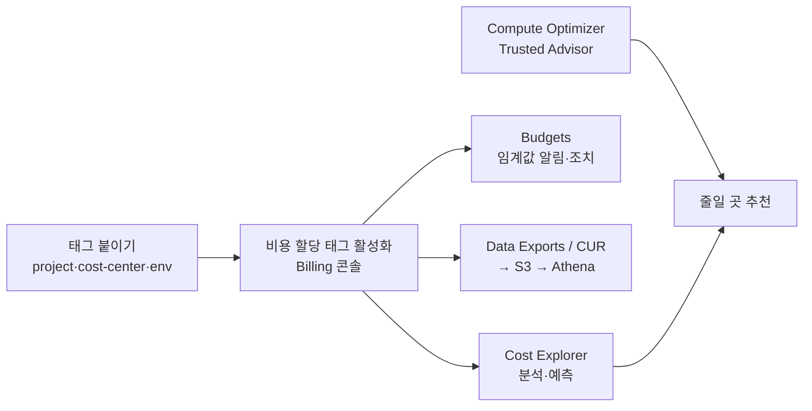

# M13-05. 비용 도구: Cost Explorer, Budgets, CUR, 비용 할당 태그, Compute Optimizer, 통합 결제
> 도메인: D4 · 예상 시간: 55분 · 실습 등급: 🟡 Budgets · 🔴 Cost Explorer · 🟢 태그 감사

## 왜 필요한가

레슨 1~4에서 "무엇을 줄일 수 있나"를 배웠다. 그런데 청구서가 나온 **뒤에** 알면 늦다. TodayOrder에는 세 가지가 필요하다. ① 예산을 넘기 **전에** 알림을 받기. ② "이 돈은 어느 팀·어느 기능이 썼나"를 나눠 보기. ③ "무엇을 줄이면 되나"를 도구가 추천하게 하기. 이 레슨은 그 도구들을 구분하고, 에뮬레이터에서 되는 것(예산 저장, 태그 감사)과 안 되는 것(실제 비용 조회)을 직접 확인한다.

## 핵심 개념

### 도구 한 줄 구분

| 도구 | 한 줄 | 시험 키워드 |
|---|---|---|
| **Cost Explorer** | 지난 비용을 서비스·계정·태그·사용 유형별로 **시각화·분석**, 향후 비용 **예측** | "어디에 돈을 썼나 분석", "추세", "예측" |
| **AWS Budgets** | 비용·사용량·약정 사용률/적용률에 **임계값 알림**(실제·예측), 예산 조치(Budget Actions: IAM·SCP 정책 적용, 인스턴스 중지) | "한도를 넘기 **전에** 알림", "초과 시 자동 조치" |
| **Cost Anomaly Detection** | 머신 러닝으로 평소와 다른 지출을 찾아 알림 | "예상치 못한 비용 급증 감지" |
| **CUR / Data Exports(CUR 2.0)** | 시간·리소스 단위의 **가장 상세한** 사용·비용 데이터를 S3로 내보냄 → Athena·QuickSight 분석 | "가장 상세한", "리소스 단위", "자체 분석" |
| **비용 할당 태그** | 태그별로 비용을 나눠 보기. 사용자 정의 태그는 Billing 콘솔에서 **활성화**해야 비용 데이터에 나타남 | "부서·프로젝트별 비용 배분(chargeback)" |
| **Compute Optimizer** | 사용률 지표로 EC2·ASG·EBS·Lambda·Fargate·RDS 등의 **적정 크기 권장** | "과다 프로비저닝 찾기", "rightsizing" |
| **Trusted Advisor** | 비용·보안·성능·내결함성·서비스 한도 점검(유휴 리소스 등). 전체 점검은 Business 이상 지원 플랜 | "모범 사례 점검", "유휴 로드 밸런서" |
| **Pricing Calculator** | **아직 만들지 않은** 아키텍처의 견적 | "이전 전 비용 추정" |
| **Organizations 통합 결제** | 여러 계정 청구서를 하나로, 사용량 합산 볼륨 할인, RI·Savings Plans 할인 **공유**(끌 수 있음) | "여러 계정, 볼륨 할인", "약정 할인 공유" |



### 태그 전략

- **필수 키**를 정한다: TodayOrder는 `project`, `cost-center`, `env`. 값도 허용 목록으로 제한한다(`env`는 `prod|staging|dev`). `Project`와 `project`는 **다른 키**다(대소문자 구분).
- 강제 수단: AWS Organizations **태그 정책**(키 대소문자·허용 값 표준화, 규정 미준수 보고, 지정한 리소스 유형의 미준수 태그 작업 차단), SCP의 `aws:RequestTag` 조건으로 "태그 없이는 생성 금지", AWS Config 규칙 `required-tags`, IaC 템플릿의 기본 태그.
- 태그는 **붙인 시점 이후**의 비용에만 반영된다. 사용자 정의 태그는 붙인 뒤 활성화 목록에 나타나기까지, 활성화 후 반영까지 각각 최대 24시간이 걸릴 수 있다. 처음부터 붙이자.

## 직접 해 보기

### 실습 1: 예산과 알림 — [labs/lab04-budgets.sh](./labs/lab04-budgets.sh)

TodayOrder의 월 예산 300 USD(태그 `project=todayorder`인 비용만). 실제 지출이 80%를 넘으면 이메일+SNS, 예측이 100%를 넘으면 이메일. SNS 주제에는 **Budgets 서비스가 게시할 수 있게** 주제 정책을 단다(없으면 실제 AWS에서 알림이 조용히 실패한다).

```bash
bash curriculum/m13-cost-optimization/labs/lab04-budgets.sh
```

```
== 1. 알림을 받을 SNS 주제 (Budgets 가 게시할 수 있게 주제 정책 허용)
arn:aws:sns:us-east-1:000000000000:todayorder-budget-alerts
== 2. 월 비용 예산 300 USD (태그 project=todayorder) + 알림 2개
{
    "Name": "todayorder-monthly",
    "Limit": "300",
    "TimeUnit": "MONTHLY",
    "Filter": "user:project$todayorder",
    "ActualSpend": "0"
}
ACTUAL	80.0	OK
FORECASTED	100.0	OK
== 3. 이 예산의 구독자
EMAIL	ops@todayorder.example
SNS	arn:aws:sns:us-east-1:000000000000:todayorder-budget-alerts
== 4. Cost Explorer: 이번 달 비용 조회와 예측

aws: [ERROR]: An error occurred (NotImplemented) when calling the GetCostAndUsage operation: operation GetCostAndUsage is scaffolded but not implemented in this emulator

aws: [ERROR]: An error occurred (NotImplemented) when calling the GetCostForecast operation: operation GetCostForecast is scaffolded but not implemented in this emulator
== 5. 비용 이상 탐지(Cost Anomaly Detection) 모니터: 서비스별
todayorder-service-monitor	DIMENSIONAL	SERVICE
LAB04 OK
```

방금 본 것:

- 예산과 알림 두 개, 구독자(이메일·SNS)가 **저장**됐다. 태그 필터 `user:project$todayorder`의 `user:`는 "사용자 정의 태그"라는 뜻이다(AWS가 만든 태그는 `aws:` 접두사).
- `ActualSpend`는 `0`이다. 에뮬레이터는 과금을 하지 않으니 지출이 늘지 않고, 알림 상태도 계속 `OK`다. **알림이 울리는 장면은 볼 수 없다**(🟡).
- Cost Explorer의 비용 조회·예측은 `501 NotImplemented`(🔴). Cost Anomaly Detection 모니터는 만들어지지만 탐지할 지출이 없다.

### 실습 2: 태그 정책 감사 — [labs/lab05-tag-audit.sh](./labs/lab05-tag-audit.sh)

태그 정책은 [labs/tag-policy.json](./labs/tag-policy.json)에 Organizations 태그 정책 문법으로 적었다. 그러나 에뮬레이터는 Organizations `CreatePolicy`가 501이라 정책을 계정에 붙일 수 없다. 그래서 같은 JSON을 읽어 **감사 스크립트가 판정**한다. 그리고 감사는 Resource Groups Tagging API 대신 **서비스마다 자기 API**로 태그를 읽는다 — 이유는 출력의 마지막 "참고" 줄에 있다.

```bash
bash curriculum/m13-cost-optimization/labs/lab05-tag-audit.sh
```

```
== 0. (참고) AWS Organizations 태그 정책으로 강제할 수 있을까?

aws: [ERROR]: An error occurred (NotImplemented) when calling the CreatePolicy operation: operation CreatePolicy is scaffolded but not implemented in this emulator
== 1. 리소스 만들기 (일부러 섞어서)
== 2. 감사
태그 정책: project∈['todayorder'], cost-center∈['orders', 'payments', 'platform'], env∈['prod', 'staging', 'dev']
✓ dynamodb  todayorder-m13-audit-orders          OK
✗ dynamodb  todayorder-m13-audit-sessions        MISSING env
✗ ebs       todayorder-m13-audit-data            BAD-VALUE env=production
✓ ec2       todayorder-m13-audit-api             OK
✗ ec2       todayorder-m13-audit-worker          MISSING cost-center
✓ s3        todayorder-m13-audit-images          OK
✗ s3        todayorder-m13-audit-logs            MISSING project; MISSING cost-center; MISSING env
✓ sns       todayorder-m13-audit-alerts          OK
✗ sqs       todayorder-m13-audit-dlq             WRONG-CASE Project→project
✓ sqs       todayorder-m13-audit-events          OK
참고: Tagging API GetResources(project=todayorder) 가 찾은 리소스 1개 (서비스별 API 로 확인한 실제 개수 8개) → sqs
NON-COMPLIANT 5 / 10
== 3. 고치기 — 서비스마다 태그 API 가 다르다
== 4. 다시 감사
...
NON-COMPLIANT 0 / 10
LAB05 OK
```

방금 본 것:

- 위반 세 종류를 모두 잡았다: 키 없음(`MISSING`), 값이 허용 목록 밖(`env=production`), 대소문자 다름(`Project`). 대소문자 하나 때문에 비용 보고서에서 `project`와 `Project`가 **두 개의 열**로 갈라진다.
- `project=todayorder` 태그가 실제로 붙은 리소스는 8개인데, Tagging API `GetResources`는 SQS 1개만 찾았다. 에뮬레이터의 Tagging API는 S3·DynamoDB·EC2·SNS를 찾지 못한다. [`sdk/tag_audit.py`](./sdk/tag_audit.py)는 그래서 `describe_instances`/`describe_volumes`(Tags), `get_bucket_tagging`(없으면 `NoSuchTagSet` 오류), `list_tags_of_resource`, `list_queue_tags`, `list_tags_for_resource`를 쓴다. 이 방식은 실제 AWS에서도 그대로 동작한다.
- 고칠 때도 서비스마다 API가 다르다: EC2·EBS는 `create-tags`, S3는 `put-bucket-tagging`(**태그 전체를 덮어쓴다** — 기존 태그를 빼먹으면 지워진다), DynamoDB는 `tag-resource`, SQS는 `tag-queue`/`untag-queue`.
- DynamoDB 태그는 테이블이 ACTIVE가 된 뒤에야 조회되고, `tag-resource` 결과도 몇 초 뒤에 보였다. 실제 DynamoDB도 태그 반영은 최종 일관성이므로 스크립트는 기다렸다가 확인한다.

## 실제 AWS에서는

- **Budgets**: 데이터는 하루에 최대 3번 갱신된다(실시간이 아니다). 조치(action)가 없는 예산은 무료, 조치가 있는 예산은 일정 개수를 넘으면 유료. 예산마다 알림 여러 개, 알림마다 이메일 여러 명과 SNS 주제를 지정할 수 있다. 알림을 Slack 등으로 보내려면 SNS → Amazon Q Developer in chat applications(구 AWS Chatbot).
- **Cost Explorer**: 콘솔 사용은 무료, **API 호출은 요청당 0.01 USD**. 예측은 최대 18개월. 처음 켜면 데이터가 준비되기까지 최대 24시간.
- **CUR**: 레거시 CUR도 동작하지만 AWS는 **Data Exports의 CUR 2.0**으로 옮기기를 권장한다.
- **비용 할당 태그**: Billing 콘솔 → Cost allocation tags에서 활성화. 관리 계정(Organizations)만 활성화할 수 있다.
- **Compute Optimizer**는 옵트인이 필요하고 기본 14일 지표를 본다(에뮬레이터: `OptInRequiredException`).

**실제 AWS에서 해 보려면**: 프리 티어 계정에서 이 lab의 예산(작은 금액, 예: 5 USD)과 알림을 그대로 만들어 보라. 조치 없는 예산은 무료이고, 실제로 이메일이 온다. **Zero spend budget**(1센트라도 쓰면 알림) 템플릿은 프리 티어 학습자에게 특히 유용하다. Cost Explorer는 콘솔에서 무료로 보되 CLI·API 호출은 요청당 과금되니 반복 호출하지 말 것. 정리: `aws budgets delete-budget --account-id <계정> --budget-name <이름>`, `aws sns delete-topic`.

## 시험 포인트

- "예산을 넘기 **전에** 알림" / "예측 지출이 한도를 넘으면 알림" → **AWS Budgets**(FORECASTED). "지난 비용 분석·추세" → **Cost Explorer**.
- "가장 상세한 리소스 단위 데이터를 S3로, Athena로 분석" → **CUR(Data Exports)**.
- "부서별 비용 배분" → **비용 할당 태그**(활성화 필요) + Cost Explorer/CUR. "태그 없는 리소스 생성 금지" → SCP `aws:RequestTag` 조건, 표준화 → 태그 정책, 감지 → Config `required-tags`.
- "여러 계정의 사용량 합산 할인, RI 공유" → **Organizations 통합 결제**.
- "과다 프로비저닝된 EC2 찾기" → **Compute Optimizer**(또는 Trusted Advisor 저사용 인스턴스 점검).
- "비정상적인 지출 급증 자동 감지" → **Cost Anomaly Detection**.

## 스스로 확인

1. 마케팅 팀이 "우리 팀이 쓴 비용만 매달 보고 싶다"고 한다. 무엇을 어떤 순서로 해야 하나?
2. Budgets 알림을 SNS로 받으려 했는데 아무 메시지도 오지 않는다. 먼저 확인할 것은?
3. `put-bucket-tagging`으로 `env=prod` 하나만 추가하려다 사고가 났다. 무슨 일이 일어났을까?

<details><summary>답</summary>

1. ① 팀의 리소스에 `cost-center=marketing` 같은 태그를 일관되게 붙인다(태그 정책·IaC로 표준화) ② 관리 계정의 Billing 콘솔에서 그 태그 키를 비용 할당 태그로 **활성화**한다 ③ Cost Explorer에서 태그로 필터·그룹(또는 그 태그 필터를 건 예산 생성). 태그는 붙인 뒤의 비용부터 잡힌다.
2. SNS 주제 정책이 `budgets.amazonaws.com`의 `SNS:Publish`를 허용하는지. 그다음 구독(이메일 확인 여부 등)과 주제의 KMS 암호화 키 정책(암호화된 주제라면 Budgets가 키를 쓸 수 있어야 함).
3. `PutBucketTagging`은 태그 집합 **전체를 교체**한다. `env=prod`만 보내면 기존 `project`, `cost-center`가 지워져 비용 보고서와 태그 기반 정책(백업 선택 등)에서 빠진다. 기존 태그를 읽어 합친 뒤 보내야 한다.

</details>
