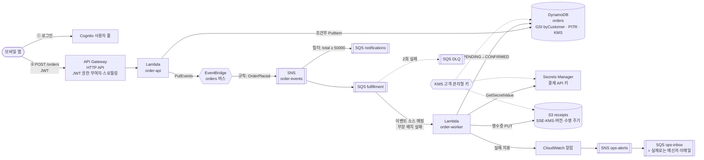
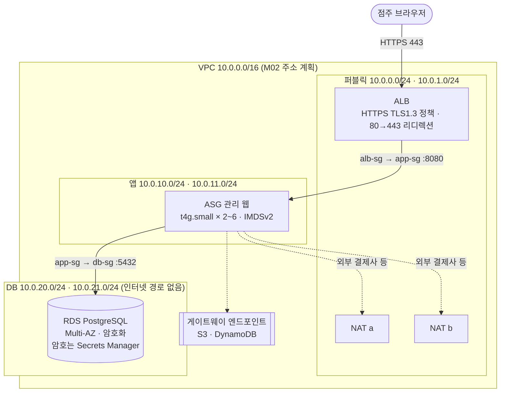
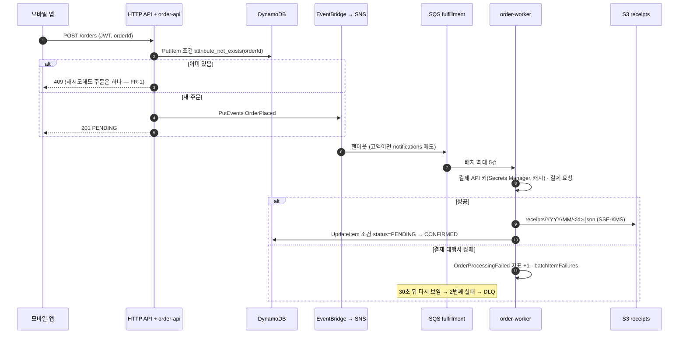
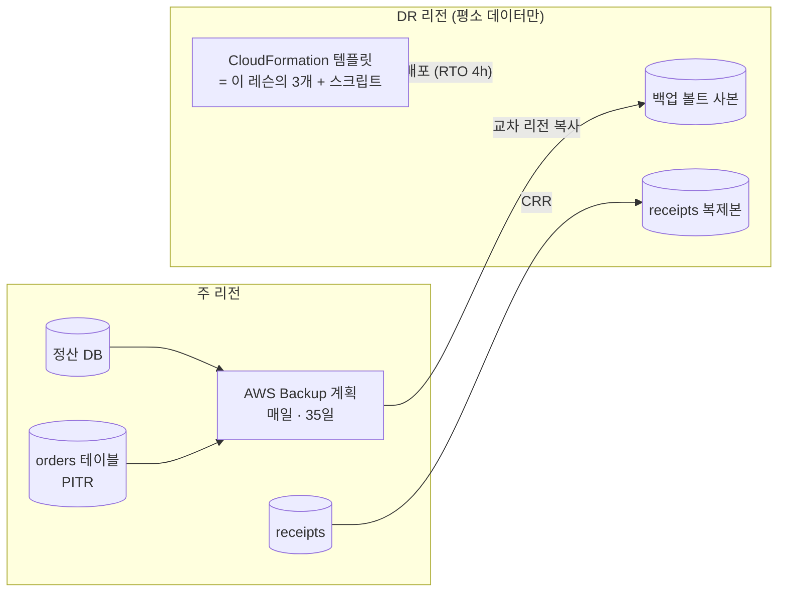

# M14-02. 캡스톤 ① 요구 사항서와 참조 설계
> 도메인: D1~D4 · 예상 시간: 90분 (읽기 40분 + 직접 설계해 보고 비교 50분) · 실습 등급: — (설계 문서. 구축은 [레슨 03](./03-capstone-build.md))

## 왜 필요한가

M01~M13에서 TodayOrder의 조각을 하나씩 만들었다. 그런데 실무에서 받는 일은 "SQS 큐 하나 만들어 줘"가 아니라 **"이런 서비스를 이 예산·이 가용성으로 만들어 줘"**다. 시험도 같다 — 65문항 대부분이 요구 사항 몇 줄을 주고 "가장 잘 만족하는 설계"를 묻는다. 이 레슨은 요구 사항서 한 장에서 출발해 참조 설계를 만들고, **각 결정의 이유와 버린 대안**을 기록한다. 먼저 요구 사항만 읽고 5장 "결정 기록"을 가린 채 스스로 설계해 본 뒤 비교하라.

## 핵심 개념

### 1. 요구 사항서 — TodayOrder 2.0

**배경**: 서버 한 대(주문 API + 관리 화면 + PostgreSQL)로 시작한 TodayOrder를 AWS 위에서 다시 짓는다. 고객 주문은 모바일 앱에서, 점주(가맹점)용 관리 웹은 기존 Spring Boot 앱을 그대로 쓴다.

**기능 요구 (FR)**

| ID | 요구 |
|---|---|
| FR-1 | 고객은 로그인 후 주문을 넣는다. 같은 주문을 네트워크 오류로 다시 보내도 주문은 하나만 생긴다 |
| FR-2 | 고객은 자기 주문만 조회하고, "내 최근 주문 목록"을 본다 |
| FR-3 | 주문이 들어오면 결제 승인 → 주문 확정 → 영수증 발행이 자동으로 이어진다. 접수와 처리는 분리되어, 처리가 늦어도 접수는 받는다 |
| FR-4 | 5만 원 이상 고액 주문은 별도 알림 채널로도 전달된다(이후 사기 검토팀이 소비) |
| FR-5 | 점주는 관리 웹(HTTPS)에서 정산 내역을 본다. 정산 데이터는 관계형 DB에 있다 |
| FR-6 | 결제 처리가 실패하면 운영자가 알 수 있고, 실패한 주문은 원인을 고친 뒤 재처리할 수 있다 |

**비기능 요구 (NFR)**

| 분류 | ID | 요구 | 근거·수치 |
|---|---|---|---|
| 가용성 | NFR-A1 | 주문 접수 API 월 가용성 99.9% 이상(월 약 43분 이하 중단). **AZ 하나가 통째로 죽어도 접수 유지** | [M12-01](../m12-resilience-dr-migration/01-availability-and-spof.md) 표 |
| | NFR-A2 | 관리 웹·정산 DB도 AZ 장애를 견딘다. DB 장애 조치는 수 분 안, 커밋된 데이터 손실 없음 | |
| | NFR-A3 | 주문 데이터 RPO: AZ 장애 0, 실수로 지운 데이터는 35일 안의 임의 시점으로 복구 | PITR |
| | NFR-A4 | 리전 장애: RTO 4시간, RPO 1시간 (이번 범위에서는 **설계만** — 7장) | [M12-02](../m12-resilience-dr-migration/02-rto-rpo-dr-strategies.md) |
| 성능 | NFR-P1 | 평시 초당 5건, 점심 피크 초당 50건, 연 2회 행사 초당 300건 주문. 접수 API p95 300 ms 이하 | |
| | NFR-P2 | "내 최근 주문" 조회는 전체 주문 수와 무관하게 일정한 지연 | 테이블 Scan 금지 |
| 보안 | NFR-S1 | 사람에게 장기 액세스 키 없음. 서비스는 역할로, 각자 필요한 권한만 | [M01](../m01-iam-identity/README.md) |
| | NFR-S2 | 저장 데이터 전부 암호화. 주문·영수증·결제 비밀은 **고객 관리형 KMS 키**(키 사용 감사, 비상시 비활성화) | [M09-01](../m09-security-encryption/01-kms.md) |
| | NFR-S3 | 전송 구간 TLS. 관리 웹은 TLS 1.2 이상만 | |
| | NFR-S4 | DB는 인터넷 경로가 없는 서브넷에. DB에는 앱 서버만 접근 | [M02-04](../m02-vpc-networking/04-security-group-vs-nacl.md) |
| | NFR-S5 | 카드 번호는 저장하지 않는다(결제 대행사 토큰만). 결제 대행사 API 키는 코드·설정 파일에 두지 않는다 | |
| | NFR-S6 | 모든 리전의 API 호출을 1년 이상 변조 검증 가능하게 남기고, 저장소 설정 위반(암호화 꺼짐 등)을 자동 판정 | [M09-04](../m09-security-encryption/04-audit-and-compliance.md) |
| | NFR-S7 | 영수증은 5년 보관 후 삭제(전자상거래 거래 기록 보존 기간), 실수로 지우거나 덮어써도 복구 가능 | |
| 운영 | NFR-O1 | 인프라는 코드로 다시 만들 수 있어야 한다. 정리(삭제)도 스크립트 한 번으로 | [M10-03](../m10-monitoring-iac/03-cloudformation.md) |
| | NFR-O2 | 결제 실패가 1분에 1건이라도 나면 운영 채널에 알림, 복구되면 해제 알림 | [M10-01](../m10-monitoring-iac/01-cloudwatch-metrics-alarms.md) |
| 비용 | NFR-C1 | 개발 환경 월 200 USD 예산, 예측이 80%를 넘으면 알림. 모든 리소스에 `Project` 태그 | [M13-05](../m13-cost-optimization/05-cost-tools.md) |
| | NFR-C2 | 트래픽이 거의 없는 시간에 비용이 0에 가까운 구성 요소를 우선 | 서버리스 |
| | NFR-C3 | 같은 리전 S3·DynamoDB 트래픽에 NAT 처리 요금을 내지 않는다 | [M13-04](../m13-cost-optimization/04-network-cost.md) |

### 2. 참조 설계 한눈에





### 3. 계층과 구축 방법

| 계층 | 만드는 것 | lab | 도구 | 에뮬레이터 등급 |
|---|---|---|---|---|
| 1 네트워크·관리 웹 | VPC·서브넷 6·IGW·NAT 2·라우팅 테이블 4·게이트웨이 엔드포인트 2·SG 3 / ACM·ALB·리스너 2·시작 템플릿·ASG / RDS Multi-AZ | [lab01](./labs/lab01-network-web-tier.sh) | CFN [network.yaml](./labs/templates/network.yaml) + CLI | 🟢 구성 |
| 2 데이터·보안 | KMS 키·주문 테이블·결제 비밀·설정 파라미터 / 영수증 버킷 | [lab02](./labs/lab02-data-security.sh) | CFN [data.yaml](./labs/templates/data.yaml) + CLI | 🟢 |
| 3 주문 파이프라인 | 이벤트 버스 / 규칙·SNS·SQS 4·DLQ·필터 정책 / Cognito·Lambda 2·매핑·HTTP API | [lab03](./labs/lab03-order-pipeline.sh) | CLI + CFN [messaging.yaml](./labs/templates/messaging.yaml) | 🟢 |
| 4 관측·감사·거버넌스 | 알람 2·CloudTrail·Config 규칙 2·Budgets | [lab04](./labs/lab04-observability-governance.sh) | CLI | 🟢 / 🟡 |
| 시험 | 종단 간 스모크 테스트(없는 계층은 먼저 지음) | [lab05](./labs/lab05-smoke-test.sh) | CLI | 🟢 |
| 정리 | 역순 삭제 + 남은 것 단언 | [lab06](./labs/lab06-teardown.sh) | CLI | 🟢 |

**CloudFormation과 CLI를 나눈 기준** — 원칙은 "IaC(NFR-O1)를 기본으로, 에뮬레이터에서 CloudFormation이 **실제 리소스를 만들지 않거나 속성을 무시하는** 부분만 CLI". 저자가 이 버전(1.0.322)에서 직접 확인한 결과다.

| 리소스 | CloudFormation 결과 | 그래서 |
|---|---|---|
| VPC·서브넷·NAT·라우팅·엔드포인트·SG | 실제 생성(2초 간격 폴링 필수 — `wait` 쓰면 NAT 경로가 롤백, [M10](../m10-monitoring-iac/README.md)) | CFN |
| KMS·DynamoDB(GSI·PITR·SSE)·Secrets·SSM·SNS·SQS·큐/토픽 정책·구독(필터 포함)·이벤트 규칙 | 실제 생성, 속성 반영 확인 | CFN |
| `AWS::ElasticLoadBalancingV2::*` | `CREATE_COMPLETE`인데 ELBv2 API에 **없음** | CLI (lab01) |
| `AWS::AutoScaling::ScalingPolicy` | `CREATE_COMPLETE`인데 정책 API는 501 | 설계 문서에만(아래 JSON) |
| `AWS::Events::EventBus` | `CREATE_COMPLETE`인데 버스가 **없음** | 버스만 CLI, 규칙은 CFN에 이름 파라미터로 |
| `AWS::S3::Bucket`의 `BucketEncryption` | 무시되어 SSE-S3로 남음 | 버킷은 CLI (lab02) |
| `AWS::DynamoDB::Table`의 `StreamSpecification` | `streamEnabled` 누락 오류로 롤백(실제 CFN에는 없는 속성) | 스트림을 쓰지 않음(7장 한계 참고) |
| Lambda·API Gateway·Cognito | (CFN 시도 안 함) zip 패키징·토큰에서 읽어야 하는 발급자(iss) 때문에 스크립트가 자연스럽다 | CLI. 실제 AWS라면 SAM/CDK로 템플릿화 |

실제 AWS에서는 이 표의 "CLI" 부분도 전부 템플릿(또는 CDK)에 넣는 것이 정답이다. 스크립트 분리는 에뮬레이터 사정이지 설계 권장이 아니다.

### 4. 주문 한 건의 흐름



### 5. 결정 기록 — 무엇을 골랐고 무엇을 버렸나

| # | 결정 | 이유 (요구) | 버린 대안과 이유 | 모듈 |
|---|---|---|---|---|
| 1 | 주문 접수는 **API Gateway HTTP API + Lambda** | 유휴 비용 0(NFR-C2), 요청량 따라 자동 확장(NFR-P1), 리전 서비스라 AZ 장애에 강함(NFR-A1) | ALB+EC2: 최소 2대 상시 비용. REST API: 캐시·API 키·WAF 직접 연결이 필요 없고 HTTP API가 더 싸고 단순. App Runner: 2026-04-30부터 신규 고객 불가 | M07-03 |
| 2 | 인증은 **Cognito 사용자 풀 + JWT 권한 부여자**, 고객 ID는 토큰의 `sub` | 본문의 customerId를 믿으면 남의 이름으로 주문 가능(NFR-S1). 권한 부여를 API Gateway가 함수 밖에서 처리 | 자격 증명 풀: 앱이 AWS를 직접 부를 일이 없음. Lambda 권한 부여자: JWT 검증을 직접 짜야 함 | M07-04 |
| 3 | 주문 저장은 **DynamoDB 온디맨드**, 키 `orderId`, **GSI `byCustomer`(customerId+createdAt, INCLUDE status·total)** | 키 조회 위주(FR-1·2), 트래픽 예측 불가 초기(NFR-C2), "내 주문"을 Query로(NFR-P2). INCLUDE 투영으로 GSI 저장·쓰기 비용 절감 | RDS: 주문 접수 경로에 연결 관리·확장 부담. 프로비저닝 용량: 패턴이 안정되면 전환(M13) | M05-04·05 |
| 4 | **조건부 쓰기**로 멱등 접수, 워커도 **조건부 상태 전이**(영수증을 먼저 쓰고 상태를 바꿔, 중간 실패 후 재시도에도 영수증이 빠지지 않게) | 클라이언트 재시도·SQS 최소 한 번 전달에도 결과는 한 번(FR-1, FR-3) | 별도 멱등 키 테이블: 같은 효과에 테이블 하나 더 | M05-04, M06-02 |
| 5 | 이벤트는 **EventBridge 버스 → 규칙 → SNS → SQS** | 생산자는 토폴로지를 모르고 이벤트만 발행(새 소비자는 규칙·구독 추가). SNS는 소비자별 큐로 팬아웃하고 **본문 기반 필터 정책**(FR-4) | Lambda에서 SNS 직접 게시: 실제 AWS에선 가능하고 더 단순하지만, 에뮬레이터의 Lambda 런타임은 SNS에 닿지 못한다(README 제약). EventBridge → SQS 두 대상: 가능, 대신 큐별 필터를 규칙으로 나눠야 함 | M06-03·04 |
| 6 | 처리는 **SQS + 이벤트 소스 매핑 + 부분 배치 실패 + DLQ(maxReceiveCount 2)** | 처리가 늦어도 접수는 계속(FR-3), 독이 든 메시지가 나머지를 막지 않음, 재처리 가능(FR-6) | 큐 없이 비동기 Lambda: 실패 대상은 있지만 버퍼·재처리 통제가 약함 | M06-02, M07-02 |
| 7 | 가시성 타임아웃 30초 = 함수 타임아웃 5초 × 6 | AWS 권장(ESM). 짧으면 처리 중인 메시지가 다시 보여 중복 처리된다([M07 lab02](../m07-serverless-containers/labs/lab02-lambda-sqs-esm.sh)는 짧으면 매핑 생성 자체를 거부함을 보여 준다) | 기본 30초를 함수 60초와 함께 쓰는 실수 | M07-02 |
| 8 | 결제 API 키는 **Secrets Manager(KMS)**, 일반 설정은 **Parameter Store**(배포 시 읽어 환경 변수) | 비밀과 설정을 분리(NFR-S5). 비밀은 교체 가능한 곳에, 설정은 무료 계층에 | 환경 변수에 비밀: 콘솔·`GetFunctionConfiguration`으로 노출. 매 호출 조회: 지연·비용 → 실행 환경당 캐시 | M09-02 |
| 9 | **고객 관리형 KMS 키 하나**(자동 교체)로 테이블·버킷·비밀 암호화, 버킷은 **S3 버킷 키** | 키 사용 감사·비활성화(NFR-S2), 버킷 키로 KMS 요청 비용·스로틀링 감소. 키 정책은 계정(IAM)에 위임만 하므로 **두 실행 역할의 IAM 정책에 키 사용 권한**을 넣는다 — DynamoDB·S3·Secrets Manager가 호출자 대신 KMS를 부르기 때문(order-api: `kms:Decrypt`, order-worker: `kms:Decrypt`·`kms:GenerateDataKey`), `kms:ViaService`로 그 서비스를 거친 호출만 허용. 빠뜨리면 실제 AWS에서 테이블 읽기·쓰기가 `AccessDenied`(에뮬레이터는 검사하지 않음) | 데이터별 키 분리: 더 강한 격리지만 이 규모에선 관리 부담. SSE-S3: 감사·비활성화 불가 | M09-01, M04-04 |
| 10 | 큐는 **SSE-SQS**(관리형) | 저장 암호화 충족, SNS→SQS 전달에 키 정책 작업 불필요 | 큐에 고객 관리형 키: 키 정책에 `sns.amazonaws.com`의 `kms:GenerateDataKey*`·`kms:Decrypt` 허용 필요 — 빠뜨리면 **조용히 전달 실패** | M06-03 |
| 11 | 영수증 버킷: **퍼블릭 차단·버전 관리·HTTPS 강제·수명 주기(30일 IA → 365일 Deep Archive → 1825일 만료, 이전 버전 30일, 미완료 MPU 7일)** | NFR-S7·C. 영수증은 첫 달 이후 거의 안 봄 | Intelligent-Tiering: 접근 패턴이 분명해 규칙이 더 쌈. 객체 잠금: 이번 요구엔 법적 WORM이 없어 버전 관리로 충분(규제가 생기면 규정 준수 모드) | M04-02·03 |
| 12 | 관리 웹은 **ALB(2 AZ) + ASG(2 AZ, 최소 2, ELB 헬스 체크) + t4g(Graviton) + IMDSv2 필수** | 기존 Spring 앱 유지(FR-5), AZ 장애 견딤(NFR-A2), 같은 성능 더 싸게 | Elastic Beanstalk: 같은 구조를 대신 만들어 주지만 이 커리큘럼은 구성 요소를 직접 이해하는 것이 목표. 단일 대형 인스턴스: SPOF | M03 |
| 13 | ALB는 **HTTPS(TLS 1.3 정책) + 80→443 리디렉션**, 인증서는 ACM | NFR-S3. 실제로는 ACM 공인 인증서 + DNS 검증(무료·자동 갱신) | 앱 서버에서 TLS 종료: 인증서 배포·갱신 부담 | M03-05, M09-03 |
| 14 | 정산 DB는 **RDS PostgreSQL Multi-AZ(인스턴스), 암호화, 비공개, 마스터 암호 Secrets Manager 관리, 자동 백업 7일, 삭제 방지** | NFR-A2(동기 복제·자동 장애 조치), NFR-S4·S1 | Aurora: 더 빠른 장애 조치·복제본 15개지만 이 규모엔 과함(성장 시 전환). 읽기 복제본: 가용성 수단이 아님 | M05-01·02 |
| 15 | **AZ마다 NAT**, 앱 서브넷 라우팅 테이블도 AZ별 | 한 AZ NAT가 죽어도 다른 AZ 앱은 외부 통신 유지(NFR-A2) | NAT 하나: 월 NAT 비용 절반이지만 그 AZ 장애 시 반대편 앱도 고립(M10 템플릿의 선택과 비교 — 레슨 01) | M02-03 |
| 16 | **S3·DynamoDB 게이트웨이 엔드포인트** | NFR-C3, 트래픽이 인터넷으로 안 나감 | 인터페이스 엔드포인트: 같은 효과에 시간당·GB당 요금 | M02-05, M13-04 |
| 17 | Lambda 2개는 **VPC 밖** | VPC 리소스(RDS 등)에 접근하지 않으므로 ENI·NAT가 필요 없음 | VPC 안 Lambda: 정산 DB를 직접 읽게 되면 그때(그리고 RDS Proxy) | M07-01 |
| 18 | Lambda는 **arm64**, 로그 보존 30일, 메모리 256 MB | 비용·지속 가능성, 로그 무기한 보관 비용 차단 | x86: 이유 없음. 기본 보존(무기한): 계속 과금 | M10-02, M13-02 |
| 19 | 알람: **사용자 지정 지표 `OrderProcessingFailed` 합계 ≥ 1 (1분)** → SNS, OK 알림도. DLQ 깊이 알람도 구성 | NFR-O2. 원인(실패)과 결과(DLQ 적재) 둘 다 본다 | 로그 지표 필터: 같은 효과(코드 변경 없이) — 이미 로그를 JSON으로 남기므로 대안으로 충분 | M10-01·02 |
| 20 | **CloudTrail 멀티 리전 + 무결성 검증**(감사 버킷 전용 정책·버전 관리), 영수증 버킷 **데이터 이벤트** | NFR-S6 | 이벤트 기록(90일)만: 1년 요구 불충족 | M09-04 |
| 21 | **Config 기록기 + 관리형 규칙**(버킷 암호화·버전 관리), `Project` 태그로 범위 | NFR-S6 "설정 위반 자동 판정" | 사람 점검: 놓친다 | M09-04 |
| 22 | **Budgets 월 200 USD, 예측 80% 알림 → 같은 운영 채널**, 모든 리소스 `Project=todayorder` 태그 | NFR-C1 | Cost Explorer만: 사후 분석이지 알림이 아님 | M13-05 |
| 23 | HTTP API **스테이지 스로틀 초당 500, 버스트 1,000** (lab03이 지정) | 스로틀 값 = NFR-P1 피크 300건/초 × 여유 약 1.7. 피크를 받으면서, 한 API의 폭주가 계정 한도(리전당 초당 10,000·버스트 5,000)를 다 쓰지 못하게 상한을 둔다 | 지정하지 않음: HTTP API에는 별도 "기본 스테이지 스로틀"이 없어 계정 한도만 걸린다. 피크보다 낮게(예: 100): 행사 때 429 | M07-03 |
| 24 | 감사 버킷 **수명 주기: 90일 뒤 Glacier Flexible Retrieval, 400일(13개월) 뒤 만료**(이전 버전도 400일) | NFR-S6 "1년 이상 보관". 감사 로그는 사고 조사 때만 읽으므로 90일 뒤 아카이브 | 무기한 보관: 요구는 충족하지만 비용이 계속 는다. 객체 잠금(규정 준수 모드): 덮어쓰기·삭제 금지까지 규제가 요구하면 버킷 생성 시 켠다 — 지금은 CloudTrail 무결성 검증(다이제스트)으로 변조 탐지가 충분 | M04-02·03, M09-04 |

**관리 웹 ASG의 조정 정책** (에뮬레이터 `PutScalingPolicy` 501 — 실제 AWS에서 lab01 뒤에 붙일 것):

```json
{
  "AutoScalingGroupName": "todayorder-cap-app-asg",
  "PolicyName": "keep-600-requests-per-target",
  "PolicyType": "TargetTrackingScaling",
  "TargetTrackingConfiguration": {
    "PredefinedMetricSpecification": {
      "PredefinedMetricType": "ALBRequestCountPerTarget",
      "ResourceLabel": "app/todayorder-cap-alb/<ALB ID>/targetgroup/todayorder-cap-app-tg/<TG ID>"
    },
    "TargetValue": 600.0
  }
}
```

### 6. 에뮬레이터로 짓는 것과 다이어그램으로 남긴 것

| 영역 | 짓고 단언함 (lab) | 다이어그램·문서로만 | 이유 |
|---|---|---|---|
| 주문 경로 | 로그인 → API → DynamoDB → 이벤트 → 팬아웃 → 워커 → 영수증(고객 관리형 키 일치), 409·400·401, 다른 고객의 조회 404와 목록 분리(FR-2), 필터 정책, DLQ, 이번 장애 주문이 일으킨 알람 → 운영 큐 | — | 에뮬레이터가 Lambda를 실제 실행하고 서비스 간 전달도 실제로 일어난다 |
| 관리 웹 | 네트워크·SG 체인·ALB·리스너·인증서·시작 템플릿·ASG(2 AZ)·대상 healthy·RDS Multi-AZ | 실제 HTTPS 요청, 조정 정책, 자가 치유, DB 장애 조치·SQL | 인스턴스가 부팅하지 않고 ALB·RDS 주소는 컨테이너 안([M03](../m03-compute-scaling/README.md)·[M05](../m05-databases/README.md)) |
| 엣지 | — | CloudFront + WAF를 HTTP API 앞에(HTTP API는 WAF 직접 연결 불가), Route 53 `api.`·`partner.` Alias, Shield Standard | 에뮬레이터의 CloudFront·WAF는 컨테이너 안에서만 관찰 가능([M08](../m08-dns-edge/README.md)) — 캡스톤 스모크 테스트를 호스트에서 돌리기 위해 제외 |
| 데이터 보호 | PITR·버전 관리·수명 주기 구성 | AWS Backup 계획(일일, 다른 리전 볼트 복사), 수명 주기 전환 실제 발생 | Backup 복원 데이터가 비어 오고([M12](../m12-resilience-dr-migration/README.md)) 전환은 일어나지 않는다([M04](../m04-storage/README.md)) |
| 리전 DR (NFR-A4) | — | 아래 그림 | 두 번째 에뮬레이터로 흉내는 M12에서 했다. 캡스톤은 단일 리전 |
| 거버넌스 | CloudTrail·S3 Config 규칙·Budgets | DynamoDB PITR·RDS Multi-AZ Config 규칙(→ `sdk/capstone_audit.py`가 직접 점검), GuardDuty·Security Hub CSPM, Organizations SCP | 에뮬레이터의 Config가 S3 버킷만 기록하고, SCP는 501 |



NFR-A4(RTO 4시간, RPO 1시간)는 **백업·복원**으로 충분하다: AWS Backup 계획의 복사 주기를 1시간으로 두거나, DynamoDB 테이블은 전역 테이블 대신 백업 사본으로 복원한다(전역 테이블은 RPO 초 단위지만 상시 비용이 든다 — 요구보다 과함). 요구가 RTO 분 단위로 바뀌면 파일럿 라이트(복제는 상시, 컴퓨트는 장애 때)로 올린다.

### 7. 알려진 한계 (리뷰에서 지적받을 곳)

1. **이중 쓰기(dual write)**: order-api는 DynamoDB에 쓴 뒤 `PutEvents`를 부른다. 그 사이에 함수가 죽으면 주문은 있는데 이벤트가 없다(주문이 PENDING에 머묾). 정석은 **아웃박스 패턴** — DynamoDB Streams → EventBridge Pipes(또는 Lambda) → 버스로 "커밋된 변경만" 발행. 이 에뮬레이터에서는 CloudFormation의 스트림 설정이 실패하고, Pipes가 SQS·Lambda 대상만 실제 전달해(SNS·버스 대상은 경고만 남김) 구축하지 않았다. 대신 "PENDING이 10분 넘은 주문"을 찾는 점검 쿼리를 운영 런북에 둔다.
2. **결제 대행사 장애 때 재시도 간격**: 가시성 타임아웃(30초)마다 재시도해 2번 만에 DLQ로 간다. 실제로는 대행사 장애가 수 분 이어질 수 있으므로 maxReceiveCount를 늘리거나, 워커가 `ChangeMessageVisibility`로 지수 백오프를 주는 편이 낫다.
3. **알림 큐 소비자 없음**: notifications 큐는 FR-4의 "나중에 붙을 소비자"용이다. 소비자가 없으면 메시지가 보존 기간(기본 4일) 뒤 사라진다.
4. **단일 KMS 키**: 키 하나를 비활성화하면 주문·영수증·결제 비밀이 한꺼번에 막힌다(의도된 "비상 차단"이지만 영향 범위가 크다).
5. **작은 영수증은 전환되지 않는다**: 2024-09부터 S3 수명 주기는 기본으로 128 KB 미만 객체를 다른 클래스로 옮기지 않는다(lab02 출력의 `TransitionDefaultMinimumObjectSize: all_storage_classes_128K`). 영수증 JSON은 수 KB라 결정 11의 전환 규칙이 사실상 동작하지 않고 만료(1825일)만 의미가 있다. 작은 객체를 IA로 옮기면 128 KB 최소 과금 때문에 오히려 비싸므로, 실제로는 ① 그대로 Standard에 두고 만료만 걸거나 ② 월별로 묶어(압축 파일·Parquet) 큰 객체로 만든 뒤 아카이브한다. 이 사실을 lab02에서 발견하도록 남겨 두었다.
6. **관리 웹 → 정산 DB만 VPC 안**: 정산 데이터가 주문 데이터(DynamoDB)에서 어떻게 넘어오는지(일 배치, M11의 Glue·Athena 경로)는 범위 밖이다.

## 실제 AWS에서는

- 이 설계를 실제 계정에 올리면 **시간당 과금 리소스**가 생긴다: NAT 게이트웨이 2개, 퍼블릭 IPv4(EIP 2 + ALB), ALB, RDS Multi-AZ, EC2 2대. 예시 단가([M13 치트시트](../m13-cost-optimization/cheatsheet.md), 실제 가격 아님)로 NAT 2개 × 730시간 × 0.05 = 73 USD, EIP 2개 × 730 × 0.005 = 7.3 USD만으로 한 달 80 USD를 넘는다. 실습 뒤 바로 [lab06](./labs/lab06-teardown.sh)을 실행할 것. 프리 티어로 줄이려면 NAT를 빼고(앱 서브넷 외부 통신 포기) RDS를 단일 AZ db.t4g.micro로 한다 — 단, 그러면 NFR-A2를 어긴다는 것을 알고 할 것.
- 실제 AWS에서 해 보려면: lab01~06은 `env.sh`가 에뮬레이터만 허용하므로 그대로는 돌지 않는다(안전 장치). 템플릿 3개는 그대로 `aws cloudformation deploy`로 쓸 수 있고, `wait`를 써도 된다. ALB 인증서는 `acm request-certificate --validation-method DNS`로 바꾸고, Cognito 권한 부여자의 Issuer는 `https://cognito-idp.us-east-1.amazonaws.com/<풀 ID>`로 쓴다.

## 시험 포인트

- 요구 사항서의 **숫자**(RTO/RPO, 가용성 %, 피크 배수, 보존 기간)가 곧 정답의 근거다. 숫자에 밑줄을 긋고 보기를 지운다.
- "접수는 유실 없이, 처리는 늦어도 됨" → **큐로 끊기**. "여러 시스템이 각자" → **SNS + 소비자별 SQS**. "내용 기반 라우팅·SaaS·재생" → **EventBridge**.
- "같은 요청을 다시 보내도 한 번" → **조건부 쓰기/멱등 키**. SQS 표준 = 최소 한 번 전달 → 소비자는 늘 멱등.
- 가시성 타임아웃 ≥ 함수 타임아웃 × 6 (ESM). DLQ는 같은 종류의 큐.
- SNS → 고객 관리형 키로 암호화된 SQS = 키 정책에 SNS 서비스 주체. 빠뜨리면 조용히 실패.
- HTTP API에 WAF가 필요하면 앞에 CloudFront + WAF. 캐시·API 키·사용량 계획이 필요하면 REST API.
- AZ마다 NAT + AZ별 라우팅 테이블, S3·DynamoDB는 게이트웨이 엔드포인트.

## 스스로 확인

1. 요구 사항이 "주문 접수 API p95 50 ms, 행사 때 초당 3,000건"으로 바뀌면 결정 기록의 몇 번이 흔들리는가?
2. 결정 5에서 EventBridge를 빼고 Lambda가 SNS에 직접 게시한다면(실제 AWS) 무엇을 잃는가?
3. NFR-A4가 "RTO 15분, RPO 1분"으로 바뀌면 6장의 DR 그림은 어떻게 바뀌는가?

<details><summary>답</summary>

1. 1번(Lambda 콜드 스타트 → 프로비저닝된 동시성, 또는 계정 동시성 한도 증설), 3번(행사 트래픽 패턴이 정해지면 프로비저닝 용량 + Auto Scaling, 핫 파티션 주의 — `orderId`는 분산이 좋아 괜찮다), 결정 23의 스테이지 스로틀(lab03이 지정한 초당 500·버스트 1,000을 3,000 × 여유로 올린다. 그러면 계정 한도 초당 10,000·버스트 5,000에 가까워지므로 한도 증설 요청도 함께). 50 ms p95면 결제 처리처럼 무거운 일은 반드시 비동기 쪽(이미 그렇다)에 둔다.
2. 생산자가 토폴로지를 모르는 장점은 SNS만으로도 상당 부분 유지된다(구독만 추가). 잃는 것은 **내용 기반 규칙으로 여러 종류의 대상(Step Functions 등)에 보내기**, **아카이브·재생**, 다른 AWS 서비스·SaaS 이벤트와 같은 버스에서 다루기다. 대신 호출 한 단계와 비용이 줄어든다 — 이 규모라면 SNS 직접 게시도 좋은 답이다.
3. 백업·복원으로는 불가. 데이터는 **상시 복제**(DynamoDB 전역 테이블 또는 교차 리전 복제, RDS 교차 리전 읽기 복제본/Aurora Global Database, S3 CRR + RTC)로 RPO를 맞추고, 컴퓨트는 최소 웜 스탠바이(작게 상시 실행) + Route 53 장애 조치 또는 Global Accelerator로 RTO 15분을 맞춘다.
</details>
