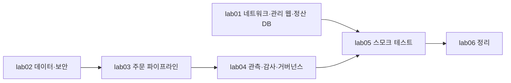

# M14-03. 캡스톤 ② 한 번에 짓고, 시험하고, 지우기
> 도메인: D1~D4 · 예상 시간: 70분 · 실습 등급: 🟢 (관리 웹 트래픽·DB 장애 조치·조정 정책은 🔴 → 레슨 02 설계로)

## 왜 필요한가

설계 문서는 "그럴듯함"까지만 보증한다. 실제로 지어 보면 정책 하나가 빠져 메시지가 조용히 사라지거나, 순서가 틀려 스택이 롤백된다. 이 레슨은 [레슨 02](./02-capstone-requirements-and-design.md)의 설계를 깨끗한 에뮬레이터에 **한 번에** 짓고, 주문 한 건을 처음부터 끝까지 흘려 요구 사항을 하나씩 확인한 뒤, 6개 기둥 자동 점검으로 마무리하고, 흔적 없이 지운다. 실무의 "배포 → 스모크 테스트 → 점검 → 정리" 한 바퀴다.

## 핵심 개념

### 계층과 의존 관계



- 각 lab은 **단독 실행 가능**하다. 선행 계층이 없으면 스스로 그 lab을 먼저 돌린다(`_lib.sh`의 `ensure`). 그래서 깨끗한 에뮬레이터에서 **lab05 하나만 실행해도 전체가 지어진다**.
- 두 번 실행해도 된다(멱등). CloudFormation 스택은 있으면 재사용하고, 관리 웹 계층·Lambda·API는 지우고 다시 만들며, 테스트 데이터는 실행마다 다른 주문 ID를 쓴다.
- **템플릿을 고쳤다면** lab06으로 지우고 다시 짓는다. lab들은 기존 스택을 갱신하지 않는다 — 에뮬레이터에서 VPC 스택 변경 세트가 IGW 연결 갱신 501로 롤백되기 때문이다([M10](../m10-monitoring-iac/README.md)).

### 스모크 테스트가 확인하는 요구 사항

| 단계 | 확인 | 요구 |
|---|---|---|
| 토큰 없이 호출 → 401 (lab03) | JWT 권한 부여자 | NFR-S1 |
| 같은 주문 두 번 → 201, 409 | 조건부 쓰기 | FR-1 |
| 잘못된 주문 → 400 | 입력 검증(Parameter Store의 최대 품목 수) | FR-1 |
| 상태 PENDING → CONFIRMED, 영수증 SSE-KMS(키 ARN = 캡스톤 고객 관리형 키) | 이벤트 → 팬아웃 → 워커 | FR-3, NFR-S2 |
| 고액만 알림 큐 | SNS 본문 필터 정책 | FR-4 |
| 내 주문 목록 2건 | GSI Query, 토큰의 sub | FR-2, NFR-P2 |
| 다른 고객이 내 주문 조회 → 404, 각자의 목록에는 자기 주문만 | 함수가 토큰의 sub와 항목의 customerId를 비교 | FR-2 |
| 장애 주문 → 알람 ALARM → 운영 큐 → DLQ, 상태 PENDING 유지. 알람은 주문 전 ALARM이 아니었고, 전환 시각·운영 알림의 `StateChangeTime`·전환을 만든 데이터 포인트가 모두 이번 주문 뒤 | 부분 배치 실패, 재시도, 사용자 지정 지표 | FR-6, NFR-O2 |

## 직접 해 보기

모든 출력은 포트 9314의 깨끗한 에뮬레이터(1.0.322)에서 실제로 실행한 결과다. ID·ARN·주문 번호의 숫자는 실행마다 다르다.

### 1. 계층 1 — 네트워크, 관리 웹, 정산 DB

```bash
export EMULATOR_PORT=9297     # 대화형 터미널이면 생략 가능
scripts/emulator-reset.sh
bash curriculum/m14-capstone-exam/labs/lab01-network-web-tier.sh
```

```text
== 1. 네트워크 스택 (CloudFormation, 2초 간격 폴링)
스택 todayorder-cap-network: CREATE_COMPLETE
todayorder-cap-public-a	10.0.0.0/24	us-east-1a
todayorder-cap-public-b	10.0.1.0/24	us-east-1b
todayorder-cap-app-a	10.0.10.0/24	us-east-1a
todayorder-cap-app-b	10.0.11.0/24	us-east-1b
todayorder-cap-db-a	10.0.20.0/24	us-east-1a
todayorder-cap-db-b	10.0.21.0/24	us-east-1b
== 2. 앱 서브넷의 경로: AZ마다 자기 NAT, S3·DynamoDB 는 게이트웨이 엔드포인트
todayorder-cap-app-rt-a   10.0.0.0/16     local
todayorder-cap-app-rt-a   pl-e9da6b72     vpce-000000000000000a7
todayorder-cap-app-rt-a   pl-55a00f4c     vpce-000000000000000a8
todayorder-cap-app-rt-a   0.0.0.0/0       nat-00000000000000098
todayorder-cap-app-rt-b   10.0.0.0/16     local
todayorder-cap-app-rt-b   pl-e9da6b72     vpce-000000000000000a7
todayorder-cap-app-rt-b   pl-55a00f4c     vpce-000000000000000a8
todayorder-cap-app-rt-b   0.0.0.0/0       nat-0000000000000009b
== 3. ALB 인증서 — 자체 서명 인증서를 ACM 으로 가져온다 (실제 AWS: ACM 공인 인증서 + DNS 검증)
partner.todayorder.example.com	ISSUED	IMPORTED
== 4. 관리 웹 계층을 새로 만든다 (이전 실행분 정리: ASG → ALB → 대상 그룹 → 시작 템플릿)
== 5. ALB (인터넷용, 퍼블릭 서브넷 2개) + 대상 그룹(8080, /health) + 리스너 2개
HTTPS	443	ELBSecurityPolicy-TLS13-1-2-2021-06
HTTP	80	redirect
== 6. 시작 템플릿 (IMDSv2 필수, 앱 SG, 퍼블릭 IP 없음) + ASG (앱 서브넷 2개, 최소 2, ELB 헬스 체크)
todayorder-cap-app-lt	1
us-east-1a	InService	Healthy
us-east-1b	InService	Healthy
대상 그룹 healthy: 2
-- 실제 AWS 에서는 대상 추적 조정 정책을 붙인다(에뮬레이터 PutScalingPolicy 501 → 레슨 02 설계 문서에 JSON)
== 7. 정산 DB: RDS PostgreSQL Multi-AZ, 암호화, DB 서브넷(인터넷 경로 없음), 마스터 암호는 Secrets Manager 가 관리
{
    "Status": "available",
    "MultiAZ": true,
    "Encrypted": true,
    "Public": false,
    "BackupDays": 7,
    "DeletionProtection": true,
    "SecretStatus": "active"
}
LAB01 OK
```

**방금 본 것**

- 서브넷 6개는 [M02의 주소 계획](../m02-vpc-networking/README.md#cidr-계획-m10에서-cloudformation으로-재현할-기준) 그대로다. 앱 라우팅 테이블이 AZ마다 하나씩이고, 각자 **자기 AZ의 NAT**(`…98`, `…9b`)를 기본 경로로 쓴다 — AZ a의 NAT가 죽어도 AZ b의 앱은 영향이 없다.
- `pl-…` 두 줄이 S3·DynamoDB 게이트웨이 엔드포인트 경로다. 최장 접두사 일치로 `0.0.0.0/0 → NAT`보다 우선해, 같은 리전 S3·DynamoDB 트래픽은 NAT 처리 요금을 내지 않는다.
- 인증서는 실습을 위해 자체 서명 인증서를 **가져왔다**(`IMPORTED`). 가져온 인증서는 ACM이 자동 갱신하지 않는다 — 실제로는 DNS 검증 공인 인증서를 쓴다([M09-03](../m09-security-encryption/03-acm-and-encryption-in-transit.md)).
- ASG 인스턴스는 두 AZ에 하나씩 떴다. 에뮬레이터는 ASG 인스턴스를 대상 그룹에 자동 등록하지 않아(M03·M12 제약) 스크립트가 `register-targets`로 등록했다. 인스턴스가 부팅하지 않으므로 `healthy`는 "running이면 healthy"라는 에뮬레이터 규칙의 결과일 뿐이다.
- RDS의 `SecretStatus: active`는 `--manage-master-user-password`로 마스터 암호를 Secrets Manager가 만들고 관리한다는 뜻이다. 암호가 스크립트·출력 어디에도 나오지 않는다.

### 2. 계층 2 — 데이터와 보안

```bash
bash curriculum/m14-capstone-exam/labs/lab02-data-security.sh
```

```text
== 1. 데이터 스택 (CloudFormation)
스택 todayorder-cap-data: CREATE_COMPLETE
KMS 키: arn:aws:kms:us-east-1:000000000000:key/30a03c88-3f02-45ac-875c-a6c5e452c2dc
{
    "Rotation": true,
    "PeriodDays": 365
}
{
    "Billing": "PAY_PER_REQUEST",
    "Key": "orderId",
    "GSI": "byCustomer",
    "GSIKeys": [
        "customerId",
        "createdAt"
    ],
    "SSE": "KMS"
}
ENABLED
== 2. 영수증 버킷 (CLI) — 퍼블릭 차단 → 기본 암호화 SSE-KMS + 버킷 키 → 버전 관리
== 3. 수명 주기: 30일 → Standard-IA, 365일 → Deep Archive, 5년(1825일) 뒤 만료, 이전 버전 30일, 미완료 멀티파트 7일
{
    "TransitionDefaultMinimumObjectSize": "all_storage_classes_128K"
}
receipts-5y  전환[30d→STANDARD_IA, 365d→DEEP_ARCHIVE] 만료 1825일
abort-mpu    전환[-] 만료 -일
== 4. 버킷 정책: HTTPS 가 아닌 요청 거부 (aws:SecureTransport=false)
== 5. 확인: 객체를 하나 올리면 기본 암호화(SSE-KMS)가 적용된다
{
    "SSE": "aws:kms",
    "BucketKey": true
}
== 6. 비밀과 설정: 비밀은 Secrets Manager(KMS), 비밀 아닌 설정은 Parameter Store
{
    "Name": "todayorder-cap/payment-gateway",
    "Kms": "30a03c88-3f02-45ac-875c-a6c5e452c2dc",
    "Rotation": false
}
비밀의 merchantId: todayorder-test (apiKey 는 출력하지 않는다)
/todayorder-cap/order/currency	KRW
/todayorder-cap/order/max-items	20
LAB02 OK
```

**방금 본 것**

- 키 교체 주기 365일은 고객 관리형 키의 기본값이다(90~2560일로 바꿀 수 있다). 교체돼도 키 ID가 같고 옛 데이터도 복호화된다.
- `TransitionDefaultMinimumObjectSize: all_storage_classes_128K` — 2024-09부터의 기본 동작으로, 128 KB 미만 객체는 수명 주기 전환 대상에서 빠진다(작은 객체를 IA로 옮기면 최소 과금 크기 때문에 오히려 비싸다). 영수증 JSON은 수 KB라 실제로는 **이 전환 규칙이 거의 적용되지 않는다** — [레슨 02 "알려진 한계" 5번](./02-capstone-requirements-and-design.md#7-알려진-한계-리뷰에서-지적받을-곳)에 대안을 적었다.
- 객체를 올릴 때 암호화 헤더를 주지 않았는데 `SSE: aws:kms`, `BucketKey: true`가 나왔다. 버킷 **기본 암호화**가 적용된 것이다.
- 비밀의 `apiKey`는 출력하지 않는다. 출력·로그에 비밀을 남기지 않는 것도 보안 요구다.

### 3. 계층 3 — 주문 파이프라인

```bash
bash curriculum/m14-capstone-exam/labs/lab03-order-pipeline.sh
```

```text
== 0. 선행 계층
(선행 계층 있음: lab02-data-security.sh)
== 1. EventBridge 사용자 지정 버스(CLI) + 메시징 스택(CloudFormation)
버스: arn:aws:events:us-east-1:000000000000:event-bus/todayorder-cap-orders
스택 todayorder-cap-messaging: CREATE_COMPLETE
sqs	todayorder-cap-fulfillment
sqs	todayorder-cap-notifications
== 2. Cognito 사용자 풀(고객 로그인) + 앱 클라이언트(비밀 없음 = 모바일·웹 앱)
사용자 풀 us-east-1_7a80974ac · 앱 클라이언트 972790c9ef784d34bfc9271135
== 3. 실행 역할 2개 — 각자 필요한 것만 (최소 권한)
order-worker
todayorder-cap-order-api-role	OrdersTableKey kms:Decrypt kms:DescribeKey via dynamodb.us-east-1.amazonaws.com
todayorder-cap-order-worker-role	Kms kms:Decrypt kms:DescribeKey kms:GenerateDataKey via dynamodb.us-east-1.amazonaws.com s3.us-east-1.amazonaws.com secretsmanager.us-east-1.amazonaws.com
== 4. Lambda 2개 (설정은 배포 시 Parameter Store 에서 읽어 환경 변수로)
{
    "Runtime": "python3.12",
    "Arch": "arm64",
    "Timeout": 5,
    "Memory": 256
}
== 5. SQS → 워커: 이벤트 소스 매핑 (배치 5, 부분 배치 실패 보고). 큐 가시성 30초 = 함수 타임아웃 5초 × 6
{
    "State": "Enabled",
    "BatchSize": 5,
    "Report": [
        "ReportBatchItemFailures"
    ]
}
== 6. HTTP API + JWT 권한 부여자(사용자 풀) + 스테이지 스로틀(이 lab 이 지정: 초당 500, 버스트 1000) + 라우트 3개
토큰 발급자(iss): https://127.0.0.1:9314/us-east-1_7a80974ac
POST /orders	JWT
GET /orders/{orderId}	JWT
GET /me/orders	JWT
1000	500.0
API: https://127.0.0.1:9314/_aws/execute-api/mp67t4dbd4   (실제 AWS: https://mp67t4dbd4.execute-api.us-east-1.amazonaws.com)
== 7. 연결 확인: 토큰 없이 → 401, 토큰으로 내 주문 목록 → 200
{"message":"Unauthorized"}
[HTTP 401]
{"orders": []}
[HTTP 200]
LAB03 OK
```

**방금 본 것**

- JWT 권한 부여자의 Issuer는 토큰의 `iss`와 정확히 같아야 한다. 에뮬레이터의 `iss`는 `https://127.0.0.1:<포트>/<풀 ID>`라 점검용 사용자로 토큰을 받아 읽어 썼다(실제 AWS: `https://cognito-idp.us-east-1.amazonaws.com/<풀 ID>`, [M07 제약](../m07-serverless-containers/README.md#에뮬레이터-제약)).
- `1000 500.0`은 **이 lab이 지정한** 스테이지 스로틀(버스트 1,000, 초당 500)이다. HTTP API에는 따로 정해진 "기본 스테이지 스로틀"이 없어, 지정하지 않으면 계정 한도(리전당 초당 10,000·버스트 5,000)만 걸린다. 값은 NFR-P1 피크 초당 300건 × 여유로 정했다([레슨 02 결정 23](./02-capstone-requirements-and-design.md#5-결정-기록--무엇을-골랐고-무엇을-버렸나)) — 피크는 받으면서 한 API의 폭주가 계정 몫을 다 쓰지 못하게 한다.
- 실행 역할 두 개는 각자 필요한 것만 갖는다: order-api는 테이블·인덱스의 `PutItem`·`GetItem`·`Query`와 버스의 `PutEvents`, order-worker는 큐 소비·`UpdateItem`·`receipts/*`의 `PutObject`·비밀 하나·지정한 네임스페이스의 지표만.
- 3단계의 `via …` 두 줄이 **KMS 권한**이다. 테이블·영수증·비밀이 모두 고객 관리형 키로 암호화돼 있고 키 정책은 계정에 위임만 하므로, DynamoDB·S3·Secrets Manager가 "호출자 대신" KMS를 부를 때 쓸 권한이 각 역할의 IAM 정책에 있어야 한다. order-api도 테이블을 읽고 쓰므로 `kms:Decrypt`가 필요하다 — 빠뜨리면 실제 AWS에서 `PutItem`부터 `AccessDenied`로 실패한다(에뮬레이터는 KMS 권한을 검사하지 않아 빠뜨려도 통과한다). `kms:ViaService` 조건은 "그 서비스를 거친 호출만" 허용해, 역할이 키로 임의의 데이터를 직접 복호화하는 것을 막는다.
- 토큰 없이 401 — 함수가 호출되기도 전에 API Gateway가 거부했다.

### 4. 계층 4 — 관측·감사·거버넌스

```bash
bash curriculum/m14-capstone-exam/labs/lab04-observability-governance.sh
```

```text
== 0. 선행 계층
(선행 계층 있음: lab03-order-pipeline.sh)
== 1. 알람: 주문 처리 실패가 1분에 1건이라도 나면 ALARM → ops-alerts (복구되면 OK 알림도)
-- DLQ 에 메시지가 쌓이면 ALARM (실제 AWS 의 AWS/SQS 지표. 에뮬레이터는 이 지표를 내지 않아 구성만)
todayorder-cap-dlq-not-empty	AWS/SQS	ApproximateNumberOfMessagesVisible	INSUFFICIENT_DATA
todayorder-cap-order-failures	TodayOrder/Capstone	OrderProcessingFailed	OK
== 2. CloudTrail: 감사 버킷(퍼블릭 차단·버전 관리·보존 400일·CloudTrail 전용 정책) + 멀티 리전 추적 + 무결성 검증
{
    "MultiRegion": true,
    "Validation": true
}
-- 영수증 객체 쓰기·읽기(데이터 이벤트)도 기록 — 별도 과금이므로 이 버킷에만
arn:aws:s3:::todayorder-cap-receipts/
== 3. AWS Config: 기록기 + 전달 채널(전용 버킷 정책) + 관리형 규칙 2개 (Project=todayorder 태그 범위)
todayorder-cap-s3-sse          todayorder-cap-receipts                  COMPLIANT
todayorder-cap-s3-sse          todayorder-cap-audit-logs                COMPLIANT
todayorder-cap-s3-versioning   todayorder-cap-receipts                  COMPLIANT
todayorder-cap-s3-versioning   todayorder-cap-audit-logs                COMPLIANT
== 4. AWS Budgets: 월 200 USD, 예측이 80% 를 넘으면 ops-alerts
{
    "Name": "todayorder-cap-monthly",
    "Limit": "200",
    "Actual": "0"
}
LAB04 OK
```

**방금 본 것**

- DLQ 알람은 `INSUFFICIENT_DATA` — 에뮬레이터가 `AWS/SQS` 지표를 내지 않기 때문이다. 실제 AWS에서는 DLQ 깊이 알람이 가장 흔한 운영 알람이다. 이 캡스톤의 알람 경로 시험은 워커의 사용자 지정 지표로 한다.
- Config 규칙은 `Project=todayorder` 태그로 범위를 좁혔다. Config 전달 버킷은 태그가 없어 평가 대상이 아니다.
- Config 기록기는 사용자 지정 역할을 쓴다. 관리형 정책 `AWS_ConfigRole`은 리소스를 읽는 권한뿐이라, 실제 AWS에서는 전달 버킷의 `s3:PutObject`·`s3:GetBucketAcl`을 역할에 따로 줘야 한다(lab04의 `config-delivery` 인라인 정책). 서비스 연결 역할을 쓰면 버킷 정책만으로 된다.
- 감사 버킷에는 수명 주기(90일 뒤 Glacier Flexible Retrieval, 400일 뒤 만료)를 붙여 NFR-S6의 "1년 이상" 보존 기간을 명시했다([결정 24](./02-capstone-requirements-and-design.md#5-결정-기록--무엇을-골랐고-무엇을-버렸나)).
- Budgets의 `Actual: 0`은 에뮬레이터가 과금하지 않기 때문이다(🟡).

### 5. 종단 간 스모크 테스트

```bash
bash curriculum/m14-capstone-exam/labs/lab05-smoke-test.sh
```

아래 출력은 1~4단계를 실행한 직후의 것이다. **깨끗한 에뮬레이터에서 lab05 하나만** 실행하면 0단계가 `(선행 계층 없음 → lab01-network-web-tier.sh 실행)`처럼 lab01~04를 먼저 실행해 전체를 짓고, 나머지 출력은 같다(`verify.sh` 2회차가 이 경로를 시험한다).

```text
== 0. 전체 계층 확인 (없으면 짓는다)
(선행 계층 있음: lab01-network-web-tier.sh)
(선행 계층 있음: lab02-data-security.sh)
(선행 계층 있음: lab03-order-pipeline.sh)
(선행 계층 있음: lab04-observability-governance.sh)
== 1. 고객 로그인 (Cognito 사용자 풀 → ID 토큰)
토큰 길이: 740자
== 2. 주문 A-1794522907 (62,000원) → 201, 같은 주문 재전송 → 409, 잘못된 주문 → 400
{"orderId": "A-1794522907", "status": "PENDING"}
[HTTP 201]
{"message": "order A-1794522907 already exists"}
[HTTP 409]
{"message": "items 는 1~20, total 은 양수여야 합니다"}
[HTTP 400]
== 3. 워커의 결과: DynamoDB 상태 PENDING → CONFIRMED, 영수증 객체(SSE-KMS)
{
    "orderId": "A-1794522907",
    "status": "CONFIRMED",
    "total": "62000",
    "receiptKey": "receipts/2026/11/A-1794522907.json"
}
{
    "SSE": "aws:kms",
    "BucketKey": true,
    "Type": "application/json"
}
영수증 KMS 키: arn:aws:kms:us-east-1:000000000000:key/30a03c88-3f02-45ac-875c-a6c5e452c2dc
== 4. 팬아웃 + 필터 정책: 고액 주문은 알림 큐에도 도착
(알림 큐에서 A-1794522907 확인)
== 5. 주문 B-1794522907 (9,000원) → 처리는 되지만 알림 큐에는 오지 않는다
{"orderId": "B-1794522907", "status": "PENDING"}
[HTTP 201]
알림 큐에 B-1794522907: no
== 6. API 로 조회: 단건(내 주문) + 내 주문 목록(GSI byCustomer)
{"orderId": "A-1794522907", "status": "CONFIRMED", "total": 62000, "receiptKey": "receipts/2026/11/A-1794522907.json"}
[HTTP 200]
내 주문 목록에서 이번 실행의 주문: 2건
== 6-1. FR-2: 다른 고객은 남의 주문을 볼 수 없다 (단건 404, 목록에는 자기 주문만)
{"orderId": "C-1794522907", "status": "PENDING"}
[HTTP 201]
{"message": "order A-1794522907 not found"}
[HTTP 404]
다른 고객의 목록: C-1794522907 · 첫 고객의 목록: A-1794522907,B-1794522907
== 7. 장애 경로: 결제 대행사 장애 주문 GW-DOWN-1794522907 → 재시도(maxReceiveCount 2) → DLQ, 실패 지표 → 알람 → 운영 큐
장애 주문 전 알람 상태: OK (이전 실행의 실패 지표: 없음)
{"orderId": "GW-DOWN-1794522907", "status": "PENDING"}
[HTTP 201]
ALARM	Threshold Crossed: 1 out of the last 1 datapoints [1.0 (12/11/26 22:35:00)] was greater than or equal to the threshold (1.0) (minimum 1 datapoint for OK -> ALARM transition).
운영 알림: ALARM: "todayorder-cap-order-failures" in us-east-1
   todayorder-cap-order-failures OK → ALARM
(DLQ 에서 GW-DOWN-1794522907 확인 — 실제 운영이면 원인을 고친 뒤 start-message-move-task 로 재처리)
GW-DOWN-1794522907 상태: PENDING (결제가 안 됐으므로 PENDING 에 머문다)
SMOKE OK — 주문 → 저장 → 이벤트 → 팬아웃 → 처리·영수증(고객 관리형 키) → 남의 주문 404 → 장애 시 DLQ·알람·운영 알림까지 확인
LAB05 OK
```

**방금 본 것**

- **409**: 클라이언트가 같은 주문을 다시 보내도 주문은 하나다. 조건부 쓰기 `attribute_not_exists(orderId)` 덕분이다.
- 주문 API는 `PENDING`으로 즉시 201을 돌려주고, 워커가 비동기로 `CONFIRMED`로 바꿨다. 접수와 처리가 분리되어 있다(FR-3).
- 영수증의 KMS 키 ARN을 출력하고 lab02가 만든 고객 관리형 키와 같은지 단언한다. `SSE: aws:kms`만 보면 AWS 관리형 키(`aws/s3`)로 암호화돼도 통과하기 때문이다(NFR-S2는 고객 관리형 키).
- 고액 주문만 알림 큐에 왔다. 필터는 SNS 구독에 걸려 있으므로 생산자(order-api)는 소비자가 무엇을 원하는지 모른다.
- 6-1단계: 두 번째 고객의 토큰으로 첫 고객의 주문을 조회하면 **404**다(403이 아니다 — "그런 주문이 있다"는 사실조차 알려 주지 않는다). 목록도 각자 자기 주문만 보인다. 고객 ID를 본문이 아니라 토큰의 `sub`에서 읽기 때문이다(FR-2).
- 7단계의 알람 단언은 **이번 장애 주문이 알람을 일으켰음**을 증명하도록 짰다. 같은 환경에서 lab05를 연달아 실행하면 직전 실행의 실패 데이터 포인트가 아직 알람 평가 창 안에 있어, `set-alarm-state OK`로 되돌려도 몇 초 뒤 그 옛 데이터로 다시 `ALARM`이 되고 그 알림도 운영 큐에 들어간다. 그래서 수동 OK를 쓰지 않고 ① 옛 실패 데이터 포인트가 창에서 빠질 때까지(마지막 데이터 포인트 + 180초) 기다려 알람이 스스로 ALARM이 아님을 확인한 뒤 ② 주문을 보낸 시각 T0보다 ALARM 전환 시각, 운영 알림의 `StateChangeTime`, 전환을 만든 데이터 포인트의 분이 모두 늦은지 본다. 연달아 실행하면 "이전 실행의 실패 지표: 있었음 — 창에서 빠질 때까지 기다림"이 찍히고 최대 3분쯤 더 걸린다.
- 장애 경로: 결제 대행사 장애 주문은 워커가 실패 지표를 올리고 `batchItemFailures`로 돌려준다. 지표 → 알람 `OK → ALARM` → SNS → 운영 큐가 먼저 도착하고, 가시성 타임아웃(30초)마다 한 번씩 두 번 실패한 뒤 메시지가 DLQ로 옮겨진다. 결제가 안 됐으므로 주문은 `PENDING`에 머문다 — 장애가 데이터를 망가뜨리지 않았다.
- 실제 운영이라면 다음 단계는 원인을 고친 뒤 `aws sqs start-message-move-task --source-arn <DLQ ARN>`으로 원래 큐에 되돌리는 것이다(자기 점검표 확장 과제 2).

### 6. 6개 기둥 자동 점검

```bash
source scripts/env.sh
uv run python curriculum/m14-capstone-exam/sdk/capstone_audit.py
```

```text
[보안]
  PASS  영수증 버킷 SSE-KMS + 버킷 키        aws:kms, 데이터 키 일치, 버킷 키 True
  PASS  영수증 버킷 퍼블릭 차단                BPA 4개 설정 4/4 켜짐
  PASS  영수증 버킷 HTTPS 강제              SecureTransport=false Deny 문장 1개
  PASS  주문 테이블 고객 관리형 키              SSEType=KMS, 데이터 키 일치
  PASS  결제 비밀 고객 관리형 키               데이터 키 일치
  PASS  정산 DB 비공개·암호화·암호 자동 관리       암호화 True, 공개 False, 암호 관리 Secrets Manager
  PASS  관리 웹 IMDSv2 필수               HttpTokens=required
  PASS  Lambda 역할 최소 권한              와일드카드 동작 없음
  PASS  보안 그룹 체이닝                    alb-sg → app-sg(8080) → db-sg(5432) 참조 체인
  PASS  CloudTrail 멀티 리전 + 무결성       로깅 True, 멀티 리전 True, 무결성 검증 True

[안정성]
  PASS  NAT 게이트웨이 AZ별                NAT 2개, AZ ['us-east-1a', 'us-east-1b']
  PASS  ASG 2개 AZ·ELB 헬스 체크          최소 2, AZ ['us-east-1a', 'us-east-1b'], 헬스 체크 ELB
  PASS  ALB 2개 AZ                    ALB 서브넷 AZ ['us-east-1a', 'us-east-1b']
  PASS  정산 DB Multi-AZ·백업            Multi-AZ True, 자동 백업 7일
  PASS  주문 큐 DLQ·가시성 타임아웃            DLQ todayorder-cap-fulfillment-dlq (maxReceiveCount 2), 가시성 30s ≥ 함수 5s×6
  PASS  주문 테이블 PITR                  PITR ENABLED
  PASS  영수증 버전 관리                    버전 관리 Enabled

[성능 효율성]
  PASS  접근 패턴용 GSI                   GSI ['byCustomer'] — '고객의 최근 주문'을 Scan 없이 Query
  PASS  ALB HTTPS(TLS 1.3 정책)        HTTPS 리스너 ELBSecurityPolicy-TLS13-1-2-2021-06

[비용 최적화]
  PASS  S3·DynamoDB 게이트웨이 엔드포인트      게이트웨이 엔드포인트 ['dynamodb', 's3'] (NAT 처리 요금 회피)
  PASS  영수증 수명 주기                    전환 ['STANDARD_IA', 'DEEP_ARCHIVE'], 미완료 멀티파트 정리 True
  PASS  로그 보존 기간                     보존 기간 {'todayorder-cap-order-api': 30, 'todayorder-cap-order-worker': 30}
  PASS  DynamoDB 온디맨드                용량 모드 PAY_PER_REQUEST (트래픽 예측 불가 초기 단계)
  PASS  월 예산·알림                      예산 200 USD/월, 알림 구독 → todayorder-cap-ops-alerts

[운영 우수성]
  PASS  실패 알람 → 운영 알림                ALARM→todayorder-cap-ops-alerts, OK 알림도
  PASS  인프라 코드(CloudFormation)       IaC 스택 {'network': 'CREATE_COMPLETE', 'data': 'CREATE_COMPLETE', 'messaging': 'CREATE_COMPLETE'}
  PASS  비용 할당 태그                     Project=todayorder 태그(비용 할당·Config 범위)

[지속 가능성]
  PASS  Graviton(arm64)              Lambda {'order-api': 'arm64', 'order-worker': 'arm64'}, EC2 t4g.small
  PASS  콜드 데이터 아카이브 계층               오래된 영수증 → Deep Archive

점검 29개 · 통과 29 · 실패 0
```

일부러 하나를 망가뜨리면 점검이 잡는다:

```bash
aws s3api delete-bucket-policy --bucket todayorder-cap-receipts
uv run python curriculum/m14-capstone-exam/sdk/capstone_audit.py
```

```text
[보안]
  PASS  영수증 버킷 SSE-KMS + 버킷 키        aws:kms, 데이터 키 일치, 버킷 키 True
  PASS  영수증 버킷 퍼블릭 차단                BPA 4개 설정 4/4 켜짐
  FAIL  영수증 버킷 HTTPS 강제              NoSuchBucketPolicy: The bucket policy does not exist
  PASS  주문 테이블 고객 관리형 키              SSEType=KMS, 데이터 키 일치
  PASS  결제 비밀 고객 관리형 키               데이터 키 일치
  PASS  정산 DB 비공개·암호화·암호 자동 관리       암호화 True, 공개 False, 암호 관리 Secrets Manager
  PASS  관리 웹 IMDSv2 필수               HttpTokens=required
  PASS  Lambda 역할 최소 권한              와일드카드 동작 없음
  PASS  보안 그룹 체이닝                    alb-sg → app-sg(8080) → db-sg(5432) 참조 체인
  PASS  CloudTrail 멀티 리전 + 무결성       로깅 True, 멀티 리전 True, 무결성 검증 True

...

점검 29개 · 통과 28 · 실패 1
```

`bash curriculum/m14-capstone-exam/labs/lab02-data-security.sh`를 다시 실행하면 정책이 돌아오고 점검은 다시 `실패 0`이 된다(lab이 멱등이라 "원하는 상태로 되돌리는 도구"로도 쓰인다).

### 7. 정리

```bash
bash curriculum/m14-capstone-exam/labs/lab06-teardown.sh
```

```text
== 1. 거버넌스·관측: 예산, Config, CloudTrail, 알람
삭제: 예산·Config 규칙/기록기·추적·알람·감사/Config 버킷·WA 워크로드
== 2. 주문 파이프라인: API, 매핑, 함수, 로그 그룹, 역할, 사용자 풀, 메시징 스택, 버스
삭제: HTTP API·Lambda 2·역할 2·사용자 풀·메시징 스택(토픽 2·큐 4)·이벤트 버스
== 3. 데이터: 영수증 버킷(모든 버전), 데이터 스택(테이블·비밀·파라미터·KMS 키 삭제 예약)
PendingDeletion	2026-12-13T07:39:53.450000+09:00
== 4. 관리 웹·정산 DB: RDS(삭제 방지 해제 → 최종 스냅샷 없이 삭제), ASG, ALB, 대상 그룹, 시작 템플릿, 인증서
삭제: RDS·ASG·ALB·대상 그룹·시작 템플릿·인증서
== 5. 네트워크 스택 (NAT 2·EIP 2·엔드포인트·서브넷·VPC)
== 6. 남은 것 확인
스택:[] 버킷:[] 함수:[] 테이블:[] VPC:[] 큐:[] WA:[]
LAB06 OK
```

**방금 본 것**

- 지우는 순서는 만든 순서의 역순이다: 거버넌스 → 파이프라인 → 데이터 → 관리 웹·DB → 네트워크. lab07의 Well-Architected Tool 워크로드도 1단계에서 지우고 6단계에서 남지 않았는지 본다(`WA:[]`). 네트워크를 먼저 지우려 하면 ENI·RDS가 서브넷을 붙잡고 있어 실패한다.
- KMS 키는 바로 지워지지 않고 `PendingDeletion`(삭제 예정일 표시)이 된다. 실수로 지운 키는 대기 기간 안에 취소할 수 있다 — 대신 실습을 반복하면 삭제 대기 키가 쌓인다(에뮬레이터를 재시작하면 사라진다).
- RDS는 삭제 방지를 먼저 끄고 최종 스냅샷 없이 지웠다. 운영 DB라면 `--final-db-snapshot-identifier`로 최종 스냅샷을 남긴다.
- CloudFormation이 지운 비밀은 30일 복구 대기로 남아 같은 이름으로 다시 만들 수 없어, 스크립트가 즉시 삭제(`--force-delete-without-recovery`)했다.

## 실제 AWS에서는

- 이 스크립트들은 `scripts/env.sh`가 에뮬레이터(계정 `000000000000`)가 아니면 멈추므로 실제 계정에서 그대로 돌지 않는다. 의도된 안전 장치다.
- 실제 AWS에서 해 보려면(비용 주의 — 레슨 02 "실제 AWS에서는"): 템플릿 3개는 `aws cloudformation deploy --template-file … --stack-name … --capabilities CAPABILITY_NAMED_IAM`으로 그대로 배포할 수 있다(실제 AWS에서는 `wait`도 정상). EventBridge 버스·영수증 버킷 암호화·ALB·대상 그룹·리스너도 템플릿에 넣는 것이 정석이다(에뮬레이터 때문에 뺀 것들 — README 제약 표). Lambda·API·Cognito는 SAM이나 CDK로 템플릿화한다.
- 프리 티어 범위 밖 비용: NAT 2개·EIP·ALB·RDS Multi-AZ·EC2 2대는 시간당 과금된다. 실습이 끝나면 같은 날 정리할 것.
- 실제 AWS라면 여기에 더해 확인할 수 있는 것: ALB에 HTTPS로 접속해 관리 웹 응답, 인스턴스를 종료해 ASG 자가 치유, RDS `reboot --force-failover`로 장애 조치 시간 측정, 대상 추적 조정 정책 동작, CloudTrail 로그 파일의 데이터 이벤트(영수증 PUT).

## 시험 포인트

- 배포 자동화의 마지막은 **스모크 테스트와 정리**다. "인프라를 반복 가능하게 만들고 지우는" 요구 → CloudFormation(+ StackSets로 여러 계정·리전).
- SNS → SQS, EventBridge → SNS, S3 → SQS, Lambda 호출처럼 **서비스가 다른 서비스를 부르는 곳마다 리소스 정책**이 있다. 시험에서 "메시지가 도착하지 않는다"면 먼저 큐 정책·토픽 정책·키 정책을 의심한다.
- 알람은 "결과"(DLQ 깊이)와 "원인"(실패 지표) 둘 다 둔다. 상태가 바뀔 때만 동작한다(복구 시 OK 알림).
- 삭제 방지(RDS·스택 종료 보호)와 최종 스냅샷, KMS 키 삭제 대기, Secrets Manager 복구 기간 — 모두 "실수로 지우는 것"을 막는 장치다.

## 스스로 확인

1. lab05의 장애 주문이 DLQ로 가기까지 워커는 몇 번 호출되는가? `maxReceiveCount`를 5로 바꾸면 DLQ 도착까지 대략 얼마나 걸리는가?
2. 실제 AWS에서 메시징 스택의 큐 정책(`OrderQueuesPolicy`)을 지우면 lab05의 어느 단계에서 어떤 증상으로 실패하는가? (에뮬레이터는 큐 정책을 검사하지 않으므로 직접 지워 봐도 통과한다)
3. lab06이 네트워크 스택을 마지막에 지우는 이유를 ENI 관점에서 설명하라.

<details><summary>답</summary>

1. 두 번(첫 수신 실패 → 30초 뒤 다시 보임 → 두 번째 실패 → 다음 수신 시도에서 수신 횟수가 2를 넘어 DLQ로). `maxReceiveCount` 5면 가시성 타임아웃 30초 × 약 5회 = 2분 30초 이상. 재시도 간격을 늘리고 싶으면 워커가 `ChangeMessageVisibility`로 지수 백오프를 준다.
2. (실제 AWS의 동작) SNS가 SQS에 `SendMessage`할 권한이 없어 **조용히** 전달되지 않는다(오류가 생산자에게 돌아가지 않는다). order-api는 201을 돌려주지만 주문이 `CONFIRMED`가 되지 않아 3단계의 60초 폴링이 실패한다. [M06 lab04](../m06-integration-messaging/labs/lab04-sns-fanout-filter.sh)가 같은 증상을 먼저 보여 준다.
3. ALB·RDS·NAT 게이트웨이·인터페이스 엔드포인트는 서브넷에 ENI를 만든다. ENI가 남아 있는 서브넷·VPC는 지울 수 없으므로(`DependencyViolation`), 그 리소스들을 먼저 지우고 마지막에 네트워크를 지운다.
</details>
