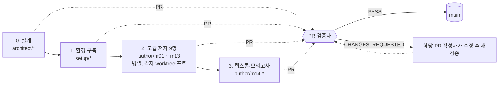

# 에이전트 역할과 브랜치

커리큘럼은 역할이 나뉜 에이전트들이 만든다. **브랜치명이 곧 역할**이다. 모든 작업은 PR로 올라오고, 검증 에이전트가 `VERDICT: PASS`를 남긴 뒤에만 `main`에 병합된다.

## 역할 표

| 단계 | 역할 | 브랜치 | 담당 범위 | 에뮬레이터 포트 |
|---|---|---|---|---|
| 0 | 커리큘럼 설계자 (메인 세션) | `architect/curriculum-master-design` | `README.md`, `docs/CURRICULUM.md`, `docs/AUTHORING.md`, `docs/AGENTS.md` | – |
| 1 | 환경 구축 엔지니어 | `setup/emulator-runtime-and-tooling` | 필수 프로그램 설치, `scripts/`, `tools/probe/`, `pyproject.toml`, `docs/FIDELITY.md`, `curriculum/m00-orientation/` | 9297 |
| 2 | IAM·계정 모듈 저자 | `author/m01-iam-identity` | `curriculum/m01-iam-identity/` | 9301 |
| 2 | VPC 네트워킹 모듈 저자 | `author/m02-vpc-networking` | `curriculum/m02-vpc-networking/` | 9302 |
| 2 | 컴퓨트·확장 모듈 저자 | `author/m03-compute-scaling` | `curriculum/m03-compute-scaling/` | 9303 |
| 2 | 스토리지 모듈 저자 | `author/m04-storage` | `curriculum/m04-storage/` | 9304 |
| 2 | 데이터베이스 모듈 저자 | `author/m05-databases` | `curriculum/m05-databases/` | 9305 |
| 2 | 통합·서버리스·컨테이너 모듈 저자 | `author/m06-m07-integration-serverless` | `curriculum/m06-integration-messaging/`, `curriculum/m07-serverless-containers/` | 9306 |
| 2 | 엣지·보안 모듈 저자 | `author/m08-m09-edge-security` | `curriculum/m08-dns-edge/`, `curriculum/m09-security-encryption/` | 9308 |
| 2 | 운영·분석 모듈 저자 | `author/m10-m11-ops-analytics` | `curriculum/m10-monitoring-iac/`, `curriculum/m11-analytics/` | 9310 |
| 2 | 복원력·비용 모듈 저자 | `author/m12-m13-resilience-cost` | `curriculum/m12-resilience-dr-migration/`, `curriculum/m13-cost-optimization/` | 9312 (+9313: 두 번째 "리전") |
| 3 | 캡스톤·모의고사 저자 | `author/m14-capstone-mock-exam` | `curriculum/m14-capstone-exam/`, 루트 `README.md` 최종 목차 | 9314 |
| 각 PR | PR 검증자 | (브랜치 없음 — 해당 PR 브랜치를 체크아웃해 검증) | [AUTHORING.md 6장](./AUTHORING.md) 체크리스트 | 9320~ |

## 진행 순서

## 병렬 작업 규칙

- 에뮬레이터는 계정·리전을 분리하지 않으므로, **에이전트마다 전용 포트의 에뮬레이터**를 띄운다 (`scripts/emulator-up.sh <port>`). 다른 에이전트의 포트를 건드리지 않는다.
- 각 저자는 자신의 git worktree에서 작업하고, 자기 담당 디렉터리만 수정한다.
- 작업을 마치면 자기 포트의 에뮬레이터를 반드시 내린다 (`scripts/emulator-down.sh <port>`).
