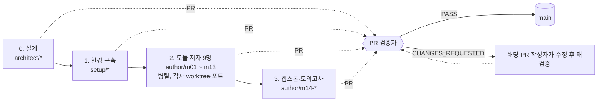

# 에이전트 역할과 브랜치

커리큘럼은 역할이 나뉜 에이전트들이 만든다. **브랜치명이 곧 역할**이다. 모든 작업은 PR로 올라오고, 검증 에이전트가 `VERDICT: PASS`를 남긴 뒤에만 `main`에 병합된다.

## 역할 표

| 단계 | 역할 | 브랜치 | 담당 범위 | 에뮬레이터 포트 |
|---|---|---|---|---|
| 0 | 커리큘럼 설계자 (메인 세션) | `architect/curriculum-master-design`, 이후 개정은 `architect/<개정 내용>` (예: `architect/curriculum-fidelity-regrade`, `architect/curriculum-as-built-revision`) | `README.md`, `docs/CURRICULUM.md`, `docs/AUTHORING.md`, `docs/AGENTS.md` | – |
| 1 | 환경 구축 엔지니어 | `setup/emulator-runtime-and-tooling` | 필수 프로그램 설치, `scripts/`, `tools/probe/`, `src/emulator_guard/`, `pyproject.toml`, `docs/FIDELITY.md`, `curriculum/m00-orientation/` | 9297 |
| 2 | IAM·계정 모듈 저자 | `author/m01-iam-identity` | `curriculum/m01-iam-identity/` | 9301 |
| 2 | VPC 네트워킹 모듈 저자 | `author/m02-vpc-networking` | `curriculum/m02-vpc-networking/` | 9302 |
| 2 | 컴퓨트·확장 모듈 저자 | `author/m03-compute-scaling` | `curriculum/m03-compute-scaling/` | 9303 |
| 2 | 스토리지 모듈 저자 | `author/m04-storage` | `curriculum/m04-storage/` | 9304 |
| 2 | 데이터베이스 모듈 저자 | `author/m05-databases` | `curriculum/m05-databases/` | 9305 |
| 2 | 통합·서버리스·컨테이너 모듈 저자 | `author/m06-m07-integration-serverless` | `curriculum/m06-integration-messaging/`, `curriculum/m07-serverless-containers/` | 9306 |
| 2 | 엣지·보안 모듈 저자 | `author/m08-m09-edge-security` | `curriculum/m08-dns-edge/`, `curriculum/m09-security-encryption/` | 9308 |
| 2 | 운영·분석 모듈 저자 | `author/m10-m11-ops-analytics` | `curriculum/m10-monitoring-iac/`, `curriculum/m11-analytics/` | 9310 |
| 2 | 복원력·비용 모듈 저자 | `author/m12-m13-resilience-cost` | `curriculum/m12-resilience-dr-migration/`, `curriculum/m13-cost-optimization/` | 9312 (+9313: 두 번째 "리전") |
| 3 | 캡스톤·모의고사 저자 | `author/m14-capstone-mock-exam` | `curriculum/m14-capstone-exam/`, 루트 `README.md` 최종 목차 | 9314 |
| 4 | 교차 모듈 편집자 | `editor/cross-module-review-followups`, `editor/stale-fact-corrections`, `editor/final-consistency-cleanup`, `editor/verify-reverse-order-pass` | `curriculum/` 모듈 간 불일치와 검증에서 미뤄 둔 제안 | 9316 (+9317) |
| 수시 | 환경 구축 엔지니어 (후속) | `setup/guard-hardening-and-shared-tooling`, `setup/fidelity-report-corrections`, `setup/dns-isolation-default-and-host-scan` | 가드·공용 스크립트 보강, 탐침과 `docs/FIDELITY.md` 정정 | 9297 (+9298) |
| 수시 | 모듈 저자 (후속) | `author/<모듈>-review-followup` (예: `author/m04-storage-review-followup`, `author/m05-verify-runtime-followup`) | 병합 뒤 발견된 자기 모듈의 결함 수정 | 원래 배정 포트 |
| 각 PR | PR 검증자 | (브랜치 없음 — 해당 PR 브랜치를 체크아웃해 검증) | [AUTHORING.md 6장](./AUTHORING.md) 체크리스트 | 9320~ |

## 진행 순서

## 병렬 작업 규칙

- 에뮬레이터는 계정·리전을 분리하지 않으므로, **에이전트마다 전용 포트의 에뮬레이터**를 띄운다 (`export EMULATOR_PORT=<port>` 후 `scripts/emulator-up.sh`, 깨끗한 상태가 필요하면 `scripts/emulator-reset.sh`). 다른 에이전트의 포트를 건드리지 않는다.
- 각 저자는 자신의 git worktree에서 작업하고, 자기 담당 디렉터리만 수정한다.
- 작업을 마치면 자기 포트의 에뮬레이터를 반드시 내린다 (`scripts/emulator-down.sh <port>`).
- 두 번째 에뮬레이터를 쓰는 에이전트는 `DR_EMULATOR_PORT`를 반드시 명시한다(역할 표에 `+포트`가 적힌 역할만 그 포트를 쓴다). 포트가 연속 번호라, 추측한 포트는 다른 에이전트의 에뮬레이터일 수 있다.
- `emulator-down.sh --all`, Colima 재시작, VM 시계 변경은 다른 에이전트의 작업을 깨뜨리므로 금지한다(스크립트는 `--all`에 경고만 한다 — 지키는 것은 에이전트의 몫이다).
- `emulator-up.sh`는 포트를 주지 않으면 비대화형에서도 9297을 쓴다. 에이전트는 항상 `EMULATOR_PORT`를 export하거나 포트를 인자로 넘긴다.
- 임시 파일은 에이전트마다 고유한 이름의 폴더에 둔다. 공용 임시 폴더에 흔한 파일명(`verify.log`, `out.txt`)으로 쓰면 서로 덮어쓴다.
- 기본 메모리 상한은 2g다. 동시에 많은 에뮬레이터를 띄울 때만 `EMULATOR_MEMORY`로 낮춘다.

## 운영하며 배운 것

- **검증자는 작성자와 다른 에이전트여야 한다.** 저자의 `verify.sh` 통과 보고만으로는 사실 오류, 순서 의존, 정답이 한 글자에 쏠린 퀴즈, 깨진 다이어그램을 걸러내지 못했다.
- **검증자도 틀린다.** 검증자의 제안이 낡은 수치였던 경우가 있었다. 사실 관계가 엇갈리면 1차 자료(AWS 문서·발표)를 인용해 판정한다.
- **"외부에 닿지 않는다"는 주장도 검증 대상이다.** 첫 탐침은 ECS 검사에 실제 공개 레지스트리 이미지를 써서, 실행할 때마다 에뮬레이터가 익명 이미지 풀을 시도했다. 여러 차례의 검증을 거친 뒤에야 발견됐다. 지금은 정적 검사(`tools/probe/no_external_hosts.py`)가 M00 `verify.sh`에서 `tools`·`scripts`·`src`와 `curriculum/` 전체(M00~M14)를 막고(탐침 시작 때는 `tools/probe`만 검사한다), 에뮬레이터 컨테이너는 기본으로 이름 해석이 막힌 채(`--dns 127.0.0.1`, 해제는 `EMULATOR_DNS=host`) 뜬다.
- **실제 AWS에 맞는 도구가 에뮬레이터에서는 느릴 수 있다.** AWS CLI의 `wait`는 RDS·DocumentDB를 30초, ElastiCache를 15초 간격으로 확인한다. 에뮬레이터는 1초 안에 상태를 바꾸지만, 생성 직후 첫 확인이 `creating`을 보면 한 간격을 통째로 기다린다. M05 `verify.sh`가 같은 조건에서 8분에서 13분까지 흔들린 원인이었다(전체 회귀에서 한 번 나온 30분도 같은 원인으로 추정하지만 재현하지는 못했다). 레슨의 명령은 `wait`를 그대로 가르치고, 실습 스크립트는 1초 간격으로 폴링한다(M05 `labs/_common.sh`의 `wait_status`·`wait_gone`). 다른 모듈의 EC2·ELB·CloudFront·Kinesis `wait`에는 같은 경합이 남아 있다.
- **병합 뒤에도 깨질 수 있다.** 부하가 달라지면 타이밍 경합이 드러난다. 공용 파일을 바꾸는 PR은 이미 병합된 모듈의 `verify.sh`를 회귀로 돌린다.
